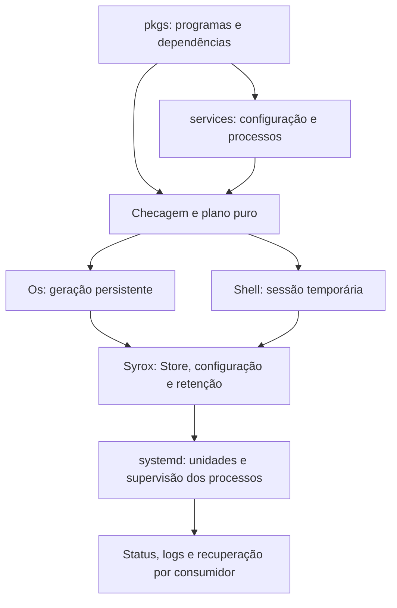
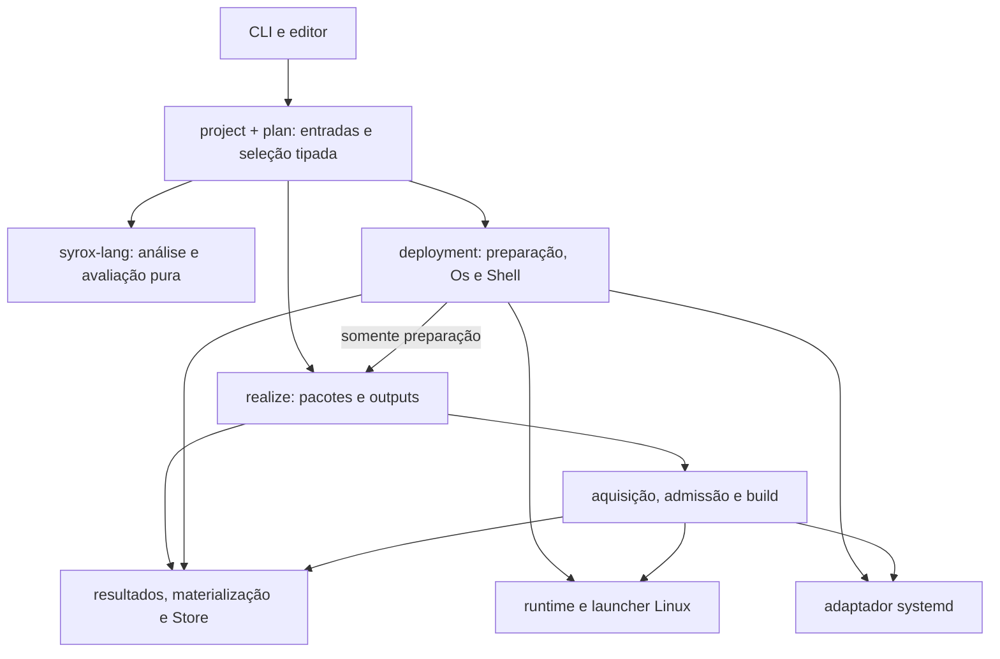
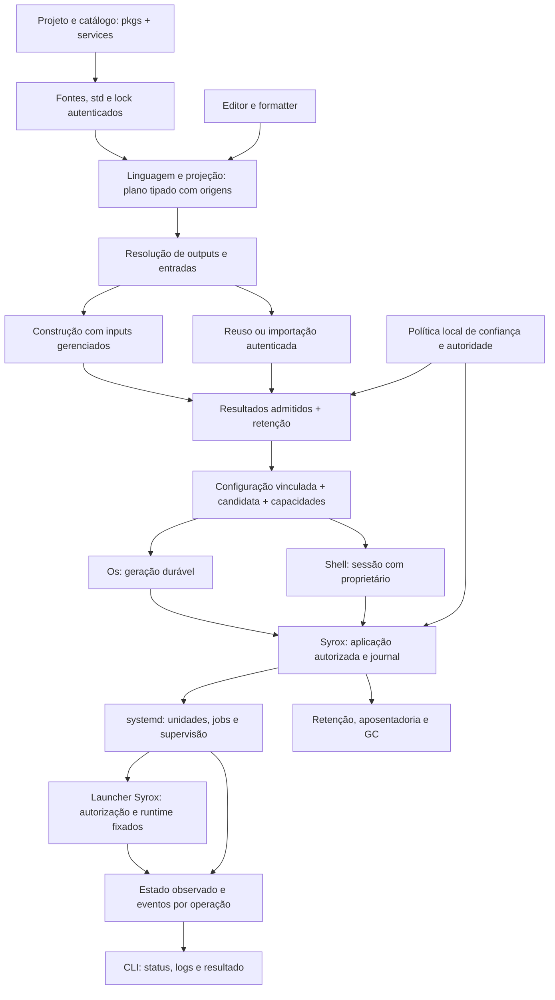
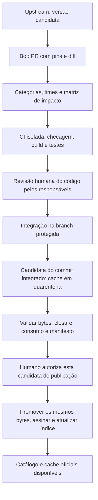

# Syrox — plano de produto, arquitetura e entrega

Este é o documento canônico do que queremos construir com o Syrox: um gerenciador de pacotes e configurador declarativo exclusivamente para Linux, com pacotes e ferramentas gerenciados pelo próprio Syrox e supervisão de serviços fornecida pelo systemd do host. Sua superfície de autoria tem exatamente duas camadas, `pkgs` e `services`, e dois tipos de output final, `Os` e `Shell`: configuração persistente do sistema ou shell temporária. Systemd é o único backend oficial de serviços. O produto não exige um daemon central próprio permanente.

Consolidação: 9 de outubro de 2026. O documento reúne a direção atual e substitui os estudos, roadmaps e decisões Markdown anteriores deste repositório. Não é uma lista de funcionalidades já disponíveis. O `README.md` continua sendo a apresentação pública do projeto; este arquivo concentra especificação, lacunas, escolhas e critérios de entrega.

Decisão revisada em 10 de outubro de 2026: Linux é a única plataforma do produto, sem roadmap de suporte a macOS, BSD ou outros sistemas operacionais. Essa escolha vale para a arquitetura e a evolução do Syrox, além da primeira entrega. A expansão de compatibilidade ocorre entre distribuições, versões de kernel e arquiteturas de CPU Linux comprovadas. Systemd fornece a supervisão; a autossuficiência dos pacotes e ferramentas respeita essa fronteira explícita do host. A decisão substitui a exigência anterior de supervisor próprio e a expansão para outros Unix. A integração descrita neste documento ainda precisa ser implementada; o uso de systemd no executor de build atual não comprova a entrega de Os/Shell.

**Política atual de desenvolvimento: breaking changes estão liberadas. O Syrox ainda não tem usuários; compatibilidade retroativa não é requisito nem trabalho a planejar nesta fase.** Podemos mudar sintaxe, std, APIs, CLI, locks, formatos, protocolos e organização do catálogo diretamente. Atualizar engine, biblioteca, catálogo, exemplos e testes em conjunto; remover os caminhos substituídos. Não criar shims, aliases legados, leitores de formatos antigos, suporte a múltiplas stds ou migrações automáticas só para preservar protótipos. Estado de desenvolvimento incompatível pode ser invalidado e recriado explicitamente. Essa decisão substitui as exigências anteriores de compatibilidade entre releases e de preservação de projetos antigos. Integridade dos dados e controle de processos vivos continuam sendo requisitos de execução; uma quebra de formato não autoriza interpretar bytes antigos incorretamente ou apagar dados externos.

## Como ler e manter este plano

Três categorias devem permanecer distintas:

- **Requisito confirmado:** organizar a sintaxe, gerenciar e configurar pacotes exclusivamente em Linux, integrar serviços ao systemd, controlar as ferramentas e dependências dos pacotes, manter somente as camadas `pkgs` e `services` e oferecer apenas outputs finais `Os` e `Shell`. Systemd e sua infraestrutura de acesso são dependências explícitas do ambiente, conforme a decisão revisada. Todo update publicável do catálogo oficial passa por validação humana; bots preparam propostas e evidências, com categorias, tags de triagem e times responsáveis pela revisão. Breaking changes estão autorizadas, sem obrigação de compatibilidade retroativa nesta fase sem usuários.
- **Estado observado:** comportamento identificado no código deste checkout durante a consolidação. Isso não substitui uma execução dos testes, uma auditoria completa nem uma prova de release.
- **Diretriz ou proposta:** desenho recomendado para cumprir os requisitos. Tipos, comandos, nomes de processos e estados futuros apresentados como proposta ainda precisam ser implementados e validados.

Quando houver conflito sobre o funcionamento atual, conferir código e testes. Quando houver conflito sobre a direção do produto, atualizar este plano com a decisão e suas consequências. Uma ideia não vira funcionalidade porque apareceu em um exemplo. Um teste antigo, digest de binário ou resultado de benchmark de outra revisão não comprova o estado deste checkout.

O conteúdo deve evoluir por edição das seções pertinentes. Evitar acumular novos documentos paralelos de “plano final”, “revisão final” ou “segunda arquitetura”. Evidências volumosas pertencem aos artefatos de execução e de CI, com identificação da revisão e prazo de retenção; exemplos executáveis e regressões pertencem ao código. Este arquivo registra o contrato que a evidência deve demonstrar.

## Sumário

- [Como ler e manter este plano](#como-ler-e-manter-este-plano)
- [Visão do produto e experiência desejada](#visão-do-produto-e-experiência-desejada)
- [Estado atual e distância até o objetivo](#estado-atual-e-distância-até-o-objetivo)
- [Organização do projeto e das responsabilidades](#organização-do-projeto-e-das-responsabilidades)
- [Limpeza do código e desenho dos engines](#limpeza-do-código-e-desenho-dos-engines)
- [Arquitetura integrada e contratos entre as frentes](#arquitetura-integrada-e-contratos-entre-as-frentes)
- [Compilar e inspecionar o que existe hoje](#compilar-e-inspecionar-o-que-existe-hoje)
- [Sintaxe-alvo: duas camadas e dois outputs](#sintaxe-alvo-duas-camadas-e-dois-outputs)
- [Linguagem `.srx`: direção e fronteiras](#linguagem-srx-direção-e-fronteiras)
- [Packaging: contrato completo do pacote](#packaging-contrato-completo-do-pacote)
- [Esteira de pacotes: Git, bots, CI e revisão humana](#esteira-de-pacotes-git-bots-ci-e-revisão-humana)
- [Autossuficiência como contrato de produto](#autossuficiência-como-contrato-de-produto)
- [Distribuição, instalação e cadeia de bootstrap](#distribuição-instalação-e-cadeia-de-bootstrap)
- [Projetos, locks e a fronteira dos efeitos](#projetos-locks-e-a-fronteira-dos-efeitos)
- [Inputs remotos, arquivos e política de aquisição](#inputs-remotos-arquivos-e-política-de-aquisição)
- [Rede incorporada: TLS, DNS e cancelamento](#rede-incorporada-tls-dns-e-cancelamento)
- [Identidades de build, resultados e outputs](#identidades-de-build-resultados-e-outputs)
- [Artifact, publicação e confiança local](#artifact-publicação-e-confiança-local)
- [Store gerenciada, caches binários e admissão](#store-gerenciada-caches-binários-e-admissão)
- [Retenção, GC e recuperação](#retenção-gc-e-recuperação)
- [Executor Linux e integração com systemd](#executor-linux-e-integração-com-systemd)
- [Contrato de Os no Linux existente](#contrato-de-os-no-linux-existente)
- [Configuração declarativa e serviços com systemd](#configuração-declarativa-e-serviços-com-systemd)
- [Experiência da CLI para Os e Shell](#experiência-da-cli-para-os-e-shell)
- [Pesquisa externa e decisões de produto](#pesquisa-externa-e-decisões-de-produto)
- [Sequência de implementação e critérios de saída](#sequência-de-implementação-e-critérios-de-saída)
- [Matriz de validação e provas de autossuficiência](#matriz-de-validação-e-provas-de-autossuficiência)
- [Desempenho, observabilidade e limites](#desempenho-observabilidade-e-limites)
- [Decisões abertas e limites do escopo](#decisões-abertas-e-limites-do-escopo)
- [Manutenção deste documento, contribuição e segurança](#manutenção-deste-documento-contribuição-e-segurança)
- [Referências técnicas externas](#referências-técnicas-externas)

## Visão do produto e experiência desejada

O Syrox deve permitir que uma pessoa declare os programas de que precisa, a configuração desses programas e os serviços que devem permanecer em execução. A partir dessa declaração, o produto verifica os dados, fixa as entradas, apresenta um plano, obtém os pacotes, prepara a configuração e aplica o estado desejado de forma observável e recuperável.

`pkgs` fornece os pacotes e suas dependências; `services` configura o uso desses pacotes e descreve seus processos quando existirem. Os outputs `Os` e `Shell` compõem essas mesmas duas camadas e determinam seu destino e sua duração. Uma receita de biblioteca não altera o sistema durante avaliação, e um módulo de serviço não decide por conta própria se deve persistir após a sessão.

O caminho do usuário comum deve ser curto: selecionar pacotes em `pkgs`, configurar integrações em `services` e escolher entre aplicar `Os` ou entrar numa `Shell`. O autor do catálogo deve conseguir descrever uma receita sem dominar o engine. Quem administra uma máquina precisa inspecionar arquivos e serviços afetados antes de aplicar a mudança. A pessoa que investiga uma falha precisa localizar a operação, sua causa e um próximo passo útil.

O fluxo geral pretendido é:



Esse desenho não torna a aplicação de múltiplos arquivos e processos uma transação atômica do sistema inteiro. O produto deve oferecer etapas registradas, estados honestos, retomada e compensação quando possível. Rollback cobre versões retidas de pacotes e configuração; estado mutável e migrações de banco têm contratos próprios.

### Resultados que definem sucesso

1. Uma receita pequena tem um formato reconhecível e pode ser entendida sem navegar por vários arquivos de helpers triviais.
2. Um pacote instalado ou serviço reiniciado usa identidades fixadas, sem consultar versões remotas a cada execução.
3. O Syrox funciona em um Linux com systemd preparado, sem ferramentas ou bibliotecas de pacotes obtidas acidentalmente do host.
4. Uma configuração pode ser inspecionada, aplicada novamente sem mudanças desnecessárias e recuperada após interrupção.
5. Um serviço persistente sobrevive à saída da CLI e encerra seus descendentes corretamente quando solicitado.
6. A Store consegue coletar conteúdo sem uso enquanto outros pacotes e serviços continuam ativos.
7. A interface declara claramente quando uma operação não é suportada pela plataforma ou pelas permissões disponíveis.
8. Regras de catálogo, fontes, build, runtime e configuração são compartilhadas por CLI, APIs internas e ferramentas de editor.
9. Todos os exemplos de composição final usam somente `pkgs` e `services`, dentro de `Os` ou `Shell`.
10. Fechar uma Shell encerra todos os serviços daquela sessão; sair da CLI que aplicou Os conserva a instalação persistente.

### O requisito de autossuficiência

A distribuição deve carregar os componentes necessários ao motor: CLI, transporte, preparador, launcher e workers. Systemd fornece supervisão no host; não será reimplementado nem distribuído como um segundo init pelo Syrox. O alvo para os binários Syrox permanece estático, com bibliotecas incorporadas e procedência conhecida. Isso não torna estáticos ou próprios os componentes systemd do ambiente.

Ferramentas usadas por receitas, como compilador, linker, shell e `make`, devem ser pacotes ou inputs fixados na Store. Uma shell necessária ao `configure` de um pacote faz parte da cadeia de build gerenciada. O motor não pode depender de encontrar ferramentas por acaso em `/usr/bin`, nem autenticar o host inteiro para descobrir a identidade de uma toolchain que deveria controlar.

Filesystem, kernel Linux, systemd, acesso autorizado ao manager, identidade, permissões e rede configurada são recursos do ambiente. O Syrox conserva a declaração desejada, gerações, autorização, journal e retenção; systemd executa as políticas das unidades. Preparação administrativa é explícita e não ganha autoridade através de uma receita. O contrato de suporte identifica os componentes de IPC e logging necessários; não promete ausência de D-Bus quando a integração o utiliza.

O suporte do produto é exclusivamente Linux; ambientes Linux sem systemd ficam fora do perfil integrado de serviços. Verificação, avaliação e operações locais que não precisam do manager não devem consultá-lo sem necessidade. A ampliação prevista é entre ambientes Linux comprovados. Não manter backends, stubs ou camadas de portabilidade para outros sistemas operacionais. Interfaces internas existem para delimitar autoridade, permitir testes e compartilhar mecanismos reais dentro do Linux.

## Estado atual e distância até o objetivo

O checkout já contém trabalho relevante de linguagem, catálogo, builds, runtime e retenção. A consolidação preserva essas implementações. O trabalho existente deve ser reorganizado e completado a partir de contratos demonstráveis, evitando reiniciar tudo sem avaliar o que é reutilizável.

| Área | Estado observado | Distância até a experiência desejada |
|---|---|---|
| Linguagem | Parser, resolução, tipos, ownership, avaliação limitada e análise recuperável | Unificar convenções e reduzir complexidade da autoria |
| Biblioteca | Receitas, fontes, catálogo, referências, Build IR e builders `.srx` | Separar responsabilidades e melhorar helpers/defaults |
| Catálogo | Catálogo irmão com receitas de Hello, glibc e bootstrap de compatibilidade | Expandir após estabilizar execução e contratos |
| Inputs | Fontes locais, módulos e snapshots GitHub fixados | Preservar operação offline e UX clara de atualização |
| Plano | Projeção pura, `PreparedPlan` e `PreparedConsumer` com outputs/comandos verificados e snapshots retidos | Aplicar configuração e ativar o destino preparado |
| Build | Programa tipado, aquisição, isolamento e retenção, com supervisão via systemd | Consolidar o contrato systemd; remover Bubblewrap obrigatório, utilitários acidentais e toolchain `/usr` |
| Runtime | Closures privadas, configuração por descritor, recolhimento de órfãos pelo init e conexão de PTY ao payload | Composição de ferramentas, terminal na CLI, UID apropriado, launcher duradouro e provas reais de namespace pendentes |
| Retenção | Origens Built/Imported reabrem por pin; interesses por objetos/views permitem GC concorrente ao runtime; candidatas Os conservam raízes duráveis | Provas de handoff FDSTORE no manager real e aposentadoria de gerações |
| Configuração | ServiceCommand vincula argumentos/ambiente aos arquivos privados; Shell materializa configuração por descritores, com integração Git/nginx no catálogo | Supervisão Shell e aplicação Os por recurso implementadas; provas reais no host e recuperação completa pendentes |
| Serviços | Adaptador D-Bus incorporado, StartUnit/Reload e identidade do manager; testes puros passaram, gates reais pendentes | Integrar unidades à implantação, launcher por geração, prontidão, duração e recuperação |
| Instalação de pacotes | Build/run, seleção preparada e execução explícita de um comando exposto por Shell não interativa | Sessão interativa com ferramentas/subprocessos e rollback de Os pendentes |
| Instalação do Syrox | `install-self` Linux e verificação estática na CI | Isso não equivale a concluir a autossuficiência dos builds |
| Editor | LSP integrado ao `srx`, fixtures comuns e gates de candidato explícito nos três clientes | Formatter puro, CLI e LSP testados localmente; gates dos clientes e hosts reais ainda pendentes |
| Plataformas | Engine recusa compilação fora de Linux; stubs e job macOS removidos | Fixar e testar a matriz Linux/systemd e a release estática |

Os pontos de entrada para verificar essa tabela são [a CLI](../crates/syrox/src/main.rs), [a API do engine](../crates/syrox-engine/src/lib.rs), [a std](../std/main.srx), [a configuração operacional](../crates/syrox-engine/src/config/mod.rs), [o executor atual de build](../crates/syrox-engine/src/build/bootstrap/sandbox.rs) e [o runtime nativo](../crates/syrox-engine/src/execution/native/mod.rs).

Antes de anunciar serviços contínuos, ainda é necessário provar retenção por FDSTORE e o launcher Os independente da CLI no manager real. O runtime já conserva interesses granulares que permitem coletar objetos não relacionados; builds e transferências ainda podem manter uma operação global. O perfil direto conserva duração ligada ao coordenador, enquanto a supervisão gerenciada de Shell tem proprietário próprio e aguarda as provas reais de encerramento.

### Contratos que ainda bloqueiam a primeira experiência

O desenho de alto nível é uma direção, não um projeto de execução fechado. A revisão adversarial identificou estes pré-requisitos no código atual; não são justificativas para acrescentar novos outputs ou camadas:

| Questão | Evidência atual | Prova necessária antes de declarar o fluxo pronto |
|---|---|---|
| Vários comandos por pacote e sessão | [Recipe.commands](../std/build.srx) separa zero ou várias entradas de Build; cada comando fixa output/path e providers ELF | Composição de duas ferramentas e subprocessos numa sessão, com configuração e bibliotecas privadas |
| Configuração realmente consumida | [RuntimeConfiguration](../crates/syrox-engine/src/execution/configuration.rs) pina árvore privada por FD; worker monta somente leitura e recebe ambiente validado | Preparação e aplicação Os integradas; gate real de leitura via argv/ambiente fora do cwd permanece pendente |
| Identidade e execução duradoura | Perfil gerenciado preserva UID/GID não zero, usa ambiente mínimo privado, reaping e gate autorizado; perfil direto anterior permanece separado | Provar esses mecanismos em host real, incluindo sinais, descendentes e readiness de aplicações |
| Terminal interativo | [PreparedLaunch](../crates/syrox-engine/src/platform/linux/fd/launch.rs) configura grupo de processos; isso não entrega terminal controlador | Pipeline, jobs, editor, resize e recuperação do terminal após falha |
| Consumo de bundle | [Resultado pinado](../crates/syrox-engine/src/result/mod.rs) e [bundle](../crates/syrox-engine/src/bundle.rs) transportam manifesto/Artifacts sem Receipt ou inputs de construção | Transferência e reabertura dinâmica sintética passam; execução real Hello/glibc no receptor continua pendente no host |
| Duração de Os | `os apply` liga publicação, journal e worker Os que reabre a geração sem canal da CLI | Provar manager real, saída da CLI, logout e boot separadamente |
| Encerramento de uma entre duas Shells | Interesses granulares preservam objetos e views de cada consumidor durante GC; encerramento gerenciado tem vínculos próprios | Provar duas sessões no manager real e recuperar configuração sem remover recursos ainda em uso |

Planejar todas as frentes em conjunto e implementar por percursos integrados. Mudanças de linguagem ou catálogo que sustentam essas provas podem avançar em paralelo; expansão independente aguarda o contrato que a viabiliza. Corrigir uma frase do plano não remove a limitação do código.

## Organização do projeto e das responsabilidades

Manter os cinco repositórios atuais do produto: `syrox`, `syrox-pkgs`, `syrox-vscode`, `syrox.nvim` e `syrox-opencode`. O núcleo e o catálogo têm ciclos de mudança diferentes; cada cliente tem integração e distribuição próprias. Essa divisão já é suficiente. Linguagem, std, Store, launcher, serviços e bots não precisam de um repositório independente cada um. As camadas `pkgs/services` representam autoria, não uma obrigação de separar repos.

### Mapa dos repositórios e seus limites

| Repositório | Responsabilidade de destino | Fronteira a preservar |
|---|---|---|
| `syrox` | Linguagem, std autenticada, engine, CLI/LSP, binários auxiliares, formatos, executor Linux/systemd, testes dos mecanismos e este plano | Compila e executa seus testes fundamentais sem checkout do catálogo. Engine não importa receitas oficiais nem decide política específica de nginx, glibc ou outro pacote. |
| `syrox-pkgs` | Receitas, pins, patches, toolchains/seed declaradas, helpers de empacotamento, integrações específicas de programas, testes de pacotes, responsáveis/categorias e automação do catálogo | Consome contratos públicos do core. Não implementa outra Store, supervisor, verificador de Artifact ou parser `.srx`. Catálogos alternativos usam a mesma interface e autoridade. |
| `syrox-vscode` | Extensão VS Code: ativação, configuração, conexão com LSP, navegação e apresentação no editor | Semântica e diagnósticos vêm de `srx lsp`; recursos do host e empacotamento da extensão ficam aqui. |
| `syrox.nvim` | Plugin Neovim: configuração, conexão com LSP, comandos e integração da interface | Compartilha o protocolo do servidor; não mantém outro checker ou algoritmo de seleção de pacotes. |
| `syrox-opencode` | Integração OpenCode: ciclo de vida do cliente, conexão com LSP e apresentação do feedback ao host | Adapta o contrato para OpenCode; não transforma heurísticas do cliente em autorização ou validação do engine. |

O [catálogo](../../syrox-pkgs/main.srx) contém três receitas `.srx`, `Syrox.lock`, testes de empacotamento e um [gate de candidato explícito](../../syrox-pkgs/scripts/test-candidate.py). O helper específico de glibc pertence à receita, sem export na std. O core testa os mecanismos sem exigir checkout irmão; as provas de pacote recebem o core e binário candidatos por argumentos. Os três clientes compartilham fixtures LSP e seus gates recebem revisão ou binário identificado; o [gate local do core](../crates/syrox/examples/check_editors.rs) cruza os checkouts explícitos. Hosts reais dos editores, empacotamento OpenCode e provas de build continuam pendentes quando o runner necessário não está disponível. Isso descreve arquivos e validação local, sem afirmar execução da CI remota.

Primeiro incremento entre repos, implementado no checkout em 10 de outubro de 2026: o [servidor](../crates/syrox/src/lsp/mod.rs) agora anuncia `syroxVirtualSource` e `syroxProjectStatus` na revisão 1 exigida por [VS Code](../../syrox-vscode/extension.js), [Neovim](../../syrox.nvim/lua/syrox/init.lua) e [OpenCode](../../syrox-opencode/client.mjs). O [status](../crates/syrox/src/lsp/status.rs) responde e notifica a geração atual, versões dos documentos, cobertura por fonte efetivamente analisada, truncamento real dos metadados e observação do lock. Consulta não agenda análise nem realiza pacotes; erros de linguagem não se confundem com indisponibilidade do projeto. Os [testes de status](../crates/syrox/tests/lsp/status.rs) cobrem edição, documento externo ao grafo, fechamento/reabertura, falha e recuperação do grafo e lock desatualizado sem escrita implícita.

Os clientes consomem a fixture comum [lsp-contract.json](../tests/fixtures/lsp-contract.json). O [gate candidato](../crates/syrox/examples/check_editors.rs) exige binário e caminhos explícitos dos três clientes, compara as fixtures e registra o digest do executável. Os workflows dos clientes recebem uma revisão candidata explícita. Validação local: 34 testes VS Code, 26 OpenCode e gates Neovim check/smoke/std passaram. Extension Host VS Code e host OpenCode continuam pendentes. O teste separado de empacotamento OpenCode falha neste sandbox com `spawnSync npm EPERM`; a execução direta de `npm pack --dry-run --json` e a comparação dos arquivos esperados passaram, sem tornar verde o teste bloqueado. A prova local não equivale à publicação de uma combinação validada de releases.

A std permanece em `syrox`, junto dos contratos que o engine autentica e interpreta. Ela já é [embutida no executável](../crates/syrox-engine/src/project/standard_library.rs); mudanças de tipos, projeção, fontes autenticadas e locks podem ser coordenadas diretamente. Não criar agora um release ou repositório de std separado. Separação de repositórios também não exige numeração de versão comum para catálogo, core e clientes: a validação identifica o conjunto exato que funciona junto.

### O que fica no core e o que fica no catálogo

O core define mecanismos e contratos gerais: tipos, avaliação, aquisição, Build IR, resultado admitido, closure, recursos declarativos, launcher, retenção, aplicação e API systemd. O catálogo descreve como construir e usar cada programa: fontes, versões, patches, outputs, comandos, configuração da aplicação, opções de integração e testes pertinentes. Receita e integração podem ficar lado a lado; compartilhar pacote entre Os/Shell não duplica sua definição.

Exemplo: opções e renderização da configuração do nginx pertencem à sua integração no catálogo. Validação de destinos, colisões, proteção de segredos, diff, escrita controlada, units autorizadas e recuperação pertencem ao engine. O módulo de nginx retorna dados tipados; não chama `systemctl` nem aplica arquivos durante avaliação. O catálogo pode fornecer dados ou helpers genéricos reutilizáveis, mas não amplia a autoridade de uma receita por ser oficial.

Pureza de uma função não basta para colocá-la na std. O helper de glibc foi transferido para `syrox-pkgs/recipes/glibc.srx`, junto das decisões de loader x86_64, locale, separação `dev/out` e ajustes de `libc_nonshared`. O export `std::glibc` foi removido; os testes específicos pertencem ao catálogo e recebem core/binário candidatos explicitamente. Os helpers atuais de Autotools também misturam ferramentas e opções de bootstrap. Mover suas políticas para o catálogo ou generalizá-los com ferramentas, inputs e opções explícitos. Tipos `BuildPath/BuildText`, operações limitadas e combinadores gerais permanecem no core. Um novo builder produz o mesmo Build IR, sem exigir despacho Rust pelo seu nome.

Testes acompanham a responsabilidade: parser, tipos, locks, identidade, admissão, Store, isolamento, protocolo e recovery genéricos ficam no core; comportamento de um pacote e sua configuração ficam no catálogo; interação com o host do editor fica no cliente. Fixtures pequenas no core exercitam contratos, sem copiar o catálogo oficial inteiro. Artefatos de release, bundles, logs, quarentena e cache são saídas da esteira, com identidade e retenção próprias; não viram outro repositório Git de binários.

A política e os workflows de descoberta, categorias, revisão e promoção do catálogo pertencem a `syrox-pkgs`. Interfaces genéricas de inspeção/edição estrutural e formatos de admissão pertencem ao core. O bot usa essas interfaces; não copia parser ou interpreta mensagens humanas da CLI como protocolo. Credenciais de promoção ficam fora de receitas e builds. A [.github da organização](../../.github/profile/README.md) hoje apresenta o projeto; não é uma dependência do produto ou autoridade implícita da publicação. Adiar um repositório de infraestrutura comum até existir reutilização real.

### Contratos e validação entre repositórios

Cada gate de integração recebe revisões exatas e caminhos explícitos. Um conjunto de validação registra commit do core, digest do executável e inventário da std, commit/digest do catálogo e locks, revisões dos clientes afetados e perfil de execução. Esse registro é evidência da CI e da candidata, não uma terceira camada de autoria nem um novo output do projeto. `../syrox-pkgs` pode ser conveniência local; nome de diretório irmão ou ponta mutável de branch não identifica uma dependência validada.

| Mudança | Dono da implementação | Gate que atravessa repositórios |
|---|---|---|
| Linguagem, std, loader, seleção ou Build IR | `syrox`, com ajustes coordenados de consumidores | Catálogo candidato checa com o core candidato; locks correspondem à std; receitas afetadas e percurso mínimo executam. |
| Receita, patch, pin, toolchain ou integração | `syrox-pkgs` | Distribuição Syrox identificada; testes de pacote, closure e consumo; Shell/Os quando prometidos; revisão humana e candidata conforme a esteira. |
| Semântica de editor ou extensão do protocolo LSP | `syrox` | Clientes afetados executam o corpus de protocolo e smoke com o servidor candidato identificado. |
| Ativação, navegação ou UX de um editor | Repositório do cliente | Testes locais e instalação do artefato distribuído no host real com `srx` identificado, exercitando ao menos uma operação editorial; carregar apenas o diretório fonte ou registrar o plugin não cobre esse gate. |
| Mecanismo de runtime, retenção ou systemd | `syrox` | Regressões Linux/VM e um consumidor real do catálogo exercitando as garantias alteradas. |

O primeiro percurso cruzado usa Hello + glibc, importação e consumo offline; acrescenta uma integração compartilhada por Shell/Os conforme esses marcos forem implementados. O teste hoje preso ao checkout irmão deve receber inputs explícitos no gate apropriado. Testes ignorados ou dependências indisponíveis são cobertura ausente, não sucesso. Não duplicar o mesmo teste completo em todos os repos; separar regressões do mecanismo, comportamento do pacote e aceitação do conjunto.

No editor, `srx lsp` é a fonte de semântica, diagnósticos e formatter. Os clientes podem ter configuração lexical de realce, transporte e adaptação do host. Fixar as extensões do protocolo com capacidades e fixtures canônicas junto do servidor, incluindo versão do documento, descarte de resposta obsoleta, URI e consulta a fontes da std. A descoberta da raiz também precisa de casos comuns para projetos aninhados e edição da própria std; os clientes atuais usam marcadores e exceções diferentes. Consumir essas fixtures nas CIs dos clientes em vez de desenvolver três especificações independentes. Não criar um SDK/repositório novo apenas para compartilhar mensagens de teste.

Breaking changes continuam liberadas entre repos. Uma mudança incompatível pode ter PRs coordenados: escolher as revisões candidatas, atualizar consumidores/locks, executar o gate sobre esse conjunto e liberar a distribuição coerente depois das revisões exigidas. Merges em repositórios diferentes não são atômicos; a publicação identifica somente conjuntos já validados. Não manter shims, leitores históricos ou uma matriz de versões antigas para evitar essa coordenação. Capacidade obrigatória ausente ou formato desconhecido recebe diagnóstico explícito. Releases de pacote continuam sujeitas à aprovação humana da candidata; teste cruzado não substitui essa autorização.

### Papel dos repositórios anteriores e sequência de limpeza

`os-cli`, `os-lang`, `os-pkgs` e `os-rfcs` pertencem à prova de conceito anterior, conforme o [registro de criação do Syrox](../../os-rfcs/SYROX-REPOSITORY-ARCHITECTURE-2026-09-21.md). Há alterações locais nesses repos; eles não são dependências do workspace atual nem autorização para descarte. A cadeia antiga depende de paths irmãos entre os repos. `os-pkgs` possui descrições `.os` e testes próprios, mas esses arquivos não são receitas Syrox executáveis. Portar seletivamente casos, algoritmos e testes sob os contratos atuais, com revisão da semântica; não importar a cadeia inteira ou reativar o supervisor próprio da PoC.

Este plano é a referência atual, inclusive para std no core e serviços sob systemd; os documentos anteriores registram histórico. `syrox-recovery-20261001` contém recuperação, evidências e worktrees, não um sexto repositório de produto. A revisão de responsabilidades não remove esses dados nem coloca seu conteúdo automaticamente na release. Fontes externas de pesquisa e outros projetos do workspace também não participam da cadeia de build por proximidade de diretório.

A limpeza entre repos segue quatro entregas: (1) inputs explícitos para integração e evidência do conjunto testado; (2) correção da divergência LSP, fixtures de protocolo e gates recíprocos dos clientes; (3) transferência do empacotamento específico da std ao catálogo, atualizando receitas/locks/testes juntos; (4) testes e esteira próprios de `syrox-pkgs`, crescendo com os marcos de consumo/build. Isso complementa os lotes internos abaixo; clientes e packaging podem avançar em paralelo. Não mover todos os diretórios nem criar novos repos como pré-condição. Responsáveis de core, packaging/services e clientes revisam suas fronteiras; a política de times e categorias detalhada adiante encaminha as mudanças.

### Responsabilidades dentro do core

As três crates atuais continuam sendo uma divisão inicial suficiente:

- `syrox-lang`: dados de fontes, sintaxe, resolução, checagem, avaliação e consultas de editor. Não deve precisar de rede, processos, Store ou acesso ambiental para decidir o significado de um programa.
- `syrox-engine`: carregamento autenticado, lock, planos, aquisição, Store, build, runtime e projeção dos consumidores de configuração/serviços. A ativação ainda precisa de implementação; os efeitos pertencem a fronteiras explícitas.
- `syrox`: comandos, apresentação, transporte LSP e entrada dos componentes distribuídos. A CLI coordena APIs; não replica validadores, algoritmos de retenção ou syscalls de isolamento.

Processos e crates são decisões diferentes. Launchers, workers de aplicação e responsáveis temporários por Shell podem ser modos dos binários distribuídos. Eles têm identidade, permissões e formatos definidos; não duplicam restart ou scheduling do systemd. Extrair uma nova crate precisa resolver acoplamento, dependências, API pública, fronteira de compilação ou reutilização real.

As fronteiras internas devem permitir testar decisões puras sem iniciar processos e testar o executor sem usar a CLI como único acesso. Os perfis de build e de serviço podem compartilhar primitivas nativas, mas mantêm políticas próprias. A propriedade de descritores, monitores, leases e transações deve estar visível nos tipos e no fluxo de controle.

Erros precisam distinguir entrada inválida, fonte indisponível, corrupção, capacidade ausente, conflito de configuração, falta de autoridade, cancelamento e incerteza de durabilidade. Converter tudo para uma string cedo demais impede recovery e torna automação frágil. A apresentação humana pode resumir; o contrato interno conserva a causa e a operação.

## Limpeza do código e desenho dos engines

Esta seção transforma a direção Linux/systemd em trabalho sobre o código existente. É um plano de refatoração e evolução; os módulos de destino ainda não estão todos implementados. Limpar significa retirar dependências e caminhos concorrentes, tornar ownership verificável e corrigir contratos inconsistentes. Quantidade de linhas, quantidade de crates e mudança de nomes não são medidas suficientes. A limpeza acompanha os marcos do produto, com lotes pequenos que preservem um caminho executável.

A liberdade de breaking changes deve remover impedimentos concretos: resultado preso ao Receipt de build, pacote obrigado a ter uma única aplicação, seleção duplicada e duração de serviço presa à CLI. Cada quebra atualiza os consumidores e remove o contrato substituído no mesmo lote; formatos de desenvolvimento podem ser invalidados. Preservar parser, checker, avaliação limitada, referências compartilhadas, verificação de conteúdo e mecanismos de autorização que já servem ao destino. A primeira entrega integrada tem prioridade sobre uma reorganização completa do workspace ou mudanças cosméticas de sintaxe.

### Dois fluxos internos e uma infraestrutura compartilhada

Manter inicialmente `syrox-lang`, `syrox-engine` e `syrox`. Dentro do engine, organizar duas responsabilidades principais:

- **Pacotes:** resolver seleções autenticadas, realizar outputs por reuso/importação/build, admitir o resultado e entregá-lo retido. O núcleo existente é `realize`; build é uma das estratégias desse fluxo. Um pacote não precisa iniciar processo nem configurar o host para ser válido.
- **Implantação:** preparar configuração e comandos, produzir diff e candidata, aplicar Os ou abrir Shell, observar e recuperar seus recursos. O módulo proposto é `deployment`. Ele usa o mesmo realizador de pacotes durante preparação; ativação e novos starts consomem manifestos retidos. Os e Shell compartilham contratos de configuração, mas conservam suas políticas distintas de persistência e propriedade.

Esses fluxos não são dois daemons nem exigem duas crates. Os nomes `PackageEngine` e `DeploymentEngine` só devem virar tipos quando houver estado ou autoridade que esses tipos precisem possuir; não criar wrappers que apenas encaminham funções. `pkgs` e `services` continuam sendo as únicas camadas de autoria. Os módulos internos de aquisição, Store, runtime e systemd não acrescentam campos raiz ou outputs públicos.



O diagrama mostra dependências propostas, não processos residentes. A implantação fornece ao adaptador uma descrição operacional validada; o adaptador devolve jobs, observações e falhas estruturadas. Ele não interpreta `.srx`, escolhe pacote, escreve configuração de aplicação ou decide rollback. O launcher reabre resultados autorizados e executa; não chama o realizador para corrigir uma closure ausente durante boot. A Store conserva bytes e interesses, sem precisar conhecer `Restart=` ou o nome de uma receita.

### Mapa de responsabilidade e destino dos módulos

Os nomes abaixo orientam a organização. Extrair uma fronteira útil antes de mover diretórios; uma movimentação mecânica não deve alterar formato persistido, semântica ou política de isolamento.

| Área | Base existente | Responsabilidade de destino |
|---|---|---|
| Linguagem | `syrox-lang`, incluindo `evaluator/runtime.rs` | Semântica pura e ferramentas de análise. O runtime do avaliador não é o executor Linux e não deve ser fundido com ele. |
| Projeto e plano | `project`, `lock`, `plan` | Carregamento autorizado, origem, avaliação e projeção. Aquisição explícita permanece separada das consultas; preparação conserva snapshots vivos. |
| Pacotes | `realize`, `realize/commands`, `realize/outputs` | Um caminho de resolução e realização de outputs para build, run e preparação Os/Shell. Nenhuma aplicação paralela de regras na CLI. |
| Construção | `build/program`, `linux`, `worker`, `shared`, `records` | Executar programa de build e publicar resultados depois de confirmar término. `Action` identifica o trabalho; `Receipt` registra a associação aos inputs e outputs realizados. A Action, isoladamente, não comprova construção. |
| Resultados e artifacts | Hoje em `build/artifact`, `build/materialize`, `build/cache` | Separar codec de Artifact, admissão de resultado, materialização e retenção do ato de construir. Origem construída e importada têm provas próprias; os consumidores compartilham a interface de uso admitido. |
| Store | `store.rs`, `store/identity` | Objetos verificados, publicação, roots, leases, inventário e GC. Dividir internamente por essas responsabilidades, mantendo uma autoridade de armazenamento. |
| Runtime | `runtime`, `runtime/elf`, `runtime/retention` | Verificar closures e entradas, compor mounts e reabrir retenção. Separar verificação de lançamento e da observação do processo. |
| Execução Linux | `runtime_native`, `linux_fd/launch`, `linux_fd/transport` | Preparação, isolamento, descritores, sinais e término. Políticas tipadas por uso: build, aplicação, serviço e sessão interativa. |
| Systemd | Hoje misturado em `build/sandbox` e recovery | Módulo interno `systemd` para API pública, manager/escopo, propriedades, jobs e observação. Usado por build e implantação; somente um backend oficial. |
| Implantação | Projeção em `plan/consumers`; aplicação ainda ausente | `deployment` com preparação, inventário, journal de geração, ativação, recuperação e ownership de Shell. Não reutilizar o journal de build como se fosse a mesma máquina de estados. |
| Operação | Hoje `build/cancellation`, sinais na CLI e budgets por subsistema | Cancelamento e prazo da operação independentes de build; autorização de publicação e interesses do produtor continuam específicos do domínio. |
| Plataforma e host | `linux_fd`, `host/linux` | Submódulos privados para filesystem/publicação, processos, transporte e isolamento; inspeção por operação e manager efetivos. Sem framework para sistemas não suportados. |

A API externa da crate deve expor pedidos, resultados e handles de uso necessários aos consumidores. [O `lib.rs` atual](../crates/syrox-engine/src/lib.rs) reexporta operações de alto e baixo nível no mesmo espaço. Rever cada export pelos seus usos em CLI, worker e testes de integração; reduzir visibilidade do que não atravessa essa fronteira. Atualizar os callers diretamente e remover reexports substituídos, sem camada de compatibilidade. Não esconder uma dependência circular atrás de um grande objeto global de contexto.

O contexto compartilhado de operação, se necessário, contém cancelamento, prazo e identificador; Store, política de rede, manager e autoridade de publicação continuam dependências explícitas. Budgets mantêm seus domínios e unidades. Um download cancelado, um consumidor que desistiu de build compartilhado e uma geração cuja autorização foi revogada não são o mesmo evento.

### Acoplamentos observados e limpeza correspondente

Os pontos abaixo foram identificados por leitura do checkout. Falhas potenciais ainda precisam de reprodução; a existência desta lista não significa que os ajustes ou os gates já passaram.

| Evidência no código | Mudança planejada | Prova de preservação ou correção |
|---|---|---|
| [Cancellation](../crates/syrox-engine/src/cancellation.rs) é neutro; `Cancelled` não depende de build; o adaptador privado [BuildControl](../crates/syrox-engine/src/build/cancellation/mod.rs) conserva `shared::Interest` | Aquisição, archive, runtime, realização e CLI migrados; sem alias `BuildCancellation` | Regressões de sinais, wakeup, aquisição e interesse compartilhado precisam permanecer nos gates; autorização de publicação continua no build. |
| [Runtime](../crates/syrox-engine/src/runtime/mod.rs) ainda usa o scanner `build::artifact`; [RetainedOutput](../crates/syrox-engine/src/result/materialize/retention.rs) distingue Built/Imported e [AdmittedResult](../crates/syrox-engine/src/result/mod.rs) autoriza consumo sem inputs de construção | Definir o contrato de resultado admitido, atualizar consumidores e extrair sua implementação. Uma verificação produz handle protegido com identidade e evidência; materialização o consome. Manter verificação construída/importada explícita; mover arquivos não é pré-requisito para evoluir o schema. | Mesmos bytes e digests nos movimentos mecânicos; bundle transferido reabre offline sem toolchain ou fontes de build; corrupção, ausência e divergência continuam distintas. |
| [Store::build_references](../crates/syrox-engine/src/store/mod.rs) agora compartilha `MAX_ROOT_BYTES/MAX_ROOT_REFERENCES` com publicação | Corrigida leitura antiga limitada a 45 referências/4096 bytes sem alterar formato | Regressões cobrem 45, 46, 60 e 65.536 referências, nome máximo e recusa acima do limite. |
| [realize_output](../crates/syrox-engine/src/realize/outputs.rs) inicializa Store e chama realização que também prepara a Store; `realize.rs` mistura seleção, aquisição e coordenação | Separar resolução pura, contexto da realização e fases de aquisição/reuso/build. Compartilhar handle e interesses pela operação, sem cache global implícito. | Mesma seleção e retenção; hit admitido não exige worker, inventário de toolchain nem manager sem necessidade; preparação continua válida após sair da avaliação. |
| [build/sandbox](../crates/syrox-engine/src/build/bootstrap/sandbox.rs) monta `timeout → systemd-run → worker`, prepara Bubblewrap e consulta `systemctl` para término | Extrair integração com manager, preparação Linux e coordenação da tentativa. Migrar acesso à API e isolamento em passos distintos. | Jobs rápidos, resposta perdida, start atrasado, cancelamento e ausência comprovada de descendentes antes de publicar. |
| [Worker](../crates/syrox-engine/src/build/bootstrap/worker/mod.rs) implementa Copy/Move/Extract nativamente; inspeção e extração compartilham o walker de [source_archive](../crates/syrox-engine/src/acquire/archive/mod.rs) | Operações limitadas ancoram diretórios em descritores, não percorrem links e preservam destino de arquivo em EOF/cancelamento; Run ainda usa o perfil host | Testes locais cobrem EXDEV, colisões, escapes e cancelamento; construir receitas reais e retirar ferramentas implícitas do perfil host continuam pendentes. |
| [runtime_native](../crates/syrox-engine/src/execution/native/mod.rs) é usado em produção; EOF e morte do coordenador encerram o namespace, e o init espera o filho principal | Preservar mecanismos atuais e adaptar launcher, sinais, reaping e prontidão por perfil. Os não herda a duração da CLI; Shell tem proprietário específico. | Cancelamento antes da autorização não executa payload; parada graciosa real; CLI de Os pode morrer; Shell morta não ressuscita. |
| Helpers sob `cfg(test)` em `runtime.rs` e [testes antigos](../crates/syrox-engine/src/runtime/tests/mod.rs) ainda exercitam JSON/PID/`--block-fd` do Bubblewrap, enquanto produção usa transporte de descritores | Transferir as regressões de autorização e encerramento para o protocolo nativo e remover o caminho de teste antigo sem consumidores. Distinguir do Bubblewrap de build ainda ativo. | Falhas antes/depois da transferência de pidfd e da liberação do gate exercitam o código realmente usado; não reduzir cobertura ao apagar testes ignorados. |
| [prepare_project_consumer_with](../crates/syrox-engine/src/project/mod.rs) retorna [PreparedPlan](../crates/syrox-engine/src/project/prepared.rs); consulta pura delega e descarta ownership | Uma avaliação selecionada conserva snapshots, referências de assets e seleção preguiçosa Os/Shell | Regressões exercitam provider local, raiz não selecionada inválida e snapshot remoto conservado até o último clone. |
| [CLI build](../crates/syrox/src/cli/commands/build.rs) e [realize](../crates/syrox-engine/src/realize/mod.rs) usam [parse_project_reference](../crates/syrox-engine/src/project/reference.rs) | Classificação centralizada, incluindo `..` em `build -A` e `info --search` | Testes de caminhos, exports compostos e limites passam; CLI conserva validação das opções. |
| [Avaliação de projeto](../crates/syrox-engine/src/project/evaluation.rs), [plan](../crates/syrox-engine/src/plan/mod.rs) e [consumers](../crates/syrox-engine/src/plan/consumers/mod.rs) reconhecem contratos da std por caminhos distintos | Consolidar a identificação nominal autenticada com adaptadores entre representações de tipos. Manter validação estrutural, limites e confiança na entrada de cada consumidor; regras de pacote continuam fora de `syrox-lang`. | Tipos impostores, genéricos inválidos e referências auxiliares recebem tratamento coerente; std não autenticada não ganha autoridade por nome. |
| A declaração `pub publish(catalog, recipe): std::Recipe;` publica bibliotecas independentemente de outputs; `PackageSet` e os defaults de build/comando foram removidos | Catálogo, seleção explícita, std, projeção e fixtures migrados. Outputs genéricos da linguagem não são destinos de implantação. Candidato estático identificado, locks regenerados e gates locais do catálogo e clientes aprovados; hosts reais permanecem pendentes. | Os 164 testes de projeto passaram: descoberta preguiçosa, aliases na mesma publicação compartilham memo, homônimos importados preservam identidade e assets; implantação aceita apenas Os/Shell e recusa demais outputs antes de avaliar. |
| Empacotamento glibc transferido para o catálogo; [builders da std](../std/build.srx) ainda têm opções específicas de bootstrap Autotools | Glibc e testes específicos não exigem checkout irmão nos testes core; generalização de Autotools continua pendente | Gate catálogo checa lock, dry-run Hello e particionamento glibc com candidato explícito; testes reais de construção/execução permanecem opt-in. |
| [Recipe.commands](../std/build.srx) e [PackageSelection](../std/deployment.srx) separam outputs e entradas; realização seleciona um comando por vez | Separar outputs de build e zero ou várias entradas nomeadas de pacote; compartilhar seleção de output/entrada entre CLI, pkgs e serviços. Atualizar std, projeção, realização, runtime, catálogo e fixtures, sem manter o campo antigo como fallback. | Pacote de dados, dois comandos e serviço com cliente público funcionam; dependências privadas não ganham exposição automática; output ausente falha antes de efeitos. |
| [LSP fields](../crates/syrox/src/lsp/fields.rs) e [construction](../crates/syrox/src/lsp/fields.rs) interpretam contexto a partir de tokens | Ao evoluir essas funcionalidades, extrair consultas reutilizáveis para a análise da linguagem; conservar protocolo, URI, encoding e apresentação na CLI/LSP. | Completion em código incompleto, overlays, cancelamento e descarte por versão preservados; buffer recuperado não se torna entrada autorizada para efeitos. |
| [lib.rs](../crates/syrox-engine/src/lib.rs) declara Linux exclusivo; mensagens e branches de macOS removidas | [CI](../.github/workflows/ci.yml) conserva jobs Rust/Linux e release estática | Compilação Linux verificada; gate estático continua obrigatório antes de release. |

Os arquivos extensos devem ser divididos pelos contratos acima. `store.rs` mistura objetos, retenção e manutenção; `linux_fd.rs` mistura publicação segura e processos; `build/linux.rs` mistura preparação, publicação e inventário de `/usr`. Parte do tamanho vem de testes. Mover testes para submódulos ajuda navegação, mas não resolve acoplamento: sua cobertura precisa continuar acompanhando a implementação efetiva. Evitar uma pasta `utils` que esconda políticas de segurança ou uma coleção de traits sem consumidores reais.

Separar também a regra de aplicação do fluxo geral de pacotes. `realize_declared_application` conserva uma restrição atual de provider — loader e única biblioteca precisam corresponder — e o bootstrap usa `BuildPath::Host`, configuração `/usr` e helpers da std. Substituir essas regras atualizando programa de build, projeção, std e receitas juntos. Remover variantes pode quebrar a codificação: invalidar os resultados antigos e reconstruir fixtures em vez de manter um leitor legado. O novo perfil gerenciado recusa paths de host antes dos efeitos e não volta ao perfil antigo diante de um miss.

A otimização de coordenação entra depois da correção dos interesses. [shared.rs](../crates/syrox-engine/src/build/shared.rs) mantém exclusão enquanto procura operações e verifica resultado; [cache.rs](../crates/syrox-engine/src/build/cache.rs) faz verificações sob lock de shard. Medir contenção entre Actions independentes e separar trabalho demorado da confirmação curta somente com revalidação e proteção contra GC. A Store genérica deve receber interesses tipados do consumidor, em vez de decidir semântica de Receipt pelo prefixo `build_`; o namespace de operações de build continua pertencendo ao build. Cancelamento do último interessado e divergência de resultado permanecem condições obrigatórias.

### Separações que não podem virar perda de garantias

Build, comando avulso, serviço e Shell compartilham mecanismos de execução, não permissões idênticas. O sandbox de build atual restringe rede; o runtime de aplicação permite recursos de sessão e cwd. Um executor comum recebe um perfil validado que determina mounts, UID, rede, descritores, terminal, limites e política de término. Não deduzir esse perfil de uma coleção de flags contraditórias nem usar o perfil conveniente da Shell como default de build.

O [journal de build](../crates/syrox-engine/src/build/journal/mod.rs) já registra autorização consumível e identidade antes do payload e confirma término antes da limpeza. Conservá-lo durante a extração do cliente systemd. O journal de implantação trata seleção, arquivos e vínculos persistentes; Os pode ter várias invocações autorizadas, e Shell perde essa possibilidade quando seu dono termina. Compartilhar publicação atômica, IDs e consultas ao manager não exige fundir esses journals ou suas transições.

Separar identidade canônica de evidência operacional. Mover `Action`, `Receipt`, Artifact ou codec de módulo, sem alterar o formato, não muda seus bytes. Alterar envelope de recursos, perfil executor, inputs efetivos ou codificação pode invalidar resultados existentes; isso está autorizado. Atualizar produtores, consumidores e testes, recusando bytes de formato desconhecido. Se houver processos ou units de desenvolvimento ligados ao caminho retirado, encerrá-los e retirar suas autorizações antes de recriar o estado necessário; não manter leitores ou releases antigos por obrigação de compatibilidade.

A integração systemd deve ter um limite testável pequeno para simular ordem de eventos e respostas incertas. Testes simulados validam decisão e recovery; a VM valida comportamento real de units, permissões e sinais. Não produzir um framework de backends para justificar o mock. `host inspect` identifica capacidades requeridas pela operação no manager escolhido; o cgroup atual da CLI não é prova de que uma unidade futura terá a mesma autoridade.

### Lotes executáveis de limpeza

Cada lote termina com código compilável, testes pertinentes e atualização do estado observado. Separar movimentos mecânicos de mudanças de formato ou comportamento quando isso permitir revisão clara. O checkout contém trabalho em andamento: a limpeza deve partir dessas mudanças e preservar seu conteúdo, sem reset geral, remoção de arquivos não rastreados ou reescrita do catálogo por conveniência.

| Lote | Entrega e dependência | Critério de saída |
|---|---|---|
| L0 — corrigir fronteiras já inconsistentes | Reproduzir e corrigir limites de referências e classificação de caminhos; duas mudanças pequenas independentes, antes de refatorações amplas | Regressões relevantes falham antes e passam depois; roundtrip do resultado respeita limites explícitos; nenhuma alteração incidental de formato. |
| L1 — alinhar plataforma e API | Retirar promessas/stubs de macOS, branches de plataforma sem consumidor Linux e o job correspondente; conservar cfgs necessários a arquiteturas, ABI e capacidades Linux. Revisar reexports e entrypoints | CLI, worker, linguagem e release Linux compilam; testes e mensagens correspondem ao suporte exclusivo Linux; callers de APIs substituídas são atualizados no mesmo lote. |
| L2 — separar operação do build | Extrair cancelamento neutro e organização de primitivas Linux; preservar coordenação específica de produtores em `build/shared` | Aquisição, runtime e build compartilham cancelamento sem herdar autoridade um do outro; sinais, wakeup e confirmação de término preservados. |
| L3 — separar resultados de construção | Definir resultado admitido e seleção preparada independente da estratégia de obtenção; atualizar consumidores; extrair Artifact/materialização/retenção e organizar a Store conforme essas fronteiras. Preparação conserva snapshots; somente a estratégia de build exige worker/toolchain | Etapa 1 do produto pode consumir bundle sem fontes ou toolchain de build no receptor; formato novo pode invalidar resultados antigos; fixtures e consumidores usam o contrato atual. |
| L4 — concentrar integração systemd | Extrair acesso atual ao manager; implementar cliente da API pública e observações tipadas; migrar consumidores com contratos de journal preservados | Gate de integração com manager real, respostas ambíguas recuperáveis e ausência de chamadas aos clientes externos no caminho migrado. Bubblewrap pode ainda existir no build de compatibilidade. |
| L5 — entregar implantação e launcher | Sobre L3/L4, implementar preparação/configuração comum e ownership Shell; depois geração Os. Adaptar runtime, PTY, prontidão e parada | Etapas 2–3 do produto: mesma integração em Shell/Os, configuração consumida, retenção granular para Os, recovery e duração comprovados. |
| L6 — substituir dependências do build | Em paralelo à implantação, isolar inventário/toolchain host como compatibilidade; completar executor e seed gerenciados; retirar utilitários e Bubblewrap após comprovar isolamento, limites e encerramento no novo perfil de build | Etapa 4: build com inputs gerenciados, isolamento e cancelamento preservados; caminho final não chama ferramentas acidentais do host. O runtime atual de aplicação, sozinho, não comprova o perfil de build. |
| L7 — aposentar caminhos sem consumidores | Atualizar a cobertura para o protocolo atual; retirar protocolos antigos, wrappers, cfgs e backend substituído | Nenhum caller usa a superfície removida; gates relevantes passam; estado de desenvolvimento incompatível é recriado sem exigir migração. |

L0 e L1 não dependem do novo ativador. L2/L3 e a prova inicial de L4 podem avançar em paralelo em arquivos distintos. A expansão de catálogo e formatter segue a etapa própria; não é condição para iniciar essa limpeza. L7 ocorre por caminho migrado, sem esperar uma grande exclusão final. Preparação de bundles pode usar o builder de desenvolvimento explicitamente enquanto L6 não termina, conforme os gates de consumo; esse uso não conta como construção autossuficiente.

Consolidar os reconhecedores da std junto da preparação de consumidor em L3. A publicação independente substituiu PackageSet na etapa 5, preservando os testes de `package_set`, `recipe_ref`, `reference_graph`, `consumers` e LSP. A validação da combinação candidata entre core, catálogo e clientes permanece necessária antes de anunciar a integração concluída.

O primeiro conjunto de mudanças deve ser L0, seguido da separação de cancelamento e dos contratos de resultado necessários ao bundle. Evitar começar repartindo todo o workspace em crates: isso aumenta o diff antes de resolver as fronteiras que hoje impedem o produto. Cada PR informa qual dependência removeu, qual consumidor foi migrado e qual prova confirma o comportamento.

### Gate da limpeza

Em movimentos sem mudança de semântica, manter fixtures canônicas de Plan, Action, Receipt e Artifact; comparar seleção, bytes e identidades nos casos existentes. Rodar os testes dos produtores e consumidores afetados e as verificações de compilação/formatação/lints exigidas pelo repositório. Não criar testes que apenas confirmem o novo nome de módulo. Mudanças de protocolo, concorrência ou autoridade recebem regressões de falha e teste real de host quando necessário.

Uma limpeza concluída deixa menos caminhos executando a mesma responsabilidade, dependências com direção clara, nenhum caller escondido do legado removido e nenhum enfraquecimento da política. A inspeção de execuções distingue utilitário acidental do host, ferramenta de receita gerenciada e componente de plataforma permitido. Mover a string `/usr/bin/tar` de arquivo, renomear um supervisor ou silenciar um teste não satisfaz o gate.

## Arquitetura integrada e contratos entre as frentes

A ambição é excelência no percurso inteiro: escrever, verificar, obter, executar, configurar, observar, atualizar e recuperar. Cada frente precisa de um contrato de entrada/saída, um responsável pelo estado e uma prova que alcance seu consumidor real. A organização interna abaixo não altera a superfície pública: continuam existindo somente `pkgs/services` e os destinos `Os/Shell`.

“Melhor” é uma hipótese a medir por cenário. Correção, limites de autoridade, integridade, duração dos processos e recuperação são condições de aceitação. Dentro dessas condições, medimos esforço de autoria, latência, consumo de recursos, compatibilidade e custo de manutenção. Uma melhoria local que torna a configuração impossível de recuperar, invalida builds sem necessidade ou obriga o usuário a entender o protocolo interno não melhora o produto.

### Um percurso comum com responsabilidades distintas

O diagrama descreve o destino. Linguagem, lock, plano, build e retenção já têm implementações; Os/Shell já têm projeção pura. Admissão importada, ativação dos consumidores e integração de serviços com systemd exigem evolução. Setas representam contratos a verificar, não prova de integração já pronta.



O editor consulta o modelo sobre buffers versionados; só fontes autenticadas e completamente verificadas podem seguir para efeitos. A seleção Os/Shell já está no plano; unidades são sua projeção operacional. O caminho de reuso pode dispensar build e rede; reiniciar uma geração retida também dispensa reavaliar o projeto. Cada tentativa passa pelo launcher autorizado, inclusive quando disparada pelo systemd. Observação não reescreve a declaração nem modifica um manifesto imutável.

Não haverá uma estrutura universal contendo todos os estados. O modelo semântico, o plano puro, a preparação com recursos vivos, o manifesto persistente e o estado observado têm vidas e responsabilidades diferentes. As conversões entre eles precisam ser explícitas, limitadas e testadas. Uma identidade de referência dentro de uma avaliação não substitui Action, Artifact, geração ou instância de serviço.

### Matriz de ligação e responsabilidade

| Fronteira | Quem produz e quem consome | Contrato e prova de integração |
|---|---|---|
| Linguagem ↔ std | Parser/resolver/checker e bibliotecas `.srx`; análise e avaliação consomem | Identidades nominais, defaults e regras comuns. Trocar std incompatível deve falhar antes da interpretação do plano; LSP não autoriza executar fragmentos recuperados. |
| Catálogo → seleção | Autores publicam receitas/integrações; linguagem e engine selecionam | Inventário e acesso nomeado compartilham referências. Dois aliases não duplicam avaliação; homônimos de origens distintas não se fundem. |
| Fontes/rede → lock | Loader e aquisição autorizada; verificador de projeto consome | Bytes, revisões e origens fixados. DNS/TLS, limites e cancelamento pertencem à mesma aquisição; operação offline não tenta descobrir versões. |
| Avaliação → plano/preparação | Engine projeta; realização consome `PreparedPlan` | Plano puro conserva origens; preparação mantém snapshots até terminar seu uso. Referências de assets não sobrevivem por acidente a um recurso já liberado. |
| Plano → build/importação | Realizador escolhe origem conforme política; admissão consome | Mesmas seleções Action/output chegam a evidências distintas de construção ou importação. Nenhum ramo reinterpreta pacote por nome ou inventa Receipt local. |
| Admissão → Store/retenção | Store valida e publica; preparador/runtime adquirem uso | Bytes, associação, confiança e retenção são fatos distintos. Lookup e proteção contra coleta não deixam janela; divergência entre origens usa uma arbitragem comum. |
| Outputs → configuração | Preparador recebe entradas, dados e escopo; geração/sessão consome | Liga arquivos, ambiente, comandos, mounts e destinos reais. Git lê o arquivo produzido; dados sem executável continuam válidos. |
| Candidata → ativação | Aplicador Syrox registra operação e publica configuração/unidades; systemd executa jobs | Confirma seleção anterior, propriedade, política e capacidades. Perder a conexão não decide sucesso; journal e consulta ao manager permitem reencontrar a operação. |
| Geração/sessão → processos | Syrox projeta a política; systemd supervisiona; launcher valida cada tentativa | Entrada e release fixadas, UID/FDs/TTY corretos, prontidão e encerramento comprovados. Duração deriva de Os/Shell; restart não atualiza geração nem contorna autorização. |
| Processos → GC | Recovery reconcilia jobs, unidade e término; aposentadoria retira interesses; Store coleta | Execução, possibilidade de restart, histórico e instalação possuem interesses separados. Unidade inativa não libera uma geração ainda autorizada para boot ou restart. |
| Estado → CLI/LSP | Engine emite causas/origens; clientes apresentam | CLI observa a operação real; editor preserva versão do buffer. O mesmo erro mantém causa reconhecível sem expor segredos ou exigir conhecer IDs internos. |
| Release → instalação viva | Distribuição autenticada entrega CLI/launcher/worker; unidades referenciam seus executáveis fixados | Uma quebra pode exigir parar a instalação e recriar seu estado gerenciado. Encerrar consumidores antes de retirar seus recursos; não exigir operação entre releases diferentes. |
| Modelo → Linux/systemd | Engine declara requisitos; adapter verifica manager e capacidades | Testar kernel, versão/propriedades systemd, autoridade, filesystem e ABI. Recusar garantias indisponíveis antes dos efeitos; presença de systemctl não comprova manager acessível. |

Os contratos existentes podem ser localizados em [interfaces da linguagem](../crates/syrox-lang/src/analysis/interfaces.rs), [avaliação](../crates/syrox-engine/src/project/evaluation.rs), [PreparedPlan](../crates/syrox-engine/src/project/prepared.rs), [seleção de outputs](../crates/syrox-engine/src/plan/outputs.rs), [realização](../crates/syrox-engine/src/realize/outputs.rs), [retenção de runtime](../crates/syrox-engine/src/runtime/retention.rs) e [instalação da release](../crates/syrox/src/cli/commands/install_self.rs). A tabela especifica também contratos futuros; a existência de um módulo com nome parecido não significa que sua linha esteja concluída.

### Identidade, autoridade e evidência contínuas

A procedência precisa ligar declaração e lock, referência estrutural, Action/output, Artifact e origem admitida, candidata, geração ou sessão, serviço, tentativa de execução e release Syrox. Nem todos são hashes ou possuem o mesmo escopo. Os IDs temporários do avaliador não entram por acidente em manifestos duráveis. A informação de origem permite explicar por que um recurso existe sem usar nome curto como autoridade.

Um pedido de operação é idempotente dentro de sua instalação e escopo, com exclusão real entre aplicadores temporários. Syrox conserva o estado desejado e o journal; systemd possui o estado das unidades e seus jobs; launcher reabre a geração e autoriza cada execução; Store arbitra bytes e retenção. A reconciliação usa identidades de operação, geração, unidade, manager e tentativa, sem reconstruir autoridade a partir de logs textuais. Cada transferência entrega a proteção necessária antes de o dono anterior soltá-la. Nenhum daemon Syrox permanente é necessário para arbitrar a Store.

Política de confiança e permissões operacionais ficam fora da avaliação pura. Hash correto não concede autoridade; resultado retido não garante elegibilidade para novos lançamentos; geração selecionada não comprova saúde. O plano, o protocolo e a apresentação precisam preservar essas distinções até a resposta ao usuário.

O mesmo identificador de operação acompanha aquisição, preparação, aplicação, monitoramento e recovery quando forem partes do mesmo pedido. Tentativas têm IDs próprios. Eventos carregam referência de origem e causa estruturada; logs de payload permanecem separados. Segredos são referências autorizadas e ficam fora dos identificadores públicos.

### Provas que atravessam várias frentes

As provas abaixo pertencem aos marcos em que suas dependências forem implementadas. Não se exige implementar todas antes de obter o primeiro resultado útil; exige-se que nenhuma frente se declare concluída apenas com testes internos.

1. **Autoria até uso:** selecionar dois comandos, um pacote de dados e uma configuração sem daemon; verificar no editor e CLI; fixar entradas; abrir Shell; executar subprocesso e observar a configuração. Alterar tipo/default da std ou uma origem deve produzir novas avaliações coerentes e invalidar caches dependentes dos bytes alterados. Candidatas autenticadas que já fixaram e conservam seus inputs não mudam por causa de uma edição posterior; sua aplicação por identidade reconfirma integridade, compatibilidade e autorização vigentes. Gerações retidas seguem o mesmo princípio, sem reavaliação oportunista.
2. **Distribuição até rollback:** importar A de outra Store, executar offline, preparar B, aplicar Os e reverter para A. Injetar falha de prontidão e falta de espaço em B. A seleção anterior continua recuperável; o status distingue desejado, aplicado e saudável.
3. **Sessões até coleta:** manter Os e duas Shells; encerrar uma sessão, coletar objetos independentes e interromper seu responsável. Confirmar ownership, parada das unidades temporárias, dados preservados e recuperação sem ressuscitar Shell. Falha de comunicação com systemd não autoriza liberar interesses incertos.
4. **Confiança até lançamento:** preparar uma candidata, revogar sua única evidência antes da ativação e tentar start/restart/rollback. Impedir novos lançamentos sem autorização atual, conservar os bytes e permitir evidência alternativa autorizada sem alterar a identidade da geração.
5. **Quebra de formato até retomada:** atualizar os componentes juntos, recusar estado antigo incompatível antes de efeitos e encerrar consumidores afetados antes de retirar seus recursos. Recriar a instalação de desenvolvimento com o formato atual e dados externos preservados; não exigir migração entre releases.
6. **Ambiente até experiência:** repetir o percurso nas VMs Linux/systemd anunciadas e verificar recusa em ambiente sem manager ou permissões suficientes. Duração, terminal, configuração visível e limites de autoridade fazem parte da comparação.

Uma alteração de contrato deve identificar produtor, consumidores atuais, formato persistido afetado e provas correspondentes. Quando houver quebra, atualizar o conjunto e indicar o estado de desenvolvimento que precisa ser recriado. Isso é parte da revisão técnica da mudança, sem exigir mecanismo de migração, outro documento ou novas camadas públicas.

## Compilar e inspecionar o que existe hoje

Esta seção descreve o checkout atual, sem pressupor que os comandos futuros do plano já existam. A toolchain está fixada em [rust-toolchain.toml](../rust-toolchain.toml). Para compilar CLI e worker:

```sh
cargo build --release --locked -p syrox --bins
./target/release/srx --help
```

Um projeto começa com `main.srx`. A factory de pacote mostrada na seção de linguagem pode ser colocada nesse arquivo para demonstrar checagem de biblioteca. Ela não publica uma raiz avaliada, portanto não produz sozinha um plano de pacote. Para um projeto atual que já declare seleções, como o catálogo existente, o fluxo da CLI é:

```sh
srx project check caminho/do/projeto
srx project lock caminho/do/projeto
srx project plan caminho/do/projeto
```

`check` verifica a descrição; `lock` grava as identidades dos inputs; `plan` usa o lock para produzir a visão do grafo. Um pacote sem fonte e programa de build serve como demonstração da linguagem, mas não comprova construção ou execução.

Para um catálogo já fixado e compatível com a std embarcada, os comandos existentes incluem:

```sh
srx info ../syrox-pkgs --search hello
srx build -n ../syrox-pkgs#hello
srx build ../syrox-pkgs#hello
srx run ../syrox-pkgs#hello --command hello -- --greeting Olá
```

Os dois últimos comandos têm efeitos e exigem os inputs e capacidades do backend atual. O executor de compatibilidade ainda usa toolchain do host e utilitários externos. Esta sequência não deve ser usada como prova de cumprimento da meta autossuficiente. O modo offline requer bytes locais verificados; não transforma ausência de fonte em permissão para buscar na rede.

Configuração operacional atual é TOML, carregada explicitamente pelo executável. Ela pode selecionar Store, catálogo local com digest de lock, toolchain de compatibilidade e URLs HTTPS autorizadas. Ela não participa da avaliação da linguagem como uma fonte ambiente implícita. A declaração reproduzível de pacotes e configurações permanece em `.srx`; política operacional governa como o executor pode realizar essa declaração.

## Sintaxe-alvo: duas camadas e dois outputs

Esta seção fixa a superfície desejada pelo usuário. O contrato mínimo abaixo está implementado na std e na projeção pura do engine. Os exemplos posteriores com nginx e helpers de catálogo continuam sendo propostas; ativação, supervisão e publicação de bibliotecas ainda precisam acompanhar o contrato.

### Primeiro incremento implementado — 10 de outubro de 2026

[`std/deployment.srx`](../std/deployment.srx) define `Os` e `Shell`, ambos com exatamente `pkgs` e `services`. `pkgs` contém `PackageSelection { output: OutputRef<Recipe>, commands: [CommandName] }`; outputs e comandos inexistentes são recusados antes dos efeitos. `select_package` seleciona `out` sem comandos, `select_output` escolhe outro output e `select_command` expõe uma entrada nomeada. `Service` contém um `id`, seleções `pkgs` opcionais e arquivos `files` opcionais. `ConfigFile` contém `path` e `text`. Arquivos literais podem ser declarados sem pacote e sem processo:

```srx
use std::{ConfigFile, Shell, Service};

outputs {
    shell: Shell = Shell {
        pkgs = [];
        services = [Service {
            id = "editor";
            files = [ConfigFile {
                path = "settings.ini";
                text = "[editor]\nindent = 4\n";
            }];
        }];
    };
}
```

O [exemplo executável](../examples/configuration/main.srx) oferece os dois outputs. Para inspecioná-lo a partir do checkout:

```sh
cargo run -p syrox --bin srx -- project lock examples/configuration
cargo run -p syrox --bin srx -- project plan examples/configuration --output shell
cargo run -p syrox --bin srx -- project plan examples/configuration --output os
```

`--output` exige um tipo autenticado da std, recusa tipos locais homônimos e avalia apenas o destino escolhido e suas referências necessárias. O plano conserva separadamente os pacotes selecionados na raiz e em cada serviço; dependências exclusivas de um serviço entram no grafo sem duplicação em `pkgs` da raiz. Referências compartilhadas conservam identidade; pacotes homônimos distintos permanecem distintos. O comando `project plan` sem seletor mantém a inspeção genérica e os formatos legados durante a migração do catálogo.

O ID do serviço aceita ASCII `[a-z0-9][a-z0-9._-]{0,127}` e deve ser único dentro do output. Cada arquivo tem caminho relativo ao namespace lógico privado daquele serviço, limitado a 4.096 bytes, com componentes de até 255 bytes. São recusados caminhos absolutos, componentes vazios, `.`/`..`, barras invertidas e caracteres de controle. Arquivos repetidos e conflitos entre arquivo e descendente, como `a` e `a/b`, são erros. Serviços diferentes podem usar o mesmo caminho lógico. O texto é público e aparece no plano; referências a segredos precisam de contrato próprio.

Uma seleção com `commands = []` representa dados; o output selecionado precisa existir no build declarado. `select_consumer` recusa colisões antes de criar Store. `prepare_consumer` realiza pacotes selecionados, compartilha views e verifica closures privadas; `PreparedConsumer` conserva leases e snapshots. `ServiceCommand` fixa referência ao comando, argumentos, ambiente e exposição opcional. `CommandArgument::Literal` conserva texto sem interpretação de shell; `File` exige arquivo declarado no mesmo serviço e resolve para `/syrox/config/SERVICE/PATH`. `CommandEnvironment` usa os campos `name` e `argument`. `ServiceProcess` referencia um comando privado pelo nome. Reservas de ambiente, limites de tamanho, contagem e profundidade são validados na projeção antes dos efeitos.

`srx shell PROJETO#OUTPUT --command NOME --non-interactive -- ARGUMENTOS` executa um comando exposto mantendo outputs retidos e configuração privada. O diretório da sessão nasce 0700; diretórios dos serviços ficam 0500 e arquivos 0400. O runtime recebe descritores e monta a configuração somente leitura, fora do cwd. A limpeza explícita reporta erros. Destinos Os e comandos ausentes são recusados antes da Store. Sem configuração de supervisão, serviços com processos também são recusados antes da Store. O perfil gerenciado é selecionado por `--session-state DIRETÓRIO --systemd-user-bus SOCKET`: exige usuário não root, estado existente próprio 0700 fora do cwd e barramento explícito. O preflight é anterior à realização dos pacotes; worker e bytes de lançamento são pinados. Serviços pertencem ao dono da sessão; o comando principal é monitorado, usa esse mesmo candidato e o perfil de runtime gerenciado. Encerramento usa cancelamento independente e conserva configuração/journal quando a parada não pode ser confirmada. A rota PTY da CLI está em validação conforme a seção de terminal; job control completo, recuperação operacional e gates reais de systemd e término abrupto continuam pendentes. Os helpers Git/nginx do catálogo recebem receitas do chamador. O catálogo agora contém factories mínimas desses programas, parametrizadas por toolchain, libc e, para Git, zlib. Quatro testes de projeção passaram e o lock do catálogo foi regenerado, acrescentando somente as receitas e os digests correspondentes. A factory `managed_zlib(toolchain, libc)` está implementada e é consumida pela projeção de Git: publica headers/linker em `dev` e bibliotecas de runtime em `out`, sem comandos. Seus quatro testes de integração passaram contra um candidato explícito; o lock foi atualizado e `lock --check` confirmou os fontes atuais. Ainda não há seed gerenciada nem prova de construção real de zlib; build e execução dessas factories permanecem pendentes. As fontes possuem pins obtidos de checksums publicados, com a procedência e a falta de download local/validação de assinatura registradas em `syrox-pkgs/MANAGED.txt`. Selecionar executáveis de inputs no Build IR não prova isolamento: o executor atual ainda usa ferramentas do host em operações como Copy/Move, que precisam ser substituídas no perfil gerenciado. O gate de leitura efetiva da configuração exige runner Linux compatível e permanece pendente. A projeção e sua apresentação participam dos budgets existentes.

A nova fonte altera o digest autenticado da std. Locks anteriores devem ser atualizados explicitamente com `project lock`; `project plan` conserva a recusa por divergência, sem atualização silenciosa. Consumidores que fixam o digest de um catálogo também precisam atualizar sua referência de forma explícita após o relock desse catálogo.

O lock do catálogo irmão `syrox-pkgs` foi atualizado com essa std, preservando todas as entradas fora do inventário da biblioteca. O exemplo foi verificado nos dois destinos e o plano legado do catálogo continuou funcionando. As regressões deste incremento incluem um destino e um catálogo recursivos não selecionados, identidades compartilhadas e homônimas, tipos locais impostores, referência auxiliar `RecipeRef<Os>`, limites de projeção, conflitos de arquivos e planejamento sem efeitos.

Validação local: os testes de configuração/preparação, oito testes de PTY, onze do journal de sessões e quatro testes puros de notificação passaram. Na suíte ampla após owner e gerações, os testes da CLI passaram; o engine teve 453 testes aprovados, 46 falhas e 29 ignorados. As 24 falhas ambientais anteriores permanecem; as 22 regressões IPC de transporte, admissão e rendezvous compilam, mas são bloqueadas pelo sandbox em controles/autenticação de socket e bind. A suíte de linguagem havia passado no lote anterior; a parada do comando amplo após a falha do engine não conta como nova execução dessa suíte. A sonda local confirma EPERM em getsockopt, getpeername e SO_PASSCRED, embora socketpair sequenciado funcione. Os testes continuam ativos e a prova IPC permanece pendente. Gates de manager, namespace, FDSTORE e perfis opt-in não executados não contam como aprovação. No fechamento do lote owner/gerações, build do workspace, Clippy de todos os targets com avisos como erros, formatação e diff check passaram. O gate anterior do catálogo e os gates locais dos três clientes passaram no lote de configuração; não substituem a prova nos hosts reais nem a validação de uma futura release. Esses resultados não demonstram ativação de serviços, terminal interativo na CLI nem autossuficiência completa do runtime. No incremento do owner/rendezvous, a suíte direcionada do launcher aprovou seis testes puros e apresentou 22 falhas nas provas IPC sob as restrições do sandbox, sem testes ignorados. Essa contagem direcionada não substitui a suíte ampla; a interoperabilidade do owner com o manager permanece pendente.

No incremento de serviços gerenciados, o runtime preserva o UID/GID não zero do chamador, recusa UID 0 no perfil inicial, cria `/tmp` privado antes dos mounts declarados e usa `/proc` do próprio namespace e `/dev` mínimo. Cwd descendente de `/tmp` é permitido como abertura explicitamente declarada; `/tmp` exato, `/proc`, `/dev`, `/sys` e seus descendentes são recusados. O cwd gerenciado não herda submontagens e seu descritor não pode apontar para cgroup v1/v2, inclusive sob outro caminho. Três testes nativos puros passaram; namespace, systemd e sinais reais continuam pendentes. A fixture estática dos gates verifica identidade, configuração e descendentes, mas compilar essa fixture não comprova execução no host.

A composição interna `session/managed.rs` prepara os serviços antes de iniciar unidades e conserva configurações quando a conclusão de uma parada é incerta. O diretório pai permanece ancorado por descritor; limpeza verifica a identidade da raiz antes de removê-la. Nove testes de arquivos passaram, incluindo substituição do pai por diretório/symlink e substituição da raiz. O snapshot Shell possui domínio próprio, compartilha a descrição operacional com Os e conserva a preparação original: 13 testes de geração/snapshot passaram. O journal separa o limite de manifesto (64 MiB + 16 KiB de envelope) do estado de tentativas (1 MiB); 17 testes do journal passaram. O encerramento após BindsTo usa a conclusão real do Stop do dono, revalida invocações e espera o pidfd do namespace, sem fabricar uma conclusão de Stop para uma unidade já removida. A API `ManagedShell` e as opções explícitas da CLI agora compõem esses mecanismos. O monitor cancela o comando em primeiro plano quando perde a admissão, a identidade ou a atividade das unidades; erros do comando e do monitor são preservados separadamente. O decoder do registro verifica pin, domínio, caminhos canônicos e limites, mas não transforma caminhos em autoridade de limpeza. Recuperação operacional completa e provas em host real permanecem pendentes. As contagens acima são direcionadas e não atualizam a contagem histórica da suíte ampla. No fechamento dessa integração interna, `cargo test -p syrox-engine --lib session:: -- --test-threads=1` aprovou 33 testes; `cargo clippy --workspace --all-targets -- -D warnings` e `git diff --check` passaram. Esse fechamento histórico antecede o monitor do comando em primeiro plano, o decoder do registro da operação e a interface gerenciada da CLI.

Na validação da interface gerenciada, os 14 testes unitários da CLI e os sete testes de Shell passaram; quatro deles validam separadamente o hash limitado do worker. Os seis testes do monitor e os quatro do decoder passaram. A suíte ampla do engine registrou 514 aprovações, 48 falhas e 32 ignorados nesse snapshot: as 46 falhas anteriores permanecem e as duas novas, de transferência do ServiceSpec, falham por EPERM no sandbox. O gate de foreground gerenciado acrescentado posteriormente continua opt-in e pendente; testes de identidade/ambiente não executados no host não são aprovações. A suíte final direcionada de sessão aprovou 48 testes e deixou um gate real ignorado/pendente. Clippy do workspace com todos os targets e avisos como erros passou após a integração. O perfil de foreground gerenciado usa o snapshot pinado do dono, sem procurar outro worker ao lado da CLI. O estado da sessão não pode ser igual, ancestral ou descendente do cwd gravável. Cancelamento durante hash/preflight também percorre a decisão de saída por sinal da CLI.


A CLI possui `session list --session-state DIRETÓRIO [--json]` e `session recover ID --session-state DIRETÓRIO --systemd-user-bus SOCKET [--json]`. Consulta abre somente um journal existente: não cria diretório ou authority.lock, conserva entradas incompletas e descreve o estado do journal, não a atividade dos processos. Estado e manifesto são observados sob o mesmo lock com uma leitura limitada do manifesto; orçamento e cancelamento são conferidos depois da decodificação. Recuperação valida o domínio Shell antes de publicar Closing, bloqueia partidas novas e só envia Stop para unidade/invocação que coincidem com um vínculo registrado. Resposta perdida não autoriza replay. O relatório separa Stop observado, unidade ausente, conflito, tentativa sem vínculo e falha de consulta/operação. Nenhum desses resultados isolados autoriza remover configuração ou declarar Closed: a CLI retorna código 2 para reconciliação ainda pendente e conserva a evidência.

A primitiva de observação de cgroup pina descritor, identidade, boot ID e vínculo de invocação, verifica cgroup v2, `populated` e FD store. Seus seis testes locais passaram. Isso não constitui prova de namespace encerrado nem está ligado a um caminho de limpeza: cgroup ausente/substituído, boot diferente e observações incompletas continuam inconclusivos. O gate real após Stop e a prova completa de confinamento permanecem pendentes. O perfil gerenciado agora omite submontagens no bind do cwd e recusa `/sys` e filesystems de controle de cgroups; testes puros validam a seleção das flags e a classificação, sem alegar que uma submontagem real foi exercitada.

O runner [preparador histórico de sessão, removido](SESSION_GATES.md) oferece `--run-managed-gates`, exigindo `--engine-tests` e `--systemd-user-bus` explícitos. Identifica por hash a tupla CLI/worker/libtest, verifica os nomes exatos dos dois gates e conserva logs/resultados; não infere que os candidatos vieram da mesma revisão. Sem opt-in, prepara a fixture e registra que E2E não foi executado. Quinze regressões do runner passaram. Gates reais de Shell gerenciado e foreground continuam pendentes.

Fechamento local do incremento de consulta/recuperação: 64 testes de sessão passaram e um gate real permaneceu ignorado/pendente; os três testes de CLI de sessão e os sete de Shell passaram. Os quinze testes do runner passaram novamente na integração. Clippy do workspace com todos os targets e avisos como erros, formatação e diff check passaram. Essas verificações não atualizam o resultado histórico da suíte ampla nem comprovam encerramento em um manager real.

O incremento de retenção separa operações curtas da Store dos interesses de execução. `ObjectLease` registra os objetos e as views protegidos em um inode próprio; materialização transfere a proteção antes de soltar a barreira global. GC valida todos os interesses vivos antes de coletar e preserva suas views. Owner retém a união dos outputs preparados; runtime retém application, loader e bibliotecas. Descritores de processo usam descrições de arquivo independentes, para o fechamento local não retirar a proteção mantida por outro processo. O caminho de bundle solta a admissão global depois de obter a closure verificada e antes de executar o payload. Builds e transferências ainda podem manter uma operação global; não há alegação de GC concorrente durante build ativo. Gates reais de FDSTORE e término continuam pendentes, embora a regressão local de subprocesso tenha comprovado retenção após o pai fechar seus handles e coleta após o filho sair.

A instalação Os agora publica candidatas `Preparing → Prepared`, conservando evidência após falhas parciais. Raízes duráveis protegem manifesto, launcher e outputs; reabertura autentica as identidades Built/Imported, recompõe views e verifica comandos sem reavaliar o projeto. A CLI oferece `os prepare PROJETO#OUTPUT --installation DIRETÓRIO --store STORE`, `os list`, `os inspect PIN` e `os diff PIN_ANTERIOR PIN_CANDIDATO`. Preparação exige diretório existente próprio 0700 e mantém sua autoridade ancorada durante o build; troca do diretório não redireciona a publicação. Listagem observa somente o journal; inspeção e diff verificam os objetos retidos. Os testes da CLI reabrem e comparam configurações após remover projeto e launcher originais, sem executá-los. `Prepared` não significa geração aplicada. O journal interno de ativação já registra seleção desejada por CAS, intenção, aceitação, incerteza e observação por recurso; `os apply` produz esses efeitos com evidência por recurso; a consulta `os status` mostra evidência registrada; `os recover` reconcilia efeitos por evidência explícita; publicações sem efeito confirmado podem terminar como `not_applied`; rollback explícito usa candidata retida e permanece pendente de prova no host, assim como ativação automática e recovery no host após boot.

Validação do incremento de retenção granular e candidatas Os: a suíte ampla do engine encerrou com 551 aprovações, 48 falhas e 34 ignorados. A comparação dos nomes das falhas com a suíte ampla anterior não encontrou falhas novas nem resolveu as 48 pendências existentes; duas expectativas antigas de `Busy` encontradas na primeira rodada foram substituídas por provas de coleta seletiva e passaram. O contador de ignorados inclui a fixture de subprocesso executada explicitamente pelo teste pai; os gates externos continuam pendentes. Os 14 testes unitários da CLI, quatro de bundle, três de Os, três de sessão e sete de Shell passaram. Clippy do workspace com todos os targets e avisos como erros passou. O catálogo passou em quatro testes de integração e um de packaging contra um candidato CLI identificado explicitamente; cinco gates de packaging ficaram ignorados/pendentes. Isso não comprova build gerenciado, aplicação Os nem execução no manager real.

O registro Shell v2 inclui identidade canônica do boot lida do procfs. Recuperação recusa boot diferente, formato antigo e identidade inválida antes de publicar Closing ou contactar o manager, preservando a evidência sem migração ou limpeza. A observação systemd associa escopo, GUID do bus e dono único do manager; mudança de dono invalida a conexão. O adaptador também oferece StartUnit para unidades persistentes e Reload do manager; resposta perdida conserva incerteza sem replay, e conclusão de job não substitui prontidão ou verificação da configuração carregada. Treze testes do adaptador passaram; três gates reais, incluindo a unidade persistente, continuam ignorados/pendentes. Três testes de boot e dois de identidade do manager passaram; a suíte direcionada de sessão gerenciada passou em 35 testes e conservou um gate real ignorado.

O journal interno de ativação Os compartilha a autoridade permanente da instalação, limita histórico e tentativas e preserva respostas incertas sem replay. Vínculos autorizados fixam geração, publicação, unidade e época; revogação e consumo da admissão usam o mesmo lock. Uma nova autorização gira o nonce, impedindo que uma admissão anterior volte a valer. O codec de lançamento fixa recurso, launcher, especificação, configuração e cwd, mas caminhos não são prova de ownership. Os 38 testes de geração passaram, incluindo dez de ativação e cinco do codec; Clippy do engine com todos os targets passou. A instalação publica vínculos imutáveis com limite de registros e confirmação de durabilidade; publicação não concede autorização. Reabertura recusa corrupção, instalação diferente e autoridade substituída. Configuração e comandos Os já podem ser recompostos de uma geração retida sem projeto ou build: o inventário exato, conteúdo e modos da configuração são verificados antes da preparação runtime, e a especificação resultante deve coincidir com o pin do vínculo. Os 47 testes de geração passaram após essa integração. Configuração e launcher persistentes já são publicados durante a preparação; o aplicador liga o journal às unidades e às invocações Os, com validação real do host ainda pendente.

Copy/Move/Extract não invocam mais cp, mv ou tar do host. Dez testes de worker, treze de arquivos de fonte e dois de snapshots GitHub passaram. A revisão das receitas atuais não encontrou incompatibilidade com seus usos dessas operações; árvores de staging podem permanecer parciais após falha, sem publicação de resultado. Isso não conclui o perfil de build gerenciado: Run, PATH e inventário de ferramentas do host ainda precisam ser substituídos por inputs explícitos.

Na integração de boot, operações nativas e preparação de lançamento Os, a suíte ampla do engine registrou 597 aprovações, 48 falhas e 35 ignorados. A comparação dos nomes confirmou as mesmas 48 falhas do incremento anterior, sem novas falhas nem pendências resolvidas. Os três testes de CLI Os, três de sessão e sete de Shell passaram. O catálogo validado com candidato explícito aprovou oito testes e conservou seis gates externos ignorados, incluindo a seed real. O lock do catálogo está atual; Clippy do workspace com todos os targets e avisos como erros, formatação e diff check passaram. Esses resultados não comprovam aplicação Os, toolchain gerenciada nem execução nos hosts dos gates.

A preparação pública Os agora publica também um snapshot executável do launcher retido e a configuração privada da candidata. O worker vem do objeto autenticado da geração, limitado a 128 MiB, sem procurar o binário instalado durante reabertura; o descritor de escrita fecha antes da publicação. Arquivos e diretórios do launcher usam modo 0500, e a configuração mantém arquivos 0400 e diretórios 0500. Publicação usa staging ancorado, renomeação sem sobrescrita e fsync; divergência preserva o destino e falhas ambíguas exigem reabrir a autoridade. Candidatas retidas podem continuar `Prepared` após erro na publicação desses arquivos derivados: a fase não declara execução nem sucesso de aplicação. Cinco testes do snapshot e os três testes da CLI passaram, incluindo remoção dos originais e preservação após incerteza.

O preflight interno `OsExecutionPaths` fixa instalação, Store e cwd existentes, recusa sobreposição nos dois sentidos, symlinks e cwd reservado, e revalida os inodes antes de uso. Seus seis testes passaram; aplicador e worker Os consomem esse contrato. A localização da Store e as escolhas operacionais devem permanecer explícitas no vínculo/unidade: uma geração igual não torna mudanças de cwd ou escopo um no-op.

O contrato interno de unidade persistente fixa UID/GID não zero, launcher e argumentos literais, Type=notify, ExitType=cgroup, Restart=no, KillMode=mixed e FDSTORE. Conserva DefaultDependencies=yes e uma lista explícita de dependências aceitas pelo perfil. A observação do manager verifica propriedades tipadas, incluindo ExecStartEx, hooks vazios, ambiente, credenciais e políticas, com duas leituras, época do manager e eventos de alteração. Seu fingerprint semântico é separado do hash do arquivo renderizado; D-Bus não oferece CAS entre essa observação e StartUnit. Quatorze testes direcionados passaram, e o novo gate real continua ignorado/pendente. Defaults efetivos do host, autorização para publicar unidades e preflight de acesso para o UID escolhido em escopo System ainda precisam ser provados e integrados; nenhuma unidade Os é publicada ou iniciada por esse contrato isolado.

A integração da preparação persistente aprovou sete testes de configuração, cinco de launcher, seis de caminhos e três da CLI Os. A suíte ampla encerrou com 622 aprovações, as mesmas 48 falhas anteriores e 36 ignorados; uma regressão adicional de eventos do adaptador passou depois na suíte direcionada. A comparação dos nomes não encontrou falhas novas nem resolveu pendências ambientais. Clippy do workspace com todos os targets e avisos como erros, formatação e diff check passaram. Esse fechamento antecede o publisher de unidades e o worker Os; a integração pública de aplicação continua pendente.

O binding Os v2 conserva o contexto operacional autenticado: Store, escopo e endpoint do manager, UID/GID, fragmento de unit e prazos. A época deve corresponder a esse escopo; versões anteriores e contexto ausente são recusados. A autorização do journal recebe o binding tipado e cruza instalação, geração, processo, época e digest com a publicação observada do próprio binding. Publicação de unit e observação semântica no manager continuam provas separadas. O interesse por descritor da geração conserva manifesto, launcher e todos os outputs/views após fechar os handles locais; a regressão remove raízes e comprova coleta somente depois de fechar o descritor.

O publisher interno de unidades usa diretório explicitamente autorizado, namespace da instalação, inventário próprio e CAS pelo pin anterior. Uma intenção durável precede a escrita atômica; incerteza exige reabertura e reconciliação explícita, que observa os bytes sem repetir a escrita. Arquivos preexistentes sem propriedade registrada não são adotados, mesmo com conteúdo igual. Seus oito testes passaram, dentro das 78 regressões de geração aprovadas. Esse módulo ainda precisa ser ligado ao coordenador público de aplicação; nenhum arquivo de unidade real foi instalado nesta validação.

O entrypoint interno `__os-service` reabre a geração e seu contexto, verifica a própria imagem, o binding e a identidade MainPID/InvocationID no manager, recompõe configuração/spec e obtém admissão consumível. Transfere a retenção ao FDSTORE com barreira, prepara o namespace e revalida o contrato carregado antes de consumir a autorização e liberar o gate. A espera de exec acontece fora do lock do journal; somente seu reconhecimento permite READY, sem alegar saúde da aplicação. O worker possui duração independente da CLI e não herda o owner Shell. O caminho real de systemd/namespace permanece pendente; a CLI `os apply` usa o coordenador por recurso e recusa argumentos inválidos antes de abrir estado.

Na integração do binding v2, publisher e worker Os, a suíte ampla registrou 640 aprovações, 48 falhas e 36 ignorados. Os nomes das falhas são os mesmos da rodada anterior. Clippy do workspace com todos os targets e avisos como erros, formatação e diff check passaram. A revisão corrigiu a abertura da própria imagem por procfs e a exposição de erros de codecs em stderr; a revalidação da configuração carregada precede o gate. Isso não substitui a prova no manager real nem conclui o percurso público de aplicação.

O percurso público `os apply PIN` reabre uma candidata retida, exige instalação/Store/diretório de unidades/cwd explícitos e compara a seleção desejada por `--initial` ou `--expected PIN`. O manager é escolhido por socket de usuário ou escopo de sistema. UID/GID devem coincidir com a identidade real e efetiva não zero do chamador; este caminho não faz elevação nem troca de proprietário. `Store::open_existing` recusa layout incompleto sem inicializar ou reparar metadados, também no worker. Antes da seleção, o publisher verifica capacidade e propriedade das unidades; a confirmação se repete na publicação, sem tratar preflight como reserva.

Cada recurso registra publicação do binding e da unidade, Reload e Start separadamente. A autorização nova só é concedida após publicação e observação do contrato carregado. Start exige job concluído, invocação nova, FDSTORE e consumo do gate; configuração sem processos não provoca Reload/Start e não prova consumo pela aplicação. Um binding anterior conserva uma invocação somente após comparar o recurso operacional e revalidar arquivo próprio, contrato carregado, identidade, retenção e gate. Alteração ou remoção revoga sob a autoridade da operação selecionada e para somente a invocação confirmada pelo journal. Operação substituída não pode revogar a autorização da sucessora. Respostas perdidas permanecem incertas, sem replay; gerações, arquivos e raízes antigos permanecem retidos. O relatório distingue `started`, `stopped`, `unchanged` e `pending`, com saída 2 quando requer reconciliação, sem declarar saúde ou aplicação global. A prova ponta a ponta no manager real, aposentadoria e ativação automática no boot continuam pendentes. A conservação compara cada recurso com a geração do seu binding registrado, permitindo misturar vínculos de gerações anteriores numa candidata nova. Exige processo operacionalmente igual, comando, launcher, spec, cwd e contexto de execução iguais; configuração e launcher antigos são reabertos sem reparo. A retenção anterior permanece viva durante a observação e as raízes não são aposentadas. Cache de manifestos antigos e trabalho de diff têm orçamentos agregados de 64 MiB e 128 MiB. Depois de consultar o manager, uma leitura sob a autoridade da instalação confirma seleção, nonce, época e invocação; aplicação substituída ou invocação divergente permanece pendente. Recurso preservável ausente segue o caminho normal de início da candidata nova.

`os status --installation DIRETÓRIO [--json]` lê um snapshot coerente e limitado do journal existente, sem Store, projeto ou conexão ao manager. Expõe seleção desejada, operação ativa, geração e autorização de cada binding e efeitos Intent/Accepted/Unknown de todas as operações. Não expõe nonce de autorização, configuração, argumentos ou ambiente. A saída identifica observação do journal; existência de vínculo ou efeito registrado não comprova execução, saúde, contrato carregado nem quiescência. A consulta não inicializa, repara, reexecuta ou limpa estado, e retorna sucesso de leitura mesmo quando há pendências registradas.

`os recover OPERAÇÃO` exige o contexto operacional explícito e a operação ainda selecionada; com `--new-boot`, também aceita o último abandono exato quando a seleção está vazia. Reabre candidata, launcher e configuração existentes, sem reparar snapshots. Apply e recover mantêm uma trava permanente de execução independente da autoridade breve do journal; a admissão dos workers continua disponível durante consultas ao manager. Instalação identificada com trava ou estrutura ausente é recusada, sem recriar autoridade perdida.

A reconciliação confirma somente publicações com bytes, identidade e ownership exatos, usando fsync e leitura posterior sem republicar os arquivos. Binding e arquivo de unidade são efeitos distintos, inclusive para serviço chamado `unit`. Jobs aceitos conservam seu identificador após respostas incertas. Start pode ser confirmado por evidência atual de execução, contrato carregado, invocação, FDSTORE e gate, sem inventar um evento de conclusão perdido. Stop exige binding revogado e invocação própria; além do estado inativo/ausente, exige que um job previamente aceito já não esteja pendente no mesmo manager. Stop sem job conhecido continua pendente, pois uma chamada enviada ainda poderia produzir efeito posterior. Reload confirma contratos atualmente carregados, sem enviar outro Reload. Nenhum desses resultados autoriza limpeza ou afirma quiescência de descendentes.

A recuperação não envia Start/Stop/Reload nem autoriza novos vínculos. Publicação local cujo alvo não está estabelecido pode terminar como `not_applied`, distinto de `observed`: exige ausência durável do binding ou estado anterior exato do publisher de unidades, sob a trava de execução. A unidade anterior precisa ser própria e corresponder ao ledger; arquivo alheio, alvo perdido após publicação registrada, intenção conflitante ou evidência insuficiente continuam pendentes. O terminal é exclusivo de Publish em Intent/Unknown, não pode reverter e não fornece autorização. Uma nova aplicação explícita pode prosseguir quando todos os efeitos anteriores estiverem terminais; os arquivos, vínculos e a retenção permanecem. `os abandon OPERAÇÃO --installation DIRETÓRIO [--json]` encerra explicitamente a seleção desejada quando todos os efeitos de todas as operações estiverem terminais. Mantém a trava de execução, limpa desired/active_operation e registra o abandono sem alterar bindings, autorizações, admissões, arquivos ou retenção. Não é rollback nem parada: as autorizações existentes continuam válidas. Recusa operações substituídas e só aceita repetição do último abandono antes de nova seleção. Status lista os identificadores abandonados; uma nova aplicação com seleção vazia usa `--initial` e continua considerando os bindings existentes. Não abre Store nem manager, não inicializa estado e mantém os limites e validação canônica do journal; campos novos ausentes conservam os bytes do formato anterior. Mudança de boot exige o percurso explícito `--new-boot`; mudança de manager no mesmo boot permanece recusada. Saída 0 significa efeitos registrados reconciliados, sem afirmar que toda a candidata foi aplicada; saída 2 conserva pendências.

A validação local aprovou os testes de geração, incluindo publicação ordenada, reaplicação sem efeitos, conservação entre candidatas, unidades alheias, Reload incerto e recusa após operação substituída. As regressões de recuperação cobrem a trava independente de execução, recusa de autoridade perdida sem reparo, publicações exatas sem adoção de arquivos alheios, serviço chamado `unit`, preservação do job aceito e Stop pendente enquanto não houver aceitação registrada e ausência do job. Os 16 testes da CLI Os passaram, incluindo status sem Store ou projeto e validação de recover antes de acessar o estado. As regressões adicionais de `not_applied` cobrem terminais sem autorização, exclusão das pendências no status, ausência durável e troca de arquivo/ledger durante a observação; o teste unitário da CLI confirma o estado distinto e saída 0 sem afirmar candidata aplicada. As regressões de abandono cobrem persistência, repetição apenas do último abandono, recusa de efeitos pendentes, preservação de admissões e vínculos autorizados, serialização por execution guard e caminhos relativos sem alterar o cwd do processo. A suíte ampla do engine registrou 749 aprovações, as mesmas 48 falhas anteriores e 36 ignorados; a comparação dos nomes não encontrou novas falhas. A suíte inclui nova seleção depois do abandono preservando a invocação autorizada e os bytes da unidade sem Start/Stop/Reload, além de A → B → A com proveniência de rollback e restauração de configuração. Após a integração da transição de boot, os 180 testes de geração passaram; a suíte direcionada systemd aprovou 32 testes e manteve nove gates ignorados. Clippy do workspace com todos os targets e avisos como erros, formatação e diff check passaram. Esses resultados não resolvem os gates de systemd, namespace, logout, boot ou hosts de editor indisponíveis.


`os rollback PIN --expected PIN_ATUAL` usa a mesma preparação, autoridade de execução e reconciliação por recurso de apply. Exige destino retido distinto da seleção atual e comparação explícita; não infere uma geração globalmente saudável nem exige que o destino já tenha executado. O journal registra `kind=rollback` e o status expõe `active_kind`; registros Apply anteriores conservam seus bytes. Efeitos anteriores pendentes são recusados antes de consultar o manager ou preparar snapshots, além da verificação final na seleção. A regressão A → B → A altera configuração imutável, troca invocações por Stop/Reload/Start, remove os projetos e launchers originais e reabre A retida. Confere restauração do binding, unidade e configuração A, preservação de B e de arquivo externo. O teste usa manager simulado; consumo efetivo da configuração, sobrevida à CLI e rollback no host continuam gates pendentes. Migrações de dados e rollback entre versões do Syrox não são prometidos.

`os recover OPERAÇÃO --new-boot` verifica boot Linux diferente e mesmo escopo antes de registrar a transição. Sob a autoridade de execução, a transação revoga bindings antigos e transforma somente efeitos remotos Intent/Unknown/Accepted em `boot_fenced`, preservando o job aceito. Observed e publicações locais não são convertidos: Publish continua exigindo prova de filesystem. Efeitos terminais, nonces, tentativas, arquivos e retenção permanecem; novos efeitos e autorizações no boot encerrado são recusados. O status apresenta as transições de boot e mantém publicações não reconciliadas como pendências. O terminal não significa JobDone, quiescência ou elegibilidade para GC.

A entrada exige operação selecionada ou último abandono exato com seleção vazia. Apply/rollback detectam boots antigos ainda não reconciliados antes de preparar ou substituir a seleção, conservando a possibilidade de recovery. Depois da transição explícita, o aplicador aceita binding antigo somente revogado e com evidência da mudança de boot. Consulta duas vezes a unidade e a tupla tipada Unit.Job, verificando a identidade do manager antes/depois; somente GetUnit/NoSuchUnit estabelece ausência. Unidade ativa, job pendente, conflito ou erro mantém o recurso pendente. Uma unidade disponível recebe novo binding e nova invocação; a antiga não é adotada nem parada por nome. Regressões simulam boot novo, unidade reativada, job corrente, ausência de autorização da transição, último abandono e conservação do job perdido. Troca de manager no mesmo boot continua recusada; a instalação automática de ativação no boot/login, testes em VM e provas de encerramento/GC permanecem pendentes.

O contrato inicial do build gerenciado agora exige `std::Build.profile`, com variantes `HostBootstrap` e `Managed`, projetadas no Build IR e apresentadas no plano. O programa usa formato v2 e Action/Receipt usam v4; o perfil integra a identidade, sem leitura legada dos formatos substituídos. Managed recusa paths Host em todas as posições, incluindo argumentos, ambiente e texto gerado, e seus registros representam a ausência de inventário host sem digest fictício. O executor gerenciado continua indisponível: realização, preparação, consulta de resultado retido e worker recusam esse perfil antes de entrar no backend host. Não há fallback implícito. As receitas e fixtures foram migradas; glibc e helpers de bootstrap continuam HostBootstrap, enquanto factories de seed/Git/nginx/zlib declaram Managed.

Permanecem abertos o executor sem ferramentas/montagens host e a seed real completa. A admissão de inputs compara a descrição selecionada com a Action do próprio produtor e verifica seus receipts, fontes, inventário quando aplicável e closure retidos, sem exigir worker ou inventário iguais aos do consumidor. A verificação transitiva preserva os pins de Action/receipt/artefato/output, cancelamento e limite de 4096 visitas. Copy/Move/Extract já são nativos. Run seleciona o ambiente pelo perfil: Managed começa com PATH vazio; HostBootstrap conserva o PATH host. Ambos limpam a herança e permitem ambiente declarado na receita. A entrada pública do worker Managed continua recusada; o backend host também verifica o perfil antes de gravar o filtro ou lançar seu supervisor. O primeiro gate continua seed → glibc → Hello → transferência offline, com isolamento e encerramento provados no runner apropriado.

A integração do perfil explícito aprovou 754 testes do engine, com os mesmos 48 nomes de falhas da baseline anterior e 36 ignorados. O reconhecimento de receipts no cache foi atualizado para v4; regressões de reconstrução, divergência e materialização voltaram a passar. A CLI aprovou 95 testes, sem falhas e com nove ignorados; a linguagem aprovou 242. A regressão da CLI confirma recusa de Managed mesmo com toolchain host configurada, fonte removida e Store ausente, sem inicializá-la. Clippy com avisos como erros e formatação passaram. O candidato SHA-256 `20fe69c4b41162f412f0d01e1bb977ea7338569155ef31ec261edb3a0b97b3b6` passou os checks dos clientes VS Code/OpenCode e os testes determinísticos, smoke e autoria da std no Neovim; Extension Host e OpenCode empacotado continuam pendentes. Os locks persistidos do exemplo configuration e do catálogo foram regenerados e verificados contra a std atual. O gate do catálogo com esse mesmo candidato aprovou oito testes, sem falhas e com seis gates ignorados; construção real de glibc/seed e transferência dinâmica offline continuam pendentes.

O incremento seguinte retirou também a igualdade de worker/inventário do produtor no atalho de cache, preservando a identidade do consumidor, os índices, a detecção de divergência e a validação da retenção própria do produtor mesmo sem raiz independente. Os testes de admissão cobrem produtores diretos e transitivos diferentes, seleção adulterada e fonte/inventário transitivos ausentes ou corrompidos. Os testes do worker confirmam o ambiente efetivo e argumentos literais usando helpers controlados fora de namespaces; não comprovam isolamento. A suíte ampla aprovou 759 testes, com os mesmos 48 nomes de falhas e 36 ignorados; Clippy, formatação, diff check e a regressão CLI sem fallback passaram.

O catálogo acrescentou `managed_hello(toolchain, libc)` e helpers de build com PATH, SHELL, CONFIG_SHELL, compilador, headers, startfiles, loader e RUNPATH declarados por inputs. A aquisição pinada é compartilhada com Hello de bootstrap; a factory gerenciada fica em módulo separado para não exigir o binding global de glibc do default. O runtime declarado contém somente Hello e glibc, sem toolchain. O gate com candidato SHA-256 `3c546fc6e8dd90ef518585c284ba56d02b5d4de291acd9ed1a6375ff00149957` aprovou nove testes do catálogo, sem falhas e com os mesmos seis gates ignorados. O lock foi regenerado e conferido. A projeção não comprova uma seed funcional: resolução de helpers/libgcc pelo compilador, linker scripts, sysroot bootstrap, Python e dados do bison exigem probes e rastreamento no executor real. Supervisão de build pela API systemd, namespaces de build com inputs somente leitura e saída privada, captura limitada e settlement permanecem por completar antes do gate seed → glibc → Hello.


A preparação explícita `prepare_managed_build` agora valida a seleção do Plan, fonte já presente na Store, receipts e proveniência transitiva dos inputs, sem consultar inventário host. Retém materializações e descritores de leitura; cria somente os arquivos conhecidos pelo journal (`source`, `worker`, `build-action`, `build-program`), sem autorizar o gate, executar comandos ou publicar resultado. `PreparedManagedBuild::verify_preparation` verifica hashes, tamanho, permissões e identidade do estágio, além do conteúdo das views contra o Artifact. A cópia da fonte é limitada e revalida o pin após leitura; a verificação dos descritores usa leitura posicional. A retenção é granular, e retirar a raiz original do input durante GC não invalida o handle vivo. Ao descartá-lo, a operação não lançada permanece para recuperação explícita. Caminhos do layout são diagnósticos; `/work` e saída privada ainda serão criados no namespace do executor.

O adaptador systemd aceita `SystemdBuildLimits` opcional, com quota de CPU, limites soft/hard de descritores e tamanho de arquivo, swap e core dumps desativados. Propriedades usam valores nativos tipados e são validadas antes do IPC; defaults dos serviços existentes permanecem. MemoryMax, TasksMax e RuntimeMax já são campos próprios. Serialização e testes puros não comprovam que o manager do host aplicou o envelope. O supervisor de build registra agora a tentativa e sua observação no journal, conforme o incremento abaixo; a admissão de execução e o transporte ainda deverão vincular os descritores e o pidfd do namespace antes de liberar o payload. Resultado só pode ser publicado após status autenticado, captura completa e prova de término, sem inferir sucesso de READY, JobDone ou EOF isolados.

O catálogo acrescentou `managed_glibc(toolchain)` e compartilha o pin original com a receita HostBootstrap. A factory exige um sysroot bootstrap explicitamente pinado na seed, ferramentas e dados auxiliares, headers Linux, shell e ambiente por input. Configure e BUILD_CC usam o bootstrap; make build/install recebem CC explícito sem injetar loader/RUNPATH da seed nos alvos. Localedef usa o loader recém-construído e o layout dev/out permanece declarado como antes. Isso corrige uma contaminação potencial identificada na revisão, mas os ELF reais ainda devem ser inspecionados para excluir dependências da seed. Projeção seed → glibc → Hello não comprova compilação, relocabilidade da seed ou execução offline.

A validação da preparação aprovou cinco testes: estágio com descritores somente leitura, troca de namespace, cancelamento e fontes corrompidas sem criar operação, releitura limitada com pin conferido, limite declarado da fonte e view retida após retirada da raiz com corrupção detectada. Os testes puros de systemd aprovaram 11 casos e mantiveram três gates reais ignorados. A suíte ampla final registrou 766 aprovações, os mesmos 48 nomes de falhas anteriores e 36 ignorados. A fixture de ambiente do worker foi corrigida para não copiar um executável recém-aberto para escrita durante testes paralelos; usa helpers host explícitos somente fora do namespace. Clippy com avisos como erros, formatação, diff check e a recusa CLI de Managed antes da Store passaram. O gate final do catálogo aprovou dez testes, sem falhas e com seis gates ignorados, usando o candidato SHA-256 `8cc739d9622416f5252a9f40e2267fd2ba70ae1ae7cd9d5f93568b1639703293`; o lock real foi conferido. Esses resultados não habilitam execução Managed nem substituem os gates de build, systemd e namespaces reais.


A preparação de serviço Managed acrescenta um registro canônico limitado a 16 KiB, com estados Awaiting → Bound → Revoked, nonce e identidades de Action, worker, boot, manager, escopo, unidade e credenciais. A observação opaca só pode ser vinculada uma vez; cancelamento, contexto divergente e operações substituídas são recusados. Recovery conserva registros Managed, inclusive revogados ou de outro boot, antes de qualquer limpeza ou ação pelo caminho legado. Bound registra uma observação histórica: não comprova liveness atual nem autoriza payload.

A descrição exige worker ELF estático pinado e explicita UID/GID do chamador no manager de sistema. A observação consulta a unidade existente sem LoadUnit, confere propriedades carregadas e identidade do manager entre leituras, invocação, PID, imagem real em procfs, todas as credenciais e participação exata no cgroup v2; verifica também o pidfd. PATH vazio e variáveis explícitas na descrição não comprovam ausência de ambiente herdado do manager. Não há Start nem dispatcher funcional para `__managed-build`; rendezvous, admissão dos descritores, namespaces, gate e settlement continuam pendentes.

O catálogo acrescentou um probe funcional opt-in da seed: compilar e executar C com headers Linux e libgcc, gerar e executar parser com bison/m4 e importar módulos Python da própria seed. O gate exige candidato, worker, arquivo e receipt explícitos, uma fonte por tentativa e resultado Built; executor indisponível não conta como aprovação. A projeção é testada localmente, mas a execução real permanece pendente.

A integração deste incremento registrou 782 aprovações no engine, exatamente os mesmos 48 nomes de falhas da rodada anterior e 36 ignorados. Os testes do supervisor aprovaram quatro casos; systemd aprovou 38 com nove ignorados. A regressão CLI que recusa Managed antes de inicializar a Store passou. Clippy do workspace com avisos como erros, formatação e diff check passaram. O catálogo aprovou 11 testes, sem falhas e com sete ignorados, contra o candidato SHA-256 `04445837ef0b9ffaf75bf01c0ab0846fb149bdb81f8129773758915cf7e95d57`; lock check e diff check passaram. Esses resultados não comprovam execução do build Managed.


A inspeção explícita `inspect_managed_build_worker` reabre a tentativa por caminho absoluto canônico, confere contexto do boot/chamador, Action e nonce, e recusa Revoked ou marcadores de admissão legados. Autentica os quatro arquivos do estágio com limites, hashes, modos e descritores retidos; exige programa Managed, ausência de inventário host e worker ELF estático. O handle permite revalidar o mesmo snapshot e conserva a identidade do lock sem segurá-lo entre chamadas. A revisão fechou trocas observáveis de parent, operação, estágio, lock e nomes dos arquivos antes/depois do hashing. Uma transição do journal exige nova inspeção. O limite específico de aquisição foi validado na preparação contra o Plan; a inspeção conserva os mesmos bytes pelo pin e verifica o envelope da Action.

Essa inspeção não mantém as views dos inputs nem prova a identidade do processo chamador perante o manager. O dispatcher e o handshake continuam pendentes: a retenção deve passar do coordenador antes de qualquer mount dos inputs, e o gate depende da admissão dos descritores, pidfd, FDSTORE e barrier. A ordem não pode esperar o job Notify terminar antes do handshake, pois READY depende da execução autorizada. Não foi adicionado um dispatcher que anuncie sucesso apenas por inspecionar arquivos.

A revisão do probe da seed acrescentou execução direta do primeiro ELF para exercitar PT_INTERP/RUNPATH, mantendo a execução do parser pelo loader explícito. A receita Managed de glibc agora fixa M4 e BISON_PKGDATADIR por input, como o probe. A chamada direta de scripts upstream e seus shebangs ainda deve ser verificada na fonte pinada durante o build real; inspeção de outra revisão upstream não comprova esse percurso.

A suíte ampla da inspeção registrou 790 aprovações, 48 falhas e 36 ignorados; os nomes das falhas foram comparados com a rodada anterior e não mudaram. Os oito testes do journal Managed passaram. Após essa suíte, a checagem do proprietário dos arquivos e a regressão Awaiting→Bound foram acrescentadas; os sete testes finais de inspeção passaram. Clippy do workspace com avisos como erros, formatação e diff check passaram. O gate final do catálogo aprovou 11 testes, sem falhas e com sete ignorados, contra o candidato SHA-256 `eda8f41979a22e043d8efaf23f5ac59e8e3490d506b54605385ee90cd8043372`. O lock regenerado tem SHA-256 `a24c612790135f55b7082ebcf23e27e77e7469589087fbeb2ac17ce9c36e11ff`; lock check e diff check passaram. Nenhum desses testes comprova o handshake ou um build sob systemd real.


`PreparedManagedBuild::retain_for_handoff` reúne o interesse granular da fonte e dos inputs em `ManagedBuildRetention`, compartilha views verificadas e mantém o descritor da fonte. `process_retention` abre uma descrição independente para futura transferência por SCM_RIGHTS/FDSTORE; descartar os interesses locais não desbloqueia essa cópia. Não cria root durável nem mantém a barreira global da Store durante o consumo. Revalidação verifica os anchors da Store, fonte, seleção e conteúdo das views. O handle não conserva o pathname do journal nem autoriza mounts ou execução.

O handshake inicial usa um diretório privado explícito e validado pelo Listener, separado do journal para caber no limite dos sockets Unix mesmo com Stores profundas. A descrição do serviço inclui esse endpoint, validado junto às propriedades observadas. `ManagedBuildHandshake` empresta a preparação enquanto mantém a conexão; observa o manager antes e depois do Hello, confere PID/UID/GID do socket e por mensagem, pidfd, contexto, nonce, Action e invocação. O Hello é canônico, limitado e exclusivo do domínio build, e não admite descritores. Aceitação consome o listener e registra Bound uma única vez; falhas após o registro podem deixar Bound durável e não autorizam retry automático. O conector do worker envia somente uma declaração a ser conferida, sem confirmação de execução.

Ainda faltam dispatcher, transferência e validação dos descritores, namespaces, FDSTORE/barrier, gate, captura e settlement. Retenção local e Hello não comprovam essas etapas. O protocolo não espera READY ou conclusão do job Notify antes da autenticação inicial.

A fonte exata da glibc 2.44 foi encontrada no CAS local e conferida pelo pin. A revisão confirmou chamadas diretas a `scripts/mkinstalldirs` em Makerules, posix/Makefile e localedata/Makefile. A receita agora ajusta somente o shebang desse arquivo na cópia Work, exige a primeira linha original, usa o shell declarado da seed e conserva corpo/modo; INSTALL invoca install-sh pelo mesmo shell. Essa transformação é validada contra a fonte pinada, separadamente da compilação Managed ainda pendente.

A validação integrada registrou 800 aprovações no engine, 51 falhas e 36 ignorados. A comparação dos nomes preservou as 48 falhas anteriores; as três novas são testes IPC do Hello que recebem EPERM ao criar PacketChannel no sandbox. Permanecem ativos e pendentes de runner compatível. Os cinco testes puros do handshake e os dez testes de preparação/retenção Managed passaram. Clippy com avisos como erros, formatação, diff check e a regressão CLI sem fallback passaram. O catálogo registrou 11 aprovações, sem falhas e oito ignorados no gate padrão; o teste opt-in da transformação de mkinstalldirs foi executado separadamente contra a fonte exata e passou (uma aprovação, nenhum ignorado). Sete gates reais continuam pendentes. Candidato SHA-256 `4580e0e7a74d8131af87fb24ea9389a266e75292f4f6bf7c9d282a550de23dd5`; lock SHA-256 `42b58ec01faf5a39c45dbb475bf19edab72f661f6537b86628cc70baf3450d2f`, conferido por lock check. Isso não comprova autenticação pelo manager real, transmissão de descritores ou execução de build.


A auditoria da fonte pinada do Hello confirmou fallbacks de configure para install-sh executável, mkdir e um conftest de make que fixa SHELL=/bin/sh. O helper Managed declara INSTALL pelo shell da seed e o script na Work, MKDIR_P pelo mkdir da seed e MAKE pelo make da seed com SHELL explícito. A expansão foi conferida na fonte exata, sem inferir comportamento de outra revisão upstream.

O inventário local não encontrou seed admissível. As 19 roots de build inspecionadas no cache de provas pertencem a Hello/glibc, com recibos históricos; foram preservadas. A seed LLVM encontrada registra executable_admitted=false e não contém as ferramentas exigidas pelo contrato atual. Existe um worker musl static PIE de 985.600 bytes (SHA-256 `6fc190bc378f4f7c5a90f30f1d99b52dc4d3bb0b9616f8b645e743c525a18b2d`), mas não há prova de correspondência com a revisão atual; ele não foi usado como candidato nem como justificativa para aprovar execução Managed.


O pacote de recursos Managed agora contém Action, programa, fonte e worker, pares ordenados view/Artifact para cada input selecionado e um descritor independente de retenção. A Action pinada define as identidades e a ordem; um manifesto canônico compacto liga a Action, a contagem de slots e o hash do registro de retenção. O limite total deriva de `BuildResources.nofile`, reservando 32 descritores para o executor. Não há limite artificial de inputs correspondente a um único datagrama.

A transferência usa Offer e batches de até 64 descritores, com domínio build, identidade do Hello, pin da oferta, offsets e contagens exatos. O receptor limita a oferta antes de alocar e autentica a Action no primeiro batch para conferir o orçamento real antes de acumular os demais. Cada mensagem exige as credenciais do peer fixado. O emissor deriva o pacote da própria preparação, revalida a tentativa Bound e a observação atual do manager antes de enviar, e mantém preparação, retenção, pacote e canal no handle retornado. Pacotes validados fora desse fluxo não podem substituir seus recursos.

O receptor reinspeciona Bound depois da Offer, exige a invocação e o PID próprios e só retorna o handle completo após conferir todos os recursos e o snapshot final. Hashes, modos, tipos e descritores somente leitura são validados; cada view é comparada byte a byte com seu Artifact pinado. Os cursores de leitura são locais e posicionais para evitar interferência entre descritores duplicados. O registro canônico de retenção deve cobrir fonte e referências/views selecionadas, mas isso não comprova sozinho lock, identidade da Store ou FDSTORE. Essa proveniência depende do coordenador autenticado; execução ainda requer as próximas fases.

A revisão corrigiu uma leitura cujo tamanho poderia crescer entre metadata e alocação e trocou a fila de diretórios abertos do verificador por caminhos reabertos sob o descritor raiz. Assim árvores largas não consomem descritores proporcionalmente à largura. Artifacts aceitam os modos privados 0400/0600 do contrato da Store, sempre com FD somente leitura e hash conferido antes/depois; arquivos fixos e retenção conservam seus modos estritos. Os nove testes focados de recursos e os cinco testes puros da transferência passaram. A primeira suíte ampla paralela registrou 813 aprovações, 53 falhas e 36 ignorados: além das 51 falhas anteriores e do novo teste IPC de batches com EPERM, falhou a asserção de coleta após o último fechamento em `runtime::launch_preparation::tests::independent_retention_survives_original_closure_and_descriptor_handoff`. Esse teste passou isoladamente. A suíte diagnóstica com uma thread registrou 814 aprovações, 52 falhas e 36 ignorados; a única falha nova frente à rodada anterior foi o teste IPC de batches. A falha paralela de retenção não foi reproduzida nem declarada corrigida; não houve alteração no teste ou nas regras de GC para ocultá-la. Clippy com avisos como erros, formatação e diff check passaram. O catálogo aprovou 11 testes no gate padrão (oito ignorados) e a transformação de glibc opt-in passou separadamente. Candidato SHA-256 `ca9d44b8d1ae3b053018a557640e7b7b5a6e8eec48bb8dc61efcc41a723ed95c`; lock SHA-256 `d08788115ca5af8e05c64e6c389147b0f3f8c3008cb2f1ce47d8f17206cbf555`, conferido por lock check. Dispatcher, namespaces, FDSTORE/barrier, COMMIT, captura e settlement continuam pendentes; receber os bytes não autoriza mounts nem execução.


O incremento seguinte separa publicação de retenção e observação do manager. O worker reinspeciona Bound, exige seu próprio PID, publica o descritor com nome fixo e espera barrier antes de enviar Processed canônico ligado ao Hello e ao manifesto. O coordenador confere credenciais por mensagem, invocação viva e observações do manager antes/depois; exige exatamente uma entrada com nome, dispositivo, inode, modo e flags esperados. Essa capacidade usa `DumpFileDescriptorStore`, presente no systemd 254, sem fallback para contagem em managers incompatíveis. A observação não identifica OFD nem comprova flock; ambos os lados conservam recursos e retenção local. Não há READY, COMMIT, nova transição do journal ou autorização de payload.

A preparação nativa de namespace empresta o handle de publicação e só pode rodar no worker dedicado de uma thread. Cria namespaces de usuário, mounts, PID, rede, IPC e UTS; deriva destinos e limites da Action validada, monta os descritores de entrada somente leitura e estabelece work/out/tmp privados. Após os binds não recursivos, a árvore visível de cada input é novamente comparada com seu Artifact para detectar conteúdo ocultado por submontagens. PID 1 confirma o layout após retirar o root herdado, capacidades e descritores não necessários, e permanece parado em canal privado. O handle mata e recolhe PID 1 antes da limpeza da raiz e liberação dos recursos. A prova real de mounts e encerramento aguarda um helper dedicado no runner; ainda não há dispatcher ou caminho de execução liberado. A integração futura precisa fixar stdin/stdout/stderr, filtros do executor, retenção do pidfd pelo manager e admissão anterior ao COMMIT; os descritores padrão herdados não são um contrato de payload.

Os gates do catálogo agora auditam ELF dos outputs de Hello/glibc: intérprete e RPATH/RUNPATH devem apontar ao runtime produzido, dependências dinâmicas devem existir nele e tags de carregamento indireto não suportadas são recusadas. O receptor offline exige o conjunto CAS exato de manifesto e Artifacts de runtime, além de conferir outputs. São verificações adicionais dos gates existentes; sem outputs reais, não demonstram build nem execução offline.


Validação deste incremento: três testes de layout, um de cancelamento/deadline, três de decodificação FDSTORE e três puros do protocolo passaram. A suíte integrada inicial registrou 824 aprovações, 53 falhas e 36 ignorados; comparada à base anterior, apenas o novo teste IPC de Processed foi acrescentado às falhas, com EPERM na criação do canal. Após a conferência pós-bind e sua regressão, a suíte serial final registrou 824 aprovações, 54 falhas e 36 ignorados: os dez testes de recursos passaram, mas `build::artifact::tests::streaming_validation_charges_alias_expansion_and_rejects_missing_target` recebeu EDQUOT ao escrever a fixture. Esse teste passou isolado com TMPDIR em target. O agente também observou EDQUOT em uma execução focada de recursos; aquele teste igualmente passou isolado com TMPDIR alternativo. A causa de quota não foi determinada, e a falha paralela histórica de retenção continua sem diagnóstico; nenhuma delas foi ocultada com alteração ou ignore dos testes.

Build do workspace, Clippy com avisos como erros, formatação e diff check passaram. O candidato SHA-256 `e268d3d79f6827879116ea42550fa80e658430fa58fb09e9ac0c29690e78e743` aprovou 13 testes no gate padrão do catálogo, com oito ignorados; o opt-in de transformação da fonte glibc passou separadamente. O lock `d08788115ca5af8e05c64e6c389147b0f3f8c3008cb2f1ce47d8f17206cbf555` permanece atual e foi conferido pelo candidato. Isso não comprova namespace, manager, FDSTORE ou execução de build no host; sete gates reais do catálogo permanecem pendentes. O próximo lote liga retenção do pidfd do namespace, protocolo e journal antes de introduzir COMMIT e dispatcher.


O protocolo seguinte ordena as duas publicações: o coordenador observa uma entrada de retenção com capacidade total dois e envia ACK canônico ligado ao Hello/manifesto. Somente depois desse ACK o worker pode publicar o pidfd do namespace, aguardar barrier e transmitir a mensagem de preparação com exatamente um descritor. O coordenador confere as duas entradas do FDSTORE, mantendo consultas e observação da invocação antes/depois. Nenhum ACK desse fluxo representa READY ou COMMIT.

A identidade do namespace exige pidfs, com inode próprio por processo, e ioctls de namespaces disponíveis no Linux 6.12; pidfds históricos de inode anônimo são recusados. O verificador conserva os dois pidfds e descritores de proc/ns, confere a imagem pinada do worker, credenciais, parentesco, cgroup v2, init de namespace PID e relações de namespaces. A visão de /proc precisa corresponder ao PID do coordenador. NS_GET_PARENT comprova que o namespace PID do filho tem o namespace do worker como pai; esse caminho confere ancestralidade, não executa setns nem exige CAP_SYS_ADMIN do namespace inicial. Permissões efetivas dos ioctls PIDFD_GET_NAMESPACE ainda precisam de prova no host.

O journal Managed v2 acrescenta NamespacePrepared, conservando a ligação Bound e registrando pin dos recursos, PID e identidade device/inode do namespace admitido. A transição recebe observação opaca, revalida antes do lock, compara o vínculo completo sob o lock e confere novamente o processo antes da escrita. A identidade do inode de gate é checada após adquirir o lock e antes da publicação. Snapshots anteriores são invalidados; a inspeção é reaberta explicitamente após a transição. Revogação e recovery conservam essas evidências históricas, sem usá-las para reabrir PID, sinalizar, limpar ou executar. Dispatcher, autorização de execução, captura e settlement permanecem necessários.


O worker da revisão atual foi compilado offline como GNU static PIE com Rust 1.98.1, target x86_64-unknown-linux-gnu, `-C target-feature=+crt-static`, `LZMA_API_STATIC=1`, GCC e ar explícitos. O artefato em `target/static-worker-current/x86_64-unknown-linux-gnu/release/syrox-worker` tem 5.101.104 bytes e SHA-256 `7e60cd9159795af4dfc73eff59b36ec2b52cd059099b6073f1d7823cc0e9cc88`. Não contém PT_INTERP, DT_NEEDED, RPATH ou RUNPATH. O harness versionado `syrox-pkgs/scripts/check-static-worker.rs` aplicou as APIs reais prepare_managed_build/retain_for_handoff/prepare_resources/revalidate e passou, sem executar o worker. Os comandos estão em MANAGED.txt. Isso remove a pendência de produzir um worker estático atual dentro do limite, mas não comprova dispatcher, seed funcional, namespace ou build Managed. Edições futuras exigem recompilar e identificar novamente o candidato.


No lote de admissão do namespace, os 12 testes do journal, oito de inspeção do worker, seis puros de identidade e dois puros do novo protocolo passaram; o novo gate de kernel permanece ignorado e pendente. Build do workspace, Clippy com avisos como erros, formatação e diff check passaram. Candidato CLI SHA-256 `c3e6ea0a937348e31a94c3e776c0d2da5f68f059262f2061efb63102c0605d53`; catálogo 13 aprovações, oito ignorados no gate padrão, transformação de fonte glibc aprovada separadamente; lock `d08788115ca5af8e05c64e6c389147b0f3f8c3008cb2f1ce47d8f17206cbf555` conferido atual. A suíte ampla serial desse candidato, com TMPDIR no workspace, concluiu com 839 aprovações, 54 falhas e 37 ignorados. A comparação preservou as 53 falhas IPC da rodada anterior e acrescentou apenas o novo teste de transferência do pidfd, também com EPERM; o teste permanece ativo. Não houve EDQUOT nessa execução, sem diagnóstico ou declaração de correção da causa anterior. Nenhuma dessas provas é execução Managed no host.


O lote seguinte acrescentou o dispatcher dedicado `__managed-build`: valida argumentos e o próprio executável pinado, recebe os recursos, publica retenção e namespace e aguarda somente abortar. Cancelamento por sinais usa a infraestrutura existente da CLI; revogação, EOF, mensagem inesperada e deadline encerram a preparação. Nenhuma mensagem COMMIT é aceita nesse candidato. O worker IR separado `__build-managed-worker` valida perfil Managed, ambiente privado, procfs, credenciais e ausência de capacidades; fecha descritores extras e aplica Landlock ABI >= 6 e o filtro seccomp compartilhado antes dos comandos. O filtro HostBootstrap foi preservado. Isso ainda não libera a execução pelo PID 1.

Nesse lote, Clippy com avisos como erros e build do workspace passaram; quatro testes de entrada, quatro de política, seis regressões do worker e um teste da CLI passaram. O novo teste ativo de rejeição de mensagens/EOF encontrou EPERM na criação do canal IPC, antes do comportamento; permanece pendente, somando-se às 54 falhas IPC da suíte ampla anterior. Não foi feita nova suíte ampla desse candidato. CLI SHA-256 `40b8a04cfd977375cdc31bfd0f342876ee0793773ca6998cf9c3f460b0d590d2`: catálogo com 13 aprovações e oito ignorados no gate padrão, transformação pinada de fonte glibc aprovada separadamente, lock `d08788115ca5af8e05c64e6c389147b0f3f8c3008cb2f1ce47d8f17206cbf555` atual. Sete gates reais do catálogo continuam pendentes.

O worker GNU static PIE desse lote tem 5.349.544 bytes e SHA-256 `7a1e7a455a2b0ae5ad8421604648282fb277ac99958b92631c63a81baad8f1c1`. O harness de admissão aplicou novamente prepare_resources/revalidate aos bytes identificados e passou, sem executar payload. Esse pin identifica o lote de preparação/abort; mudanças posteriores de journal ou gate exigem nova compilação e validação.

O catálogo ganhou inventário explícito e limitado de archives locais, com pin do helper e de cada archive, preflight de cabeçalhos tar/PAX e hashes dos membros selecionados. Não extrai, admite, promove nem executa esses arquivos; assinatura e fechamento de runtime permanecem não verificados. A revisão corrigiu abertura bloqueante de manifesto FIFO: exige arquivo regular sem symlink, O_NONBLOCK e até 1 MiB. Os 13 testes passaram, incluindo FIFO, symlink e tamanho excedido. O relatório local de GCC/glibc tem SHA-256 `cf19fe5785a8438ee58a3591f88196ac0582184fac329f8882aa1b8af4970ff4`, 4.495 membros e dez arquivos selecionados em seis papéis; não é seed funcional. Providers Imported exigirão origem explícita na Action e retenção de manifest/artefatos, sem Receipt ou objeto Action fabricado.

O journal v3 com CommitAuthorized/CommitConsumed está ligado ao protocolo: callbacks de envio e liberação ocorrem somente após persistência e sob o mesmo guard de revogação, sem replay em erro. O COMMIT canônico fixa Hello, recursos, namespace e timeout operacional; o coordenador reobserva o vínculo no manager antes de autorizar. O worker consome a autorização antes de liberar o gate e inicia seu prazo de execução após essa liberação. READY só é enviado depois da confirmação de exec. PID 1 preserva reaping e stdio explícito; o worker IR aplica Landlock/seccomp. A corrida de ACK entre leitura e observação de saída foi corrigida por uma leitura final. A máscara original de sinais é restaurada somente no monitor após clone, permitindo que o cancelamento da CLI interrompa também hashing/barrier; PID 1 conserva seu signalfd.

NamespaceProcessed v2 transfere três descritores em ordem: pidfd, artefatos e logs; o FDSTORE do manager continua com apenas lease e pidfd. Canais são admitidos como pipes anônimos distintos, somente leitura, não bloqueantes, CLOEXEC e sem flags extras. A coleta usa arquivo temporário limitado para os artefatos e cauda limitada para logs, drenando em passos de até 64 KiB por canal. EXIT é vinculado ao COMMIT e enviado depois de recolher PID 1. O ACK de saída só ocorre após pidfd encerrado e EOF nos dois canais; mantém-se a retenção do coordenador e nenhuma inferência de settlement ou Receipt decorre desse ACK. EOF inesperado, revogação, cancelamento e timeout abortam. StartTransientUnit, settlement do manager e publicação ainda precisam de integração; o caminho de build Managed continua indisponível, sem fallback HostBootstrap.

Validação do lote COMMIT/captura: journal 15/15 e inspeção 8/8; captura 4/4; nativo 8/8; protocolo quatro aprovações e duas falhas ativas na criação de PacketChannel com EPERM, antes dos comportamentos sob teste. O novo teste de protocolo substitui o teste anterior de espera exclusivamente abortiva; não se declara a restrição IPC corrigida. Regressão da CLI, build do workspace, Clippy com avisos como erros, formatação e diff check passaram. Não houve nova suíte ampla. Candidato CLI SHA-256 `f93dc17ee06d290bc8c75ecddfbe71eda96ea3c858107d3659ac7a8185dc8563`: catálogo 13 aprovações e oito ignorados no gate padrão, transformação glibc aprovada separadamente. O opt-in primeiro encontrou EDQUOT na cópia para /tmp; TMPDIR no workspace expôs um manifesto de harness sem isolamento Cargo. O gate foi corrigido com [workspace] próprio e a repetição passou. A causa da quota continua sem diagnóstico. Lock `d08788115ca5af8e05c64e6c389147b0f3f8c3008cb2f1ce47d8f17206cbf555` atual; sete gates reais do catálogo permanecem pendentes.

Worker GNU static PIE recompilado: 5.396.624 bytes, SHA-256 `3c75418ffa47ccb04af3140e8e18bb4b54ee76209d04229b24a3e35d86d0a8c3`. O harness de admissão dos bytes passou novamente. Nenhuma dessas verificações substitui execução real do protocolo em namespace/systemd, seed funcional ou build offline transferível. Próximo lote: iniciar sem aguardar o job de readiness antes do handshake, fixar observação de unidade/cgroup para settlement e só então admitir/publicar os artefatos capturados.


O incremento seguinte adiciona a API explícita `ManagedBuildExecution`: Start precede o handshake, a captura é drenada antes de aguardar o job Notify e a publicação compartilha a admissão de outputs com HostBootstrap. Managed produz Receipt com `toolchain=None`, sem inventário fictício, e conserva as closures dos inputs. O caminho normal de build ainda recusa Managed; integração com produtor compartilhado e recuperação anterior ao binding permanecem pendentes.

A referência à unidade usa Ref/Unref na conexão e no objeto observados; resposta perdida não permite replay. O cgroup é fixado enquanto o worker está vivo, com descritor de cgroup.events e pidfd independente. Settlement exige os dois processos encerrados, cgroup vazio ou remoção confirmada pelo descritor previamente aberto, FD store vazio e unidade sem job. Sucesso exige unidade inactive, MainPID zero e saída normal com código zero. `FileDescriptorStorePreserve=no` vale somente para build Notify; Shell conserva sua política. Falha de Unref mantém a tentativa incompleta, mesmo depois de confirmar encerramento dos processos. Erros anteriores à obtenção das evidências não autorizam Stop pelo nome e conservam pendência explícita.

Validação focada deste incremento: publicação 3/3, referência à unidade 3/3, perfil systemd 4/4 e coordenador 2/2. Cgroup: cinco aprovações e um gate real ignorado. O novo gate de execução Managed permanece ignorado: exige worker estático com SHA-256 explícito, diretório privado de sockets e host Linux/systemd compatível; verifica Artifact materializado com diretório proof e ausência de inventário de toolchain. Nenhum manager real foi iniciado por essa validação. Build do workspace, Clippy com avisos como erros, formatação e diff check passaram. Candidato CLI SHA-256 `dca744fb0b2b5580fab61202e98dd9ff6d4ce5aea71f5291036621bcae2b219b`: catálogo com 13 aprovações e oito ignorados; transformação glibc aprovada separadamente. Lock `d08788115ca5af8e05c64e6c389147b0f3f8c3008cb2f1ce47d8f17206cbf555` conferido pelo gate. Não houve nova suíte ampla; as restrições IPC e os gates reais anteriores continuam pendentes.

Worker desse incremento: GNU static PIE de 5.416.232 bytes, SHA-256 `37822419d8b54edadfbd6e065f384e34ecb90bdca17c36bf52feb57485eadb55`; sem PT_INTERP, DT_NEEDED, RPATH ou RUNPATH. O harness de prepare_resources/revalidate passou para esses bytes, sem execução.


O lote seguinte fecha a retenção de evidências antes do Hello: depois de observar o worker autenticado, o coordenador conserva binding, UnitRef e cgroup/pidfd antes de aceitar o canal. A fase de envio avança antes de transferir recursos; somente a fase em que nenhum recurso foi enviado admite settlement sem pidfd do namespace. Start incerto, transferência parcial sem evidência de namespace, mudança de identidade e resposta incerta de Ref continuam pendentes. Quatro testes puros do coordenador passaram; o gate real continua ignorado.

`Recipe.imported` agora declara `ImportedResult { root, manifest, entries }`, com mapeamento explícito de nome de output para key do manifesto, sem renomear o output autenticado. Projeção rejeita mistura com acquisition/build/build_inputs e valida nomes, pin, root e unicidade sem abrir Store. Comandos, outputs e seleções de Shell aceitam o provider importado; a seleção de pacote é explícita, sem DefaultBuild. A realização usa o resultado admitido, sem Build/Receipt fictício e sem abrir fonte, toolchain ou worker no ramo Imported.

BuildInput seleciona RetainedOutput completo. Action v5 autentica origem Built/Imported, pin, action lógico, artifact, output e ordem dos slots; root não entra na identidade. Receipt permanece v4 porque seu formato de referências não mudou. Imports retêm manifest e todos os seus artifacts; o action lógico não exige objeto Action na CAS. A verificação de referências é exata, transitiva, limitada e deduplicada; inputs Built continuam confrontados com o build declarado. O atalho de cache continua Built-only. Descritores e retenção incluem a origem correta, sem exigir receipt/action de import. Testes verificam preparação sem proveniência fictícia, rejeição de seleção adulterada, irmão ausente/corrompido, root alternativo com a mesma Action e retenção após remover o root original.

Validação central: build do workspace, Clippy com avisos como erros e formatação passaram. Registros 6/6, cache 21 aprovações e dois ignorados, realização Imported 2/2. A suíte ampla do engine teve 892 aprovações, 55 falhas e 39 ignorados. As falhas continuam nos caminhos IPC indisponíveis; a leitura do wakeup de cancelamento voltou a falhar isoladamente com EAGAIN. Uma reprodução mínima demonstrou que o envio no socketpair recebe EPERM e a leitura sem dados recebe EAGAIN; não era criação de thread, nem foi declarado corrigido. Nenhum gate real foi promovido a aprovado.

Candidato CLI SHA-256 `6dac921db2741293a5c3c7589618dce1be7d293cc266ca43054ed9ec46bf2eb5`: catálogo com 13 aprovações e oito ignorados. Locks regenerados após a std: catálogo `3bd25a069e46e3d5d3073d3e4071c603a4893c5870f566ed0266d426d527ceb3`; exemplo configuration `4bb3b3b82b5eb0278f4c7d15917cdfa14fb8b63896a36311bc97752b548d7f89`. Permanecem pendentes seed funcional, integração normal do executor Managed/produtor compartilhado e provas reais de systemd/namespace/build transferível. O novo contrato permite importar uma seed explícita; não transforma o inventário existente em seed admitida.

A transformação pinada de glibc passou separadamente nesse candidato; sete gates reais do catálogo seguem pendentes. Worker GNU static PIE recompilado: 5.489.184 bytes, SHA-256 `20c3efc08aac6dc3406dcf8c441d8360a3d809a1140c75da83eb6867e4a88233`. A admissão real de prepare_resources/revalidate passou para esses bytes, sem executar payload.


A preparação Managed foi separada em `prepare_managed_build_inputs`/`ManagedBuildInputs` e staging posterior. O primeiro passo fixa Action, bytes e interesses granulares sem criar Operation nem manter o barrier global da Store; o wrapper anterior continua disponível para tentativas standalone. Dois novos testes provam GC de objetos não relacionados durante essa preparação e cancelamento antes de criar staging, dentro de 12 testes de preparação aprovados. A admissão do produtor compartilhado ainda precisa passar sua única Operation ao staging; essa ligação não foi anunciada como pronta.

O coordenador agora persiste `managed-settled` somente depois de confirmar encerramento e liberar a referência do manager, ou depois de revogar uma tentativa que nunca enviou Start. A prova opaca vincula contexto e nonce ao snapshot exato CommitConsumed/Revoked; não deriva de resultado, job ou marker cleaned legado. Escrita idempotente repete sync de diretório se necessário. Após a prova, o journal recusa novas mutações e inspeção de worker. Shared reconhece a prova terminal específica, e recovery exige também locks exclusivos de coordenador, consumidores, observadores e gate, além da identidade original. A época original precisa coincidir com o registro, mas não precisa ser o boot atual para uma tentativa já comprovadamente encerrada. Staging permanece até cleanup explícito. Journal 29/29 e compartilhamento 4/4 passaram; nenhum teste acionou manager real.

A configuração pura `build.managed` fornece worker absoluto, SHA-256, scope e socket-parent explícitos; user-bus é obrigatório no escopo user e proibido no system. Sete testes passaram. Parse não admite o executável, concede acesso ao manager nem habilita o caminho de build Managed por si só. A integração ainda deve validar esses recursos, usar leases globais curtas, conservar a única operação do produtor e conectar cancelamento por interesses à publicação. Build e Clippy com avisos como erros passaram neste incremento. Não houve nova suíte ampla: a última continua com 892 aprovações, 55 falhas IPC e 39 ignorados.


Candidato do lote de preparação/terminal: CLI SHA-256 `e5ff301b0ed72c8c22a140fdb595693c417b5790dc74bb7d1af55490eac4d516`; catálogo 13 aprovações e oito ignorados, lock atual `3bd25a069e46e3d5d3073d3e4071c603a4893c5870f566ed0266d426d527ceb3`. Formatação e diff check passaram. Worker GNU static PIE de 5.503.288 bytes, SHA-256 `efbb9c669803d2a57c25ba6a287a1aa24aa72e9b68085e25bc9923661f19adcf`; prepare_resources/revalidate aprovou esses bytes, sem execução.

O catálogo ampliou o inventário explícito para 48 archives pinados, 25.909 membros inspecionados e 2.810 arquivos selecionados (257.506.602 bytes) em dez papéis. Cada papel cabe no limite de payload individual, mas a soma exige divisão em outputs/inputs, sem elevar limites. O parser ELF limitado não executa ferramentas dos archives; o relatório associa DT_NEEDED somente a candidatos selecionados, sem provar a busca do loader. Das 898 dependências, 894 têm candidato e quatro seguem ausentes: Tcl/Tk para _tkinter e libdebuginfod para objdump/readelf. Há 168 entradas com interpreter/RPATH/diretivas a normalizar; dlopen e caminhos de dados continuam não verificados. Treze testes de inventário e cinco de ELF/relatório passaram. Relatório local `target/bootstrap-inventory/seed-closure.json`, SHA-256 `3282a8799c25d9d805ddc6bd4496a62c9d003f5551aa3adecfab165d8d009901`. Nenhum archive foi executado, instalado, admitido ou publicado. A escolha e prova do relocador/normalizador ainda estão pendentes.

O lote seguinte conectou a rota normal Managed ao produtor compartilhado. `realize_owned` admite uma única Operation e o staging valida Action, timeout e Store antes de reutilizá-la. A configuração explícita valida o worker regular, limitado, pinado e static ELF antes de inicializar Store. Aquisição conserva autorização HTTPS/offline e origem de fontes locais; dependências Built/Imported são materializadas com retenção granular. A CLI não exige worker HostBootstrap irmão para resolver Managed ou resultados importados. A ausência da configuração foi testada com instalação isolada de `srx`, sem worker nem criação de Store.

Cancelamento acompanha os interesses do produtor em uma thread com encerramento obrigatório; a publicação recebe o controle original, não apenas o token de polling. Cancelamento antes da entrada na preparação agora limpa a operação ainda não lançada; depois da tentativa de handshake, erros conservam a evidência para reconciliação. `BuildResult` e `AdmittedResult` retêm toda a closure por ObjectLease, removendo o bloqueio global do GC nos consumidores enquanto outro Managed executa. Remover explicitamente uma root Built continua impedindo uma nova materialização por essa root, embora handles vivos conservem seus bytes.

Validação deste lote: preparação/staging 15/15, rota Managed 5/5, bridge 8/8, publicação 4/4, cache 21/21 (dois ignorados), materialização 11/11, journal de publicação 1/1 e cleanup anterior ao handshake 1/1. A suíte ampla final aprovou 926 testes, falhou em 55 testes de IPC sob restrições do ambiente e manteve 39 ignorados. A falha intermitente anterior de GC em launch_preparation não reapareceu nessa rodada; isso não prova sua causa nem a encerra. Nenhum manager real foi acionado. Continuam pendentes reconciliação de tentativas incertas anteriores ao binding, gates reais e seed funcional.

O catálogo produziu um plano de normalização pinado com cinco outputs, contabilizando o framing real do Artifact: compiler 60.204.759 bytes/163 arquivos; python 40.849.410/681; runtime 87.408.118/183; sysroot 28.866.381/1.565; tools 40.299.094/218. Os limites permanecem 128 MiB por Artifact e 512 MiB por resultado. Colisões exatas e ancestrais após agrupamento, aliases inválidos, divergência dos relatórios e limites são recusados. Os 24 testes de inventário/ELF/plano passaram; revisão independente não encontrou bloqueador. Plano SHA-256 `f2d7ebe457fd59bada7f847395108753d213d56556bd37e1ec077b683ac9585a`. Ele descreve trabalho futuro: quatro dependências ausentes e 168 entradas ELF continuam pendentes, sem normalização, execução ou admissão.

Candidato integrado da rota Managed: CLI SHA-256 `0e0a83b3249d54a1a0919db25b2a347ddbf97986cad16c0643981ef1bd22d755`; catálogo 13 aprovações e oito ignorados. Build, Clippy com avisos como erros, formatação e diff check passaram. Worker GNU static PIE de 5.537.936 bytes, SHA-256 `fea361824b406a100429cd2fb684f007969d461e1cfc0a35672457e5d1675212`; a validação existente de recursos/ELF aprovou esses bytes sem executá-los. Std e receitas não mudaram neste lote; nenhuma regeneração de locks foi necessária. O teste de gate agora prepara IPC antes de iniciar seu subprocesso e garante kill/wait ao falhar; seu alvo continua pendente por EPERM, antes do spawn. Isso corrige cleanup da fixture, sem atribuir causa à falha intermitente de GC.

O normalizador geral do catálogo agora deriva a Action do plano e do relocador pinados antes da transformação, preserva a árvore original e produz cinco outputs com pins Artifact finais. Valida dependências selecionadas, interpreter/RUNPATH, metadados ELF e shebangs; preserva os scripts glibc reconhecidos para uso com sysroot explícito. Quinze testes Python passaram, usando fixtures sintéticas sem executar ferramentas da seed. A revisão independente encontrou e corrigiu a aceitação de ferramenta com DT_NEEDED sem PT_INTERP; bibliotecas, loader e PIE estático sem dependências conservam seus contratos próprios. O plano real continua recusado pelas quatro dependências ausentes; Perl não selecionado e relocador indisponível também permanecem pendentes. Não há árvore real normalizada, admissão ou prova funcional decorrente desses testes.

A expansão seguinte reautenticou 62 archives, inspecionou 30.920 membros e selecionou 4.697 arquivos, incluindo Perl, libdebuginfod e suas dependências ELF locais. Das 1.033 dependências, 1.031 têm candidato selecionado e duas continuam ausentes: Tcl/Tk. O framing previsto soma 330.436.980 bytes; tools ocupa 107.166.403 e runtime 93.350.027, mantendo os limites existentes. O inventário registra permissões especiais de membros não selecionados, mas recusa seleção, aliases e ancestrais que as atravessem; não extrai nem muda esses membros. Dados Perl não executáveis com shebang relativo são preservados, enquanto scripts executáveis continuam exigindo intérprete válido. Passaram 14 testes do inventário com helper explícito, cinco da expansão e 17 do normalizador; a regressão correspondente do auditor Rust passou no alvo seed, com 16 aprovações e três gates ignorados. Os novos relatórios e seus hashes foram conferidos, preservando artefatos anteriores. Tcl/Tk, relocador, caminhos de dados/Perl e execução funcional permanecem pendentes; não houve normalização, admissão ou execução da seed. O gate funcional agora declara PERL5LIB a partir dos inputs e contém probe de módulos/XS, seguido de perl -c para os dois scripts gp-display-html. Sua projeção e a ordem do marcador final foram verificadas; a seed não foi executada. A dependência de shell interno desses scripts permanece distinta da descoberta de módulos. Os locks foram regenerados e conferidos com o candidato identificado da std vigente.

O gate funcional da seed usa a rota/configuração Managed explícita, conforme a validação abaixo; a migração do antigo caminho HostBootstrap está concluída. Não foi encontrado relocador ELF adequado instalado, em cache ou com fonte completa local: `objcopy`/`elfedit` não substituem a prova de normalização de PT_INTERP/RUNPATH. A aquisição explícita e a prova funcional permanecem pendentes; tentativas com Start incerto continuam conservadas.

A preparação anterior a Start agora usa um token local exclusivo, adquirido antes de listener, consultas ao manager ou criação de Awaiting. Seu orçamento de lock é independente e limitado a cinco segundos; cancelamento/timeout já ativos ainda permitem fechar somente a operação comprovadamente nova. Estado de admissão anterior é recusado antes do callback. Se houver falha após instalar Awaiting, apenas o token vivo com os mesmos bytes/nonce pode revogar e persistir o marker terminal; escrita com resultado incerto é tratada por essa autoria, não por inferência a partir do arquivo encontrado. O staging permanece até recovery. Descarte de listener após rejeição final é explícito e preserva erros de fechamento. Crashes e Start incerto continuam exigindo reconciliação, sem nova autoridade derivada desse token.

Sete regressões novas de preparação passaram; validação central aprovou 38 testes de journal, cinco de compartilhamento, quatro do coordenador (um ignorado) e seis da rota Managed. A nova regressão confirma reutilização de cache Managed sem fonte original, host worker ou manager e recusa corrupção posterior da fonte retida. A revisão independente do token/descartes não encontrou bloqueador. O gate funcional da seed migrou de execute_build para ManagedBuildInputs.execute, com worker/pin, scope, bus e socket-parent explícitos; compilador, parser, Python, ausência de toolchain host e witness final continuam exigidos. Seus cinco testes puros passaram e os dois gates reais permanecem ignorados.

O materializador de seed copiou e releu 2.810 arquivos regulares de 48 archives pinados, nos cinco outputs planejados, sem executar ou alterar seus ELFs. Snapshots de helper/archives, comparação integral com o inventário, cópias regulares de aliases, limites, framing e hashes por arquivo são verificados. O destino exclusivo é percorrido sem symlinks e ancorado por descritor; a leitura final rejeita extras e mudanças de identidade/metadados. Falha posterior remove somente o relatório criado por essa execução, sem apagar substituto alheio. Onze regressões do materializador e os 24 testes anteriores dos scripts passaram. Revisão independente confirmou os limites desse resultado: não é admissão durável, proteção contra mutações arbitrárias do mesmo UID nem prova de closure executável.

Artefato local preservado: target/bootstrap-inventory/regular-seed-v5/materialization.json, SHA-256 `4ee32ef1e601ffc9d5267de9d2fb78ca1c6e58ed6761cdb9ef594c6f2399fd2e`; script materializador `6743d0afd080e136cea662d9733e647d306335f74fae8fa0d52d93c031e2c30a`. A aquisição explícita do relocador patchelf falhou em DNS antes de obter bytes; nenhum pin ou candidato foi inventado. Normalização ELF, quatro bibliotecas ausentes, dados/dlopen, adaptação das factories à seed dividida e prova funcional permanecem pendentes.

A preparação mínima de Bash seleciona cinco ELFs dos archives autenticados de Bash, readline, ncurses e glibc: executável, loader e três bibliotecas. O materializador produziu 4.503.040 bytes de arquivos, com 4.503.219 bytes previstos no framing de Artifact, sem admitir ou executar o resultado. O script opcional de normalização exige relocador absoluto com SHA-256, deriva a Action da transformação antes de fixar o prefixo Imported e revalida interpreter, RUNPATH, SONAME e dependências após a alteração. Os quatro testes locais de seleção e política passaram. A aquisição oficial do relocador continua impedida por DNS, portanto normalização, admissão e execução real permanecem pendentes. O primeiro percurso será não interativo; uso interativo exige também terminfo e configuração explícita de TERM/TERMINFO, além das provas de ABI, NSS e dlopen. O alvo Bash do catálogo agora valida relatório e plano de transformação, cria um Artifact limitado e usa admissão Imported real em Store nova, sem fabricar Receipt. O gate de execução recebe CLI, worker, relatório, bus e diretório explícitos e usa Bash para aliases de dois serviços, pipeline, redireção, status e isolamento. Onze testes locais passaram, incluindo projeção sem builds ou aquisição, recusa de relatório inválido antes de inicializar a Store, rejeição de symlinks ancestrais, reexecução com stdin nulo e recusa de divergência entre o candidato capturado pelo harness e o CLI pinado para execução. O gate grava evidências separadas de seleção, admissão, tentativa e execução verificada; somente os testemunhos, status, redireções e CAS conferidos permitem o relatório de sucesso. Esses relatórios de execução real ainda dependem do runner e da preparação normalizada; não são prova de resistência a perda de energia ou de settlement por ausência de arquivo. Um percurso positivo com ELFs sintéticos atravessou snapshot, Artifact, admissão Imported e reabertura, conferindo prefixo e CAS sem Receipt; essa fixture testa formato e API, nunca é executada e não representa Bash real. Os negativos conferem a causa específica da recusa; dois gates reais permaneceram ignorados. A preparação regular foi regenerada em destino novo com o plano anterior à relocação incluído, permitindo recomputar a Action; continua sem normalização, admissão ou execução reais.

A ponte de admissão da seed agora transforma uma árvore normalizada de cinco outputs em Artifacts canônicos e ResultManifest Imported, usando o encoder compartilhado com o gate Bash. Exige plano pinado, identidade explícita do relocador e cinco pins dos Artifacts finais; a Action é definida antes da relocação pelo plano e pelo relocador, sem depender circularmente dos bytes transformados. O snapshot verifica nomes, modos, arquivos regulares sem symlinks, limites de 128 MiB por Artifact e 512 MiB no conjunto e os hashes finais; crescimento após transformação não é confundido com o tamanho original do plano. A auditoria de ELF e dados recebe somente views da cópia admitida em quarentena, antes de publicar a Store final. O resultado pode ser exportado pelo bundle existente e reaberto pelos consumidores de seed e Managed. Quinze testes locais de seed passaram, incluindo roundtrip dos cinco outputs sem Receipt ou execução, pins divergentes, outputs faltantes/extras, modos, symlinks e colisões de caminhos; três gates reais permaneceram ignorados. A extração do encoder preservou os testes de Bash (12 aprovados, dois ignorados), e managed_chain passou novamente (dez aprovados, um ignorado). Esses testes usaram o core explícito e o candidato anterior identificado; a validação de uma nova tupla binária é separada. A materialização sem relocação continua recusada pela auditoria. O relatório distingue admissão de metadados de execução do relocador, ferramentas funcionais e procedência assinada: nenhuma dessas provas é inferida dos pins ou da quarentena.

O catálogo agora oferece um projeto consumível que liga os cinco outputs de uma seed Imported às factories Managed de glibc e Hello. O preparador escreve autoria, configuração e comandos explícitos em uma árvore nova, identifica candidato e worker por SHA-256 e não admite a seed nem executa aquisição ou build. Seus sete testes Python passaram, incluindo roundtrip TOML de paths Unicode fora do plano básico e recusa de sobreposição entre destino e Store por identidades ancoradas de diretório. O alvo managed_chain passou em dez testes locais, com projeção de duas builds Managed, runtime de Hello restrito à glibc e os auditores existentes de seed/ELF e subprocesso. A primeira execução revelou um nome de fixture de reexecução incompatível com o módulo reutilizado; a correção foi recompilada e a suíte passou. O único gate real permanece ignorado: exige seed admitida, fontes exatas e runner autorizado, constrói glibc e Hello frescos e testa um receptor offline com apenas manifest e dois Artifacts. Esse gate reautentica e copia CLI/worker antes da execução, fecha os handles do receptor antes de iniciar a CLI e confere o conjunto exato dos três objetos antes e depois. O relatório de sucesso inclui pins do bundle, manifesto e Artifacts para reexecução explícita. Após esses ajustes, os dez testes locais passaram novamente e o gate real permaneceu ignorado. Os comandos escritos pelo preparador são instruções, não prova de execução com os mesmos bytes. Nenhuma fonte de pacote foi atualizada; receitas existentes, std e locks gerais permaneceram sem alteração nesse incremento.


Candidato do lote de preparação local: CLI SHA-256 `925ff198ff1456529595f7edf365f4e3d1ed127adf863a6cdf83427160b645af`; catálogo 14 aprovações e oito ignorados. Build, Clippy com avisos como erros, formatação e diff check passaram. Worker GNU static PIE de 5.501.600 bytes, SHA-256 `11633ca6c99f324de1cc48daad4fa6d664dc8734a1116ac273c70be2a28c2aad`, aprovado pelo verificador existente de recursos/ELF sem execução. Locks permanecem nos digests anteriores porque std/receitas não mudaram nesse lote. Não houve nova suíte ampla; a última continua com 926 aprovações, 55 falhas IPC e 39 ignorados.

O journal Managed v4 distingue `Awaiting`, ainda local, de `StartAuthorized`, persistido antes de entregar Start ao manager. A autorização é de uso único; inspeção pelo worker e binding recusam Awaiting. Recovery só encerra Awaiting/LocalAborted v4 sob locks exclusivos e identidade validada. LocalAborted conserva a prova local entre as duas escritas duráveis, permitindo retomar uma interrupção antes do marker terminal. Registros v3, Start incerto e revogação genérica permanecem conservados; não há migração nem inferência de encerramento pelo nome da unidade. A revisão cruzada não encontrou bloqueador nesse contrato. Passaram 33 testes de journal Managed, oito de inspeção, dez de recursos e quatro do coordenador; seu gate real permanece ignorado.

O catálogo agora recebe `Toolchain` com cinco OutputRefs explícitos: compiler/python/runtime/sysroot/tools, preservando usr/... e os slots 0–4. Factories glibc/Hello/zlib/nginx/Git e o probe funcional usam esse contrato; o extrator legado de seed com output único foi removido. Os gates da seed exigem Store, root e pin de ImportedResult com os cinco outputs, sem Receipt fabricado. O auditor distingue ferramentas executáveis de objetos relocáveis, verifica loader e provedores ELF, precedência de RUNPATH e resolução ordenada sem pular arquivos inválidos anteriores. Essas verificações de forma e paths não provam símbolos, dlopen ou execução funcional.

Git exige um OutputRef separado de runtime no slot 9, com bin/sh e bin/cat estáticos. O Python declarado valida os bytes antes da cópia, aceitando static PIE sem interpreter/dependências externas e recusando diretivas de carregamento externo. Nenhum helper dinâmico da seed é copiado para runtime. Quatro regressões do validador passaram sem executar os ELF de fixture; um provider real desses helpers continua necessário para construir Git.

A integração recompilou CLI e worker estático; a admissão de recursos/ELF do worker passou sem execução. O catálogo contra o candidato explícito aprovou 20 testes e manteve oito gates ignorados; lock regenerado após as receitas. Build e Clippy do workspace com todos os targets e avisos como erros passaram. A suíte ampla do engine aprovou 937 testes, falhou em 56 e manteve 39 ignorados: os mesmos 55 nomes de falhas IPC anteriores e a recorrência da falha intermitente de retenção/GC em launch_preparation. Uma rodada diagnóstica posterior aprovou 938 e conservou as 55 falhas IPC, sem reproduzir a falha de GC; isso não encerra a investigação. Normalização e admissão da seed, execução Managed real e transferência dinâmica offline continuam pendentes.

O gate independente de consumo offline recebe bundle, manifesto, artifacts Hello/glibc e release CLI/worker por paths e pins explícitos. Copia a release de até 128 MiB por binário para um diretório privado, exige worker estático sem paths de busca dinâmica e importa somente dois outputs runtime. Remove apenas sua cópia de transporte, reabre a Store sem handles anteriores e exige CAS contendo exatamente manifesto e dois Artifacts antes e depois do greeting. Não constrói seed nem depende do checkout irmão. Sete testes ativos de packaging passaram; seis gates desse alvo permanecem ignorados, incluindo a execução independente nova. Os artifacts reais encontrados em cache local documentado estão sendo preparados como Imported novo, sem migrar receipts históricos ou alterar a Store original; ainda não há prova de execução desse bundle.

A CLI `bundle import --file` agora abre sem bloquear em FIFO e verifica no descritor que a entrada é regular e está dentro do limite de transporte antes de inicializar a Store. Seis testes de bundle passaram, incluindo uma regressão com FIFO sem escritor e prazo de encerramento. A API de transporte do engine continua aceitando streams limitados.

A preparação do bundle real concluiu pela API atual: os dois Artifacts Hello/glibc foram pinados e admitidos como Imported novo, sem executar payload nem alterar o cache original. Manifesto, bundle e relatório de procedência local estão disponíveis para o gate; as ações históricas servem somente de namespaces para preservar os paths ELF, sem alegação de build corrente. O gate instrumentado confirmou importação, reabertura da closure Imported, CAS contendo exatamente manifesto/Hello/glibc e inspeção. A etapa `bundle run` falhou com EPERM; não foi identificado o syscall específico nem comprovada a execução do Hello. O gate conserva a falha, identifica suas fases e limita subprocessos/captura. Isso não resolve normalização da seed, auditoria global dos módulos glibc ou prova de construção Managed.

Um projeto local separado consome esse mesmo resultado por duas receitas Imported, com loader/bibliotecas explícitos, comando nomeado e seleção Shell sem serviços. Lock, checagem e planos passaram: duas importações, nenhuma aquisição e nenhum build. A Store é fornecida explicitamente, sem configuração de toolchain host. Isso comprova autoria/projeção dessa composição, não execução da Shell ou do comando; a fixture reutilizável está em `syrox-pkgs/tests/fixtures/offline-imported.srx`.

Uma prova determinística demonstrou que fork herda o descritor de retenção apesar de CLOEXEC: fechar os handles do pai conserva o objeto enquanto o filho vive; somente depois de exit/wait a coleta o remove. Isso comprova um mecanismo de interferência no harness concorrente, sem identificar retroativamente o filho da falha observada. O teste original e essa prova foram isolados por reexec, mantendo as mesmas assertions de GC e sem retry da coleta. A suíte ampla final aprovou 939 testes, conservou os mesmos 55 nomes de falhas IPC e 39 ignorados; ambos os testes isolados passaram. Clippy do engine passou. Nenhuma implementação de GC foi alterada.

### As duas camadas

| Camada | Responsabilidade | Conteúdo |
|---|---|---|
| `pkgs` | Fornecer programas e dependências verificáveis | Receitas, fontes, builders, referências de pacotes e artefatos |
| `services` | Configurar o uso dos pacotes selecionados | Opções tipadas, arquivos, diretórios, ambiente, segredos e zero ou mais processos gerenciados |

A dependência entre camadas segue `services → pkgs`: uma integração usa pacotes; uma receita não depende de serviço nem inicia sua configuração. Esse é o modelo operacional adotado para o Syrox: programas e bibliotecas são fornecidos por pkgs, e seu uso configurado é controlado por services. O output escolhido determina onde aplicar essa composição e por quanto tempo mantê-la.

Os dois campos raiz de qualquer output final são `pkgs` e `services`. Ambos são explícitos e recebem listas; uma lista vazia é válida. Não há campos irmãos `files`, `env`, `tasks`, `profiles` ou `configuration`. Esses detalhes, quando necessários, pertencem à especificação do serviço que os utiliza. Listar um pacote sozinho disponibiliza seus programas sem inventar um serviço correspondente.

A lista raiz `pkgs` seleciona pacotes e outputs disponibilizados ao consumidor. Comandos são uma forma de exposição; dados, fontes tipográficas, temas, plugins e headers também são seleções válidas, sem executável fictício. Cada seleção identifica seus outputs e metadados de exposição; configurar caminhos, índices ou aplicações que usam esses dados pertence a `services`. Cada serviço declara suas próprias referências de pacote, que entram na closure necessária mesmo sem repetição nessa lista. A realização reúne as duas origens e suas dependências transitivas; a exposição de comandos continua explícita. Instalar nginx para um serviço não precisa adicionar seus comandos ao PATH de toda a sessão. Essa distinção reduz repetição sem esconder a procedência: o plano explica se um pacote veio de `pkgs`, de determinado serviço ou de uma dependência.

Um serviço pode apenas configurar um programa, sem manter um daemon. Configuração de Git, editor ou ferramentas de terminal pode ser representada por módulos em `services` com zero processos. Eles continuam donos dos arquivos que geram. Essa possibilidade evita uma terceira camada de configuração e não exige criar um processo fictício para cada arquivo.

As opções específicas de nginx ou de um editor são tipos de seus módulos. A API de composição também precisa demonstrar duas instâncias do mesmo serviço e um dependente: referências explícitas identificam instância, condição de prontidão e endpoints compartilhados, sem reconstruir a dependência por nome de pacote ou copiar portas em vários lugares. A grafia dessas referências só será congelada após esse exemplo funcionar. Cada construtor retorna uma especificação comum de serviço, permitindo uma lista homogênea de serviços distintos. O motor recebe arquivos e processos estruturados; não interpreta uma coleção de comandos shell livres como configuração.

### Os dois tipos de output final

| Output | Finalidade | Duração |
|---|---|---|
| `Os` | Aplicar configuração persistente do sistema, no escopo autorizado | Geração e serviços conservados depois da saída da CLI |
| `Shell` | Abrir uma shell temporária com pacotes e serviços | Recursos operacionais próprios encerrados ao terminar a sessão |

`os` e `shell` são os nomes convencionais dos exemplos. Outros nomes de seleção podem existir, mas o tipo final continua sendo exclusivamente `Os` ou `Shell`. Um output de tipo `Profile`, `Environment`, `Development`, `Configuration` ou `PackageSet` não faz parte do destino público. Aplicações, arquivos, perfis de execução, manifests e artefatos continuam necessários internamente, sem virarem novas formas de output.

O escopo usuário/sistema de uma aplicação de `Os` pertence ao pedido operacional autorizado e é vinculado à preparação e à geração. Escolher um escopo diferente exige nova validação dos destinos e permissões. Essa escolha não cria um terceiro campo de configuração no output nem concede privilégios pela declaração. No escopo inicial do produto, `Os` configura pacotes e serviços do host; suporte a kernel, bootloader ou substituição do init continua fora da primeira entrega.

### Exemplo canônico dos dois outputs

Este exemplo inteiro é uma proposta. `pkgs::nginx`, `pkgs::bash`, `services::nginx` e `services::Nginx` representam membros futuros; o catálogo atual não publica todos esses pacotes e não oferece essa API de serviços. O input local `services` seria uma biblioteca do projeto com `main.srx` e exports públicos, sem um output final próprio. As integrações também podem ser publicadas por bibliotecas de catálogo; não é necessário um novo repositório por camada.

```srx
inputs {
    pkgs = "github:ryro-hq/syrox-pkgs";
    services = "path:services";
}

use std::{Os, Shell};

outputs {
    os: Os = Os {
        pkgs = [];
        services = [
            services::nginx("web", pkgs::nginx, services::Nginx {
                port = 8080;
            })
        ];
    };

    shell: Shell = Shell {
        pkgs = [pkgs::bash];
        services = [
            services::nginx("web", pkgs::nginx, services::Nginx {
                port = 8081;
            })
        ];
    };
}
```

O módulo recebe um nome estável de instância, aqui `"web"`, e a referência do pacote que deve configurar, incluída entre suas dependências. O nome é único dentro do consumidor, não deriva da posição na lista e pode se repetir entre Os e uma Shell independente. Não é preciso repetir nginx em `pkgs`; fazê-lo é útil se o usuário também quiser seus comandos expostos. O nginx do output `os` e o nginx da `shell` podem reutilizar os mesmos bytes imutáveis na Store, mas suas configurações, processos, logs e estado de instância são separados. Os serviços de uma shell não adotam nem interrompem o serviço persistente do sistema.

O exemplo usa portas diferentes para explicitar a colisão potencial. Cada sessão tem identidade e diretórios próprios, porém recursos compartilhados do host, como uma porta, ainda precisam de reserva ou de diagnóstico de conflito. Duas shells com a mesma porta não se tornam isoladas apenas por terem nomes diferentes.

### Regras de composição e identidade

1. `pkgs` contém seleções tipadas de pacotes/outputs que o consumidor disponibiliza, incluindo pacotes sem comandos. `services` contém especificações produzidas por módulos de integração e as referências necessárias a elas.
2. A closure reúne pacotes diretos, referências dos serviços e dependências transitivas. Um serviço com referência válida funciona sem duplicação na lista raiz. Repetir a mesma referência compartilha sua instância; dois pacotes homônimos não são fundidos por nome.
3. Passar `pkgs::nginx` ao construtor reutiliza essa instância. O serviço não resolve o texto `"nginx"`, não escolhe outra versão e não recria uma factory para obter uma instância diferente. Um helper com pacote default deve fixar e expor sua referência pelo catálogo autenticado.
4. Um módulo de serviço produz dados puros. Aquisição, escrita de arquivos e início de processos só acontecem no consumidor do output escolhido.
5. Persistência pertence a `Os` ou `Shell`. A integração de nginx pode ser reutilizada em ambos sem expor nomes de unidades systemd, duração global ou caminhos absolutos obrigatórios do host.
6. Destinos de configuração e estado são lógicos no módulo. O consumidor os vincula a destinos autorizados de Os ou a diretórios privados da sessão Shell. Uma integração que exige um destino permanente precisa recusar Shell quando não puder cumprir sua semântica.
7. Arquivos avulsos podem ser declarados por uma integração de configuração em `services`, com identidade e propriedade explícitas. A integração declara zero ou mais dependências de pacote conforme seu conteúdo; um arquivo literal não exige receita fictícia. Não surgem um terceiro campo `files` nem um output de arquivo.
8. `inputs`, `use`, funções e tipos são mecanismos da linguagem para compor as duas camadas. Não representam novos layers de produto.
9. `out`, `dev` e outros outputs nomeados de build são artefatos internos dos pacotes. Não são tipos adicionais de output final do projeto.
10. Listas de serviços vazias são válidas nos dois outputs. Uma configuração Os pode apenas disponibilizar pacotes; uma Shell pode apenas oferecer ferramentas temporárias.

### Migração da superfície atual

O parser da linguagem aceita outputs de tipos arbitrários, mas as APIs de planejamento de projeto validam destinos autenticados Os/Shell antes da avaliação. A publicação do catálogo é uma declaração independente; seleção da CLI, projeção, diagnósticos e ferramentas de editor usam esse contrato.

Receitas, tipos e funções reutilizáveis são exports de biblioteca por `pub`, separados dos dois consumidores finais. `pub publish(namespace, factory): ResultType;` declara o inventário tipado sem executar factories. Acesso nomeado e inventário compartilham referências; não existe um terceiro destino de implantação.

O consumidor aceita exclusivamente valores `Os`/`Shell`. O `PackageSet` legado ainda existe no código, mas não é destino de configuração ou sessão; substituir sua publicação junto das referências como `pkgs::hello` e `project::glibc`, sem manter uma API antiga para os protótipos. Reescrever os projetos, exemplos e testes que exportam `Recipe`, `DefaultBuild`, `DefaultCommand` ou `PackageSet` por `outputs` para biblioteca ou para um dos dois outputs finais. Ferramentas de build e inspeção de pacote continuam necessárias, sem definir uma terceira saída de implantação.

Não é necessário criar uma sintaxe própria para cada integração nem um repositório separado para serviços. Receita e módulo podem viver lado a lado no catálogo, com revisão compartilhada e teste de compatibilidade. O parâmetro de pacote permanece tipado para permitir substituições explícitas; validar compatibilidade de opções é parte da integração. Duas camadas descrevem responsabilidades, não a quantidade de diretórios ou de inputs.

## Linguagem `.srx`: direção e fronteiras

O requisito confirmado é tornar o Syrox um gerenciador de pacotes e configurador legível para Linux com systemd, com apenas `pkgs` e `services` como camadas de autoria e `Os`/`Shell` como outputs finais. A linguagem deve servir a esse produto. Escrever uma receita comum não pode exigir conhecer arenas do avaliador, identidades internas, regras do protocolo LSP ou unidades systemd. A supervisão é uma integração do engine com o host; não muda a gramática nem acrescenta um campo raiz de backend.

As decisões de organização apresentadas nesta seção são propostas de engenharia para atingir esse requisito. Não tornam automaticamente disponíveis novas funções, novos tipos ou novos comandos. A implementação observada possui uma linguagem funcional tipada, referências preguiçosas de receitas, catálogo compartilhável, IR comum de build e servidor de linguagem. A superfície de autoria ainda mistura convenções, e formatação automática permanece pendente.

As duas camadas do produto são implementadas por contratos técnicos distintos. A divisão técnica abaixo não acrescenta camadas à autoria:

| Contrato | Responsabilidade | Exemplos |
|---|---|---|
| Linguagem | Sintaxe, nomes, tipos, avaliação e ownership | `fn`, `let`, `struct`, `enum`, `match`, `use` |
| Bibliotecas `.srx` | Composição das camadas e dos dois outputs finais | Receitas/builders em `pkgs`, especificações em `services`, tipos mínimos `Os` e `Shell` já disponíveis |
| Engine | Validação e realização de efeitos externos | Aquisição, Store, build, ativação e integração com systemd |

Criar um builder deve normalmente exigir apenas `.srx`. Criar uma operação externa que o engine ainda não sabe executar pode exigir Rust e um contrato novo. Serviços descrevem intenção tipada; o engine produz unidades systemd estruturadas. Um bloco livre de propriedades do host não deve contornar autoridade, duração de Shell, retenção ou isolamento. Extensões específicas exigem schema e validação, sem um terceiro layer público.

As fontes de referência são [o parser](../crates/syrox-lang/src/syntax/parser/items.rs), [as expressões](../crates/syrox-lang/src/syntax/parser/expressions.rs), [a interface pública da std](../std/main.srx) e [os contratos de build atuais](../std/build.srx). Este documento define a direção; o código mostra o que já está entregue.

### Convenções de sintaxe e autoria

A convenção inicial deve preservar a gramática existente. `:` anota tipos; `=` fornece valores; `;` termina campos, bindings e entradas de interface; `,` separa argumentos, elementos de listas e variantes. Caminhos usam `::`; acesso a campos usa `.`. Tipos usam `PascalCase`; funções, campos, módulos e bindings usam `snake_case`. Identificadores atuais são ASCII, embora comentários e strings aceitem texto UTF-8.

Um arquivo começa com inputs e imports necessários, segue com tipos ou helpers locais pertinentes e termina com a interface principal. Uma receita simples deve concentrar seus dados em `pub fn recipe() -> Recipe`. Funções auxiliares são apropriadas para reutilização, parametrização ou lógica que mereça nome. Separar identidade, fonte, build e aplicação em cinco funções chamadas uma única vez não deve ser o modelo obrigatório.

Imports agrupados já são suportados. Usar `use std::{Recipe, Package, Option};` reduz repetição sem criar prelude implícito. Nomes que ficariam ambíguos continuam qualificados. Não há import com alias ou wildcard na gramática atual. Acrescentar essas formas exige projeto próprio e testes de resolução; não é pré-requisito para melhorar as receitas.

Defaults existentes devem ser omitidos quando isso melhora a leitura. Atualmente `Recipe` requer `package`; seus componentes opcionais têm default `None`. `Package.dependencies` ainda é obrigatório. A proposta de torná-lo `[]` por default é uma mudança da biblioteca, e deve ser tratada como tal. Valores importantes para comportamento, como revisão da fonte, digest e dependências reais, continuam explícitos.

Este é um exemplo de biblioteca compatível com a sintaxe e a std atuais. Ele exporta uma factory de pacote sem build; uma factory não é um terceiro tipo de output final:

```srx
use std::{Package, Recipe};

pub fn recipe() -> Recipe {
    Recipe {
        package = Package {
            id = "demo";
            dependencies = [];
        };
    }
}
```

Um tipo em `outputs` continua explícito porque define uma interface útil para ferramentas e consumidores. No destino, cada valor desse bloco deve ser `Os` ou `Shell`; receitas, factories, tipos e catálogos são interfaces de biblioteca. Hoje o parser ainda aceita outputs arbitrários. Essa restrição de produto e a migração da publicação do catálogo precisam ser implementadas; não resultam apenas de uma convenção de nomes. A limpeza inicial não exige inferência global, métodos, mutação, traits ou um segundo formato de manifesto.

### Capacidade atual e mudanças ainda em estudo

O núcleo atual suporta funções nomeadas e anônimas, generics, aliases, listas homogêneas aninhadas, concatenação de listas, enums com payload, pattern matching, valores nominais e defaults de campos. Funções podem ser argumentos, retornos e campos. Bindings `let` são imutáveis e podem ter anotação. Inferência contextual permite usar literais nos tipos nominais esperados e resolver variantes de enums quando o contexto é suficiente.

Strings usam aspas duplas e escapes como `\n`, `\"` e `\\`. Interpolação permite `${nome}` e projeção `${valor.campo}`; não é avaliação arbitrária de shell. Novas linhas literais dentro de strings são inválidas. A necessidade de representar scripts ou configurações extensos justifica estudar strings raw e multilinha antes de inventar DSLs específicas para cada pacote.

Também não existem `bool` nativo, `if`, shorthand de campos, atualização com spread, argumentos nomeados ou blocos especiais `service` na gramática atual. Um exemplo futuro com `enabled = true` exigiria definir primeiro o tipo e os valores correspondentes. Até uma decisão explícita, estados podem ser modelados com enums. Não se deve apresentar uma grafia atraente como recurso implementado.

Mudanças gramaticais deverão mostrar problema concreto, regra sintática, regra de tipagem, avaliação e comportamento do editor. Atualizar exemplos e testes diretamente; não exigir sintaxe legada nem migrador automático. A primeira prioridade é reduzir repetição na std e adotar uma convenção única. Recursos novos devem resolver limitações restantes mensuráveis.

### Receitas, builders e o contrato comum

`Recipe` reúne `Package` e componentes opcionais de aquisição, build, inputs de build e aplicação. A identidade do pacote pertence a `Package`; os demais componentes não precisam repetir o ID. Um pacote pode existir sem fonte, sem build ou sem executável. Isso permite futuramente representar metapacotes e dados sem inventar uma combinação de tipo para cada caso.

No estado atual, `Build` contém diretório da fonte, entrypoint, prazo, envelope de recursos, formato de fonte, nomes dos outputs e operações. `autotools`, `autotools_with_libc` e `glibc` são funções `.srx` que retornam esse mesmo tipo. Bibliotecas externas podem produzir outro programa de build usando o mesmo contrato, sem registrar o nome do builder no Rust.

O IR possui `Run`, `Write`, `Directory`, `Copy`, `Move` e `Extract`. `BuildProcess` preserva executável, argumentos, diretório e ambiente como dados separados. `BuildText` combina partes literais e caminhos em um argumento. Isso é relevante para reprodutibilidade e para evitar que cada argumento vire um trecho de shell implícito.

Os caminhos também carregam significado: `Work` pertence à área de trabalho; `Output` aponta à árvore de preparação; `Installed` representa o destino final; `Input` identifica um output selecionado; `Source` representa a fonte. Usar strings indistintas para todos eles esconderia dependências. Helpers de alto nível devem encurtar a autoria e continuar produzindo esses valores estruturados.

Há limitações concretas: embora a aquisição contenha uma lista, o executor de build atual usa uma fonte fixada por build. Inputs são posicionais, através de `BuildInputs.selected` e `BuildPath::Input(index, path)`. Dependências de build e papéis de runtime são separados. Um compilador necessário na construção não deve entrar automaticamente na closure de execução.

O backend de build existente usa systemd para supervisão, uma dependência agora aceita. A dívida restante inclui ferramentas acidentais do host, Bubblewrap obrigatório e toolchain inventariada em `/usr`. O executor Syrox deve estabelecer o ambiente de build e usar a integração systemd para limites e ciclo de vida, preservando cancelamento e término confirmado. A biblioteca descreve operações sem embutir comandos systemctl em receitas. Uma shell de build é uma dependência explícita e realizável.

### Módulos e catálogo compartilhável

`main.srx` é a entrada do projeto. `inputs` declara as fontes de módulos/projetos que o loader resolve. `path:` carrega um projeto local; `modules:` organiza os arquivos do diretório em módulos públicos derivados dos caminhos; `github:` identifica um projeto remoto cuja aquisição e fixação pertencem ao fluxo explícito de lock. Imports na linguagem e downloads são operações diferentes.

Em um input `modules:recipes`, `hello.srx` fornece o módulo `hello`; helpers privados ficam dentro dele. Arquivos diferentes podem usar o nome `recipe`. Adicionar um pacote altera o inventário autenticado e exige relock, sem exigir uma lista central duplicada de nomes. Colisões de módulos e de exports devem ser diagnosticadas com suas duas origens.

`pub fn` e `pub use` publicam declarações. No destino, bibliotecas expõem receitas e integrações por essa interface, e `outputs` fica reservado a `Os` e `Shell`. Hoje o bloco ainda aceita resultados e interfaces arbitrários, inclusive valores funcionais, embora funções não sejam serializáveis no Plan. `std` é um domínio reservado e autenticado pelo loader. Um projeto criar um módulo com esse nome não lhe dá a autoridade da biblioteca padrão.

O catálogo declara `pub publish(catalog, recipe): std::Recipe;`. A publicação descobre factories públicas sem argumentos nos módulos do namespace, verifica seu tipo e expõe referências preguiçosas. A linguagem admite tipos de resultado genéricos; o engine enumera somente membros visíveis no domínio raiz com o tipo Recipe autenticado da std. Importar uma biblioteca não publica automaticamente seus membros no catálogo local.

Aliases da mesma factory na mesma publicação compartilham memoização; publicações distintas têm identidades próprias. Reexports mantêm a identidade canônica e a origem dos assets da factory original. `module_exports` continua sendo uma operação de descoberta sobre namespaces, independente dos destinos Os/Shell.

A manutenção do catálogo precisa acompanhar as integrações: atualização upstream, revisão de receita/patches e schema de serviço, checagem, construção ou admissão e testes do consumo pertinente, depois publicação de revisão imutável. Cada pacote documenta entradas, dados, dependências de execução, plataformas verificadas e integrações suportadas. Receitas oficiais não recebem dispensa das provas exigidas de catálogos externos. Atualização do consumidor é explícita e preserva a revisão anterior necessária ao rollback.

As regressões da publicação cobrem descoberta tipada, duplicatas, avaliação preguiçosa, aliases e homônimos importados. A combinação candidata entre os repositórios ainda precisa passar pelos gates explícitos antes de publicação de releases.

### Identidade, referências e avaliação preguiçosa

É necessário distinguir nome público, instância de receita, output e Action. Dois catálogos podem publicar `hello` sem serem o mesmo pacote. Dois aliases podem apontar à mesma instância. A instância produz outputs nomeados como `out` e `dev`; o consumidor escolhe quais precisa. A Action persistente identifica o trabalho concreto e suas entradas, não o texto curto usado para selecionar o pacote.

`RecipeRef<R>` é uma referência opaca a uma factory sem argumentos. Copiar ou reexportar a referência conserva sua identidade; construir uma nova referência cria outra instância. `OutputRef<R>` combina referência e nome do output. `bind_recipe` e `bind_output` permitem injetar provedores explicitamente em factories parametrizadas.

Enumerar nomes não deve executar receitas. Selecionar uma receita avalia sua instância e expande as dependências necessárias. A checagem estática continua cobrindo os arquivos carregados: uma factory desconectada com erro de tipo invalida o projeto, mas uma factory desconectada cujo corpo falharia apenas durante avaliação não precisa ser executada.

Memoização tem estados pendente, em avaliação, pronta e falha. Um ciclo precisa produzir a cadeia responsável. Falhas e consumo de orçamento não desaparecem quando a mesma referência é consultada novamente. Descrições reutilizáveis devem permanecer livres de recursos consumíveis e claims dependentes da raiz. Essa propriedade não pode ser deduzida apenas porque o retorno parece copiável.

Tokens de arena, endereços de funções e IDs locais de sessão nunca são identidades persistentes. O Plan concreto não serializa closures. O Lock autentica a avaliação e conserva proveniência; a Action usa inputs efetivos e já exclui o Lock completo, rótulos do grafo e deadlines de tentativa. Identidade independente da toolchain do host e de inputs previamente realizados continua pendente. Alterações nos campos que afetam identidade exigem contrato e testes de determinismo e sensibilidade aos inputs efetivos. Mudanças intencionais podem invalidar identidades anteriores; equivalência é exigida somente quando declarada pela alteração.

### Tipos e ownership sem burocracia nas receitas

Tipos nominais distinguem domínios que compartilham a representação primitiva: URL, digest, nome de output e caminho não precisam ser intercambiáveis só porque usam strings. Aliases conservam identidade; novos tipos nominais criam identidade. Refinamentos permitem recusar valores fora do contrato antes de efeitos.

`value` representa dados reutilizáveis. `resource` aplica a regra affine: um valor pode ser consumido no máximo uma vez. É permitido não usá-lo. Structs, listas e enums herdam essa restrição quando contêm valores affine. `once fn` permite capturar esses valores, transferindo-os para a closure, que só pode ser chamada uma vez.

A semântica atual não oferece empréstimos ou movimentos parciais. Projetar um campo ou interpolar um portador affine consome o portador completo. Um valor consumido em qualquer caminho de um `match` não pode ser usado depois como se todos os caminhos o preservassem. Diagnósticos devem mostrar a utilização atual e o movimento anterior.

`opaque` protege construção e leitura da representação. Autoridade lexical e delegação `owner` respeitam o domínio de origem; reexports não concedem acesso adicional. `erase` também existe e depende de políticas específicas. A existência desses mecanismos não significa que o autor de Hello precise aprendê-los. Sua superfície pública deve ser revisada por necessidade concreta, sem apagar garantias ou alterar silenciosamente a semântica.

Ownership de linguagem não substitui ownership operacional. Evitar duplicação de um valor no avaliador não prova que um processo foi encerrado, que uma árvore de descendentes está vazia ou que uma geração pode ser coletada. O adaptador systemd, o launcher e a retenção precisam de contratos próprios, implementados pelo engine.

### Organização proposta da biblioteca padrão

A primeira reorganização deve separar arquivos por responsabilidade, preservando identidades nominais e reexports onde possível. Hoje tipos de pacote e build compartilham `std::pkg`, mesmo definidos em arquivos distintos. Mudar apenas o arquivo não exige mudar esse namespace; migrar nomes públicos é uma decisão posterior. A tabela organiza módulos internos da std; a superfície de composição continua tendo somente `pkgs` e `services`.

| Área proposta | Conteúdo |
|---|---|
| Núcleo | `Option`, `Result`, listas e mapas |
| Referências e catálogos | `RecipeRef`, `OutputRef`, declaração de publicação e descoberta |
| Pacotes e fontes | Identidade, dependências, aquisição e limites |
| Build | IR, paths, argumentos, inputs e outputs |
| Builders | Combinadores gerais com ferramentas, inputs e opções explícitos; políticas de ecossistema e pacote pertencem às bibliotecas do catálogo |
| Runtime | Aplicações e seleção da closure |
| Integrações de serviços | Contratos e helpers gerais da camada `services`, incluindo configurações sem processo; opções/renderização específicas de aplicação pertencem ao catálogo |
| Consumidores finais | Somente `Os` e `Shell`, ambos compostos de `pkgs` e `services` |

Helpers específicos de glibc pertencem ao catálogo, junto da receita e seus testes. Um helper de Autotools só pertence à std se generalizado com ferramentas e políticas explícitas; o nome do ecossistema não concede uma exceção para inputs acidentais do host. Defaults e construtores devem reduzir `Option::Some`, structs intermediários e índices manuais sem esconder informação necessária. A interface simples retorna o mesmo contrato tipado utilizado pela interface detalhada.

Exemplo de **API futura, ainda não implementada**, preservando a gramática atual:

```srx
use std::{Recipe, AutotoolsPackage, autotools_package};

pub fn recipe() -> Recipe {
    autotools_package(AutotoolsPackage {
        name = "demo";
        source = project::demo_source;
        executable = "usr/bin/demo";
    })
}
```

`AutotoolsPackage`, `autotools_package` e `project::demo_source` são nomes ilustrativos, não promessas da std atual. A futura API precisa especificar fonte fixada, inputs, runtime, timeout e defaults. O critério de qualidade é produzir uma receita verificável com menos repetição, mantendo acesso à forma completa.

Configuração seguirá o mesmo princípio: `Os` e `Shell` são os dois tipos finais; `Service`, arquivos, diretórios e políticas são contratos usados dentro de `services`, sem uma saída genérica `Configuration` paralela. A representação comum descreve processos opcionais, dependências, prontidão e parada; o consumidor a traduz para systemd. Unidades, targets e scopes são detalhes internos. Configuração literal continua possível sem processo nem unidade de daemon fictícia.

### Formatação e ferramentas de edição

O parser atual conserva tokens, comentários e trechos incompletos em uma árvore lossless. O editor já usa análise recuperável, enquanto execução exige programa completamente validado. O LSP no binário `srx` oferece diagnósticos, navegação, completion, assinatura, símbolos, semantic tokens, hints e ações versionadas. Isso deve permanecer conectado ao mesmo modelo de linguagem da CLI.

Formatter CLI/LSP e organização de imports são entregas propostas. O formatter deve preservar comentários, strings, ordem de argumentos/listas e semântica, ser idempotente e definir comportamento seguro para arquivos incompletos. Ordenar campos ou imports não deve acontecer como efeito colateral sem prova de equivalência. `cargo fmt` formata Rust; não fornece formatação de `.srx`.

Formatação também altera bytes autenticados. Reformatar fontes de projeto ou std pode exigir relock mesmo quando o significado é equivalente. O formatter não deve atualizar silenciosamente locks, adquirir inputs ou executar factories. Uma migração coordenada pode formatar, revisar o diff e então relockar explicitamente.

No editor, valores desconhecidos não recebem hints de tipos inventados. Erros locais preservam informação independente, mas nunca tornam um fragmento executável. Buffers não salvos sobrepõem disco para consultas, não para autenticar builds. Diagnósticos atrasados e edições de versões antigas devem ser descartados. Unicode, UTF-8/UTF-16, arquivos remotos virtuais e std merecem cobertura equivalente aos arquivos locais.

Otimização incremental por corpo deve comparar resolução, interfaces, visibilidade, defaults, afinidade e política, além do texto. Reutilizar fatos não pode renovar budgets. A prioridade prática é autorar receitas reais com resposta previsível; metas de latência precisam de medições em corpus e hardware definidos.

### Migração e critérios de aceitação

O primeiro corte organiza exemplos, imports, defaults e arquivos da std. O segundo introduz helpers comprovados por receitas reais. O terceiro entrega formatter e integrações de editor. Mudanças de gramática vêm depois, justificadas por casos que esses cortes não resolveram. Serviços e configuração crescem sobre esse núcleo, com ferramentas gerenciadas e supervisão systemd, sem expor o mecanismo de integração na autoria comum.

Mudanças incompatíveis são permitidas. Atualizar linguagem, std, projeção, catálogo, locks, exemplos e testes juntos, mantendo uma única superfície atual. Formatos antigos podem ser recusados e estados de desenvolvimento recriados; não entregar migradores, leitores legados, aliases de transição ou suporte a várias stds para preservar protótipos.

Hoje a [CLI seleciona a std embarcada](../crates/syrox/src/cli/mod.rs), e o [loader verifica os locks dos projetos filhos](../crates/syrox-engine/src/project/loader.rs) contra a mesma std. Um relock apenas na raiz pode não bastar: atualizar também os catálogos controlados pelo projeto e seus pins de forma explícita. Aceitamos esse trabalho coordenado nesta fase. Retirar do escopo a seleção de releases antigas por projeto, a std histórica independente da CLI e a obrigação de abrir projetos de versões anteriores. Lock incorreto continua sendo recusado; liberdade para quebrar a API não permite adulterar uma dependência remota imutável silenciosamente.

Aceitação mínima:

1. Hello, uma biblioteca e uma aplicação dependente usam a mesma convenção de autoria.
2. Um builder externo funciona sem recompilar o binário nem registrar seu nome em Rust.
3. Aliases e reexports compartilham referências; catálogos homônimos continuam distintos.
4. Enumeração não executa factories; dependência em diamante compartilha a instância.
5. Ciclo, output ausente, duplicata e erro estático mostram origens úteis.
6. Limites são acumulados por operação; falha não produz Plan parcialmente válido.
7. Formatter preserva comentários e significado; duas passagens produzem bytes iguais.
8. CLI e editor concordam sobre nomes, tipos, visibilidade e ownership.
9. Alteração incompleta mantém completion útil; edição obsoleta não modifica texto novo.
10. Pacotes e serviços não exigem aprender detalhes internos para o fluxo comum.
11. Nenhum exemplo de API futura aparece como comando ou sintaxe já disponível.
12. Simplificação da biblioteca preserva paths estruturados, retenção e políticas realizáveis pelo backend systemd.
13. Outputs finais admitem somente `Os` e `Shell`, com os campos raiz `pkgs` e `services`.
14. Bibliotecas de pacote e serviço não precisam publicar um terceiro tipo de output para serem importadas.
15. Um serviço inclui seu pacote na closure sem duplicação em `pkgs`; referências repetidas compartilham instância e referências homônimas distintas conservam sua identidade. Referências inválidas e incompatibilidade da integração falham antes de efeitos.
16. A integração canônica compatível com ambos funciona em Os e Shell sem codificar persistência, nomes de unidades ou destino global obrigatório. Integrações incompatíveis com um consumidor o recusam antes dos efeitos e explicam o requisito ausente.

## Packaging: contrato completo do pacote

Packaging precisa ligar autoria, construção, distribuição e uso. Um pacote estará pronto quando seus outputs puderem ser identificados, obtidos, verificados e consumidos com dependências completas, sem exigir que o usuário conheça a implementação da Store. Estar compilado não comprova que comandos, scripts, plugins ou dados funcionem no ambiente instalado. A direção desta seção complementa o realizador descrito acima e continua dentro da camada `pkgs`.

### Base atual e contratos que faltam

[Package](../std/package.srx) contém ID e dependências; [Recipe, Build e Command](../std/build.srx) acrescentam aquisição, programa de construção, inputs e comandos com loader/bibliotecas próprios. [RecipeRef e OutputRef](../std/recipe.srx) já preservam referências estruturais. O catálogo irmão contém Hello, glibc e bootstrap de compatibilidade. `Os.pkgs`, `Shell.pkgs` e `Service.pkgs` usam `PackageSelection { output, commands }`. `select_package` escolhe explicitamente `out` sem comandos; `select_command` expõe uma entrada declarada. A execução seleciona uma entrada ELF por vez; a sessão composta ainda está pendente.

Persistem restrições relevantes além da organização de módulos. [A projeção de build](../crates/syrox-engine/src/plan/builds/mod.rs) exige uma fonte única, apesar da lista de fontes da std. O helper de glibc agora pertence à receita no catálogo; o bootstrap de compatibilidade ainda depende do host. Corrigir essas limitações no engine e nas receitas atuais, aceitando quebra dos protótipos; acrescentar nomes ao catálogo não as resolve.

### Identidade, versão, variante e seleção

Separar os conceitos usados para apresentar um pacote daqueles que autorizam seu uso:

| Conceito | Papel no produto |
|---|---|
| Nome e versão upstream | Busca, apresentação, documentação e comparação de atualizações. Não substituem identidade dos bytes. |
| Revisão da receita e do catálogo | Identificam as definições, fontes e patches selecionados. Não confundir revisão de empacotamento com versão do programa. |
| Variante | Escolha tipada de funcionalidades, providers ou opções que a receita realmente oferece. Defaults precisam ser visíveis. |
| Plataforma Linux | Arquitetura, ABI, libc e requisitos de execução pertinentes. Compatibilidade é verificada antes da realização. |
| Referência da receita | Conserva a seleção e o compartilhamento dentro do grafo autenticado. Homônimos não são equivalentes por nome. |
| Action/output e Artifact | Identificam trabalho, output selecionado e conteúdo, ligados à evidência de origem admitida. |
| Entrada de execução | Liga um comando ou papel de aplicação a um output/path, interpretador quando necessário e closure de uso. |

A std deve ganhar metadados úteis de versão, descrição, origem, licença declarada e manutenção. Esses dados não conferem confiança ao resultado. Uma alteração apenas editorial não deve invalidar uma Action quando seus inputs efetivos permanecerem iguais. A revisão do catálogo pode mudar o lock sem obrigar a reconstrução de pacotes semanticamente idênticos.

O primeiro modelo usa referências fixadas e parâmetros explícitos. Não implementar inicialmente um solver global de intervalos de versão, substituição automática por nome ou uma versão universal de cada biblioteca para toda a instalação. Duas variantes podem coexistir com closures privadas. O conflito aparece quando ambas pedem o mesmo comando público, destino, porta ou estado incompatível. Opções de compilação entram na identidade quando mudam o trabalho; configuração de um serviço fica na geração quando não muda o pacote.

Atualizar é preparar novas seleções e apresentar suas consequências. Um pedido para atualizar um pacote pode exigir mudar uma revisão compartilhada do catálogo e alcançar dependências ou outros selecionados; o preview deve mostrar isso. Não prometer atualização isolada quando o grafo fixado exige uma mudança maior. Reabrir um pacote instalado ou reiniciar um serviço conserva a seleção existente.

### Dependências com papel definido

A referência é compartilhável; seu uso precisa indicar o papel. Hoje `Package.dependencies`, `BuildInputs` e `Command` não formam sozinhos uma classificação completa. O contrato deve evitar que autores repitam a mesma relação em listas diferentes apenas para satisfazer implementações internas.

| Papel | Exemplo | Onde precisa estar disponível |
|---|---|---|
| Ferramenta executada durante build | Compilador, gerador de código, `pkg-config`, shell | Ambiente que executa o build, com sua própria closure |
| Input para produzir o resultado | Headers, biblioteca alvo, código fonte e patch | Sandbox de construção, sem exposição automática na instalação final |
| Dependência de uso | Loader, biblioteca, interpretador, plugin, dados ou comando auxiliar | Closure da entrada ou recurso que efetivamente a usa |
| Seleção pública | Comando, documentação ou SDK escolhido pelo consumidor | Ambiente Os/Shell selecionado, conforme contrato de exposição |

Uma biblioteca pode participar de mais de um papel, com outputs distintos. Por exemplo, compilar com `glibc:dev` não significa expor headers na instalação final; executar depende dos componentes pertinentes de `glibc:out`. A mesma referência fornece essas seleções sem duplicar sua identidade. Bibliotecas e ferramentas privadas de um serviço entram automaticamente na closure sem aparecer como comandos de uso geral.

O primeiro perfil suportado é nativo Linux x86_64. A classificação conserva a distinção entre a máquina que executa ferramentas e a que executará o resultado, permitindo futura expansão entre arquiteturas Linux. Cross-compilation exige seu próprio gate: uma etapa que executa o binário recém-compilado, como o `localedef` usado pelo helper atual, precisa de ferramenta nativa equivalente, runner explícito ou recusa. Trocar apenas o compilador não entrega esse contrato. O [manual do nixpkgs](https://nixos.org/manual/nixpkgs/stable/#chap-cross) demonstra por que separar esses papéis evita ambiguidades entre compilação nativa e cruzada; o schema Syrox será definido pelos seus próprios casos de uso.

### Outputs, entradas e disponibilidade no ambiente

Um resultado pode oferecer zero ou várias entradas. Outputs como `out`, `dev`, `doc`, `debug` ou dados são nomes do pacote, não novos tipos finais de output do projeto. O conjunto declarado é validado antes do build e confirmado na publicação. Um pacote só de fontes, dados ou headers não ganha um executável fictício.

Evoluir o elemento de `pkgs` ou seus helpers para permitir seleção de output e entradas, mantendo os campos raiz `pkgs` e `services`. A seleção simples de uma receita deve usar defaults declarados pelo pacote e mostrar sua expansão no plano. Seleções explícitas reutilizam `OutputRef` e referências de entrada, sem reconstruir identidade por strings de paths da Store. O formato concreto dessa seleção ainda precisa ser implementado; os exemplos atuais de Os/Shell não afirmam que ela já exista.

Um servidor, seu cliente e seu inicializador podem vir do mesmo pacote. O serviço escolhe a entrada de servidor; o usuário pode expor somente o cliente; o inicializador permanece privado. Bibliotecas selecionadas para compilar não precisam exportar seus programas auxiliares. Expor duas entradas com o mesmo nome no mesmo ambiente gera conflito determinístico; aliases, quando suportados, precisam ser explícitos.

Cada entrada resolve sua própria closure. Validar ELF não basta para declarar programas completos: interpretar scripts, executar helpers, carregar plugins por nome e localizar dados são relações adicionais. Referências declaradas e testes de consumo sustentam essas relações; varredura de strings ou inspeção de binários pode auxiliar diagnóstico, sem ser uma prova universal de completude. O runtime deve demonstrar duas bibliotecas de mesmo SONAME em entradas diferentes, script com interpretador gerenciado, subprocesso e leitura de dados. Ausência de um componente não autoriza buscar substituto no host.

Disponibilizar dados exige um consumidor. Um output de fontes, certificados, locale ou documentação precisa de path visível e mecanismo de descoberta adequado à aplicação. Integrações em `services` ligam esses recursos ao comando selecionado. Evitar um `LD_LIBRARY_PATH` global ou união indiscriminada de todos os diretórios de dados. Integração com menus, ícones e outros consumidores do desktop exige uma etapa própria, com inventário e atualização de recursos pertencentes ao Syrox; não será anunciada apenas porque o Artifact contém um arquivo `.desktop`.

O caminho público de comando de Os resolve a geração selecionada e adquire retenção antes de executá-la. Uma execução já aceita conserva seus inputs mesmo quando outro apply muda a seleção. Serviços e comandos internos usam referências fixadas; uma Shell conserva o ambiente da sua sessão. Um processo antigo não pode acabar usando outra versão do próprio auxiliar apenas por consultar um seletor mutável sem política definida.

### Fontes, patches, builders e normalização

O contrato de aquisição deve admitir fontes nomeadas e pinadas, assets de projeto, patches ordenados e builds sem download quando todos os inputs forem literais ou já gerenciados. Toda leitura usada pelo builder possui origem, limite e identidade. Mudar bytes ou ordem de patch altera o trabalho correspondente; um patch ausente em modo offline produz erro antes de construir. Não inventar uma fonte vazia apenas para encaixar um pacote gerado no modelo atual.

Builders são bibliotecas `.srx` que produzem programa de build limitado. Começar por passos básicos e Autotools comprovados, depois acrescentar helpers para CMake/Meson e ecossistemas quando houver receitas reais. Cargo, Go, Python e outros gerenciadores chamados durante uma construção precisam receber dependências previamente fixadas e adquiridas; não podem abrir um segundo resolvedor online invisível ao lock Syrox. Ferramentas e interpretadores desses helpers são inputs gerenciados.

O empacotamento específico de glibc foi movido para o catálogo: separação de outputs, locale e ajustes particulares de linker script pertencem à receita. A std conserva primitivas, tipos e helpers reutilizáveis. Atualizar um detalhe desse pacote não deve exigir alterar os bytes da std incorporada em todos os projetos. A mudança pode quebrar o helper antigo; atualizar receitas, locks e provas de consumo juntos.

Normalização e ajustes de paths são etapas declaradas, executadas com ferramentas gerenciadas. Fixar ordem, ambiente, flags, timestamps e política de arquivos quando forem relevantes ao resultado; paths temporários de staging não podem vazar como dependências executáveis. Ajustar shebang/RUNPATH exige conhecer os campos e preservar o contrato do formato; substituição cega de strings não torna um binário arbitrário relocável. [SOURCE_DATE_EPOCH](https://reproducible-builds.org/docs/source-date-epoch/) oferece uma convenção útil para ferramentas que a respeitam; definir essa variável, isoladamente, não comprova reprodutibilidade.

O Artifact atual conserva arquivos, bit de execução e aliases relativos restritos. Packaging precisa publicar seus limites: nomes e profundidade de paths, quantidade e tamanho de arquivos, links aceitos e metadados preservados. Pacotes que exigem representação ainda não suportada são recusados com diagnóstico. Não descartar silenciosamente modos especiais, xattrs ou capabilities nem presumir que o formato atual já empacota qualquer programa Linux. Evoluir o formato e seu leitor exige identificação inequívoca e provas contra arquivos hostis; não exige ler nem migrar o formato anterior.

Construção e admissão não executam scripts de instalação no host. Produzir bytes pertence a `pkgs`; efeitos de configuração pertencem a `services` e ao consumidor autorizado. Um futuro importador de formatos externos precisa separar conteúdo, origem e scripts de manutenção; instalar um `.deb` ou RPM não será um atalho para executar hooks privilegiados nem substituir o gerenciador da distribuição. Esse importador não é requisito da primeira entrega.

### Catálogo, binários e manutenção dos pacotes

Catálogo e cache têm contratos diferentes. O catálogo publica definições e integrações de uma revisão; o cache fornece bytes e evidência para identidades solicitadas. A disponibilidade de um binário mais recente não altera a seleção. Falta de binário pode levar a build conforme política e inputs disponíveis; nunca a escolher outra versão sem pedido explícito. A cadeia de confiança e a recusa de divergência seguem o capítulo de admissão.

Uma revisão publicável do catálogo deve ligar receita, fontes/patches, outputs, entradas, metadados, requisitos Linux e testes de consumo. Publicar somente receitas avaliáveis não comprova que seus serviços funcionem. A situação de cada pacote deve distinguir descrição verificada, resultado construído ou admitido, comando executado e integração Os/Shell comprovada. Informar limitações de plataforma e funcionalidades testadas, sem uma marca geral de “suportado” obtida por um teste Hello.

O mantenedor atualiza a receita, prepara resultados, compara outputs e exercita os consumidores afetados antes de publicar a revisão. O consumidor recebe diff de versões, variantes, outputs, closure, espaço adicional e serviços que precisam mudar. O [diff de closures do Nix](https://nix.dev/manual/nix/2.35/command-ref/new-cli/nix3-store-diff-closures) é uma referência útil de apresentação de versões e tamanho; Syrox também precisa explicar efeitos sobre arquivos, comandos e serviços da instalação.

### Disponibilidade, suporte e custo do catálogo

Um pin fixa identidade, não disponibilidade futura. Cada revisão publicada informa perfis testados, estado de manutenção e política de disponibilidade de binários/fontes. Antes de anunciar suporte estável, definir e financiar sua janela de manutenção e retenção. Começar com um canal experimental e poucos perfis comprovados; novas arquiteturas e variantes entram por capacidade de construir, testar, revisar e manter. Pacote órfão ou fora da janela continua identificável no histórico, mas não recebe aparência de suporte ativo.

O cache remoto possui GC próprio: conservar as closures completas dos snapshots ainda cobertos pela política publicada, inclusive metadados de origem e verificação. Quarentena e logs têm prazos distintos; uma revisão em análise não depende de um artifact prestes a expirar. Avisar sobre retirada de disponibilidade antes do prazo anunciado, preservando o registro da revisão. Roots locais não são enviadas automaticamente ao servidor nem obrigam retenção remota infinita. Usuários que exigem reconstrução ou restauração futura podem exportar os bytes, fontes permitidas e evidências necessários; preservar somente o lock não basta. Ausência de bytes não vira atualização silenciosa.

Fontes podem ter espelho pelo digest quando sua redistribuição for autorizada. A política de manutenção distingue possibilidade de construir, executar na CI e redistribuir fonte/binário; licença declarada isoladamente não libera upload. A prática de [metadados de licença e disponibilidade de cache no Nixpkgs](https://nixos.org/manual/nixpkgs/stable/) evidencia essa distinção. Todos os pacotes passam por triagem e revisão, mas somente os elegíveis e verificados recebem cache oficial. Um pacote com restrição tem estado explícito e testes compatíveis com a permissão existente; não aparece como verificado em CI quando não foi executado. O catálogo inicial prioriza pacotes que podemos testar e redistribuir.

Medir fila de revisão, tempo de manutenção, custo de build e armazenamento por pacote/perfil. Saturação limita novas entradas e candidatas concorrentes, sem reduzir aprovação humana ou integridade. Rebuild de dependência compartilhada é deduplicado por Action; testes de cada consumidor permanecem identificados. Nenhuma promessa de testar infinitas combinações de flags: variantes oficialmente suportadas formam um conjunto finito, e combinações particulares são apresentadas com sua cobertura real.

### Percurso mínimo de packaging até Os

O conjunto inicial deve crescer por contratos demonstrados:

| Caso | O que precisa provar |
|---|---|
| Hello + glibc `dev/out` | Inputs de construção separados dos componentes necessários à execução; consumo offline em outra Store |
| Pacote pequeno de dados | Resultado sem entrada executável e arquivo realmente lido por outro pacote |
| Variante explícita de um programa | Seleção e identidade explicáveis; coexistência privada e conflito público diagnosticado |
| Pacote com servidor e cliente | Várias entradas, auxiliar privado e uma referência compartilhada pelo serviço e pelo ambiente |
| Configurador sem daemon | Arquivo gerado efetivamente consumido por uma entrada gerenciada |
| Serviço com estado persistente | Identidade, inicialização e parada corretas; atualização e rollback preservam os dados |

Fixtures pequenas validam os mecanismos antes de receitas grandes. Um servidor HTTP e, em seguida, integrações reais de Git e PostgreSQL exercitam contratos diferentes, conforme os marcos existentes. Não substituir a prova de uma aplicação real por uma fixture nem exigir completar todos os ecossistemas para obter a primeira experiência útil.

O percurso integrado é: selecionar referências → fixar entradas → admitir ou construir outputs → validar entradas e dados → preparar a mesma integração em Shell/Os → executar → atualizar com diff → encerrar/remover → explicar retenção e coletar o que perdeu consumidores. Formatos, APIs e testes precisam atravessar esse percurso; cada engine não pode inventar uma definição própria de “pacote instalado”.

## Esteira de pacotes: Git, bots, CI e revisão humana

**Decisão de produto:** todos os pacotes do catálogo oficial entram na mesma esteira. Bots descobrem versões e preparam PRs; CI valida receitas, constrói resultados e verifica o cache; humanos autorizam as atualizações publicáveis. Isso inclui patches, correções de digest, dependências, seed, toolchain e integrações que alterem o resultado ou seu uso. Atualização de segurança recebe prioridade, preservando os gates. PR manual obedece às mesmas regras. Builds privados do usuário não exigem autorização do catálogo oficial.

**Estado observado:** a [CI do Syrox](../.github/workflows/ci.yml) verifica o workspace Rust e a distribuição estática, exclusivamente em Linux. O catálogo contém receitas e factories para consumo importado e construção gerenciada; projeção não comprova sua construção real. A toolchain importada declara cinco outputs distintos e ferramentas de runtime separadas; a normalização/admissão da seed e o percurso gerenciado glibc → Hello permanecem pendentes. `syrox-pkgs/maintenance.json` registra os exports atuais bootstrap, glibc e hello. O checker local compara enumeração preguiçosa do catálogo bloqueado com política, base e inventário pinados; recusa exports sem registro, registros obsoletos e redução das exigências da base. Seis testes passaram, incluindo factory recursiva não avaliada, limites, pins e recusas de schema. O relatório atual é consistente, mas todos os exports precisam de responsáveis: declarações de owners não comprovam filiação, e o checker nunca autoriza promoção. Discovery permanece manual com motivo explícito. Workflow próprio, bots, descoberta automática, cache remoto autenticado e publicação com promoção humana dos mesmos bytes continuam pendentes; configurações remotas de teams, rulesets e environments não foram verificadas.

### Ferramentas e responsabilidades da automação

Usar GitHub como primeira implementação de hospedagem: PRs, GitHub Teams, labels, Actions, revisões e publicação protegida. Preferir recursos nativos e pequenos adaptadores. Renovate é candidato para dependências já compreendidas, como Actions/Cargo, e descoberta de versões onde seus provedores servirem. Seus [custom managers](https://docs.renovatebot.com/modules/manager/regex/) permitem extrair dependências de formatos adicionais; isso não entrega por si só edição semântica de `.srx`, seleção segura de assets ou atualização coerente de fontes/locks. A edição do catálogo exige um adaptador limitado e verificável.

O bot de atualização usa identidade de GitHub App com escopo restrito ao catálogo: abrir/atualizar suas branches e PRs, sem aprovar revisões, alterar proteção, assinar cache ou escrever no canal publicado. Desabilitar automerge. Separar essa identidade da que verifica a política e da autoridade de publicação. A [documentação atual de GITHUB_TOKEN](https://docs.github.com/en/actions/concepts/security/github_token) permite alguns eventos de PR iniciado pelo token em estado de aprovação de workflow; escolher App para a descoberta evita depender dessa aprovação operacional para cada execução de CI. Aprovar a execução de um workflow não conta como aprovar o update.

Essas ferramentas pertencem à manutenção do catálogo. O Syrox instalado não depende de GitHub, Renovate, `gh` ou um bot em execução para admitir um bundle já obtido, executar Os/Shell ou verificar evidência offline. Metadados, manifestos e registros de autorização devem ser exportáveis; mover a hospedagem não deve mudar as identidades de build. A esteira não cria uma terceira camada pública nem um terceiro output.

| Responsável | Trabalho permitido | Limite de autoridade |
|---|---|---|
| Detector/editor | Consultar upstream, preparar pins e abrir PR | Sem aprovação, merge automático ou publicação |
| Classificador de PR | Calcular categorias, impacto e revisores a partir da política confiável | Labels não concedem permissão nem reduzem gates |
| Executor de build/teste | Realizar pacotes e produzir evidências em ambiente descartável | Sem segredo, assinatura ou escrita no cache oficial |
| Validador da candidata | Conferir inventário, hashes, closure, testes e procedência | Aprovação técnica não substitui decisão humana |
| Revisores humanos | Revisar fonte, empacotamento, integrações e candidata identificada | Aprovação limitada à mudança e evidência apresentadas |
| Publicador | Promover os bytes aprovados e atualizar índice | Não executa receitas, recompila ou escolhe outra candidata |

### Inventário de manutenção e descoberta de versões

Cada pacote oficial precisa de identidade estável, versão upstream, revisão da receita, categorias, responsáveis, plataformas/variantes anunciadas e testes exigidos. Deve declarar discovery automático com política explícita ou manutenção manual com responsável e motivo, como a seed inicial. Ausência de detector automático não exclui o pacote da CI. Um inventário gerado confronta os exports do catálogo com esses registros; pacote descoberto sem registro bloqueia a publicação até ser classificado.

Separar os pins consumidos pela receita da política que procura candidatos. O descritor da receita mantém uma fonte autoritativa para versão e fontes nomeadas, com URL/revisão exata, digest, tamanho limite e formato. A política de manutenção informa provedor, upstream, canal aceito, regra de comparação de versões, transformação de tags e assets esperados. Nem todo projeto usa semver; maior tag não significa release estável. Metadados de triagem sem efeito no build não devem invalidar Actions.

O editor altera campos identificados estruturalmente, com precondição de valor e revisão anteriores, preservando comentários e recusando expressões que não sabe atualizar. Versão, URL, digest, diretório derivado, patches e lock pertinente devem permanecer coerentes. Não substituir números por regex em todo o repositório. O parser já oferece tokens/spans, mas o atualizador ainda precisa ser implementado. Um descritor auxiliar não pode virar uma segunda versão independente da que a receita realmente usa.

O bot verifica origem e limites do download e conserva evidência upstream disponível. Hash calculado pelo próprio bot identifica os bytes recebidos; sozinho não autentica a release upstream. Mesma versão/tag com conteúdo diferente produz alerta e proposta explicitamente marcada, sem trocar silenciosamente o checksum. Mudança de provedor, template, política de discovery ou chave upstream aparece separadamente para revisão. Falha ao aplicar patch exige correção revisável, sem remoção automática do patch.

Discovery e edição tratam metadados upstream e do PR como dados limitados; não avaliam receitas nem executam scripts de release com a credencial de escrita do bot. URLs, versões, nomes e descrições não são interpolados em shell. O classificador e o gate também inspecionam dados sem construir pacotes; realizar código de receita pertence ao executor isolado.

Começar com varredura diária e acionamento manual, ambos limitados por orçamento, concorrência e backoff. Evitar múltiplos PRs concorrentes para o mesmo pacote. Um PR por pacote é o padrão; atualização coordenada de ABI/toolchain pode agrupar dependentes em uma única candidata, com cobertura explícita. O bot resume changelog, origem, diff dos pins, patches, impacto e testes; texto gerado não substitui evidência. Esses agendamentos são proposta de implementação, não tarefas já ativadas.

### Tags, categorias e times de revisão

Usar **labels de PR** para o sistema de tags solicitado. Times são grupos de pessoas com responsabilidade de revisão; categorias descrevem pacotes e mudanças. Tags Git ficam reservadas à identificação de revisões/releases, separadas da triagem. Uma pessoa pode participar de vários times, e um pacote pode pertencer a várias categorias.

| Família de label | Exemplos propostos | Origem e utilidade |
|---|---|---|
| `category/*` | `base`, `dev`, `network`, `databases`, `desktop`, `data` | Descritor do pacote; navegação e filas por área |
| `team/*` | `core`, `toolchain`, `network`, `databases`, `security`, `release` | Política resolve responsáveis e solicita revisores |
| `change/*` | `version`, `recipe`, `source`, `patch`, `service`, `toolchain`, `policy` | Diff real; uma mudança pode receber várias |
| `impact/*` | `leaf`, `rebuild`, `abi`, `state`, `trust` | Plano e regras de risco; base para verificações adicionais |
| `priority/*` | `normal`, `security` | Prioridade da fila; não reduz revisão ou testes |
| `status/*` | `proposed`, `testing`, `needs-review`, `blocked`, `ready`, `published` | Estado calculado a partir de checks, revisão e publicação |

Os nomes são proposta, sem afirmar que esses times já existam. Começar com poucos grupos reais, por exemplo core/packaging, services e release; abrir especializações quando houver pessoas para sustentá-las. Um time listado sem membros aptos não conta como cobertura. Em uma organização GitHub, usar Teams para pessoas e permissões; labels `team/*` apenas tornam o encaminhamento visível. Não dar escrita no repositório ou autoridade de publicação a alguém por adicionar uma tag.

A relação pacote → categorias → responsáveis é versionada junto da política de manutenção. O classificador lê a política aceita na base protegida, calcula o diff e solicita revisão dos responsáveis aplicáveis. Labels manuais ajudam a triagem, mas o gate recalcula os times e exigências; apagar `impact/trust` não permite publicar uma alteração de confiança. Mudanças de categoria, responsáveis, testes, workflows ou dessa política exigem os responsáveis anteriores e a equipe da política, com a sucessão extraordinária delimitada abaixo. Um PR não pode reclassificar a si próprio para escapar de revisão. Pacote novo ou caminho desconhecido vai para core/packaging e fica pendente até receber responsável.

Regra inicial de revisão: cada pacote modificado deve ter aprovação de pelo menos um humano responsável pela área; mudanças em integração também passam pelo time de services pertinente. Um revisor pode cobrir vários pacotes sob sua responsabilidade. Mudanças em seed, toolchain, ABI central, confiança, política ou migração de estado exigem dois humanos distintos, cobrindo o responsável técnico e o especialista exigido pela política. Autor do PR, conta de automação e autor do último push sujeito à regra não substituem essa revisão independente. Sem revisores suficientes, a atualização espera; não existe fallback silencioso para aprovação do bot.

[CODEOWNERS](https://docs.github.com/en/repositories/managing-your-repositorys-settings-and-features/customizing-your-repository/about-code-owners) ajuda a encaminhar revisões por arquivos; incluir proteção do próprio arquivo. Dois owners na mesma regra não exigem aprovação de ambos, e a última regra correspondente prevalece. Para receitas hoje planas em `recipes/`, usar mapeamentos concretos; não reorganizar todos os diretórios só para gerar labels. Times usados como code owners precisam ser visíveis e ter a permissão exigida pelo GitHub.

Os [rulesets atuais](https://docs.github.com/en/repositories/configuring-branches-and-merges-in-your-repository/managing-rulesets/available-rules-for-rulesets) documentam exigência de aprovações por time e padrões de arquivos em repositórios de organizações. Preferir essa capacidade nativa quando disponível e suficiente; verificar sua configuração efetiva, inclusive quantidade maior que zero, antes de depender dela. Para impacto semântico ou requisitos não representáveis ali, um check obrigatório pequeno, emitido pelo verificador confiável, aplica a política. Conferir pessoas distintas, união dos times afetados, revisão do código, estado vigente das aprovações e membros autorizados. Pertencer a dois times pode cobrir duas áreas, mas não conta como duas pessoas. O publicador revalida a autorização antes de promover.

Exemplos de encaminhamento:

| Atualização | Categorias/impacto | Revisão esperada |
|---|---|---|
| Hello | `category/base`, `change/version`, `impact/leaf` | Responsável por packaging; confirmar execução e closure |
| glibc | `category/base`, `change/version`, `impact/abi`, `impact/rebuild` | Dois humanos distintos nas responsabilidades core/toolchain; exercitar dependentes como Hello |
| PostgreSQL e sua integração | `category/databases`, `change/service`, possivelmente `impact/state` | Responsável do pacote e de services; especialista de dados quando houver migração |
| Chave de cache ou workflow de promoção | `change/policy`, `impact/trust` | Dois humanos distintos cobrindo confiança e release; nenhum bot aprova sua própria permissão |

Essas tags refletem o diff concreto: atualizar a versão de um banco não prova por si só que há migração, e uma mudança de receita aparentemente pequena pode alterar ABI. A revisão vê a razão de cada classificação. Fila por time mostra candidatas aguardando revisão, idade, falhas, dependentes e bloqueios. Ausência do responsável permite solicitar suplente já autorizado; tempo decorrido não aprova nada.

Se responsável e suplentes abandonarem o pacote, permitir sucessão extraordinária por dois humanos distintos de governança/segurança previamente autorizados na política vigente. Registrar motivo, responsáveis indisponíveis, substituto e escopo; manter os gates técnicos e a autorização da candidata. Essa delegação resolve a ausência do owner sem depender da aprovação da pessoa ausente. Bot, label ou modificação proposta da política não concede essa autoridade. Sem os humanos autorizados, a atualização permanece bloqueada e o pacote pode perder o estado de manutenção ativa.

### Fluxo da proposta até o canal publicado



Há duas decisões humanas com propósitos concretos: revisão do código pelos responsáveis antes do merge e autorização da candidata de publicação após a evidência final. A primeira pessoa pode também exercer a segunda função quando a política permitir; um PR de bot não exige equipes grandes só para mudar de etapa. Um lote aprovado pode abranger todos os pacotes afetados identificados, sem clicar em cada arquivo do cache. O catálogo oficial consumível aponta para revisões publicadas, não acompanha automaticamente a ponta de `main`.

O build do PR antecipa erros e custo. Após o merge, realizar e testar a candidata sobre o commit integrado exato, usando engine/std/seed e workflow identificados. Não confundir SHA do HEAD do PR com o merge sintético testado ou com o commit que entrou na branch. Reutilização de resultados já confiáveis segue o contrato de Action; o conjunto final e suas evidências sempre são conferidos. A segunda aprovação evita tratar uma aprovação antiga do PR como autorização genérica para quaisquer bytes produzidos depois.

Ao crescer o catálogo, estabilizar mudanças de ABI/toolchain em lotes de revisão fixada, com limite de candidatas ativas. Uma candidata pronta para revisão não é substituída continuamente pelo detector de versões; descobertas posteriores ficam na fila até conclusão ou cancelamento explícito. Uma regressão de um lote amplo não deve bloquear correções independentes: permitir branch temporária de release protegida, baseada na última revisão publicada, sujeita à política de revisão vigente e aos mesmos gates. Publicar o commit efetivamente testado, sem misturar resultados do lote quebrado. Isso não exige vários canais permanentes nem automerge.

O manifesto canônico da candidata inclui: revisão integrada do catálogo e PRs de origem; digests dos locks e fontes; release Syrox/std/builder/seed; workflow e perfil Linux; matriz esperada; Action/output → Artifact e closure; digests/tamanhos dos bundles; origem construída/importada; resultados e identidades de execução dos testes; revisão da política e encaminhamento de revisão. O conjunto recebe uma identidade por conteúdo. Logs e relatórios associados são imutáveis e têm retenção suficiente para revisão e auditoria.

O relatório humano resume versões, fontes/patches, dependentes, outputs/entradas, tamanho da closure, mudanças de configuração/ABI/estado e cobertura real. Expõe falhas, testes não implementados e dependências do host. Mostra commit e identidade da candidata com links para detalhes, sem exigir que o mantenedor reconstrua a relação entre vários logs. `status/ready` só aparece depois dos gates técnicos e revisões exigidas; a label não é autorização.

### Gates de CI e verificação do cache

| Gate obrigatório | Evidência exigida |
|---|---|
| Inventário e sintaxe | Todos os exports oficiais classificados; receita/descritor/lock coerentes; formatter e checagem quando implementados |
| Fontes e aquisição | Pins, formatos, limites e patches verificados; mudança inesperada de upstream destacada |
| Plano e impacto | Dependências de build/runtime e integrações afetadas; matriz por plataforma/variante oficialmente anunciada |
| Realização | Resultado e evidência de produtor identificados; executor/builder conhecidos; limites de recursos e isolamento |
| Conteúdo e closure | Hashes, limites do formato, outputs, entradas e todas as referências necessárias; sem paths temporários ou inputs acidentais do host |
| Consumo transferido | Importação em outra Store e execução/leitura offline, sem ferramentas de build no receptor; política de teste isolada, sem conferir confiança oficial à quarentena |
| Integrações | Smoke tests próprios; Shell/Os e systemd em VM quando a integração os promete; configuração realmente consumida |
| Cobertura agregada | Comparação entre matriz esperada e resultados obtidos; ausente, cancelado ou ignorado não vale como sucesso |
| Revisão e promoção | Aprovações humanas exigidas e ainda válidas; candidata exata, procedência, autorização e ausência de divergência |

Com três receitas, validar todo o catálogo em cada PR é aceitável. Ao crescer, obter o grafo de impacto de planos identificados por revisão/std/plataforma/variante; não inferir dependências buscando nomes em texto. Preservar a descoberta preguiçosa do produto: esse índice é trabalho explícito da CI. Mudança de glibc, std, seed ou builder pode exigir validação ampla. Grafo incompleto amplia a matriz ou bloqueia a candidata, sem interpretar desconhecido como nenhum dependente. Auditoria periódica do catálogo completo verifica a seleção incremental.

O agregador compara o inventário confiável com os jobs esperados e verifica conclusões efetivas. Não aceitar que alterações no PR removam o próprio teste obrigatório, retornem uma matriz vazia ou emitam um check homônimo para liberar o gate. Fixar a origem autorizada dos checks e o workflow de validação. Checks de PR são evidência preliminar; o publicador usa evidência da candidata gerada pelo fluxo confiável.

A matriz lógica é um manifesto persistido, separado da matriz de jobs de uma execução. Particionar o trabalho em lotes limitados e agregar cobertura por pacote/perfil/teste e identidade de execução, incluindo deduplicação e falhas. Os [limites atuais do Actions](https://docs.github.com/en/actions/reference/limits) incluem 256 jobs por matriz, 30 dias de espera por aprovação e 35 dias por workflow; esses números são limites do provedor, não do catálogo Syrox. Candidata e evidências necessárias à revisão sobrevivem à execução que as produziu, respeitando a política de retenção. Expiração de um workflow cancela sua autorização pendente; outra operação pode revalidar os mesmos bytes e pedir nova aprovação sem rebuild obrigatório apenas por esse motivo.

Separar três armazenamentos: cache de aceleração da CI, quarentena de candidatas e cache binário oficial Syrox. Cache de Cargo ou Artifact do GitHub não é automaticamente um resultado admitido. Inputs e resultados oficiais podem ser lidos conforme a política; PR escreve apenas no espaço de sua execução, sem contaminar índices oficiais. Identificar artefatos por repositório, run, tentativa, ID e digest, nunca por nome mutável como `latest` ou apenas pelo número do PR.

Toda publicação verifica os bytes e sua associação ao resultado solicitado. Isso não equivale a comprovar reprodução independente: essa exige outra construção limpa, realmente executada sem aceitar hit de resultado como segunda prova, e comparação. Para toolchain e núcleo do catálogo, exigir essa prova conforme a reconstrução dos componentes for implementada; ampliar a amostragem periódica dos demais pacotes conforme custo e risco. A seed binária inicial exige procedência, pins, aprovação e declaração explícita da raiz de confiança, sem anunciar uma reprodução ainda não demonstrada. O manifesto informa o nível de prova de cada componente e limitações aceitas; não transformar uma dependência futura de bootstrap em bloqueio circular do primeiro bundle. Qualquer divergência observada para a mesma Action bloqueia promoção e preserva ambos os resultados para análise; não apagar o conflito nem alterar artificialmente a identidade para escolher o mais recente.

Usar hosts/VMs Linux descartáveis capazes de cumprir o perfil systemd anunciado. Receitas e testes upstream executam sem credenciais do publicador, OIDC de assinatura ou acesso à infraestrutura interna; credenciais do runner ficam fora do ambiente do build. Nunca executar o checkout do PR com privilégios por `pull_request_target` ou consumir seu script num job privilegiado de `workflow_run`. Fixar Actions por SHA completo e separar o coletor confiável dos processos do pacote. A [orientação oficial de segurança do Actions](https://docs.github.com/en/actions/reference/security/secure-use) e o [contrato de `pull_request_target`](https://docs.github.com/en/actions/reference/security/securely-using-pull_request_target) fundamentam essas fronteiras.

O builder de compatibilidade atual pode produzir evidências de desenvolvimento com suas dependências do host declaradas. Esse resultado não comprova autossuficiência. Da mesma forma, teste de sintaxe de um service futuro não libera uma marca de integração funcional. Pacotes sem entrypoint recebem testes de conteúdo/consumo, sem um `--version` fictício para passar a matriz.

### Aprovação humana e publicação vinculadas à candidata

Exigir PR, checks e revisões na branch protegida, invalidando aprovações de código após mudanças pertinentes e protegendo o último push revisável. Restringir bypass, dismiss de revisões e escrita direta; bot de atualização não possui exceção. CODEOWNERS, matriz, gerador de labels, política e workflows pertencem à mesma fronteira protegida. Uma aprovação de código não é reutilizada para uma mudança que altera as condições sob as quais foi concedida.

Para a primeira entrega, usar um environment de publicação com revisão humana, branch permitida explícita e bypass desabilitado, quando disponível no plano/visibilidade do repositório. O job pendente aponta para uma única candidata já validada. No GitHub, listar vários revisores de environment exige apenas um deles para liberar o job; isso não implementa quorum por time. O gate de política continua responsável pelas exigências adicionais. Conferir disponibilidade e configuração efetiva antes de anunciar a proteção. Ver [environments e revisores](https://docs.github.com/en/actions/reference/workflows-and-actions/deployments-and-environments).

O registro de autorização conserva identidade humana, papel/time exigido, commit, digest da candidata, revisão da política, momento e execução de promoção correspondente. A pessoa vê a candidata antes de aprovar. Nova realização ou substituição de evidência cria nova candidata de publicação e pede nova aprovação, mesmo quando o commit não mudou. Não depender somente da invalidação de reviews por novos commits. Repetir apenas a promoção pode conservar a candidata imutável, mas pede nova aprovação vinculada à operação e revalidação da política; não herda autorização ampla de uma execução antiga. Retomada técnica dentro da operação autorizada conserva o mesmo escopo e registra cada efeito já concluído.

O publicador executa em ambiente novo, com implementação confiável; trata manifestos e bundles como dados limitados, sem executar seu conteúdo. Reconfere identidade da execução, origem do workflow, autorização, revisões aplicáveis, digests, closure e conflitos. Só então recebe autoridade curta de assinatura/upload. Nunca recompila depois da autorização. Publica blobs e manifestos imutáveis antes do índice, verifica sua disponibilidade e atualiza o canal com comparação da revisão anterior esperada. Candidata atrasada não sobrescreve uma publicação mais recente; interrupção deixa operação retomável, sem índice apontando para closure incompleta.

Assinatura Syrox autentica a associação e a política de publicação definida no capítulo de confiança. [Atestações de artifacts do GitHub](https://docs.github.com/en/actions/concepts/security/artifact-attestations) podem complementar a procedência: verificar identidade do emissor, repositório, workflow, commit e digest. Procedência não prova ausência de defeitos ou aprovação humana. Separar evidência de construção da autorização de promoção; o signer não alega ter construído o pacote. Guardar material necessário à verificação offline, sem transformar `gh` em dependência do runtime.

Publicação não aplica updates nas máquinas consumidoras. Os projetos continuam escolhendo uma revisão/pins e revisando seu próprio diff de Os/Shell. Retirada de um candidato em quarentena apenas encerra a proposta; revogação de conteúdo já publicado segue a política de admissão/starts do Syrox, preservando evidência. A confiança em administradores, política aceita e signer continua sendo uma raiz explícita; revisão humana não elimina essa responsabilidade.

### Entrega gradual e provas contra bypass

1. Inventariar os três pacotes atuais, seus testes e responsáveis. Definir descritor/pins, categorias e política de discovery; gerar classificação verificável, com fallback explícito para core. Começar por Hello, sem editor genérico de toda a linguagem.
2. Fazer o bot produzir uma proposta coerente e revisável. CI do catálogo checa e testa o conjunto atual; revisões humanas e cobertura agregada tornam-se obrigatórias. Enquanto importação autenticada não existir, publicar somente relatórios de desenvolvimento, sem afirmar cache distribuível pronto.
3. Completar o protocolo de bundle/admissão e provar Hello + glibc transferidos entre duas Stores. Acrescentar quarentena, candidata canônica, aprovação de publicação e promoção dos mesmos bytes. Primeiro perfil Linux único; todas as limitações expostas.
4. Provar glibc → Hello como atualização com impacto, encaminhamento entre times e bloqueio por cobertura incompleta. Acrescentar testes de services conforme Shell/Os forem funcionais. Só então ampliar receitas, perfis e seleção incremental.
5. Operar auditoria periódica de disponibilidade, cobertura e reprodução; medir tempo de descoberta, CI, espera humana, publicação, custo e bytes novos. Categorias e times precisam melhorar a fila, sem criar aprovações decorativas.

Os workflows futuros podem se dividir em descoberta, CI de PR e candidata/publicação, reutilizando a mesma implementação de validação. Não criar YAML com comandos ainda inexistentes, testes vazios ou `continue-on-error` nos gates obrigatórios para aparentar uma esteira pronta. O primeiro incremento executável entrega um pacote atravessando os contratos disponíveis; a publicação real só é habilitada depois das provas de confiança.

Provas obrigatórias da automação: pacote sem responsável; label removida para tentar reduzir revisão; PR trocando seu próprio owner/política; aprovação de bot ou humano sem papel; revisão vencida; ausência de um time exigido; commit/artefato trocado; rerun depois da aprovação; matriz vazia ou teste omitido; cache contaminado; mesma Action divergente; upload interrompido; publicação concorrente fora de ordem. Todas devem bloquear ou retomar conforme o contrato, sem publicar uma candidata diferente da autorizada.

## Autossuficiência como contrato de produto

A plataforma do Syrox é exclusivamente Linux, com systemd como supervisor oficial. Kernel, filesystem, identidade, permissões, systemd e o transporte local necessário à sua API pública são dependências explícitas do host. O contrato de autossuficiência cobre a distribuição do Syrox, aquisição, pacotes, ferramentas de construção e closures de execução; não promete substituir o gerenciador do sistema. Não haverá daemon central obrigatório do Syrox. Operações puras de linguagem, consultas locais à Store e instalação de arquivos não precisam contatar o gerenciador quando sua finalidade não envolve processos supervisionados.

A distribuição deve fornecer seus clientes, workers e launchers. Compilador, linker, shell, utilitários de receita, headers, loader e bibliotecas dos pacotes vêm de inputs fixados e gerenciados. Não devem aparecer por acidente através de `PATH`, de `/usr` ou de variáveis herdadas. Bibliotecas incorporadas ao build do Syrox e ferramentas upstream empacotadas são compatíveis com esse objetivo, desde que tenham identidade, procedência, licença e política de atualização conhecidas. Uma shell que executa `configure` pertence à closure de build; a libc carregada pela aplicação pertence à closure de runtime.

A interface final com systemd usa sua API pública D-Bus, com autenticação local, limites de mensagem, prazos e reconciliação de respostas incertas. Não depende de executar `systemd-run` ou `systemctl`; esses clientes aparecem no backend atual de compatibilidade. O perfil do host enumera os componentes systemd, de IPC e de logging necessários, suas capacidades e limites. Essa permissão não autoriza executar ferramentas genéricas do host ou montar sua toolchain no sandbox. A política e as capacidades efetivas do host continuam sendo pré-condições: autossuficiência não concede privilégios.

Há três provas distintas: instalar e iniciar os componentes distribuídos do Syrox sem ferramentas auxiliares da distribuição; consumir pacotes prontos com suas closures completas no host Linux/systemd declarado; construir pacotes usando uma toolchain gerenciada. A primeira não demonstra as outras duas. A prova completa de autossuficiência de pacotes exige as três e continua admitindo systemd como dependência explícita. Reconstruir o próprio Syrox a partir de inputs fixados será uma prova adicional, incluindo a origem do compilador Rust e das dependências nativas.

A entrega deve provar essas capacidades progressivamente. O primeiro fluxo de consumo pode usar closures pré-compiladas e autenticadas distribuídas pelo Syrox, enquanto executor de build e toolchain evoluem em paralelo. Nesse marco, anunciar somente o consumo demonstrado; a promessa de construção continua pendente. Reconstruir toda a origem da seed não é pré-condição para experimentar Shell e serviços, mas sua raiz de confiança deve estar declarada desde o início. Rede configurada só é necessária para aquisições remotas solicitadas; reabertura, execução e rollback de resultados retidos devem funcionar offline.

No estado atual, existem instalação própria, distribuição estática Linux e runtime nativo. [O sandbox de build](../crates/syrox-engine/src/build/bootstrap/sandbox.rs) usa `systemd-run`, `systemctl`, `timeout`, Bubblewrap e `setpriv`; [o executor dos passos](../crates/syrox-engine/src/build/bootstrap/worker/mod.rs) usa utilitários em `/usr/bin`; [a identidade da toolchain](../crates/syrox-engine/src/build/bootstrap/linux/mod.rs) inventaria `/usr`. A supervisão por systemd passa a ser parte da direção oficial. Migrar seu acesso para a API, trocar Bubblewrap e auxiliares por execução controlada pelo Syrox e retirar ferramentas e inventário do host da cadeia dos pacotes continuam pendentes. Preservar os contratos já implementados de limites, autorização, cancelamento, recuperação e publicação.

## Distribuição, instalação e cadeia de bootstrap

A primeira arquitetura de CPU suportada será x86_64; a plataforma do produto permanece Linux. O destino de distribuição usa executáveis Syrox estáticos, com verificação de ausência de interpreter ELF e dependências dinâmicas externas. Isso não implica que o systemd do host seja estático nem obriga todos os pacotes a usar musl. Compilar para musl é parte do método; a inspeção do artefato final é a evidência. A baseline de CPU deve ser publicada, sem gerar releases com `target-cpu=native`.

`srx install-self --prefix CAMINHO` já existe em [install_self.rs](../crates/syrox/src/cli/commands/install_self.rs). A release inclui o worker correspondente, publica um diretório identificado pelo manifesto e troca a seleção da instalação atomicamente. A escolha do auxiliar deve continuar vinculada à release, sem busca livre no `PATH`. Processos em andamento mantêm acesso à release que abriu seus recursos. O pipeline atual de release estática ainda instala ferramentas na máquina de desenvolvimento; isso é distinto das dependências exigidas na máquina consumidora. Instalar esses arquivos não demonstra que a integração systemd ou a construção gerenciada já estejam prontas.

O digest local da release identifica bytes, mas não autentica quem os distribuiu. A aquisição da distribuição precisa verificar origem autorizada antes da instalação. A release declara os contratos de linguagem, std, lock, Artifact, admissão, manifestos, journal e protocolos de auxiliares que lê ou escreve, além do perfil systemd suportado. Esses eixos possuem versões próprias; incrementar uma versão geral não demonstra compatibilidade. Mudanças na apresentação do cliente não devem invalidar Actions se builder e inputs efetivos forem os mesmos.

### Atualização do próprio Syrox com consumidores vivos

Nesta fase, uma atualização incompatível pode exigir parar serviços/Shells de desenvolvimento, retirar seus vínculos de boot/restart e recriar a instalação ou Store de teste. Não exigir migração de metadados, coexistência de releases, downgrade funcional, janela de suporte histórico ou continuidade entre versões. CLI, std, catálogo e auxiliares podem avançar juntos para o contrato novo; fixtures e locks são regenerados de forma explícita.

Enquanto uma execução estiver viva ou um start ainda estiver autorizado, seus recursos precisam permanecer disponíveis. Antes de retirá-los, revogar novos starts pertinentes, confirmar término dos consumidores e remover os vínculos correspondentes. Isso é controle de execução, não obrigação de manter releases antigas. Uma unidade usa o launcher fixado para o estado que conhece; não trocar seu executável por uma versão de protocolo diferente através de `current`. Formato desconhecido é recusado antes de efeitos, com indicação de que o estado de desenvolvimento precisa ser recriado. Dados externos à instalação descartável permanecem preservados.

Recovery de uma operação interrompida no contrato corrente continua necessário. Ele registra intenção e efeitos concluídos e reconcilia arquivos/unidades pelo manager; não precisa interpretar formatos de qualquer release anterior. Atualizar Syrox não atualiza systemd implicitamente. Um launcher vulnerável não é, sozinho, uma barreira contra seu próprio comprometimento; parar/desabilitar suas units pelo manager confiável precede sua retirada quando necessário.

### Seed de construção e bundle de consumo

A organização pretendida separa o cliente `srx`, os auxiliares de execução e integração systemd e o builder pinado. O último terá identidade própria para que uma mudança na apresentação da CLI não invalide todos os builds. O digest dos bytes e o contrato do protocolo identificam o builder; uma versão escrita manualmente não substitui essa identidade. Essa separação é destino arquitetural, não promessa de um terceiro executável já disponível.

A seed de bootstrap precisa conter um conjunto suficiente e fechado: builder, shell, utilitários, compilador, assembler, linker, headers, bibliotecas dos próprios compiladores, loader, arquivos de configuração e dados utilizados. Seu manifesto e suas identidades são conhecidos antes da aquisição. A seed pode vir de cache autenticado ou mídia offline, e sua origem precisa ser auditável. Importar `/usr` pode continuar como ferramenta explícita de desenvolvimento, sem representar o fluxo final do usuário. O systemd autorizado do host supervisiona a tentativa; sua presença não autoriza a receita a consumir o restante do host.

A cadeia desejada é `seed pinada → toolchain gerenciada → bibliotecas e ferramentas reconstruídas → pacotes`. O bootstrap tem uma raiz de confiança declarada. Devemos documentar como a seed foi produzida, quais inputs a originaram e quais etapas conseguimos reproduzir independentemente. Copiar um compilador para a Store não comprova reprodutibilidade ou ausência de comprometimento desse compilador.

O primeiro bundle de consumo é distinto da seed de compilação: reúne shell, aplicações e suas closures de runtime para uma plataforma fixada. Sua admissão verifica manifesto autenticado, digests, completude das referências e associação autorizada entre pacote, output e artefato. Importar bytes não equivale a construir localmente; não fabricar um Receipt de build para fingir essa origem. A direção inicial é um resultado admitido com origem distinguida entre construção e importação. A origem construída conserva o Receipt real; a importada conserva o manifesto autenticado do produtor, a associação entre Action/output e Artifact e as referências necessárias para executar. Materialização, retenção e reabertura já aceitam essa origem através do manifesto pinado. A resolução normal de receitas ainda realiza builds; substituição automática por caches e seleção na implantação permanecem pendentes. O resultado importado não declara uma construção local inexistente e não precisa reter compilador/fontes apenas para execução. O formato atual e os limites de leitura são pré-requisitos da primeira etapa; não há obrigação de migrar bundles ou Stores de protótipos anteriores. Basta inicialmente um protocolo estreito de bundle de release, inclusive offline; federação de caches pode vir depois.

O perfil inicial aceita executáveis produzidos para o layout Syrox e preserva as identidades do produtor usadas nos paths lógicos. Arquitetura compatível e bibliotecas presentes não bastam: o runtime atual valida PT_INTERP e RUNPATH contra prefixes exatos e usa o output `out`. Não atribuir uma Action nova depois de empacotar bytes que contêm a anterior. Importação de binários arbitrários da distribuição, relocação genérica e suporte irrestrito a outputs de execução ficam fora desse primeiro perfil. Antes de anunciá-lo, transferir uma aplicação dinâmica entre duas Stores com paths físicos distintos, verificar loader/bibliotecas e executar offline sem fonte, inventário do host ou toolchain no receptor. A evolução para outros outputs identifica mounts pelo par Action/output, não só por Action.

## Projetos, locks e a fronteira dos efeitos

A configuração declarativa descreve resultados. Sua avaliação não pode executar comandos, consultar serviços, adquirir segredos ou modificar o sistema. Parsing, tipos, resolução de referências e projeção do plano produzem dados verificados. Os efeitos ficam em operações explicitamente solicitadas e com entradas validadas.

A distinção pública deve permanecer clara:

| Operação | Comportamento esperado |
| --- | --- |
| `check` e consultas do editor | Analisar fontes locais e, no editor, overlays; a raiz pode ainda não ter Lock atual. Não resolver refs remotas nem executar builds. Inputs remotos continuam sujeitos ao carregamento e cache autorizados. |
| `plan` e `lock --check` | Verificar o grafo contra o Lock correspondente, sem resolver novas refs remotas ou executar builds. |
| `project lock` | Resolver dependências declaradas e publicar um Lock completo, após validar o grafo. |
| `project lock --fetch` | Recuperar snapshots ausentes pelos pins existentes, preservando os bytes do Lock. |
| Realização | Reusar, adquirir ou construir outputs selecionados, conforme política explícita. |
| Aplicação de configuração | Publicar e ativar uma geração já preparada, com seu próprio journal. |

Pureza não impede ler as entradas do projeto para carregá-lo. Impede esconder novos efeitos na avaliação: um editor não pode baixar uma versão diferente porque o usuário pediu autocompletar. Um snapshot ausente pede aquisição explícita; um pin ausente pede novo lock. Nenhum erro desses autoriza improvisar uma dependência.

`Syrox.lock` autentica os arquivos carregados, a std e as arestas do projeto. A std tem identidade pelos seus bytes, sem duplicar revisão manual. A Action representa os inputs relevantes ao build; alterar uma exportação sem relação com determinado pacote não deveria invalidá-lo. O código atual já separa o Lock completo e rótulos do grafo da identidade em [records.rs](../crates/syrox-engine/src/build/records.rs).

## Inputs remotos, arquivos e política de aquisição

O suporte atual a `github:owner/repository[/ref]` resolve a referência para um commit e fixa o hash do arquivo adquirido. O grafo importado conserva o próprio Lock. Atualizar uma dependência transitiva exige publicar uma nova revisão do projeto proprietário, sem reparar silenciosamente o Lock imutável de terceiros.

A aquisição GitHub usa os endpoints autorizados da API e do codeload por HTTPS. Isso autentica o servidor e os bytes fixados; não equivale a verificar assinatura do commit. Credenciais e proxies ambientes não devem entrar implicitamente no processo. Ampliações de suporte, inclusive repositórios privados e outros provedores, exigem autorização operacional explícita e limites publicados.

Extração é uma fronteira de entrada não confiável. Nomes canônicos, quantidade de entradas, bytes comprimidos, bytes expandidos, profundidade e trabalho acumulado possuem limites. Traversal, escapes, dispositivos e links incompatíveis são recusados. Um arquivo parcialmente extraído não pode gerar um plano parcial utilizável. O motor deve consolidar inspeção e extração sob a mesma semântica, retirando a dependência operacional de `tar`.

Os arquivos `project:assets/...` pertencem ao domínio do projeto que declarou a receita. Eles não são resolvidos no diretório de trabalho do consumidor. [PreparedPlan](../crates/syrox-engine/src/project/prepared.rs) já mantém a associação entre o Plan puro, as origens autenticadas e os snapshots vivos; os paths temporários não alteram a igualdade do Plan. A vida da preparação precisa cobrir a realização que ainda usa esses assets.

## Rede incorporada: TLS, DNS e cancelamento

[O transporte HTTPS](../crates/syrox-engine/src/acquire/https/mod.rs) já usa raízes públicas incorporadas à distribuição e [um resolvedor próprio](../crates/syrox-engine/src/acquire/https/dns/mod.rs), sem chamar `getent`. As raízes TLS devem ter revisão conhecida e atualização autenticada. Suporte a CAs privadas deve entrar como configuração operacional deliberada, não como enfraquecimento da validação.

O resolvedor atual reconhece IPs literais, arquivos de hosts, consultas A/AAAA por UDP e um adapter Varlink para resolved quando a política do host o seleciona. Ele interpreta ordem e ações suportadas de NSS; não carrega módulos NSS arbitrários. Ler `/etc/hosts`, `/etc/resolv.conf` e `/etc/nsswitch.conf` significa consumir configuração do ambiente, não depender de executáveis externos.

O adapter para resolved é opcional. O produto básico precisa operar com configuração explícita de hosts/DNS e também offline. Ao mesmo tempo, não podemos ignorar regras de VPN ou split DNS escolhidas pelo usuário. Uma política alcançada e não suportada gera erro identificável. Resposta negativa de um resolver e impossibilidade de alcançá-lo são resultados diferentes e respeitam a ordem de fallback.

O backend DNS direto ainda não implementa fallback TCP para truncamento, expansão completa de busca, `sortlist` e todas as opções de resolução. A documentação de produto deve apresentar essa limitação até a implementação correspondente. O contrato futuro precisa ampliar compatibilidade por etapas, com testes das políticas reais nos ambientes Linux anunciados; uma consulta DNS simples não comprova equivalência com a política de resolução do host.

Toda aquisição recebe um prazo absoluto, orçamento de bytes, limite de redirects e token de cancelamento. DNS, TLS, leitura do corpo e extração compartilham a operação. Cancelar precisa fechar seus sockets e encerrar o trabalho, sem abandonar threads bloqueadas ou processos de resolução. Redirects também precisam continuar dentro dos endpoints autorizados. O caminho de reuso local não deve inicializar transporte de rede.

## Identidades de build, resultados e outputs

Os termos têm funções diferentes:

| Entidade | Significado |
| --- | --- |
| `Plan` | Grafo declarativo verificado, sem autoridade sobre recursos vivos. |
| `Action` | Identidade canônica do trabalho a realizar e de seus inputs efetivos. |
| `Artifact` | Bytes canônicos de um output, identificados pelo hash completo. |
| `Receipt` | Registro que associa Action, inputs e outputs produzidos. |
| View | Árvore local reconstruível para consumir um Artifact. |
| Root | Interesse durável de um consumidor em resultados. |
| Lease | Autoridade viva de uso que precisa coordenar com a coleta. |

O alvo é calcular a identidade de uma Action antes de baixar fontes ou realizar dependências. Ela deve ligar descrição efetiva, fontes e patches pinados, builder, toolchain, plataforma, ambiente relevante, inputs declarados e outputs esperados. Dependências declarativas por Action/output permitem procurar um binário pronto antes de construir sua libc ou baixar o compilador.

O estado atual ainda inclui identidades de inputs realizados e do provider em seus registros; a toolchain vem do inventário do host. Existem melhorias de consulta antecipada, mas a identidade inteiramente independente do host e da realização prévia exige evolução. O envelope de recursos integra a codificação atual; remover um campo da identidade requer demonstrar que ele não muda o resultado e alterar o contrato conscientemente.

O Receipt registra os inputs efetivamente usados e a associação exata de outputs a Artifacts. Nome e versão do pacote não substituem essa identidade. Dois resultados diferentes para a mesma Action são divergência, não autorização para escolher o mais recente. Devemos preservar evidência e exigir resolução explícita do conflito, inclusive quando a evidência original veio de cache.

É necessário distinguir dependências para executar de dependências para reconstruir. Um programa pode precisar de `glibc:out` para executar e de headers, compilador e `glibc:dev` para ser reconstruído. Fontes e toolchain devem poder ser coletadas quando nenhuma root de reconstrução as retiver. Bibliotecas, módulos carregados dinamicamente, locale e outros dados necessários ao uso precisam constar na closure real.

## Artifact, publicação e confiança local

O Artifact atual é um bundle binário canônico: marcador `syrox-artifact\n`, contagem de arquivos em `u32le` e entradas ordenadas por path. Cada entrada contém comprimento do path em `u16le`, bytes ASCII do path, um byte de tipo, comprimento do conteúdo em `u64le` e conteúdo. Os tipos distinguem arquivo regular, executável e alias relativo contido. Não são aceitos paths duplicados, escapes, ciclos ou bytes extras após a estrutura. Aliases têm destino regular direto no mesmo output; cadeias de aliases também são recusadas, mesmo quando acíclicas.

O hash cobre o bundle completo. Recompressão de transporte não deve alterar a identidade canônica do output. A validação de bytes não autoriza automaticamente executar um programa nem significa que suas dependências estejam retidas. Esses fatos precisam de contratos próprios.

[A Store atual](../crates/syrox-engine/src/store/mod.rs) usa objetos endereçados por SHA-256 e publicação durável com staging, verificação, sincronização e ausência de sobrescrita. Encontrar um path com o digest esperado não é suficiente para confiar no conteúdo. Objeto existente divergente é corrupção; escritores concorrentes de bytes idênticos convergem. Uma falha após rename pode deixar publicação visível com durabilidade incerta e precisa ser relatada dessa forma.

O modelo local atual confia que outros processos do mesmo UID não adulteram deliberadamente os diretórios privados. Ownership, modos e descritores protegem as fronteiras declaradas, mas não convertem processos do mesmo usuário em adversários completamente isolados. Essa premissa deve permanecer explícita quando o caminho rápido ganhar metadados persistidos.

A primeira integração usa Store privada e escopo de usuário. Instalação de sistema vem depois, com autoridade explícita e seus gates próprios. Um cache compartilhado pode fornecer bytes verificados sem conceder escrita irrestrita na Store de outro usuário. Concorrência entre CLIs do mesmo UID não comprova segurança entre usuários não confiáveis. Acesso ao manager de sistema segue suas permissões; nenhum helper privilegiado avalia receitas ou aceita execução arbitrária para contornar essa fronteira.

## Store gerenciada, caches binários e admissão

O fluxo final é `reuso local → substituição por cache → build local`, conforme política. Um hit de runtime não exige fontes nem compilador. Cache local, mídia offline e endpoint HTTPS devem fornecer o mesmo modelo de resultados. A decisão de quais caches e chaves aceitar é operacional; a receita não ganha poder para acrescentar silenciosamente uma origem confiável.

A Store pretendida terá metadados transacionais para objetos, realizações, referências, roots, views, admissões e operações. SQLite incorporado é um candidato; a escolha permanece aberta e depende de prova de consistência, recovery e desempenho. Isso ainda é evolução planejada. O índice atual de Actions é uma indicação reconstruível, não autoridade suficiente para executar um resultado. A transição não pode fingir que a mera presença de uma linha no banco comprova bytes nunca admitidos.

A admissão deve publicar dados físicos duráveis antes de confirmar resultados utilizáveis em transação curta. Download, hashing e build ocorrem fora da transação de escrita. Uma queda entre publicação dos blobs e commit produz órfãos recuperáveis; jamais um registro que autoriza usar bytes incompletos. Commit com resultado incerto exige reconciliação pelo identificador da operação.

A consulta e aquisição da retenção precisam ser indivisíveis perante o GC. Abertura de uma Store existente deve ser barata, sem reinicializar shards, revarrer todas as roots ou rehashar `/usr`. Auditoria integral e importação de uma Store copiada são operações explícitas. Caso o caminho rápido reutilize evidência de admissão, sua garantia precisa declarar que alteração externa pelo mesmo UID pode ser detectada somente na auditoria, sem prometer detecção integral por metadados.

O protocolo de cache deve autenticar a associação entre Action/output, Artifact, referências de runtime e evidência de origem. Para resultado construído, o Receipt participa dessa associação; para importação, o manifesto autorizado cumpre o contrato próprio sem declarar construção local. SHA-256 comprova conteúdo; sozinho não comprova quem afirma que ele é resultado daquela Action. Assinaturas com chaves autorizadas são a direção, com Ed25519 como candidato inicial. Algoritmo, formato e política final precisam de contrato implementado e testes antes da publicação.

O transporte informa codec, tamanho comprimido, tamanho canônico e os respectivos digests. O leitor valida limites de expansão, framing e referências durante streaming. Origem e chave de admissão ficam registradas. Revogação local explícita torna inelegível a evidência afetada, sem exigir um serviço online para toda execução. Outra evidência ainda autorizada pode sustentar o mesmo resultado.

O primeiro incremento de admissão offline está implementado em [result.rs](../crates/syrox-engine/src/result/mod.rs) e [bundle.rs](../crates/syrox-engine/src/bundle.rs). O manifesto `syrox-result-v2` tem codificação canônica, até 1 MiB, 128 outputs e 128 comandos; Artifacts únicos somam no máximo 512 MiB. Cada output fixa prefixo lógico, digest e inventário; comandos ligam aplicação, loader e bibliotecas pelos nomes do manifesto e fixam seus próprios paths. Outputs não possuem entrada executável implícita. O framing `syrox-runtime-bundle-v1` é limitado a 1 GiB, exige ordem e quantidade exatas de objetos e recusa bytes extras. Importação requer pin obtido fora do bundle; valida Artifacts e ELF antes da root durável. Interrupção anterior pode deixar blobs órfãos coletáveis, nunca root parcial. `AdmittedResult` mantém lease e materialização compartilha o mesmo extrator/cache dos builds. A reabertura verifica também outputs não selecionados; roles da mesma admissão compartilham a validação. Leases ainda são globais à Store; este incremento não entrega GC concorrente com processos vivos, assinatura remota, revogação ou atualização de canais.

Uma assinatura válida não demonstra que um índice é atual. Antes de habilitar atualização de canais remotos, implementar metadados versionados com detecção de regressão e expiração, estado de confiança persistido, separação entre autoridade de raiz e publicação e rotação de chaves com continuidade verificável. A [especificação TUF](https://theupdateframework.github.io/specification/v1.0.36/) é referência para esses contratos; preferir implementação incorporável auditada a criar um protocolo informal de assinaturas. Definir recuperação de chave comprometida e bootstrap da primeira raiz por distribuição autenticada ou decisão local explícita. O primeiro bundle pinado pode usar confiança instalada explicitamente; isso não comprova que descoberta e atualização automática de canais sejam seguras.

Expiração de metadados de descoberta impede aceitar uma visão remota como atual; não revoga retroativamente uma geração já admitida. Execução offline usa a política local conhecida e informa sua revisão/última atualização, sem alegar conhecer revogações ainda não recebidas. Revogação recebida segue a regra de starts abaixo. Rollback explícito para geração autorizada não é regressão silenciosa do índice remoto. Relógio indisponível/inconsistente e restauração de estado antigo exigem erro ou recuperação de confiança explícita, sem simplesmente desativar expiração ou aceitar uma raiz fornecida pelo servidor consultado.

A política local de confiança tem revisão identificável. Preparação registra a evidência usada; ativação e novos starts, incluindo restart automático, boot, início por systemctl e rollback, reconfirmam sua elegibilidade sob a política vigente. Toda unidade gerenciada executa um launcher Syrox fixado, que reabre a geração, adquire proteção da closure e valida uma autorização antes de liberar o payload. A autorização final e uma mudança de política são ordenadas por exclusão e registro durável no escopo, sem servidor Syrox obrigatório. O ponto que efetiva o start é o consumo registrado da autorização de uso único pelo launcher sob a política vigente. Autorizações preparadas e ainda não consumidas são invalidadas pela mudança. Um start aceito antes da revogação pode completar depois dela; essa tentativa passa a ser observada como dependente de evidência revogada. Prazo de inicialização e encerramento continuam aplicáveis. Testar as duas ordens com barreiras determinísticas. Isso não exige consulta online nem reavaliar receitas. Revogação conserva bytes e manifestos; recusa definitiva de autorização precisa impedir retry automático infinito, com classificação de saída distinta de falha comum do payload.

Tentativas cujo start foi aceito antes da revogação, estejam iniciando ou já executando, permanecem identificadas no estado observado como dependentes de evidência revogada. A revogação, por si, não apaga dados nem encerra esses processos; parada ou substituição é operação explícita, e a automação de resposta precisa de política própria. Uma evidência alternativa válida pode restaurar elegibilidade para os mesmos outputs. Falta de autorização não pode virar retry infinito de serviço.

A fronteira autorizada é a tentativa de serviço, a execução avulsa pelo launcher ou a sessão Shell inteira. Subprocessos dentro dessa tentativa já admitida podem executar sua closure, inclusive após revogação local posterior; um wrapper no PATH não intercepta todo `exec` de um processo. Assim, uma Shell aberta não perde acesso aos binários montados apenas por mudar a política. Bloquear novas tentativas e encerrar tentativas antigas são operações distintas. Revogação de cada execução interna exigiria outro mecanismo comprovado e não é garantia do primeiro contrato.

Build local, bundle e caches usam a mesma regra de divergência: duas associações incompatíveis para a mesma Action não são arbitradas por data, ordem de chegada ou assinatura válida. Conservar as evidências e impedir seleção ambígua até resolução explícita. A associação divergente não condena automaticamente bytes que outro resultado autorizado também referencia.

A preparação deve estimar e contabilizar espaço adicional para downloads, objetos, staging, views, geração candidata e histórico preservado. Reserva de capacidade só é uma garantia quando o backend realmente a oferece; espaço livre observado pode mudar. Falta de espaço em qualquer fronteira de publicação exige erro recuperável e limpeza apenas dos recursos próprios. Não aposentar silenciosamente a geração anterior para fazer a candidata caber. O usuário deve conseguir inspecionar bytes retidos por instalação, geração, execução e preparação; revogação, aposentadoria e coleta continuam operações distintas.

Um miss pode tentar o próximo cache. Falha de integridade ou assinatura precisa aparecer como falha própria; não pode sumir em um fallback silencioso. Closure incompleta pede os outputs exatos ausentes. O modo offline permite Store e caches em disco, sem consulta remota. O produtor publica blobs e manifestos antes de tornar a Action descobrível.

## Retenção, GC e recuperação

[RetainedOutput](../crates/syrox-engine/src/result/materialize/retention.rs) conserva root e `OutputIdentity { action, origin, artifact, output }`, com `Built { receipt }` ou `Imported { manifest }`. Reabrir verifica a evidência correspondente e reconstrói a view quando necessário. A origem importada exige somente manifesto autorizado e Artifacts; não afirma uma construção local nem exige fonte/toolchain. Um manifesto persistente salva identidades, não paths temporários da cache. O prefixo lógico `/syrox/store/<Action>/<output>` é consumido pelo launcher que monta a closure correspondente; uma unidade systemd não cria esse ambiente apenas por mencionar tal path.

[RetainedRuntime](../crates/syrox-engine/src/runtime/retention.rs) já associa aplicação, loader e bibliotecas a roots duráveis. Isso permite reiniciar depois que o projeto e os snapshots deixaram de existir, sem rede ou novo build, desde que os objetos exigidos pelo contrato atual continuem retidos. Cada role declarada precisa comprovar sua retenção. Uma root é imutável; reutilizar o nome com outro conjunto de objetos retidos gera conflito. Outputs irmãos com identidades próprias podem compartilhar a root que retém seu Receipt completo. Abandonar um handle não remove uma root durável.

Duas limitações atuais precisam ser resolvidas antes de uso duradouro completo. A retenção conserva o Receipt inteiro, incluindo outputs irmãos e inputs de construção, e o lease de um runtime impede manutenção da Store inteira. O alvo é retenção por output e closure de uso, com origens construídas e importadas verificadas pelo contrato correspondente e GC concorrente para objetos sem consumidores. Usar systemd não remove essas limitações. Lookup, admissão do interesse e proteção contra coleta devem compartilhar uma fronteira de coordenação sem janela desprotegida; operações demoradas não devem manter uma transação global de escrita aberta.

A instalação, uma preparação, a geração retida, a sessão e cada tentativa de execução possuem interesses identificáveis. Uma geração selecionada conserva sua closure e a release de seu launcher mesmo quando nenhum processo está vivo, pois restart e boot ainda podem precisar deles. Uma unidade gerenciada autorizada a iniciar aponta para uma associação durável protegida. Cada lançamento, inclusive restart automático, passa pelo launcher fixado, que valida a origem admitida e a política vigente e estabelece proteção de execução antes de usar os objetos. A origem do interesse deve permitir explicar por que bytes permanecem retidos.

Gerações registram previamente as roots que vão criar, publicam essas associações, publicam o manifesto e só então mudam a seleção ativa. Aposentar uma geração ou sessão retira somente seus próprios interesses. Antes de liberar recursos de execução, o protocolo revoga autorizações futuras pertinentes, reconcilia jobs e reinícios possíveis e confirma que todos os descendentes daquela tentativa terminaram. Unidade momentaneamente inativa, perda de um lease, fechamento da CLI ou morte do launcher não comprovam isso isoladamente. O desaparecimento do proprietário pode deixar um interesse conservador pendente de recovery; não autoriza coleta otimista.

O GC valida inventário e referências antes de excluir, possui modo de inspeção e relata falhas parciais. Pode coletar objetos independentes enquanto serviços continuam vivos; não precisa esperar todas as unidades Syrox pararem. Encerrar uma Shell não deve exigir manutenção exclusiva bloqueada por outra Shell. O primeiro corte pode usar leases de sessão sobre roots pertencentes à instalação, mantendo explícita a limitação de GC global enquanto existir. Staging, journals, logs e views precisam de políticas próprias de espaço e recuperação; idade de arquivo não prova que um recurso perdeu seu consumidor.

A recuperação conserva o princípio de [recovery.rs](../crates/syrox-engine/src/build/maintenance.rs): adquirir ownership real, revogar novos lançamentos, confirmar encerramento e depois limpar. [O journal de build atual](../crates/syrox-engine/src/build/journal/mod.rs) já coordena gates e recuperação de unidades systemd; essa base deve ser preservada. A integração final usa a API pública para reconciliar o escopo e a unidade pertencentes à operação, sua tentativa e a identidade de boot, com evidência de término da árvore. PID salvo, nome de unidade isolado ou tempo decorrido não bastam. Resultado do payload, encerramento dos descendentes, limpeza e publicação são fatos separados. Resposta incerta da API deixa a operação recuperável; falha ou cancelamento não pode promover staging a resultado utilizável.

Não é necessário um daemon central Syrox para manter esses contratos. Frontends e coordenadores temporários usam locks e registros duráveis por Store, instalação e escopo; systemd mantém a supervisão dos processos. Recuperação explícita, no início de uma operação ou no boot preparado precisa ser idempotente e limitada. O desenho deve definir ordem de locks e impedir que o caminho de GC espere prontidão segurando uma exclusão necessária ao launcher. [A coordenação de builds existente](../crates/syrox-engine/src/build/shared.rs) já separa produtor e interesses de consumidores; perder o coordenador não transforma um lock livre em prova de sucesso.

Separar o ownership longo da operação, que serializa aplicadores, dos locks curtos de journal, seleção e autorização que os launchers também usam. O launcher não adquire o lock exclusivo do aplicador para iniciar. Não esperar IPC, job, prontidão ou parada segurando um lock necessário à tentativa observada; registrar intenção, soltar os locks curtos, observar e reconciliar sob nova transação. Fixar a ordem de aquisição entre Store/instalação/autorização. A prova obrigatória mantém dois aplicadores serializados enquanto o launcher consome autorização e alcança prontidão, sem deadlock ou janela de GC.

O padrão inicial é Store privada por usuário e cooperação entre processos do mesmo UID. Múltiplos clientes desse usuário não equivalem a uma Store gravável por UIDs não confiáveis. Compartilhamento inicial pode usar cache somente leitura, com admissão verificável em cada Store. Escopo de sistema exige autoridade administrativa explícita e fronteiras próprias de escrita e execução; um helper privilegiado não avalia receitas arbitrárias. A política de acesso da Store e dos registros deve impedir que uma unidade de sistema obtenha autoridade de execução a partir de bytes mutáveis por um usuário sem essa autorização.

## Executor Linux e integração com systemd

Systemd é o único supervisor oficial para serviços e tentativas de build. O Syrox permanece responsável por linguagem, aquisição, identidade dos resultados, Store, preparação de gerações, configuração, admissão e lançamento do payload no ambiente declarado. O gerenciador mantém as unidades e os controles de lifecycle e recursos acordados. A integração alvo usa sua API pública D-Bus; não cria um supervisor central paralelo do Syrox. Clientes `systemd-run` e `systemctl` continuam descritos somente como implementação atual de compatibilidade, com substituição planejada.

O executor de build deve reutilizar os contratos do [runtime nativo](../crates/syrox-engine/src/execution/native/mod.rs): descritores com ownership, herança seletiva, gate de autorização, mounts somente leitura e encerramento confirmado. O processo Syrox iniciado pela unidade prepara namespaces, dados e políticas de isolamento necessárias, sem depender de Bubblewrap, `setpriv`, `timeout` ou shell do host. Shell e ferramentas solicitadas pela receita vêm da Store. Seccomp e Landlock fazem parte do perfil quando exigidos; o plano não presume que o isolamento de serviços oferecido pelo gerenciador substitui todos os controles do executor de pacotes.

A propriedade do cgroup e a aplicação dos limites precisam ser explícitas. O Syrox utiliza os recursos da unidade e solicita delegação somente quando seu executor realmente precisa administrar uma subárvore. Um user namespace não cria essa autoridade. Preparação administrativa ocorre com permissão disponível e escopo declarado; não transforma o processo privilegiado em avaliador de receitas. `srx host inspect` já sonda capacidades e oferece prova opcional de migração em cgroup, mas ainda não comprova a integração completa com systemd nem um `host prepare` implementado. Os preflights devem testar a operação efetiva no gerenciador de usuário ou de sistema que será utilizado.

Linux 6.12 permanece a baseline candidata, sujeita à confirmação das capacidades necessárias. A versão mínima de systemd depende das propriedades e operações efetivamente usadas e de testes do perfil; não está fechada apenas por um número de versão. Publicar a matriz de recursos, inclusive controles de cgroup, IPC, prontidão e restart escolhidos. Funcionalidade indisponível gera erro antes dos efeitos ou limita explicitamente o perfil anunciado; não habilita fallback silencioso para outro supervisor. Um hit que só precisa executar não faz preflight de compilação. Operações locais e puras não falham apenas porque o gerenciador está indisponível.

Os builds distinguem a plataforma que executa as ferramentas, a plataforma onde o pacote resultante roda e, no caso de compiladores, a plataforma para a qual ele gera código. Cross-compilation não autoriza executar um binário estrangeiro durante a configuração; runner ou emulador deve ser dependência explícita ou a receita declara a limitação. Essa distinção não constitui promessa de suporte do Syrox a outro sistema operacional. A entrega e os testes de integração são Linux; os stubs existentes de outras plataformas não ampliam esse compromisso.

Reprodutibilidade exige fixar CPU baseline, builder, toolchain, ambiente, paths lógicos, locale, timezone, fontes e normalização dos arquivos. O perfil de execução declara requisitos e controles que podem afetar a semântica; a evidência da tentativa registra o ambiente supervisor observado. Não inventariar todo `/usr` nem incluir a versão da CLI automaticamente na Action para representar isso. Alterações do contrato de execução que mudem inputs ou comportamento relevante exigem versionamento consciente, em vez de presumir equivalência entre quaisquer hosts com systemd. Testes comparam construções independentes e execução das closures. A prova completa ocorre em VM mínima com Linux/systemd e sua lista explícita de dependências: instalação, consumo offline, miss com seed, reconstrução, reuso, cancelamento, recuperação e GC. Uma estação que já possui GCC e Bubblewrap não comprova esse contrato.

## Contrato de Os no Linux existente

`Os` representa uma instalação persistente dos pacotes e recursos declarados ao Syrox. Seu alcance é o inventário gerenciado dessa instalação no Linux existente. O primeiro produto não substitui a distribuição, seu gerenciador de pacotes, kernel ou bootloader. Instalar uma aplicação não concede propriedade sobre `/usr`, toda a árvore `/etc` ou unidades criadas por outro administrador. Essa fronteira deve aparecer no plano antes dos efeitos.

O objetivo é administrar esse inventário de forma integrada: disponibilizar comandos e dados, aplicar configuração, preparar diretórios e identidades permitidas, controlar serviços e conservar gerações recuperáveis. Configuração sem daemon também pertence a `services`. Tipos internos para diretórios, estado, permissões e vínculos não criam uma terceira camada de autoria.

### Contexto da instalação e autoridade

O núcleo interno de gerações em [generation.rs](../crates/syrox-engine/src/deployment/os/mod.rs) congela um consumidor Os preparado, conserva suas leases e produz um manifesto canônico identificado por digest. O manifesto descreve outputs, seleções, comandos, configuração, processos e a identidade dos bytes do launcher; não usa caminhos de views, PIDs ou IDs locais do avaliador como identidade durável. Sua leitura é limitada e exige pin explícito. Decodificar esses dados não admite resultados nem autoriza starts.

O diff puro classifica criação, remoção, conservação e alteração por recurso. Mudanças de executável, closure, argumentos, ambiente, launcher ou configuração do serviço indicam necessidade de nova execução; o conjunto completo dos arquivos montados no serviço participa dessa comparação. Alterações apenas de apresentação não reiniciam processos, e serviços independentes permanecem conservados. A saída de preview não imprime os conteúdos de configuração, argv ou ambiente. Dez regressões passaram, incluindo limites de leitura e vários processos compartilhando configuração; fingerprints de comando e árvores de configuração são calculados uma vez por recurso, sem reprocessar o manifesto inteiro para cada processo. Roots duráveis, inventário de unidades e aplicação por recurso estão implementados. Seleção efetiva consultável, rollback e provas no manager real continuam pendentes; um manifesto preparado não prova aplicação.

Os de usuário é a primeira implantação persistente. Os de sistema vem depois de demonstrar a fronteira administrativa. Ambos usam o mesmo tipo final `Os`; o pedido operacional identifica instalação, escopo, manager, autoridade, Store e destinos permitidos. Executar a CLI como root não seleciona implicitamente outro conjunto de recursos, e uma receita não pode mudar esse contexto para ganhar privilégios.

| Aspecto | Os de usuário | Os de sistema |
|---|---|---|
| Autoridade | Usuário da instalação e manager autorizado desse usuário | Operação administrativa explicitamente autorizada |
| Objetos e metadados | Store e geração privadas do usuário | Objetos e manifestos admitidos sob controle administrativo |
| Configuração | Destinos próprios e adoção explícita de arquivos permitidos | Destinos administrativos delimitados pelo inventário |
| Identidade de processos | Identidade permitida pelo manager de usuário | Conta de serviço aprovada e acesso comprovado à closure e aos dados |
| Persistência | Continuidade, logout e boot comprovados separadamente | Unidades e requisitos de storage/configuração preparados para boot |
| Coexistência | Instalações e Shells isolam seus nomes e interesses | Preserva arquivos, unidades e dados fora da instalação |

A Store atual valida ownership pelo UID efetivo em [linux_fd.rs](../crates/syrox-engine/src/platform/linux/fd/mod.rs). Portanto, uma conta de serviço não ganha acesso seguro a uma Store administrativa só porque a unit contém `User=`. O desenho de sistema deve admitir bytes e manifestos em domínio administrativo, manter retenção e realizar abertura/handoff autorizado de recursos para a identidade de execução. Não remover a checagem de owner para fazê-lo funcionar nem executar como root um launcher substituível por usuário sem essa autoridade.

Começar serviços de sistema com contas existentes explicitamente autorizadas. Criação/remoção de usuários e grupos, migração de ownership e identidade dinâmica exigem contratos próprios. O uso de `DynamicUser=` fica condicionado à prova de acesso ao runtime e duração dos dados. As propriedades de identidade e diretórios do [systemd.exec](https://github.com/systemd/systemd/blob/main/man/systemd.exec.xml) têm efeitos concretos de ownership; não devem ser aplicadas sobre diretórios alheios como uma normalização automática.

A operação privilegiada consome um pedido preparado, limitado e revalidado: destinos, objetos, manager, identidades e ações permitidas. Ela não avalia `.srx`, resolve referências remotas nem executa hooks de receita com privilégios administrativos. Permissão de iniciar uma unidade não implica permissão de substituir sua definição ou publicar arquivos administrativos; o adaptador respeita essas distinções da [API do systemd](https://github.com/systemd/systemd/blob/main/man/org.freedesktop.systemd1.xml).

### Arquivos, defaults, permissões e consumo real

Há três responsabilidades complementares. O pacote pode fornecer defaults, exemplos e templates imutáveis. A integração em `services` escolhe opções, gera arquivos e os liga às entradas que devem consumi-los. A configuração operacional determina autoridade e destinos. Selecionar um pacote em `pkgs` não executa automaticamente seu configurador nem sobrescreve preferências existentes.

Cada recurso conserva caminho lógico da integração, destino físico na instalação e path visível pela aplicação. O `ConfigPath` relativo atual continua sendo uma base útil; não transformá-lo em uma string absoluta que autoriza escrever em qualquer lugar. Preparação resolve esses vínculos, incluindo referências a templates e dados dos outputs. Arquivos de configuração sem processo precisam indicar como o comando correspondente os encontra.

O inventário deve registrar instalação, serviço proprietário, destino, tipo de objeto, owner/group, modo e conteúdo esperado quando aplicável. Mudança de permissão pode exigir ação mesmo quando os bytes permanecem iguais. Symlinks e diretórios ancestrais são verificados por identidade para impedir redirecionamento entre preview e aplicação. Um diretório com conteúdo desconhecido não é removido recursivamente porque uma declaração deixou de existir.

O primeiro contrato privilegia diretórios próprios e configuração privada ligada por argv, ambiente ou mounts. Escrita em configuração já existente exige adoção explícita, comparação de versões e política de preservação. Um arquivo como `~/.gitconfig` ou `/etc/nginx/nginx.conf` não se torna gerenciado apenas porque uma integração conhece seu nome. Atualizar arquivos compartilhados por vários comandos/serviços exige conhecer esses consumidores antes de classificá-los como conservados.

A organização de destinos de usuário deve respeitar a separação de configuração, dados, estado, cache e recursos temporários da [especificação XDG](https://specifications.freedesktop.org/basedir/0.8/). Syrox mantém seu inventário dentro dessa organização. Journals e manifestos necessários ao reboot não ficam em diretórios de duração temporária. Integrações de desktop precisam entregar paths acessíveis ao consumidor real; apontar para o prefixo privado do namespace de um pacote não o torna visível ao desktop do host.

### Estado e recursos que ultrapassam a geração

| Recurso | Contrato de duração e remoção |
|---|---|
| Pacote, template e configuração imutável | Identificados e retidos pela geração; podem ser recriados a partir das evidências e bytes necessários |
| Estado significativo | Diretório externo à Store, identidade e política de backup próprias; update, rollback e GC não o apagam |
| Cache da aplicação | Recriável segundo contrato da integração, com destino, limites e política explícitos |
| Runtime | Sockets, PID files quando exigidos e diretórios operacionais vinculados à instância; cleanup após término confirmado |
| Credencial | Referência e entrega autorizada durante ativação/execução; valor fora do plano público e da Store |
| Identidade da conta | Pertence ao domínio de autoridade do host; não é derivada de um hash de pacote nem apagada automaticamente junto dele |

Trocar conta, path de estado ou modo é uma mudança operacional que precisa aparecer no diff. Nenhum `chown` recursivo implícito adota um banco existente. Diretórios novos têm ownership conhecido; adoção e migração são operações distintas. Duas instâncias não compartilham estado por terem o mesmo pacote. A política de concorrência do aplicativo precisa permitir qualquer compartilhamento declarado.

Os mecanismos `RuntimeDirectory=` e `StateDirectory=` do systemd podem atender parte dessa criação, conforme suas condições de duração, permissões e namespace. A integração testa se o payload realmente enxerga os diretórios corretos. Esses mecanismos não substituem o inventário Syrox nem definem por conta própria a política de preservação de dados do usuário.

Recursos globais como firewall, resolução de rede, sysctl ou configuração de dispositivos precisam de integrações Linux específicas e autoridade delimitada quando forem acrescentados. Não entram como efeitos ocultos de instalar um pacote. O primeiro corte não administra esses subsistemas críticos; expande o conjunto de recursos somente quando houver plano, conflitos, aplicação e recuperação verificáveis.

Autossuficiência de pacotes também não elimina interfaces externas usadas por aplicações: dispositivos, GPU, áudio, display server e barramentos do host. Cada integração futura declara recursos necessários, acesso e compatibilidade; não libera `/usr`, dispositivos ou sockets indiscriminadamente para fazer um programa iniciar. Drivers e interfaces de GPU, em particular, exigem prova conjunta de kernel e userspace, conforme o [contrato DRM](https://docs.kernel.org/gpu/drm-uapi.html). O primeiro perfil continua focado em CLI e serviços sem esses requisitos. Acrescentar desktop/GPU exige seu próprio gate Linux, conservando os mesmos dois outputs.

### Diff, atualização e falha parcial

A preparação gera um diff de recursos e consumidores, não apenas uma lista de versões. Classificar cada mudança permite evitar interrupções desnecessárias:

| Mudança | Efeito a planejar |
|---|---|
| Metadado de apresentação sem mudança efetiva | Nenhum rebuild/restart por esse motivo |
| Comando exposto ou output selecionado | Nova disponibilização na geração; execuções aceitas mantêm referências antigas |
| Configuração consumida por programa avulso | Novo vínculo ou arquivo gerenciado; nenhuma unidade fictícia |
| Configuração de serviço | Reload somente com mecanismo e confirmação declarados; caso contrário, parada e nova execução |
| Executável, closure ou launcher do serviço | Nova execução com identidades fixadas, salvo mecanismo específico comprovado |
| Unidade ou vínculo de dependência | Atualização do manager e ação de lifecycle necessária, registradas separadamente |
| Dados, conta ou esquema persistente | Validação/migração explícita; não inferir reversibilidade a partir da geração |

Mudar um pacote privado atinge os consumidores que realmente o usam. Um serviço independente e sem alteração não reinicia porque outro pacote da instalação mudou. Uma dependência de prontidão também não implica, por si, propagar qualquer restart: a integração declara a política necessária. O plano conserva as origens que explicam essa decisão.

O comportamento inicial diante de falha parcial será explícito: se A mudou com sucesso e B falhou, registrar os vínculos efetivos de ambos, interromper o avanço dos dependentes afetados e preservar recursos independentes seguros. A operação termina como parcial recuperável; não reporta saúde integral nem inicia rollback automático de toda a instalação. Retomada e rollback/compensação são operações identificadas. A geração anterior permanece retida, mas voltar a ela ainda precisa obedecer às políticas de dados e autorização.

Configuração de uma execução antiga deve continuar acessível enquanto ela for conservada. Se A antigo e B novo usam um recurso compartilhado incompatível, a preparação deve agrupar a atualização ou recusar o plano; não trocar o arquivo por baixo de A e continuar apresentando-o como inalterado. O estado observado associa cada serviço à especificação realmente executada, inclusive enquanto a instalação contém efeitos de uma operação parcial.

### Boot, armazenamento e convivência com o host

Iniciar no boot exige disponibilidade da release do launcher, Store, manifestos, configuração, dados e fontes locais de credenciais requeridas. Linger e enable não comprovam essas condições. Home criptografado ou montado depois do login pode impedir a persistência sem login. A preparação registra essa limitação ou usa um destino autorizado cuja disponibilidade tenha sido comprovada.

No manager de sistema, `RequiresMountsFor=` pode expressar dependência e ordenação dos mounts necessários, conforme [systemd.unit](https://github.com/systemd/systemd/blob/main/man/systemd.unit.xml). Unidades do user manager não controlam automaticamente a preparação de mounts do host; o preflight e o gate de boot precisam testar o domínio correto. Se o armazenamento estiver ausente, conservar o estado e explicar o recurso faltante. O boot não baixa pacote, executa build ou escolhe outra geração para esconder a falha.

Conflitos com processos e arquivos externos precisam aparecer como tal. Uma porta ocupada não autoriza parar o serviço da distribuição. Uma unit com nome parecido não pertence automaticamente à instalação. A publicação dos comandos deve usar namespace próprio e integração de ambiente explícita, sem substituir binários de `/usr/bin`. Não há reconciliação contínua de recursos alheios por um daemon Syrox.

Desinstalar a instalação revoga starts e vínculos de boot próprios, encerra processos, remove apenas recursos cuja propriedade esteja comprovada e retira suas retenções. Dados persistentes são apresentados separadamente. Remover o binário `srx` ou trocar seu symlink não realiza essa operação. Backup/restore distingue declaração e pins, evidência de origem e bytes retidos, estado operacional recuperável e dados/segredos externos. Restaurar um diretório não deve reautorizar automaticamente starts de outra máquina ou identidade.

### Provas para anunciar Os utilizável

1. Instalação de usuário disponibiliza um comando e dados, configura uma aplicação sem daemon e mantém um serviço usando esses recursos.
2. Uma segunda aplicação sem alterações não reescreve recursos nem reinicia processos; chmod ou edição manual é detectado como divergência.
3. Atualizar B com A independente vivo preserva A; falha de B e de seus dependentes fica observável e recuperável.
4. Reverter pacotes/configuração preserva banco e arquivos do usuário; incompatibilidade de dados exige decisão explícita.
5. Morte da CLI, logout e reboot são provados separadamente, incluindo storage atrasado ou ausente e reabertura offline.
6. Os e duas Shells usam a mesma integração com recursos próprios; encerrar uma Shell conserva Os e dados declaradamente persistentes.
7. Antes do escopo de sistema, dois UIDs, owner incorreto, substituição de launcher/manifesto e autoridade insuficiente são exercitados sem enfraquecer a Store.
8. Remoção e GC explicam o que saiu da instalação, o que outra geração ainda usa e quais dados continuam pertencendo ao usuário.

Essas provas dependem dos contratos de packaging e da implantação, além do adaptador systemd. Um serviço que inicia manualmente por uma unit isolada não comprova a experiência Os completa.

## Configuração declarativa e serviços com systemd

### Compromisso do produto e situação atual

A primeira implementação oficial usa Linux e systemd como único backend de supervisão. O Syrox possui linguagem, pacotes, Store, gerações, configuração, inventário e journal das suas operações; o systemd possui as unidades e a execução operacional dos serviços: partidas, reinícios, ordenação, limites, parada e integração com o boot. Não haverá um supervisor nativo paralelo no MVP nem fallback silencioso quando o manager necessário estiver indisponível. A independência de toolchain, shell e utilitários do host continua sendo um objetivo próprio da distribuição e dos pacotes, com systemd e sua interface de controle declarados como dependências da plataforma escolhida.

A integração com implantação ainda está pendente. O adaptador `SystemdManager` já usa D-Bus incorporado sobre socket local, com AUTH EXTERNAL, identidade do manager fixada, frames limitados, cancelamento e deadlines. Distingue aceitação, conclusão observada de job e estado consultado após reconexão; mutação sem resposta permanece incerta e não é repetida automaticamente. Não usa libsystemd dinâmica nem comandos externos. Onze testes puros cobrem o codec e o contrato; interoperabilidade com manager real e a release musl continuam pendentes. O gate estático permanece obrigatório, mas falta o compilador C musl no ambiente local de validação. A projeção e a preparação Os/Shell ainda não ativam arquivos nem serviços. [PreparedPlan](../crates/syrox-engine/src/project/prepared.rs), [resolve_plan_command](../crates/syrox-engine/src/realize/commands.rs) e [RetainedRuntime](../crates/syrox-engine/src/runtime/retention.rs) fornecem bases reutilizáveis. Ainda faltam configuração aplicada, manifestos públicos de gerações, integração das unidades e comandos correspondentes. A presença de `systemd-run` no [sandbox de build](../crates/syrox-engine/src/build/bootstrap/sandbox.rs) não demonstra esses contratos: é outro fluxo, com dependências e limitações próprias.

O [runtime nativo atual](../crates/syrox-engine/src/execution/native/mod.rs) pode continuar fornecendo mounts, preparação e contenção do payload. Seu monitor encerra o namespace ao perder o coordenador, espera o filho principal e ainda não oferece a ponte completa de sinais e prontidão exigida abaixo. Reutilizá-lo como launcher de uma unidade requer adaptação e testes; não significa manter duas autoridades de restart.

### Serviços integram os pacotes selecionados

As duas camadas mantêm contratos complementares. `pkgs` descreve aquisição, construção, dependências e artefatos. `services` recebe referências dos pacotes e descreve configuração, arquivos e processos. Os outputs finais continuam exclusivamente `Os` e `Shell`; systemd é uma decisão de execução, sem adicionar uma terceira camada de autoria.

Uma instância declara zero ou mais pacotes sem exigir repetição na lista raiz `pkgs`. Seu ID é único no consumidor. Duas integrações podem compartilhar bytes de um pacote e conservar identidades distintas para arquivos, processos, logs e estado. Um serviço pode produzir somente configuração, com zero processos; nesse caso não se cria uma unidade ou daemon fictício para representar um arquivo.

Os contratos futuros podem acrescentar argumentos, ambiente, cwd, diretórios, estado mutável, dependências tipadas, prontidão, segredos e políticas de execução. A primeira integração executável deve produzir um processo principal em foreground. Uma integração com vários processos exige decomposição e identidade explícitas, sem esconder um supervisor arbitrário dentro de um comando shell.

O mesmo módulo deve funcionar em Os e Shell quando seus requisitos forem compatíveis. Ele declara destinos lógicos; o consumidor os vincula ao escopo. Um pedido Shell não inicia serviços globais nem escreve implicitamente em `/etc`. Configuradores de Git e editores precisam identificar os comandos que consumirão arquivos, ambiente e argumentos. Materializar um gitconfig sem fazer o Git selecionado lê-lo não cumpre a integração.

### Preparação e plano de mudança

O fluxo permanece `avaliar → validar → preparar → visualizar → aplicar → observar`. Avaliação e projeção produzem dados puros. A validação detecta ciclos, nomes duplicados, destinos conflitantes, identidades ausentes e capacidades incompatíveis. A preparação realiza outputs e conserva uma candidata verificável. Somente a aplicação altera destinos gerenciados, publica unidades e muda o estado desejado.

O preview anterior à realização pode indicar arquivos e pacotes pendentes. O preview preparado conhece os bytes, hashes, unidades e efeitos exatos. A candidata fixa fontes, seleção e capacidades relevantes. Aplicá-la exige reconfirmar autorização, integridade, geração de origem e estado dos destinos; mudanças desde o preview produzem novo diagnóstico ou recusa antes dos efeitos incompatíveis.

As interfaces propostas `srx config plan`, `prepare`, `apply`, `status` e `rollback` operam sobre Os. `srx shell .#shell` abre uma sessão temporária. A CLI apresenta criação, atualização, remoção, conservação, conflito e necessidade de parada/restart. Uma mudança sem efeito no conteúdo normalizado não justifica reiniciar uma unidade. Reload só existe quando a integração define mecanismo e confirmação; `daemon-reload` apenas atualiza a configuração conhecida pelo manager, não substitui reload da aplicação ou ativação da candidata. [Distinção upstream](https://github.com/systemd/systemd/blob/main/man/systemctl.xml).

### Gerações, manifestos e unidades persistentes de Os

Cada geração contém manifesto versionado, arquivos imutáveis, identidades admitidas dos outputs, especificações normalizadas e proveniência. Uma Shell também prepara um manifesto, porém seu registro pertence à sessão e não publica seleção persistente de Os. IDs de conteúdo derivam de representação canônica; timestamps de observação não alteram a identidade do conteúdo. Candidata, seleção desejada, execução observada e histórico são registros distintos.

O contrato de [RetainedOutput](../crates/syrox-engine/src/result/materialize/retention.rs) conserva `OutputIdentity { action, origin, artifact, output }`. Imports pinados usam `Imported { manifest }`; builds usam `Built { receipt }`, sem inventar um Receipt local para importação. Schemas persistentes têm versão, limites e validação; structs serializadas sem contrato não constituem autorização.

Cada processo de Os corresponde a uma unidade `.service` persistente identificada por instalação, manager/escopo, consumidor e ID lógico. O nome é codificado de forma limitada e determinística; nomes de receitas não viram fragmentos livres de configuração. Aplicar uma geração nova atualiza esse mesmo lugar lógico. O MVP não cria gerações paralelas de unidades executando o mesmo serviço, nem faz blue-green implícito para contornar conflitos de portas ou dados.

Separar três identidades: o nome estável da unidade, o vínculo autorizado da unidade com uma especificação/launcher imutáveis e a invocação concreta observada no systemd. Uma nova tentativa de execução pode ter outro `InvocationID` sem mudar o pacote. O manifesto da geração registra quais vínculos permanecem autorizados; um serviço conservado sem alterações mantém seu vínculo e sua execução, mesmo quando outra parte da geração muda.

`ExecStart` aponta para uma release retida do launcher Syrox e um registro de lançamento fixado. Cada partida automática, manual ou de boot verifica esse registro e sua autorização vigente, reabre as identidades retidas e prepara a closure. A verificação e o consumo da autorização de cada start são serializados com sua revogação. Um start admitido antes da revogação pode concluir sua criação; seu registro deve permitir reencontrá-lo e pará-lo antes da limpeza. Revogar não desfaz retroativamente uma admissão já consumida. Não reavalia receitas, consulta catálogo, resolve versões ou inicia build. Caminhos físicos em `.syrox-store/views` são cache reconstruível; o prefixo `/syrox/store/...` só é válido no namespace preparado pelo launcher.

Unidades, vínculos e raízes duráveis conservam os executáveis necessários aos starts ainda autorizados. Trocar o executável selecionado da CLI não muda unidades existentes nem atualiza o systemd do host. Alterar o launcher muda explicitamente esse vínculo; uma quebra de protocolo pode exigir encerrar os consumidores e recriar o estado de desenvolvimento. Rollback de pacotes/configuração no contrato atual não promete rollback entre versões do Syrox. Recursos ainda usados ou autorizados para restart/boot não podem ser coletados antes de retirar esses interesses.

### Aplicação, idempotência e propriedade dos arquivos

Aplicações são serializadas por instalação e escopo mediante exclusão efetiva e comparação da geração esperada. Preparação pode ocorrer em paralelo. Antes de publicar, o configurador reconfirma seleção, inventário e configuração efetiva das unidades; nome com prefixo conhecido não basta para provar propriedade. Unidades ou drop-ins modificados externamente são conflito observado, não autorização para sobrescrever configuração alheia.

A operação segue a classificação do diff. Configuração sem processo publica somente seus arquivos e vínculos de consumo, sem criar ou parar uma unidade. Alteração sem efeito operacional conserva a execução. Para um processo cujo diff exige nova execução, registrar a intenção, fechar a autorização de novos starts do vínculo anterior, reconciliar jobs pendentes e solicitar a parada pelo systemd. Depois de confirmar encerramento, publicar os arquivos e a unidade preparados, atualizar o manager quando necessário, selecionar o vínculo novo autorizado e solicitar seu início. A indisponibilidade entre parada e nova prontidão é aceita no primeiro contrato e aparece no preview.

Reload só é selecionado quando a integração comprova que a execução atual consegue ler a configuração candidata e confirmar sua aplicação; enviar um sinal não basta. Registrar publicação, pedido e confirmação no journal, conservando referências necessárias enquanto o resultado for incerto e associando a execução à configuração efetivamente confirmada. Falha produz estado parcial ou desconhecido, sem marcar sucesso nem iniciar restart implicitamente; eventual fallback exige política já apresentada no plano. Enquanto esse contrato não estiver implementado, mudanças de configuração de processos usam parada/nova execução, conforme o diff.

O inventário associa escopo, destino, proprietário e fingerprint esperado. Antes de substituir, compara estado presente, última versão gerenciada e candidata. Edições manuais são conflitos. Adoção de arquivo existente e políticas de preservar/substituir são operações identificáveis, com evidência para recuperar a origem quando previsto. Diretórios, aliases e links recebem validação contra redirecionamento para outro destino.

Publicação usa temporários no filesystem de destino, sincronização e rename. Trocar um seletor pode reduzir a superfície da mudança, mas arquivos, unidades, journal e jobs do manager não formam uma transação atômica universal. A operação registra cada etapa para permitir retomada ou compensação. Não anunciar sucesso integral porque um symlink mudou ou porque o pedido D-Bus foi aceito.

Remover uma declaração apaga somente recursos cuja propriedade e estado esperado estejam comprovados. Remoção de serviço revoga novos starts, remove vínculos de boot/ativação próprios, para a unidade e confirma encerramento antes de aposentar suas referências. Arquivos desconhecidos e dados persistentes não são apagados como consequência de remoção de configuração. Desinstalar, aposentar geração e apagar dados são ações distintas.

### Autoridade, interface do manager e recuperação

O Syrox é autoridade sobre declaração desejada, candidata, vínculos autorizados, arquivos e journal. O systemd é autoridade operacional sobre unidades, jobs, cgroups e tentativas de execução. A CLI usa a interface estruturada do manager correspondente, com autenticação e política de autorização do host; não interpreta saída humana de `systemctl` como protocolo. Não há socket de supervisor Syrox permanente adicional no MVP. `srx service stop` é intervenção operacional temporária; desativação persistente pertence a `config apply`. Mudanças feitas por `systemctl` são observadas como estado ou drift. Nenhum daemon Syrox as desfaz continuamente; reconciliação mutante exige uma operação explícita ou a recuperação de uma transação já autorizada.

Chamadas de controle são assíncronas. Registrar a intenção antes da chamada, acompanhar o job identificado e consultar propriedades da unidade depois. A interface upstream recomenda assinar `JobRemoved` antes de enviar `StartUnit`, para não perder uma conclusão rápida. Após desconexão, reconciliar a intenção com unidades e jobs existentes; não repetir cegamente um pedido ambíguo. [API oficial do manager](https://github.com/systemd/systemd/blob/main/man/org.freedesktop.systemd1.xml).

O journal contém ID da operação, escopo, geração anterior/candidata, vínculos, roots, unidades e efeitos confirmados. Uma máquina inicial distingue `preparing`, `prepared`, `applying`, `selected`, `activating`, `healthy`, `failed` e `recovering`. Seleção e saúde são dimensões diferentes. A geração pode estar selecionada com ativação incompleta; status conserva causa, timestamps observados, resultado dos jobs e identidades de invocação.

Recovery adquire a autoridade do escopo, reconcilia estado durável e manager, revoga vínculos obsoletos e resolve operações parciais. Não destrói serviços saudáveis de Os porque a CLI anterior morreu. Reexec do manager, reinício do user manager, reboot ou troca de conexão exigem revalidar suposições transitórias sobre jobs/PIDs e reconsultar as evidências. Isso não promete recuperação transparente de uma falha do PID 1 do host. Mensagens antigas não autorizam publicações, e o launcher recusa vínculos revogados em qualquer novo start.

A fronteira de autorização continua explícita. O manager de usuário executa sob aquele usuário; uma declaração não ganha privilégios por escrever `user = root`. O manager de sistema exige autoridade administrativa para os efeitos aprovados. A avaliação e os downloads continuam fora da operação privilegiada. Escopo do pedido, destinos e UID efetivo são validados antes da aplicação.

### Launcher, prontidão e encerramento

Dependências obrigatórias têm vínculo de ativação e política de falha explícitos: `After=` só ordena e não inicia a unidade referenciada. Combinar a ordenação com `Requires=` ou `BindsTo=` conforme a relação desejada; em serviços `Type=notify`, o término bem-sucedido do start depende de `READY=1`. A aplicação do grafo precisa verificar essa combinação, sem tratar ordem como prova de disponibilidade. [Dependências e ordenação de unidades](https://github.com/systemd/systemd/blob/main/man/systemd.unit.xml).

Cada relação especifica separadamente requisito de início, efeito da perda do provedor e retomada do dependente. No primeiro contrato, um dependente parado por perda obrigatória do provedor permanece parado até pedido explícito de retomada/reaplicação, mesmo se o provedor voltar. O restart configurado para uma falha do próprio serviço não promete recuperá-lo de toda parada causada pelo grafo. Retomada automática exige mapeamento systemd e prova específicos; não acrescentar `Upholds=` indiscriminadamente, pois manutenção contínua de atividade também interfere em uma parada solicitada pelo usuário. O status explica o bloqueio e a operação necessária para retomar.

O launcher é um adaptador por execução: verifica o vínculo, retém a closure, prepara namespaces/mounts, inicia o payload, encaminha sinais e comunica o resultado. Ele não implementa outro loop de restart, outro grafo global ou outro plano de controle. Quando mantiver um PID namespace, seu init precisa recolher órfãos durante a execução, além de esperar o filho principal.

O primeiro contrato com wrapper usa `Type=notify` e `NotifyAccess=main`. O launcher principal só comunica `READY=1` depois da inicialização e da prontidão declaradas. `Type=exec` provaria apenas que o próprio launcher foi executado; com o runtime atual isso não prova o exec ou a saúde do payload interno. A notificação da aplicação deve chegar por canal autorizado ao launcher, com associação à instância. [Tipos e notificação de serviços](https://github.com/systemd/systemd/blob/main/man/systemd.service.xml).

Prontidão inicial admite notificação explícita ou probe estruturada de executável gerenciado mais argv, com prazo e resposta limitados. O launcher pode executar essa verificação finita dentro do ambiente correto e comunicar seu resultado; `TimeoutStartSec` limita a ativação da unidade. Dependências por prontidão usam ordenação depois dessa conclusão. Porta ocupada por outro processo não comprova sucesso. Health checks contínuos ficam fora do primeiro corte.

Restart é configurado no systemd: condição em `Restart=`, espera em `RestartSec=` e limite de partidas em `StartLimitIntervalSec=`/`StartLimitBurst=`. Esses limites incluem partidas manuais; esgotar a janela não agenda sozinho uma tentativa futura. Backoff progressivo usa `RestartSteps=`/`RestartMaxDelaySec=` quando suportados, presentes desde a versão 254. Um requisito indisponível é recusado; não cria um supervisor alternativo. Falhas permanentes de vínculo/configuração/segredo precisam de resultado distinguível que não provoque loop ilimitado. [Política de restart](https://github.com/systemd/systemd/blob/main/man/systemd.service.xml), [limite de partidas](https://github.com/systemd/systemd/blob/main/man/systemd.unit.xml).

Para o wrapper, o contrato inicial usa `KillMode=mixed`, `SendSIGKILL=yes` e `TimeoutStopSec` explícito. O launcher recebe o sinal configurado, encaminha-o ao payload apropriado e permanece vivo esperando o encerramento; o systemd aplica a escalada final ao cgroup. `mixed` também pode forçar remanescentes quando o processo principal sai: o launcher não deve terminar prematuramente. `KillMode=process`/`none` não satisfazem o contrato. [Procedimento de parada](https://github.com/systemd/systemd/blob/main/man/systemd.kill.xml).

O mecanismo atual de EOF/PDEATHSIG não pode transformar uma parada graciosa em SIGKILL imediato por acidente. Adaptar sinais, herança seletiva e papéis dos descritores é requisito da integração. Descritor de observação, canal de controle e retenção possuem proprietários distintos; um cliente de status não prolonga nem encerra o payload. Preservar a diferença entre exit code e término por sinal ao apresentar resultado ao manager.

Pedido de parada aceito, job concluído, saída do processo principal e ausência de descendentes são evidências diferentes. Antes de liberar recursos, confirmar unidade/instância esperada e quiescência do conjunto controlado. Timeout ou evidência indisponível mantêm cleanup pendente e retenção conservadora. O backend não manipula diretamente cgroups pertencentes ao manager para criar uma segunda autoridade; delegação só é pedida se algum isolamento interno demonstravelmente a exigir.

### Contrato obrigatório da Shell

Uma Shell cria sessão identificada e unidades `.service` transitórias no manager de usuário preparado. Elas não são habilitadas para boot e nunca viram Os durante recovery. Cada sessão possui dono explícito, distinto de clientes de status/logs e de outras sessões. Configuração sem processo continua dispensando unidade fictícia.

O dono da sessão é representado por unidade transitória própria, sem restart automático, com adaptador de duração limitada à sessão. Sua ativação consome uma autorização de sessão única e vincula um canal de vida autenticado à CLI/terminal e à shell principal. Tornar esse dono ativo significa que o ownership está estabelecido; não significa que todas as aplicações já estejam prontas. A execução interativa só é liberada quando as dependências requeridas estiverem prontas.

O journal interno de sessão mantém manifesto pinado e tentativas com IDs aleatórios, vínculo de unidade/invocação e consumo único persistido antes de devolver a admissão. Fechamento revoga tentativas pendentes antes de qualquer pedido de parada; recovery conserva o estado e nunca reabre admissão. Não existe transição que declare encerramento com um booleano do chamador: quiescência, liberação de retenção e limpeza ainda precisam do verificador. O transporte interno usa mensagens SEQPACKET limitadas, descritores CLOEXEC e credenciais do remetente por mensagem. O pedido de admissão compara sessão, tentativa, manifesto e invocação com dados esperados independentes; replay e pedido enfileirado após fechamento são recusados. O worker interno `__session-owner` e o rendezvous privado estão integrados: o diretório deve pertencer ao usuário e ter modo 0700, o socket usa 0600 e sua remoção verifica o inode. O worker conserva o peer autenticado, envia o pedido canônico, recebe uma lease por descritor e aguarda a barreira de processamento do FD store antes de responder. Somente um commit posterior do coordenador permite READY; EOF ou fechamento explícito encerra o dono. Mensagem vazia autenticada é erro de protocolo, não EOF. O coordenador interno conecta esse protocolo ao manager de usuário: compara MainPID e InvocationID, consome a admissão durável e exige a observação do FD store da mesma invocação antes do commit. O worker é copiado de uma fonte com digest esperado para um arquivo privado persistido, com o descritor de escrita fechado antes de Exec. Stop exige revalidar a invocação; falha de Start sem vínculo comprovado não autoriza parar uma unidade pelo nome. Os gates reais dessa composição continuam pendentes. O coordenador de serviços agora implementa o handoff de descritores, uma lease independente por serviço, vínculo BindsTo ao dono, gate de payload e READY após confirmação de exec. A confirmação de exec não é uma prova de saúde da aplicação. Os commits do dono e dos serviços revalidam o consumo sob o lock do journal, impedindo envio após Closing. Ainda faltam as provas reais dessa composição e a conexão completa à CLI.


A integração seguinte prepara serviços com slots de descritores e um corpo canônico de até 8 MiB, transferido em mensagens autenticadas de até 4 KiB sob um único prazo. O receptor verifica pin, sequência, quantidade e tipos de descritores, além da árvore de configuração. O pin dessa mensagem fixa a descrição e os slots; a procedência dos conteúdos e da lease vem do coordenador autenticado, que prepara uma closure já verificada. Oito testes puros/FS passaram e duas provas IPC continuam bloqueadas por EPERM. O worker de serviço, seu coordenador e o perfil explícito da CLI Shell estão conectados. Isso não comprova execução real do nginx nem a conclusão dos gates de namespace/systemd.

Os gates do coordenador exigem um worker candidato explícito e acesso autorizado ao bus do manager de usuário. O teste fixa e registra o digest do worker, verifica retenção após fechar as cópias da CLI, recusa replay e separa fechamento explícito de morte abrupta. Executar cada gate pelo nome exato; a fixture de subprocesso não é um teste independente. A ausência dessas entradas mantém o gate pendente, sem escolher um checkout ou manager implicitamente:

```sh
export SYROX_OWNER_WORKER=/caminho/absoluto/candidato/syrox-worker
export SYROX_SYSTEMD_USER_BUS=/run/user/UID/bus
cargo test -p syrox-engine --lib execution::launcher::coordinator::tests::owner_retains_store_rejects_replay_and_closes_admission_before_stop --offline -- --ignored --exact --nocapture
cargo test -p syrox-engine --lib execution::launcher::coordinator::tests::coordinator_death_closes_owner_and_recovery_does_not_restart_it --offline -- --ignored --exact --nocapture
```

Essas provas cobrem somente a unidade dona da sessão; não certificam serviços dependentes, payload, logout ou boot. Falha ou limpeza incerta conserva o diretório de evidência para inspeção.

As unidades de serviço são vinculadas ao dono por `BindsTo=` e `After=`, além das dependências internas declaradas. A ligação propaga o desaparecimento inesperado do dono; um target isolado ou somente `PartOf=` não substitui esse contrato. Como dependências também podem solicitar partidas, toda nova execução verifica que a sessão continua aberta e que o dono e sua invocação ainda correspondem ao vínculo autorizado. Sessão encerrada, canal morto ou autorização já consumida impedem reconstruir o dono e ressuscitar seus serviços. [Semântica de dependências](https://github.com/systemd/systemd/blob/main/man/systemd.unit.xml).

O adaptador tipado já representa esse par com `SystemdService.bound_to`, recusa vínculo consigo mesmo e fixa `Restart=no` no perfil atual. O gate de parada do dono, propagação ao dependente e preservação de unidade independente requer manager real e permanece pendente. Essa relação isolada não autoriza uma sessão: uma dependência pode solicitar a partida do dono. O launcher ainda precisa validar a invocação e a revogação. Retenção herdada apenas pelo launcher também não basta para morte abrupta: a prova deve conservar o interesse até o cgroup esvaziar, inclusive se o launcher morrer antes dos descendentes.

O perfil tipado `Notify` configura `Type=notify`, `NotifyAccess=main`, `KillMode=mixed` e capacidade limitada de FD store. O cliente de notificação envia um descritor e uma barreira separada, com prazo e cancelamento. A barreira confirma processamento, sem garantir aceitação; a observação do manager compara a invocação e a contagem de FDs. Nenhuma delas, isoladamente, comprova a identidade do descritor retido. O gate real inclui capacidade zero e morte abrupta do launcher com descendente vivo; fica pendente até executar no manager compatível. A composição desse mecanismo com admissão, recursos preparados e gate do payload permanece em implementação.


Não usar `.scope` como substituto automático de `.service`: scope agrupa processos criados externamente, não os inicia, não oferece um processo principal equivalente e continua ativo enquanto houver processos no grupo. Um descendente remanescente pode impedir que a morte da shell seja percebida pelo simples estado da scope. Uso futuro de scope para um proprietário externo exige prova específica de composição e duração. [Contrato upstream de scopes](https://github.com/systemd/systemd/blob/main/man/systemd.scope.xml).

A composição do PATH da Shell deve incluir todas as exposições públicas já resolvidas, tanto comandos de `pkgs` quanto aliases de serviços, sem inferir ferramentas do host. O mapa alias → invocação permanece sob autoridade da sessão. Separar somente mounts não basta para preservar arquivos, estado e segredos de serviços: um processo no namespace PID ancestral pode acessar descendentes por `/proc`. As invocações isoladas precisam de namespaces PID irmãos da Shell e de um coordenador externo a esses payloads. O wrapper observado pela Shell encaminha IO, status e sinais; suspensão, continuação e foreground exigem protocolo e provas próprios. O índice e a ponte de execução estão ligados ao consumidor Managed e aos branches dedicados do worker. Essa integração de fontes ainda não comprova PATH funcional nem job control completo no host.

O índice completo e a preparação privada de wrappers aprovaram nove testes locais: limites, aliases de serviços, identidade do mapa privado, pin do worker, cancelamento antes da criação, substituição de arquivo, renomeação da raiz e limpeza explícita. O wrapper usa o worker estático como interpretador, sem shell do host. A ligação ao coordenador, o alvo de montagem do socket e a admissão do cliente estão implementados nas fontes; o dispatcher do worker e o consumidor Managed ativam esse diretório. A validação da combinação candidata e sua execução no host permanecem pendentes. A integração de fontes passou no Clippy do workspace com todos os targets e avisos como erros; isso não substitui execução do candidato no host.

A preparação privada do coordenador agora conserva o índice completo, a união de interesses dos outputs e closures e um descritor ancorado do diretório de trabalho. Cada alias produz a especificação e os descritores da própria invocação sob demanda; não se duplicam antecipadamente os recursos de todos os aliases. O preflight verifica cada invocação antes de publicar a árvore de comandos. Os cinco testes de preparação passaram, incluindo verificações dos bytes de segredos de fixture, identidade dos descritores, substituição do cwd e cancelamento do fechamento. A rodada conjunta do filtro `command_` aprovou 27 testes sem falhas ou ignorados; esse filtro não executa o init nativo nem os gates reais de namespace. O diretório inventaria um placeholder regular vazio para o socket; o bind do endpoint ocorre no namespace antes de torná-lo somente leitura. A admissão de pedidos aprovou seis testes de limites, argumentos de bytes arbitrários, paths relativos, identidade do cwd e papéis de descritores. Esses testes não aprovam a autenticação do processo remoto, execução ou settlement dos namespaces irmãos.

O canal privado CLI → monitor foi implementado com envelopes canônicos de sequência/invocação/alias e resposta pinada, reutilizando a transferência limitada de ServiceSpec e descritores. Falha torna a conexão inutilizável; recusas não incluem diagnósticos internos. Quatro testes puros passaram, mas quatro testes de IPC falham na criação do PacketChannel com EPERM e permanecem ativos. A revalidação do pedido imediatamente antes do gate acrescentou uma regressão aprovada, totalizando sete testes de pedidos. O init nativo recebeu um ramo privado de eventos distintos para saída, sinal, suspensão e continuação. Seu alvo de testes registrou duas aprovações e três falhas: um probe independente confirmou EPERM ao enviar Event::Exec por UnixStream; a coleta do principal foi verificada antes das falhas. Nenhuma dessas provas executou namespace ou aprovou job control. Adaptador de montagem, autenticação do wrapper e loop do monitor foram ligados ao percurso Managed; os resultados locais não aprovam sua execução integrada no host.

O contexto público passou à versão 2 e inclui device/inode do socket previamente admitido; versões antigas e inode zero são recusados antes de publicar a árvore. O conector do wrapper compara essa identidade antes e depois de conectar. A credencial de um monitor ancestral pode aparecer como PID zero dentro da namespace filha; essa exceção pertence somente ao conector do endpoint pinado. A autenticação do wrapper pelo monitor continua exigindo PID host positivo, pidfd, imagem pinada e namespace PID exata no conjunto de inits sob sua posse. O filtro integrado atualizado aprovou 38 testes e preservou as quatro falhas de IPC do bootstrap, sem ignorados. A admissão do adaptador de montagem aprovou dois testes e deixou três falhas no bind de listener por EPERM; attach em namespace não foi executado. O bootstrap agora enfileira o pedido inicial e avança por envio ou recepção de no máximo um pacote por chamada, sem espera bloqueante no monitor. O prazo de admissão permanece fixo; erro ou cancelamento descarta os recursos parciais e inutiliza a conexão. O receptor incremental compartilha a validação com a transferência síncrona existente. Cinco regressões do receptor passaram; o alvo completo registrou sete aprovações e duas falhas na criação do PacketChannel por EPERM, sem ignorados. Esses testes locais não comprovam autenticação SCM nem transferência IPC neste ambiente. A ligação ao loop completo do monitor está implementada; a execução integrada continua pendente.

O fornecedor privado de recursos da CLI recebeu um escopo de thread que empresta a preparação, cancela a operação em falha/retorno/unwind e aguarda o término da thread antes de liberar os recursos. Erros do foreground e do fornecedor são preservados separadamente. O token consumido é interno à operação; o token original do usuário não deve ser passado a esse escopo. As quatro regressões locais de lifecycle passaram: retorno do foreground, falha do fornecedor, panic do fornecedor e unwind do foreground. O chamador Managed já usa esse escopo. O helper não comprova settlement: o foreground continua responsável por encerrar o monitor e seus namespaces antes de retornar. A rodada atual do bootstrap aprovou quatro testes puros e manteve cinco falhas na criação de PacketChannel por EPERM; os quinze testes de transporte também falharam em criação/bind IPC, incluindo as duas novas regressões de backpressure e recepção vazia. Nenhum teste foi ignorado. Essas falhas não aprovam o comportamento real do transporte. A custódia foi transferida do monitor para um guardian externo, pai e subreaper; morte do monitor continua insuficiente para comprovar settlement dos namespaces irmãos. O anúncio autenticado antes do gate e a retenção persistente estão implementados, com validação IPC e execução integrada ainda pendentes conforme os gates abaixo.

A retenção persistente do runtime agora publica um registro `hold-<identidade da execução>` distinto dos interesses vinculados a descritores. GC inclui seus objetos e materializações mesmo depois de todos os handles fecharem; Drop nunca o retira. Publicação é atômica, conflito recusa alteração do conjunto e resultado incerto conserva o registro. A retirada explícita revalida inode e bytes; a integração de sessão deve exigir settlement autêntico antes de chamá-la. Cinco regressões novas passaram, incluindo falha de fsync após publicação, retomada, cancelamento, substituição e registro malformado. A suíte de retenção terminou com 13 aprovações, zero falhas e uma fixture ignorada na seleção direta, executada pelos testes de subprocesso. Isso valida retenção/GC local, não a árvore de namespaces. A preparação do broker expõe a publicação dessa união. O journal agora registra uma identidade própria da execução e fases Prepared, Retained e Started; um lock separado acompanha sua duração sem impedir consultas de supervisão. A transição Retained consome o handle da retenção publicada, confere identidade e registra seu pin. Started é intenção durável de uso único anterior ao spawn, não autorização final do gate. Revogação impede novos starts e Drop conserva estado e retenção. Quatro regressões novas passaram; o alvo completo de ownership aprovou 22 testes sem falhas ou ignorados. O journal agora associa somente um SettlementReceiver revalidado e consome uma sequência durável antes de cada callback de autorização final, sob a mesma autoridade usada por Closing. Falha da confirmação não permite replay. A retirada recebe ObservedCommandExecutionSettlement com identidade do guardião, sessão, execução e pins correspondentes; grava Settled antes de retirar o hold. Falha nessa retirada mantém retenção e exige reconciliação: Settled não comprova que o GC já foi liberado. A revisão também corrigiu o orçamento de locks órfãos, contando a evidência física anterior ao novo arquivo. O alvo atualizado de ownership aprovou 24 testes sem falhas ou ignorados. O teste de sequência estabelece um binding de fixture diretamente e comprova apenas o journal, não autenticação IPC; o roundtrip com prova real está sendo preparado. O bootstrap agora consome essa autorização: a entrega de recursos e o ACK final conferem sessão, índice de aliases e digest da união efetivamente retida. O pedido final vincula invocação, alias, spec e identidade da namespace; a identidade é fornecida pelo monitor autenticado, não comprovada apenas pelo formato do pedido. A sequência do journal é persistida antes do ACK e não pode ser reutilizada após resultado incerto. O alvo bootstrap aprovou 11 testes e falhou em cinco criações de IPC com EPERM, sem testes ignorados. A preparação aprovou seis testes, incluindo recusa de uma retenção de recursos diferente com a mesma sessão e o mesmo índice de aliases. O broker nativo consome o ACK antes de abrir o gate; o percurso Managed e a entrada dedicada ainda estão em integração. A autorização inicial da Shell reserva a sequência zero, antes das autorizações de comandos públicos. O coordenador de execução agora prepara a retenção antes do spawn, autentica o anúncio do monitor, serve recursos em thread delimitada, autoriza o gate inicial sob o journal e exige tanto prova final quanto status do guardian. A prova permanece disponível mesmo quando a thread de recursos ou a leitura de status falha. Erros e unwind fecham a custódia antes de aguardar o guardian, evitando espera por uma negociação que perdeu seu frontend. EOF entre pedidos encerra somente a admissão; não cancela a coleta final nem comprova settlement. Os cinco testes do escopo passaram, incluindo essa distinção. O contrato de entrada preserva argumentos arbitrários por bytes, limita base e extras antes de efeitos e distingue saída numérica de término por sinal; quatro testes passaram. O chamador Managed prepara worker conferido pelo digest da sessão, diretório e rendezvous por execução. Suas entradas pública e de terminal usam o coordenador novo; os branches `__runtime-managed-commands` e `__shell-command` estão implementados no worker. O percurso Managed anterior foi removido do consumidor, conservando apenas o helper de baixo nível usado por fixtures explícitas de runtime. A remoção automática do socket fica desabilitada quando a execução pode ter começado; o teste desse modo permanece falhando em EPERM no bind.

O guardião dedicado em implementação será pai do monitor, subreaper antes do fork e único coletor da sua árvore. Somente coleta do monitor e de todos os filhos adotados até ECHILD autoriza settlement; resultado zero de wait não basta. A retenção durável precede o spawn e permanece após perda do guardião. Um descritor somente no init não cobre toda a saída abrupta: no código upstream consultado, `exit_files` antecede `exit_notify`, onde a saída do init conduz ao encerramento da namespace. A escolha de retenção persistente evita depender dessa janela. [Ordem de saída no kernel](https://raw.githubusercontent.com/torvalds/linux/master/kernel/exit.c). O módulo do guardião aprovou seis testes locais, incluindo crash do monitor antes de registro com três filhos vivos, status normal, abort, rejeição de cópia do token em outro processo e preservação de filho preexistente. Não executaram namespace, IPC ou restauração de tty. Um sétimo teste integra anúncio autenticado do monitor, journal, prova real de ECHILD e retirada da retenção; permanece falhando em EPERM na criação do canal, antes de exercitar esse percurso. Os dois testes de comparação de settlement e os dois de validação dos descritores de handoff passaram; não comprovam autenticação IPC nem execução em namespaces irmãos. Os gates completos de namespace, terminal e GC concorrente à árvore gerenciada continuam pendentes. O wrapper tem agora um loop de guardian separado para custódia, encaminhamento e job control; os testes locais aprovaram quatro casos e falharam em um canal IPC com EPERM. O relay sem leitura de stdin aprovou a preservação do pipe de entrada, e os quatro testes de preparação do frontend passaram. Esses resultados não comprovam restauração após SIGKILL nem execução nos hosts reais. A custódia global agora distingue o marco de todos os descendentes encerrados, enviado pelo guardian antes de drain/restauração, da prova final que também exige sua saída. Morte do guardian ou saída apenas da namespace raiz não autorizam restauração local; sem evidência, o guard local é desarmado sem ioctl. Os quatro testes locais de custódia e o teste de PTY passaram. O init do percurso proxy também substitui os slots herdados 0/1/2 por `/dev/null` antes do gate, preservando apenas os descritores explícitos do payload; sua regressão isolada passou e não constitui prova de isolamento em namespace. Parada mediada pelo protocolo restaura antes de suspender o grupo; tomada concorrente do foreground após SIGSTOP externo é recusada conservadoramente, sem roubar o terminal.

A pausa da raiz usa duas fases: o frontend confirma que o relay parou antes de autorizar a restauração pelo guardian; somente depois suspende seu grupo. A retomada exige foreground e atributos raw válidos antes de SIGCONT. Saída da raiz e settlement global continuam distintos. Os testes locais aprovaram cinco casos de execução, quatro de custódia e doze das primitivas de terminal; não comprovam Ctrl-Z/fg entre guardian, broker e payload reais. O consumidor drena eventos já enfileirados antes de aplicar job control para evitar suspender o frontend quando uma saída já foi anunciada. O conjunto de contratos e progressão aprovou oito testes, incluindo essa regressão. Continua aberta a corrida em que a raiz morre entre a última observação e o SIGSTOP do frontend: eliminá-la exige acordá-lo externamente durante a pausa protocolar, com identidade e duração verificadas; checagens locais adicionais não fecham essa janela. O wrapper de comandos adotou a pausa em duas fases: a restauração espera a confirmação de pausa do relay. A composição no host continua pendente. O cruzamento Abort/Stopped no wrapper foi corrigido: depois de abortar, uma parada recebida não restaura atributos nem altera o estado de job control. As duas regressões locais passaram, incluindo um callback que falha se houver tentativa de restauração nesse estado.

O incremento de despertar da CLI está em implementação. O consumidor exige um descritor pinado do grupo externo antes de efeitos de execução e abandona explicitamente a sequência de pausa quando a raiz encerra. O cabeçalho privado passa à versão 2 para carregar esse descritor; versões anteriores são recusadas. A saída da raiz continua insuficiente para restaurar ou retirar retenção global. A compilação conjunta de todos os targets passou, assim como os nove testes de lançamento e o parser de identidade de processos. A falha inicial do teste de grupo foi causada pela fixture herdar SID 1; ela passou a criar sua própria sessão, preservando as recusas de produção. Os três testes do helper passaram, incluindo parada e continuação reais de dois membros em duas rodadas e despertar por um pidfd de grupo conservado depois de seu líder ser encerrado e coletado. Isso ainda não prova a composição do watcher durante S/F/D no runtime completo. Os testes locais do incremento aprovaram cinco casos de execução, quatro de custódia, quinze das primitivas de terminal e dez de lançamento. Clippy do workspace com todos os targets e avisos como erros, formatação e diff check passaram. A suíte completa do engine registrou 1.095 aprovações, 76 falhas e 43 ignorados. A comparação preservou os 60 nomes de falha da referência anterior e acrescentou 16 testes que falharam em operações IPC com EPERM, inclusive nas fixtures de subprocesso. Nenhuma dessas falhas ou dos gates ignorados foi considerada aprovada. A revisão corrigiu também o envio duplicado de conclusão de pausa quando a raiz sai depois de R e antes de Continued. O orçamento de drenagem agora conserva o tempo restante enquanto a pausa está armada e compartilha o mesmo estado entre leituras de bytes. Duas regressões com relógio injetado passaram: suspensão longa não consome o prazo, e bytes ou novas pausas não renovam o orçamento. O gate determinístico de host está implementado, mas sua observação ptrace exige desanexar sem SIGCONT após confirmar o group-stop: PTRACE_LISTEN conserva estado de tracing, incompatível com a parada real exigida pelo guardian. O tracer já usa DETACH sem sinal após observar o group-stop; a regressão local exige estado T sem um waker, enquanto o E2E permite despertar imediato legítimo. O teste real de detach permaneceu ativo e falhou em PTRACE_SEIZE com EPERM; os dois casos auxiliares passaram, sem comprovar a parada. O gate completo no host continua pendente.

O protocolo local dos wrappers está na versão 2, com sequência de pausa própria e pidfd da invocação recebido antes de Commit. O guardian confirma a pausa do relay antes de restaurar o terminal, e o wrapper distingue retomada de abandono; o abandono só libera drenagem sem stdin depois do evento de settlement autenticado e da observação do pidfd. O watcher conserva a identidade do grupo para acordá-lo quando a invocação encerra. Um pipe privado sinaliza que o wrapper saiu definitivamente do caminho capaz de emitir SIGSTOP; seu EOF não prova settlement e o escritor é fechado antes da espera pelo guardian. A compilação integrada passou. Doze testes do wrapper passaram, incluindo fechamento do escritor antes de wait, enquanto o teste de troca IPC falhou com EPERM. Sete testes do leitor e dos estados do guardian nativo passaram, assim como quatro da progressão da raiz, que agora recusa Continued antes do envio de Resume. O prazo de drenagem do wrapper conserva o tempo restante durante a pausa armada, sem renovação por mensagens; duas regressões com relógio injetado passaram. A composição de erros também preserva a falha original quando o watcher falha durante o cleanup, sem restaurar o terminal nesse caminho; sua regressão passou. Esses resultados não substituem os gates de terminal e systemd no host. A candidata estática desse protocolo foi compilada e identificada separadamente, sem substituir as anteriores. Contra seus bytes explícitos, o catálogo aprovou 23 testes e manteve nove ignorados; os checks locais de VS Code e OpenCode e os testes check/smoke/std do Neovim passaram. Clippy do workspace com todos os targets e avisos como erros, formatação e diff check passaram. Nenhum host real de editor, gate de job control ou execução Managed foi considerado aprovado por essa validação. O preparador de candidatas agora oferece um gate separado de pausa/saída da CLI, exigindo binários e hashes explícitos de CLI, worker, payload e libtest. Ele recusa teste ausente, zero testes ou evidências incompletas e conserva snapshots, logs e relatório. Seus 24 testes Python passaram. A execução real com essa candidata falhou antes da prontidão da CLI por EPERM no IPC systemd; não chegou à janela ptrace/SIGSTOP e permanece sem comprovar o job control.

O gate `managed_path_root_services_pipeline_redirection_and_private_resources` exige worker, payload e hashes explícitos, libtest identificado e bus de usuário. A fixture C exercita alias raiz, dois serviços com configuração e segredo privados, pipeline, redirecionamento e status; não é uma shell real. A preparação local passou; a execução do gate permanece pendente. Os dezoito testes Python do preparador passaram. Probes independentes observaram EPERM na conexão ao bus e em operações de credenciais/envio IPC; a criação isolada de namespaces user, mount e PID funcionou, sem comprovar montagem, execução de payload ou manager.

`exit`, fechamento do terminal, morte da CLI proprietária, morte da shell principal e falha de inicialização convergem para: fechar a autorização de starts, pedir parada das unidades, aguardar sinais/prazos do manager, confirmar descendentes encerrados, limpar recursos temporários próprios e liberar interesses. O adaptador de sessão mantém apenas o vínculo de vida e a ponte de terminal; reinícios e parada das aplicações pertencem ao systemd. Sua queda também encerra o vínculo e não autoriza uma nova sessão com a mesma identidade.

A Shell interativa exige PTY/terminal controlador no ambiente interno, relay, resize, job control e restauração do terminal externo. Herdar stdin/stdout dos namespaces atuais não entrega esse contrato. Provar pipelines, Ctrl-C, Ctrl-Z/fg, editor interativo, resize e saída após crash. Execução não interativa é caminho explícito do mesmo consumidor, sem TTY fictício.

O engine oferece `run_runtime_with_terminal`, `ShellSession::run_command_with_terminal` e `ManagedShell::run_command_with_terminal` com slave dedicado por descritor. A rota Managed conserva a supervisão do dono/serviços e exige settlement do namespace, independentemente de EOF no PTY. A validação rejeita master e arquivos comuns; o payload recebe terminal controlador somente após a autorização. O init recolhe filhos adotados enquanto o principal vive, preservando o status deste. A configuração de sessão/grupo agora evita setpgid depois de setsid e restaura a máscara de sinais nos dois caminhos. Com PTY explícito, o perfil Managed fixa o dispositivo kernel 5:0 por O_PATH e monta somente `/dev/tty`, independente de stdin; sua montagem real ainda exige gate de namespace. O descritor é fechado antes do fechamento bruto dos FDs herdados.

Primitivas internas de relay usam descritores dedicados não bloqueantes, buffers limitados, cancelamento, deadline e resize. O guard restaura termios em retorno/unwind, sem promessa para SIGKILL. Os testes locais anteriores das primitivas passaram, incluindo foreground, restauração, resize, cancelamento e drenagem de burst final com entrada pendente. O incremento Managed aprovou 21 testes de runtime nativo e um preflight, incluindo syscalls locais de terminal controlador e stdin redirecionado; isso não comprova namespace ou systemd. A fixture `terminal-devtty` e seu gate opt-in pinam worker/payload e exigem witness pelo dispositivo após redirecionar stdin; compilação não aprova sua execução no namespace.

O adapter privado `PreparedShellTerminal` valida foreground e identidade kernel do terminal, reabre OFDs próprios sem alterar flags de stdio e transfere o slave uma única vez. Três testes locais passaram, cobrindo aliases, independência dos descritores, resize e restauração após término/prazo/cancelamento. Cancelamento prévio não entra em raw. Ativação permanece inacessível aos consumidores até haver custódia independente confirmada para a restauração. O owner systemd fora da sessão externa não consegue consultar seu foreground somente recebendo o slave; essa restrição está no [controle de terminal do kernel](https://raw.githubusercontent.com/torvalds/linux/master/drivers/tty/tty_jobctrl.c). Uma prova local com o PreparedLaunch real confirmou que o monitor conserva a sessão externa, observa seu foreground mesmo em outro grupo e restaura atributos com SIGTTOU bloqueado, sem alterar outro PTY. O teste isola os processos e cobre seu cleanup; Clippy passou. Isso fundamenta reutilizar o monitor existente, sem outro auxiliar, mas ainda não implementa a custódia.

O protocolo de custódia está em implementação: confirmação antes de raw, ativação confirmada antes de liberar o payload e eventos distintos de namespace encerrado, drenagem e restauração. A API `ManagedShell::run_prepared_terminal` consome `PreparedShellTerminal` e conecta o adapter à mesma supervisão de dono e serviços durante todo esse ciclo; sua exposição não constitui gate aprovado. O monitor conserva o guard desde antes de unshare; a cópia herdada por init não pode restaurar o terminal externo. Falhas, EOF e morte da CLI precisam encerrar o namespace e restaurar antes de concluir, inclusive quando a CLI morre entre entrar em raw e confirmar essa entrada. A revisão identificou correções na ordem de restauração durante abort/unwind e na compatibilidade dos prazos de drenagem entre frontend e monitor; as provas dessas correções estão em andamento. Nenhuma restauração contra tomada concorrente arbitrária do terminal ou SIGKILL do próprio monitor é anunciada. A CLI exige escolher `--interactive` ou `--non-interactive`, mantendo `--command` explícito. O modo interativo exige estado de sessão e bus de usuário; valida stdin/stdout no mesmo terminal em foreground antes da realização ou Start. Composição de comandos/PATH e gates completos de job control continuam pendentes.

A integração de custódia, adapter e CLI encerrou a suíte ampla com 960 testes aprovados, 60 falhas e 40 ignorados. A comparação da lista final de falhas preservou os 55 nomes anteriores e acrescentou exatamente as cinco provas de custódia bloqueadas no envio IPC. Build estático, formatação, Clippy do workspace com todos os targets e verificação do worker estático passaram; essa última apenas admitiu seus recursos/ELF. O catálogo contra o candidato estático explícito aprovou 23 testes, com nove gates ignorados. Std e receitas não mudaram, e os locks do catálogo e do exemplo de configuração conservaram seus bytes. Nenhum desses resultados comprova execução interativa completa.

O incremento seguinte compilou os wrappers de custódia e aprovou seis testes do adapter e dez das primitivas de terminal. A regressão do guard recusa atributos divergentes mesmo quando o grupo em foreground permanece igual, preservando-os também no Drop. Os testes do adapter cobrem falhas antes da ativação, perda de canal, espera pela drenagem e composição de erros; não confirmam a custódia entre processos. A revisão dos wrappers confirmou supervisão durante todo o ciclo e tokens internos separados do cancelamento do caller. Cinco provas locais do protocolo foram implementadas: abort cruzando settlement, EOF antes/depois da ativação, cópia desarmada e SIGKILL do frontend entre raw e ativação, mantendo a sessão externa viva. Sua execução falha antes de Ready porque o ambiente recusa send(MSG_NOSIGNAL) com EPERM; permanecem ativas e pendentes. A prova separada de unwind aguarda somente o monitor e não representa namespace vivo ou restauração de termios. Seu primeiro timeout revelou dependência indevida de shutdown para produzir EOF. Após fechar os descritores próprios antes da espera, a mesma regressão passou sem ampliar o prazo nem relaxar a asserção: o retorno do Drop exige monitor encerrado e coletado.

Os gates da CLI interativa agora recebem CLI, worker e payload explícitos com hashes, bus e diretório de evidências. Há três casos opt-in: resize/saída normal, Ctrl-C e SIGKILL da CLI com sessão externa sobrevivente. Os gates fixam identidades por pidfd, observam namespace e owner e preservam evidência de crash. A suíte aprovou 11 testes locais e deixou os três gates reais ignorados; compilação e Clippy passaram. O caso de crash verifica restauração e término eventual, mas não prova por observação a ordem causal entre settlement e restauração; essa propriedade também exige as provas do protocolo nativo. Job control completo e hosts reais continuam pendentes.

A fixture `tests/fixtures/session-payload.c` cobre configuração, filhos e protocolo de terminal; [preparador histórico de sessão, removido](SESSION_GATES.md) prepara seus bytes estáticos com compilador e binários candidatos explícitos e registra hashes. Essa preparação não executa nem aprova o percurso completo. Gates separados verificam órfãos e PTY no namespace real e continuam dependentes do runner Linux.

O mesmo preparador aceita `--with-path-payload` para incluir `tests/fixtures/path-payload.c`, mantendo CLI, worker, fontes, flags e binários identificados em diretório novo. Essa fixture controlada resolve um comando pelo PATH e confere argumentos literais, saída limitada, EOF e status; o modo pipeline também exige os bytes de stdin. Quatro casos positivos e seis negativos passaram, incluindo executável silencioso com status zero, saída excessiva e timeout. A revisão corrigiu a preservação de errno entre waitid e leitura. A preparação real das duas fixtures passou na inspeção ELF estática e no help da CLI; o relatório conserva explicitamente E2E não executado. Isso não comprova wrappers, coordenador, isolamento por serviço ou job control de uma Shell real.

Os dez testes da CLI Shell passaram com temporários no workspace. Cobrem escolha exclusiva do modo, exigência de comando/ownership gerenciado, validação da seleção antes do terminal e recusa de redirecionamento antes de criar Store ou estado. Essa validação não inicia payload, worker ou manager e não aprova a sessão interativa completa.


Arquivos de configuração, sockets e diretórios operacionais são privados e temporários. Dados mutáveis significativos exigem escolha explícita: temporários da sessão ou persistentes em destino autorizado. Persistir dados não persiste processos. Instâncias concorrentes isolam ou recusam o mesmo diretório de estado. Fontes e arquivos editados pelo usuário fora do inventário não são removidos.

O primeiro incremento implementa `Service.state = ServiceState::Session` e `CommandArgument::StateDirectory` somente em Shell Managed. A referência exige declaração; Os e Shell direto recusam antes dos efeitos. Cada serviço recebe diretório próprio fora da Store, compartilhado por seus processos e comandos, com identidade distinta entre sessões e montagem gravável não recursiva, nosuid/nodev/noexec. Manifestos registram a declaração, nunca o conteúdo mutável. O inventário local fixa identidades dos diretórios; crash/Drop conserva dados, e a remoção explícita exige settlement, identidade preservada e travessia sem links ou submounts. Sete testes locais cobrem isolamento, inventário, cancelamento, substituição, links e limites de remoção; projeção, roundtrip e rejeição prévia também passaram. Um gate opt-in verifica duas sessões, persistência do contador entre comandos e remoção após close confirmado; sua fixture estática exige montagem gravável nosuid/nodev/noexec e fsync. O gate foi compilado, mas montagem e consumo reais ainda exigem execução em runner Linux. Persistência, migrações, quotas, segredos e integração de banco não estão entregues por esse incremento.

No MVP, logs enviados ao journal seguem acesso e retenção do host, inclusive na Shell; sair da sessão não promete apagar seus registros do journald. Um requisito futuro de descarte por sessão exigirá destino privado e contrato próprio, sem executar vacuum global do journal. A CLI filtra observação por unidade e invocação, sem confundir registros de sessões diferentes.

### Dados mutáveis, segredos e rollback

Rollback de Os seleciona geração retida e reconcilia arquivos e unidades estáveis, aceitando parada e nova inicialização. Compensação de uma candidata que falhou pode ser configurada, mas também pode falhar e deve aparecer no status. Shell encerra e abre uma sessão nova; não cria outro produto de rollback de ambientes.

Trocar geração não reverte banco de dados, arquivos de usuário, mensagens enviadas ou migrações externas. Dados ficam fora da Store e dos arquivos imutáveis. Inicialização de banco é operação identificada e idempotente. Migrações incompatíveis, reset e remoção de dados exigem contratos separados; nunca pertencem ao GC.

Segredos são referências resolvidas durante ativação/execução, sem valores em planos, manifestos públicos, hashes de conteúdo, Store ou diagnósticos. A primeira implementação deve preferir fontes locais autorizadas e entrega por arquivo/descritor; mecanismos de credenciais do systemd só são usados quando sua visibilidade no namespace estiver resolvida. Não colocar bytes secretos em argumentos, conteúdo de unit ou variáveis serializadas para o manager.

O incremento em implementação é exclusivo de Shell Managed: `Service.secrets` declara nomes lógicos, e `CommandArgument::SecretFile(nome)` referencia um nome declarado. A configuração operacional autoriza fontes locais por serviço/nome em `[shell.secrets.SERVIÇO]`; fontes não solicitadas pela seleção não são abertas. O plano conserva somente nomes e referências. Cada sessão deve fixar snapshots privados em descritores selados e entregar a cada serviço apenas seus arquivos em `/syrox/secrets/SERVIÇO/NOME`, com montagem somente leitura, nosuid/nodev/noexec. A fonte não pode reaparecer pelo diretório de trabalho montado. Os limites são 32 nomes por serviço, 256 por consumidor, 64 KiB por arquivo e 4 MiB por sessão, preservando também o limite combinado de descritores do launcher. Os e Shell direto recusam declarações de segredo antes dos efeitos. A alteração da fonte só deve afetar uma sessão nova; não há rotação automática neste incremento. Std, projeção, grants operacionais, manifesto e ligação da CLI estão implementados. Cinco testes de contratos, nove de projeção de consumidores e 13 da CLI Shell passaram, com três gates da CLI ignorados. A infraestrutura de snapshots e montagem está implementada. O filtro de segredos aprovou 11 testes, incluindo os contratos e as regressões de fontes, snapshots, isolamento por serviço, limite agregado e descritor selado; o gate de consumo real permaneceu ignorado. Clippy do engine com todos os targets, formatação e diff check passaram. O gate preparado usa duas sessões e comandos explícitos para provar que a primeira conserva o snapshot anterior após alteração da fonte e a segunda recebe o novo conteúdo; montagem e consumo reais, supervisão de serviço persistente e término abrupto ainda exigem runner. A suíte completa do engine registrou 978 aprovações, os mesmos 60 nomes de falhas anteriores e 42 ignorados. Clippy do workspace passou. O candidato estático foi identificado e os locks regenerados; catálogo aprovou 23 testes com nove ignorados, OpenCode 29 testes, VS Code 35 e Neovim check/smoke/std. A regressão de autoria LSP também passou sem carregar configuração operacional. Os gates reais de namespace/systemd e hosts de editor permanecem pendentes.

O launcher precisa preservar somente os canais e arquivos de credenciais autorizados, com duração e descarte definidos. Uma aplicação pode imprimir um segredo recebido; nem Syrox nem journald prometem redaction universal. Rotação de segredo tem efeito explícito de reload/restart, sem alterar silenciosamente o pacote ou invalidar a identidade pública da geração.

### Retenção, boot e preparação do host

Gerações, unidades habilitadas, vínculos autorizados para restart/boot e execuções em andamento conservam interesses distintos. Uma unidade momentaneamente inativa pode voltar a iniciar e não autoriza GC da sua closure. Remoção de unidade, aposentadoria de geração e confirmação de encerramento precisam estar reconciliadas antes de liberar esses interesses. O runtime já usa `ObjectLease` granular e a preparação do launcher transfere uma descrição de arquivo independente de retenção; a barreira global fica nas operações de publicação e coleta, não na duração do runtime. Essa implementação local não substitui os gates reais de retenção por FDSTORE, morte do launcher, logout e boot.

O primeiro Shell pode usar roots estáveis do bundle, sem roots duráveis próprias por sessão enquanto sua remoção depender de manutenção exclusiva. O encerramento libera leases após settlement; a retenção do bundle continua da instalação. GC granular e registros recuperáveis de execução são requisito de saída para Os duradouro, permitindo coletar objetos independentes enquanto outras unidades continuam vivas.

Host inspection deve verificar Linux, disponibilidade/versão e identidade do manager, acesso à interface estruturada, capacidade de criar/controlar unidades próprias, recursos de cgroup e capacidades efetivamente exigidas pelo launcher. Um binário `systemctl` presente ou número de versão isolado não comprova suporte. Ausência de user manager ou autorização adequada produz diagnóstico antes da ativação.

O manifesto operacional registra as capacidades obrigatórias. Cada nova tentativa revalida as relevantes à segurança e execução contra o host/manager efetivos, incluindo propriedades aplicadas à unidade; evidência efêmera de outro boot ou outra instância do manager não basta. O [systemd pode carregar uma unit com opções desconhecidas apenas emitindo aviso](https://github.com/systemd/systemd/blob/main/man/systemd.unit.xml), portanto sucesso no reload não comprova que a proteção foi aplicada. Uma mudança de kernel, systemd ou política do host não autoriza enfraquecer requisitos: recusar o payload com causa identificável, preservando retenção e possibilidade de reparo. Essa verificação usa manifesto e mecanismos locais, sem rede ou reavaliação da receita.

Os de usuário usa o user manager; sobreviver à CLI, ao logout e voltar no boot são provas separadas. Para persistência sem login, a preparação autorizada verifica lingering e habilitação das unidades/target próprios. `enable-linger` mantém o manager após logout e o inicia no boot; isso é política do host e não é alterado silenciosamente durante avaliação. Os de sistema usa unidades persistentes e autoridade administrativa. [Contrato de lingering](https://github.com/systemd/systemd/blob/main/man/loginctl.xml).

Habilitar units para boot não executa novamente receitas: o launcher reabre os manifestos e roots selecionados. O journal durável fica fora de diretórios de runtime que podem desaparecer no logout/reboot. Preparação, remoção de habilitação e recuperação devem preservar unidades de outras instalações e configuração alheia. Syrox não instala/substitui PID 1 nem atualiza o systemd do host. Systemd é o backend oficial; outros sistemas operacionais estão fora do produto.

Depois de aplicação interrompida, todo start encontra um vínculo confirmado ou recusa com recuperação pendente; arquivos de unit presentes não autorizam um vínculo incompleto. Para anunciar boot automático, uma operação finita de recovery por instalação deve preceder os starts afetados e confirmar os vínculos elegíveis, inclusive os efetivos de uma aplicação parcial. Recursos independentes já confirmados podem continuar conforme sua política. Se recovery falhar ou não existir naquele perfil, manter as units afetadas bloqueadas até recuperação explícita. A operação termina e não cria daemon permanente. Provar reboot em cada fronteira entre revogação, publicação de unit, seleção e autorização nova.

### Primeiro corte e gate integrado

O primeiro percurso integrado completo deve executar o mesmo serviço pequeno empacotado em Shell e Os de usuário, com entregas intermediárias de consumo e Shell. Um servidor HTTP com configuração gerada prova processo/prontidão; Git prova configuração sem daemon. Não ampliar o catálogo antes de demonstrar arquivos efetivamente lidos, múltiplos comandos, subprocessos, identidade correta e terminal funcional. PostgreSQL vem depois, para validar dados, inicialização e parada específica.

O gate de Os de usuário cobre: reaplicar sem restart; duas aplicações concorrentes; arquivo/unit/drop-in editado manualmente; interrupção entre publicação e reload do manager; falha de prontidão; limite de partidas incluindo tentativas manuais; sinal e prazo próprios; descendente que tenta sobreviver; queda da CLI de Os sem interrupção dos serviços; desconexão D-Bus com job em andamento; reexec do manager e reinício do user manager em VM, cada qual com seu contrato de preservação ou encerramento; rollback de configuração preservando arquivos externos; e GC concorrente sem perda de conteúdo utilizável por execução ou restart. Boot depende também da barreira de recovery e da disponibilidade do armazenamento. Inicialmente, integrações que precisam de segredos ou migração de dados são recusadas; ausência de segredo sem vazamento e reversibilidade de dados entram nos gates do marco que implementar essas capacidades.

Para Shell, provar dono morto por SIGKILL, shell principal terminada, terminal fechado, adaptador interrompido, startup parcial, duas sessões, tentativas atrasadas de start/restart e nenhum retorno após reboot. Após settlement, não restam unidades/processos ou interesses próprios ativos; cleanup incompleto é reportado e recuperável, sem prometer apagar logs do journal ou dados persistentes.

A VM de validação contém Linux, systemd/user manager e serviços de plataforma declarados. Ferramentas de build vêm da seed/Store conforme o marco testado; systemd não pode servir de desculpa para dependências acidentais de `/usr`, shell do host ou resolução por `PATH`. Registrar separadamente validação do backend oficial, consumo de bundle autenticado e construção com toolchain gerenciada. Não exigir um guest sem systemd para provar uma arquitetura que o escolheu explicitamente.

## Experiência da CLI para Os e Shell

A superfície pública deve ser organizada pela intenção do usuário. Quem quer executar um programa não deveria precisar escolher nomes de roots, copiar IDs de receipts ou descobrir o layout interno da Store. Esses dados continuam disponíveis para inspeção e automação, mas o caminho normal tem defaults estáveis e mensagens curtas.

### Comandos atuais e interfaces propostas

A tabela evita confundir exemplos de produto com instruções executáveis hoje. Nomes propostos podem mudar enquanto preservam a operação e seu contrato.

| Intenção | Interface | Situação |
|---|---|---|
| Verificar projeto | `srx project check` | Existe |
| Fixar/verificar inputs | `srx project lock`, `--check`, `--fetch` | Existe, com efeitos distintos por modo |
| Inspecionar grafo | `srx project plan` | Existe |
| Inspecionar um destino declarativo | `srx project plan --output shell` ou `--output os` | Existe; nomes são exemplos, tipo deve ser Os/Shell; somente plano puro |
| Descobrir pacote | `srx info`, `--search` | Existe |
| Construir e conservar resultado | `srx build` | Existe |
| Executar aplicação | `srx run` | Existe, limitado ao runtime suportado |
| Inspecionar capacidades | `srx host inspect` | Existe |
| Instalar a distribuição Syrox | `srx install-self` | Existe em Linux |
| Manter a Store | `srx store doctor`, `gc`, `recover`, `reindex` | Existe; consultar as opções da CLI |
| Formatar `.srx` | `srx fmt` | Proposta |
| Selecionar pacotes permanentes | Alterar `pkgs` do output Os e aplicar sua geração | Proposta; sem output separado de perfil |
| Entrar em shell temporária ou ambiente de projeto | `srx shell .#shell` | Proposta; consumidor exclusivo de Shell |
| Planejar/aplicar configuração Os | `srx config plan`, `prepare`, `apply` | Proposta; consumidor exclusivo de Os |
| Inspecionar/reverter configuração Os | `srx config status`, `rollback` | Proposta |
| Operar serviço | `srx service start`, `stop`, `restart`, `status`, `logs` | Proposta; identifica geração Os ou sessão Shell |
| Preparar recursos do host | `srx host prepare` | Proposta |

`host inspect` deve evoluir para distinguir manager do usuário/sistema, acesso à API pública, propriedades e permissões efetivas, journald e condições de logout/boot. A inspeção Linux já existente não comprova essa integração. Ausência do manager não impede plano puro ou aquisição independente; impede a operação que exige supervisão. A CLI apresenta a fronteira ausente sem tentar iniciar um supervisor próprio como fallback. O comando `host inspect` agora aceita `--systemd-user-bus` ou `--systemd-system`, mutuamente exclusivos e sem seleção implícita. A conexão e a observação de identidade compartilham um orçamento de cinco segundos; nenhuma unidade é iniciada ou parada. O teste de parsing passou e o Clippy da CLI passou. A regressão de integração também confirmou que uma seleção de cgroup inválida não elimina o diagnóstico do manager explicitamente escolhido. A execução local com bus de usuário explícito apresentou a indisponibilidade por IPC EPERM; isso comprova o diagnóstico nesse ambiente, não acesso ao manager. Permissões de execução, FDSTORE, journald, logout e boot permanecem explicitamente não verificados. O status de saída continua indicando conclusão da inspeção, e não disponibilidade de todas as capacidades.

A referência de pacote deve ter significado previsível. Nome curto resolve no catálogo escolhido e fixado; `.#nome` seleciona um export do projeto; caminho identifica projeto explícito. Revisão e atualização devem ser operações visíveis. Executar novamente uma aplicação instalada não é uma oportunidade para atualizar a referência remotamente.

`build`, `run` e a preparação de novas gerações devem compartilhar o caminho de resolução e realização. Ativar ou reiniciar uma geração já pronta reabre suas identidades retidas, sem reavaliar o projeto nem depender da toolchain. Uma camada não pode reinterpretar fontes, inventar defaults incompatíveis ou construir a mesma dependência por outro contrato. A apresentação pode ser diferente: `run` normalmente mostra a saída da aplicação; `build` informa o resultado produzido ou reutilizado; `apply` mostra mudanças na configuração e saúde dos serviços.

Os comandos de serviço atuam nas unidades pertencentes à instalação e no manager autorizado. `restart` conserva geração e release fixadas; `stop` é uma intervenção operacional, sem remover a declaração nem desabilitar definitivamente o boot. Persistir essa mudança exige aplicar outro Os. Intervenções externas via systemctl aparecem como divergência observada; o Syrox não mantém um daemon apenas para desfazê-las continuamente. Uma aplicação ou recuperação autorizada reconcilia a intenção declarada e relata seus efeitos; consultar status não altera serviços. Mensagens humanas de `systemctl status` não são protocolo de máquina; consultas usam interfaces estruturadas.

### Pacotes e comandos na geração Os

A lista `pkgs` de Os seleciona os pacotes e outputs disponíveis naquela instalação, inclusive dados sem comando executável. Cada alteração é preparada e aplicada como uma nova geração Os, junto com as integrações declaradas em `services`. Um eventual mapa interno de comandos ou perfil de execução não é uma camada que o usuário precisa declarar nem um output público independente.

Adicionar e remover um programa são mudanças em `pkgs`. Configurar esse programa pertence a `services`; processos persistentes são projetados em unidades systemd que executam launchers Syrox fixados. A instalação não obriga todo pacote a ter um daemon: bibliotecas continuam dependências, comandos avulsos podem ser apenas selecionados e integrações sem processo podem apenas gerar configuração.

O modelo atual separa `Build` de `Recipe.commands`: zero ou várias entradas nomeadas por pacote, cada uma com output/path, loader opcional e bibliotecas selecionadas por output. `srx run EXPORT --command NOME` exige seleção explícita de membro e comando, sem output DefaultCommand. Action e Receipt v3 não contêm entry nem dependência de runtime implícita; somente os inputs de construção declarados entram na Action. Interpretadores gerenciados e a composição da sessão permanecem pendentes. Servidor, inicializador e cliente de um banco compartilham o pacote, mas selecionam entradas distintas. Receitas e consumidores usam o contrato novo, sem fallback para `Build.entry`.

Duas seleções que expõem o mesmo nome no mesmo ambiente de comandos geram conflito. Providers privados podem conter comandos homônimos sem colisão pública; sua mera presença na closure não os expõe. A política de seleção precisa ser determinística e inspecionável, sem depender da ordem acidental de um mapa. Bibliotecas de uma aplicação não substituem globalmente as de outra apenas porque foram selecionadas depois.

Uma Shell com vários pacotes exige ambiente de sessão próprio. O `RuntimeClosure` atual valida uma aplicação ELF com seu loader e bibliotecas; concatenar as bibliotecas de todos os programas mistura resoluções e pode produzir conflitos de SONAME. A direção é validar cada entrada e sua closure, montar a união das referências de armazenamento necessárias e preservar a resolução privada de cada aplicação. Comandos filhos, interpretadores, scripts e helpers precisam de referências e paths executáveis válidos nesse ambiente. A prova deve incluir duas aplicações com bibliotecas homônimas de versões diferentes, uma aplicação com subprocesso e um pacote de dados. O nome e o schema dessa composição interna não criam outro output público.

O launcher de um comando disponibilizado reabre a closure retida e estabelece seu ambiente. Um symlink para uma view descartável não garante execução futura, e exportar PATH não monta por si só o runtime do Syrox. Lançamento, sinais, cwd e exit status fazem parte da implementação do consumidor, sem novos campos de output.

Remover um pacote da lista raiz cria outra geração Os e retira a disponibilização direta de seus outputs e comandos. Se algum serviço ainda referencia o pacote, ele permanece na closure e o plano mostra esse motivo. Para eliminar essa necessidade é preciso remover ou alterar a integração. Bytes usados por processos vivos ou gerações retidas permanecem protegidos. O GC usa referências, e a política de histórico mostra quais gerações perderão a possibilidade de rollback quando aposentadas.

### Shell temporária e ambiente de projeto

Um ambiente de desenvolvimento é um output Shell. Ele combina somente `pkgs`, com os pacotes e outputs escolhidos, e `services`, com as integrações, configuração e processos da sessão. Não há tipo Environment, output Development ou comando develop separado neste plano. Adaptadores como direnv podem entrar e sair da mesma Shell por uma interface de sessão, sem outro modelo declarativo.

A shell executada também é um pacote gerenciado. Pode ser escolhida dentre os programas declarados; qualquer default deve ter identidade fixa e aparecer no plano de dependências. Não depender de `/bin/sh` do host. O output mantém os dois campos raiz: seleção da entrada interativa, cwd e autoridade operacional pertencem ao pedido de sessão validado e registrado.

Configurações são materializadas em diretórios privados da sessão, e o lançamento fornece às aplicações os paths ou variáveis correspondentes. O plano precisa distinguir o destino físico do arquivo no host, sua referência lógica e o caminho visível dentro do runtime; mounts são vinculados antes de renderizar referências dependentes desses destinos. Um arquivo fora do cwd não aparece automaticamente no payload. No primeiro corte, as integrações configuram aplicações gerenciadas pelo Syrox. Um editor ou Git instalado fora dele exige um contrato adicional: não pode receber caminhos privados `/syrox/store/...` que não existem em seu namespace. Módulos de services descrevem essas necessidades. A Shell não aplica configuração permanente no host nem registra serviços de boot. Escritas deliberadas do usuário no projeto e dados persistentes explicitamente declarados por um serviço seguem seus próprios destinos e não são apagados pela limpeza da sessão.

A sessão conserva os outputs necessários, estabelece terminal e job control e devolve o status da execução com diagnóstico de eventuais falhas de encerramento. Herdar stdin/stdout não entrega esse contrato através dos namespaces atuais. A proposta inicial usa PTY e relay, com terminal controlador no ambiente interno, encaminhamento de resize e restauração do terminal externo em falhas. Execução não interativa é um caminho explícito do mesmo consumidor. Antes de anunciar Shell interativa, provar pipelines, Ctrl-C, Ctrl-Z/fg, editor interativo, resize e retorno ao terminal após crash. Seu fim exige parar os serviços, confirmar descendentes encerrados e liberar interesses próprios. Recovery de uma sessão interrompida limpa seus resíduos; não a transforma em uma geração Os para mantê-la funcionando.

Duas Shells simultâneas têm identidades separadas, inclusive quando usam a mesma receita ou os mesmos bytes na Store. Compartilhamento de dados precisa ser explícito e validado; colisões de portas ou diretórios produzem diagnósticos úteis. Testar apenas uma shell sem serviços não comprova esse contrato.

Ambiente de desenvolvimento e sandbox de build têm políticas distintas. A Shell precisa de acesso declarado ao projeto e de interação com o terminal; herança de HOME, rede, variáveis, sockets e credenciais deve ser documentada e inspecionável. Oferecer ferramentas gerenciadas não comprova isolamento total. Um perfil conveniente de desenvolvimento não pode enfraquecer silenciosamente a política de builds.

Integrações de editores, provedores de segredos e CI são opcionais e usam os mesmos dois consumidores. Uma nova integração não justifica acrescentar um terceiro layer ou um novo tipo final de output.

### Progresso, erros e automação

Mensagens de progresso devem explicar trabalho reconhecível: verificando projeto, adquirindo fonte, reutilizando resultado, construindo dependência, preparando configuração, iniciando serviço. Detalhes como arenas, serialização do journal ou campos do protocolo ficam em modos de diagnóstico quando forem úteis.

Saída para máquinas é uma interface versionada, com status, identidade da operação, resultados e causas estruturadas. Progresso não deve corromper a saída consumida por scripts. Valores secretos são removidos na origem, em vez de depender de um filtro textual no final. IDs permitem reencontrar operações após desconexão.

Um erro de capacidade deve dizer qual operação precisa do recurso e o que está ausente. Uma entrada inválida aponta para o arquivo e span. Uma falha de serviço mostra instância, geração, exit status e acesso ao log. Um conflito de arquivo identifica o destino e a divergência. Uma publicação com durabilidade incerta deve conservar essa distinção até recovery confirmar o resultado.

A inspeção deve responder: por que este pacote está presente, qual serviço usa este arquivo, por que este processo precisa reiniciar e qual geração está realmente em execução. Registrar origens durante avaliação e planejamento permite mostrar uma cadeia concreta até arquivo e declaração. Conflitos de serviço, comando, porta ou destino exibem as duas origens. O LSP pode apresentar tipos, documentação e defaults sem executar receitas. No primeiro contrato, conflitos são recusados; prioridades e combinações implícitas aguardam casos reais.

Instalação e entrada automatizadas precisam de modo sem interação documentado e erros claros para configuração incompleta. Um futuro comando para adicionar pacotes deve editar uma declaração de forma revisável e preservar comentários, sem criar um banco paralelo de instalações imperativas.

O usuário não deve ser obrigado a compreender termos internos para resolver situações comuns. A informação detalhada continua acessível para manutenção, sem substituir a mensagem principal por um dump de estruturas Rust.

## Pesquisa externa e decisões de produto

Pesquisa realizada em 9 e 10 de outubro de 2026, confrontando documentação e código dos projetos com relatos originais de usuários e mantenedores. Não foram executados benchmarks comparativos nem instalações desses produtos. Uma issue demonstra uma experiência concreta; não mede frequência, não representa toda a comunidade e não prova que a falha permaneça na versão atual. Documentação sem data editorial foi consultada nesse período; links para branches podem evoluir. A escolha de Linux e systemd é uma decisão do produto; os relatos externos orientam contratos e testes, sem decidir o backend pelo Syrox.

| Evidência primária | Consequência proposta para Syrox |
|---|---|
| Usuário de NixOS relata redundância entre serviço e lista de pacotes em [10/08/2019](https://discourse.nixos.org/t/how-to-detect-redundant-nix-packages/3676); o [módulo oficial nginx](https://github.com/NixOS/nixpkgs/blob/master/nixos/modules/services/web-servers/nginx/default.nix) executa o pacote selecionado diretamente | A referência do serviço já inclui seu pacote na closure. A lista raiz seleciona os pacotes/outputs disponibilizados diretamente, incluindo comandos e dados. Não interpretar repetição de declaração como duplicação necessária de bytes. |
| A documentação de [Modular Services do nixpkgs](https://github.com/NixOS/nixpkgs/blob/master/nixos/README-modular-services.md) descreve uma abordagem experimental de integrações associadas a pacotes | Permitir receita e integração versionadas juntas, com referência do pacote preservada. Adotar o benefício concreto sem importar toda a composição de módulos do NixOS. |
| Participantes discutem reutilização desenvolvimento/sistema e perda de garantias por abstração na [discussão de Modular Services](https://github.com/NixOS/nixpkgs/issues/428084), incluindo comentários de maio de 2026 | Compartilhar descrição e configuração entre Os/Shell; validar capacidades do consumidor e do manager systemd escolhido antes dos efeitos. Reutilizar a integração não autoriza omitir isolamento ou persistência silenciosamente. |
| [Apresentação de Ludovic Courtès, FOSDEM, 05/02/2017](https://archive.fosdem.org/2017/schedule/event/composingsystemservicesinguixsd/) trata serviços Guix como composição de recursos além de processos | `services` inclui configurações sem daemon. Começar por arquivos e processos explícitos, sem exigir um sistema extensível de contribuições globais. |
| [devenv 2.0, 05/03/2026](https://devenv.sh/blog/2026/03/05/devenv-20-a-fresh-interface-to-nix/) introduziu gerenciador incorporado em Rust, substituindo process-compose como padrão | O caso explicita uma escolha de implementação e seu custo de manutenção. No Syrox, a primeira entrega concentra a supervisão no systemd e reserva código próprio para pacotes, configuração, autorização e retenção. |
| [devenv 2.2, 28/07/2026](https://devenv.sh/blog/2026/07/28/devenv-22-attach-to-running-processes-and-persistent-out-of-tree-environments/) centralizou o estado no gerenciador. A [release 2.3, 07/09/2026](https://github.com/cachix/devenv/releases/tag/v2.3) registra correções para descendentes, queda do gerenciador e interrupções repetidas | Definir quem controla cada estado: Syrox registra geração e operação; systemd mantém unidades e processos. Testar morte do proprietário e falhas dos helpers desde o primeiro serviço. Persistência de Os e duração de Shell são contratos diferentes. |
| A [issue devenv #2608, 12/03/2026](https://github.com/cachix/devenv/issues/2608), fechada, relata problema com sinal/prazo fixos. A [documentação atual](https://devenv.sh/processes/#shutdown) permite configurá-los. A [documentação s6](https://skarnet.org/software/s6/notifywhenup.html) separa processo iniciado de pronto | Sinal e prazo pertencem à integração. Prontidão exige evidência e limite de espera; ausência de executor da probe é falha definitiva, não espera infinita. |
| Na [issue Flox #1888, 05/08/2024](https://github.com/flox/flox/issues/1888), discute-se configuração antiga ainda usada pelo gerenciador após editar o manifesto | Exibir geração desejada e executada. Reiniciar usa a geração retida; aplicar candidata é uma operação distinta. O relato orienta o teste, sem afirmar que a falha continua em releases atuais. |
| [Devbox documenta serviços em foreground e background](https://www.jetify.com/docs/devbox/guides/services); o [manifesto Flox](https://github.com/flox/flox/blob/main/cli/flox/doc/manifest.toml.md) explicita configuração de serviços e shutdown | Não assumir que “shell” significa o mesmo lifecycle em todos os produtos. No Syrox, duração temporária encerra todos os processos próprios; dados têm política separada. |
| [Jan Nieuwenhuizen, 26/04/2023](https://www.joyofsource.com/the-full-source-bootstrap-building-from-source-all-the-way-down.html), descreve o bootstrap Guix e explicita a raiz binária e o driver adicional necessários | Separar consumo autossuficiente, build com seed e reconstrução do bootstrap. A seed autenticada tem raiz de confiança declarada; minimizá-la é trabalho próprio. Texto no site do autor, usado porque o site Guix não pôde ser acessado nesta pesquisa. |
| [Relato Devbox #2369, 20/10/2024](https://github.com/jetify-com/devbox/issues/2369) descreve atrito com instalação interativa em container; uma [discussão NixOS de dezembro de 2024](https://discourse.nixos.org/t/solving-imperative-to-declarative-for-nix-env/57260) pede comandos que mantenham configuração declarativa | Testar entrada sem interação e mudanças revisáveis. A complexidade interna não deve aparecer como exigência para instalar o primeiro pacote. |
| A [API D-Bus oficial do systemd](https://github.com/systemd/systemd/blob/main/man/org.freedesktop.systemd1.xml) expõe unidades, jobs, propriedades e criação de unidades transitórias; [systemd.service](https://github.com/systemd/systemd/blob/main/man/systemd.service.xml) define prontidão, restart e timeouts | Implementar um adaptador tipado para a API do manager e mapear apenas políticas comprovadas. A conclusão de um pedido de API não equivale, sozinha, à saúde da aplicação nem à conclusão da transação Syrox. |
| [systemd.kill](https://github.com/systemd/systemd/blob/main/man/systemd.kill.xml) distingue término do processo principal e do grupo; [systemd.unit](https://github.com/systemd/systemd/blob/main/man/systemd.unit.xml) separa dependências e ordenação | Demonstrar o encerramento de toda a Shell e a relação entre instâncias. Gerar uma unidade transitória não prova vínculo à morte de seu proprietário; o grafo precisa expressar e testar essa política. |
| [loginctl](https://github.com/systemd/systemd/blob/main/man/loginctl.xml) documenta linger; [logind.conf](https://github.com/systemd/systemd/blob/main/man/logind.conf.xml) distingue processos da sessão e do user manager | Separar sobrevida à CLI, ao logout e retorno no boot. A preparação do domínio de usuário deve ser explícita; a declaração Os não concede privilégios nem configura linger silenciosamente. |
| [systemd.exec](https://github.com/systemd/systemd/blob/main/man/systemd.exec.xml) documenta diferenças entre execução de usuário e sistema; a [documentação Ubuntu](https://documentation.ubuntu.com/release-notes/24.04/) descreve restrições AppArmor para user namespaces | Fixar uma matriz Linux com versões, propriedades, permissões e políticas efetivas. Presença do binário systemd ou versão de kernel suficiente não comprova que o perfil exigido funcionará. |

A conclusão é uma recomendação de engenharia, não um consenso atribuído às fontes: o diferencial plausível do Syrox é reunir pacotes verificáveis, configuração tipada e uso consistente em Os/Shell, apoiando a supervisão no systemd. A autossuficiência dos pacotes e ferramentas deve ser provada com systemd e sua infraestrutura de acesso declarados como dependências do host. Linguagem própria ou catálogo amplo isoladamente não demonstram vantagem. A primeira comparação útil verifica se uma pessoa consegue declarar um serviço, usá-lo na Shell, aplicar a mesma integração em Os, identificar o que mudou e sair sem deixar processos órfãos. Os precedentes externos não comprovam que o runtime atual do Syrox consiga oferecer esse fluxo; as provas de integração são decisivas.

Reutilizar a sintaxe existente quando os tipos e funções resolverem bem a autoria; mudanças que melhorem esse contrato podem quebrar a grafia anterior e atualizar seus consumidores diretamente. Evitar inicialmente um sistema global de opções recursivas, prioridades ocultas e merges implícitos. Isso é uma escolha de escopo nossa; não uma afirmação de que esses mecanismos sejam errados em outros projetos. Diagnósticos com origem, defaults visíveis e conflitos explícitos precisam vir antes de novo açúcar sintático.

## Sequência de implementação e critérios de saída

As etapas são marcos demonstráveis, não uma fila que obriga terminar todo subsistema antes de testar o produto. O percurso prioritário é autoria mínima → consumo de bundle autenticado → Shell com serviço → Os com a mesma integração, em Linux com systemd. Cada marco atravessa as frentes necessárias e usa a matriz de contratos integrada; manter uma implementação isolada de cada subsistema não cumpre o marco. Executor de build, toolchain e formatter avançam em paralelo. A autossuficiência completa de pacotes só é anunciada quando as provas de distribuição, consumo e construção passarem no perfil de host publicado; uma demonstração de consumo não disfarça as dependências atuais do build.

Os [lotes de limpeza do código](#lotes-executáveis-de-limpeza) dão a ordem técnica dentro desses marcos. Eles preservam o realizador de pacotes, criam o fluxo de implantação e extraem contratos compartilhados conforme seus consumidores reais. A reorganização não é uma etapa preliminar sem fim: cada lote entrega uma correção, remove um acoplamento identificado ou viabiliza o próximo percurso do produto.

O [percurso de packaging](#percurso-mínimo-de-packaging-até-os) fornece as fixtures e os pacotes de aceitação; o [contrato de Os](#contrato-de-os-no-linux-existente) define os efeitos permitidos e o comportamento de falha parcial. Cada marco deve fechar as relações entre inputs, outputs, entradas e recursos realmente consumidos, além de fazer o processo iniciar.

### Estado da execução por ondas

A primeira onda implementou a correção dos limites da Store, classificação única de referências, transferência do empacotamento glibc, contrato comum dos clientes LSP, gates com candidatos explícitos e remoção do suporte/stubs macOS. O core conserva três crates e os cinco repositórios atuais; os repositórios `os-*` não foram alterados.

Validação deste lote: compilação do workspace, formatação e Clippy com `-D warnings` passaram; testes de CLI, LSP e linguagem passaram. No engine, 366 testes passaram, 24 falharam neste sandbox e 16 continuam ignorados por seus requisitos opt-in. Das falhas, 23 retornam `EPERM` em I/O e uma observa `WouldBlock` após o wakeup impedido; a suíte completa permanece pendente em runner apropriado. Os 162 testes de projeto e os quatro de interesse compartilhado passaram. O gate do catálogo passou lock, dry-run Hello e particionamento, com cinco testes reais de host/artefatos pendentes. Locks do catálogo e do exemplo de configuração foram regenerados com a std candidata. Gate estático Linux e hosts reais de editor não foram executados neste lote.

Na segunda onda foram implementados cancelamento neutro, preparação única com snapshots retidos, manifesto consumível pinado, distinção Built/Imported e transporte offline. `srx bundle export/import/inspect/run` usa Store e pin explícitos. Testes transferem closure dinâmica sintética para outra Store, apagam a origem, reabrem dois comandos distintos e dados, recusam corrupção/truncação/pin incorreto e verificam que a root contém somente manifesto e Artifacts. O critério de saída **ainda depende da execução real** Hello + glibc no receptor: esse gate foi acrescentado ao catálogo, mas permanece opt-in e não executado neste sandbox. Seleção de outputs/entradas em `pkgs/services` e ergonomia de autoria ainda precisam acompanhar o modelo de consumo; a CLI de bundle é uma operação explícita de baixo nível.

Validação do incremento de bundle: sete regressões do manifesto/admissão e dez de materialização passaram; a integração CLI testa transferência, dois comandos em outputs distintos, dados, framing adversarial e cancelamento sem root parcial. A suíte do engine passou 375 testes e manteve as mesmas 24 falhas de I/O restrito e 16 testes opt-in ignorados. O runtime passou as novas provas sintéticas de importação e de múltiplos outputs da mesma Action; o scanner/launcher continua limitado ao perfil ELF Linux x86_64 existente. Esses resultados não substituem execução real no host nem completam Shell/Os.

As ondas 3–5 têm implementações parciais detalhadas nas etapas abaixo: adaptador systemd, launchers, retenção granular, gerações Os, publicação de bibliotecas e formatter já possuem código e validação local. Os critérios de saída continuam pendentes para Shell completa, recuperação operacional, construção gerenciada e esteira com promoção humana dos mesmos bytes. Os gates locais de protocolo e projeção não comprovam esses marcos. Hosts reais dos editores, build/isolamento, GC concorrente, logout e boot precisam de seus ambientes e artefatos próprios; nenhum teste ignorado conta como prova.

O runner Python de desenvolvimento, posteriormente substituído pelos targets Rust abaixo, oferecia instalação do comando local, diagnóstico das capacidades reais de IPC/manager, build/preparação de uma tupla identificada e execução dos gates exatos de manager, cgroup e restart Shell. Reutiliza o preparador existente de candidatos; não instala pacotes nem altera políticas do host. A opção de delegação pede uma scope temporária de usuário e preserva os filtros do chamador. Cada execução conserva relatório e logs próprios, exige os mesmos pins do início ao fim e recusa zero testes como aprovação. Os 17 testes locais do runner e os 24 do preparador passaram; preparação com binários existentes e recusa do preflight bloqueado foram exercitadas. Dentro do sandbox do agente, IPC/barramento continuam recusados e cgroup permanece somente leitura. No terminal normal do usuário, o preflight passou com IPC autenticado, barramento acessível e mount gravável. O gate real do manager passou, com uma unidade transitória, Start, consulta, reconexão e Stop observados no kernel 7.2.9 e manager systemd 262; relatório e log do runner foram conferidos. Esse gate usa sleep como fixture do host, portanto não prova runtime autossuficiente, FDSTORE, namespace, restart ou recuperação. Os dois gates internos de restart Shell passaram posteriormente no host, conforme a etapa 3; foreground, recuperação completa, logout e boot continuam pendentes. A instalação foi exercitada em um prefixo dentro do workspace. O build integrado passou com dependências offline, compilação estática e descoberta explícita do libtest pelo Cargo; a tupla foi preparada sem executar gates de host. O diagnóstico e as fixtures de restart usam caminhos privados curtos, independentemente do TMPDIR herdado; a regressão do limite de endereço Unix passou. A scope temporária com Delegate=yes foi exercitada no host: o gate de cgroup passou verificando processo presente, término, grupo vazio, remoção pelo descriptor previamente pinado e recusa de uma árvore substituta no mesmo caminho. Os relatórios externo/interno e o log foram conferidos, com a mesma tupla de inputs. Isso prova o helper de filesystem de cgroup neste host; não substitui settlement completo de namespace, integração de parada com manager ou GC concorrente.

### DevX nativa com Cargo test

O fluxo de desenvolvimento agora pertence aos [targets Rust de integração](../crates/syrox/tests/vm.rs), preservando os três crates. A feature padrão `vm-tests` inclui a microVM em `cargo test --workspace --locked`; `--no-default-features` seleciona a cobertura sem VM. Filtros comuns funcionam, por exemplo `cargo test --test vm shell_restart -- --nocapture`. Preparação inicial, runtime e firmware ficam em `cargo test --test vm -- --prepare`. O MCP foi removido por solicitação do usuário. O runner Python de desenvolvimento e seus testes foram removidos após comprovar no guest os mesmos quatro gates de manager, cgroup e restart Shell. Os preparadores próprios de sessão e editores foram removidos por solicitação do usuário; seus percursos usam os targets e examples Rust. A execução dos gates restantes continua pendente.

O SDK Microsandbox está fixado como dependência de desenvolvimento em `=0.7.3`. Cada execução usa uma VM com quatro CPUs e 6 GiB, serializada por lock no host. Fontes modificados e novos são capturados e congelados, com manifesto SHA-256, HEAD, lock e pins do ambiente; os candidatos e fixtures C são recompilados no guest com Rust 1.98.1. Os testes são descobertos pelo Cargo e invocados por nome exato: fixture, capacidade ou teste ausente, zero testes, timeout e alteração de bytes produzem falha. Fontes e dependências vendorizadas ficam montados somente para leitura; cada gate recebe diretórios privados próprios em tmpfs nativo do guest (limite de 3 GiB), arquivados como gN.tar antes da limpeza. Candidatos usados também ficam nesse filesystem, com uma segunda cópia pinada nas evidências. Cache tem quota de 32 GiB, identidade verificada antes da compilação e chave que inclui fontes e ambiente. Mudanças nos fontes selecionam outra chave e podem exigir nova compilação das dependências.

Qualificação observada na máquina local: o firmware oficial retornou `ENOSYS` para Landlock. A receita Rust recompilou o firmware da revisão exata `cf4c22b9f05c680928e6d96a9d198f5845573a87`, Linux 6.12.109, habilitando somente Landlock e sua entrada na lista de LSMs. A VM com esse firmware passou systemd como PID 1, manager de usuário 257.13, UID 1000, namespaces, cgroup v2 delegado, PTY, Landlock ABI 6 e os ioctls reais de pidfs/namespace, inclusive o teste do próprio core. Isso qualifica esse ambiente pinado; a versão nominal do kernel não substitui essas sondagens.

| Input qualificado | Pin observado |
|---|---|
| Runtime oficial `msb` 0.7.3 | `5335882f19f34b23ecdd03ea32f2c719a13326892904629f8b5d0518170ce2c0` |
| Firmware recompilado com Landlock | `b56e27897eea282ad10767dee232b348f6e116cb6300282956d32dc6fa093a9d` |
| Manifesto da imagem importada | `787865ddb969eb7b266f52e2a631f29814e51cb14f8dc564f606274d9da7d3d6` |
| Fontes da aceitação inicial | `143c299cfdf374be716bff375e7545699a01780806ac31ac9930fa28e4b3c6b2` |

Os quatro gates de aceitação passaram em `target/test-evidence/native-1791752323480971025`: manager real (Start, consulta, reconexão e Stop), cgroup pinado (populado, vazio, removido e substituto recusado) e os dois gates de restart Shell. O teste do limite de restart observa a recusa efetiva de uma nova partida, inclusive no systemd 257 que conserva o resultado anterior `exit-code`. A repetição em `native-1791753090976206493` passou com os mesmos hashes de CLI, worker e payloads. As quatro injeções de falha realmente retornaram código não zero: teste do manager com barramento indisponível, libtest excedendo timeout, remoção da fixture C exigida e alteração de um byte do worker após seu pin. Todas encerraram a VM; relatórios e logs permaneceram. O resumo está em `target/test-evidence/native-verification/summary.json`. Cancelamento direto pelo Cargo também preservou evidências e confirmou encerramento em `native-1791740550031196689`.

O [registro dos 61 testes ignorados](../crates/syrox/tests/vm_support/gates.json) contém 48 gates locais, cinco fixtures internas invocadas por seus pais, quatro benchmarks, uma prova de rede e três provas com artefatos externos. Os quatro gates acima têm aprovação observada; registro e preparação não aprovam automaticamente os demais. A primeira rodada padrão aprovou também build::managed::preparation::cgroup::tests::host_pinned_events_observe_alive_empty_and_removed, mas falhou no gate de build gerenciado: o worker encerrou antes de confirmar o layout do namespace, mantendo settlement inconclusivo. Esse resultado está em target/test-evidence/native-full-1791753343868045766. A repetição com filesystem nativo do guest falhou no mesmo gate, em target/test-evidence/native-full-1791754546302162301: journal e staging foram preservados, inclusive g1.tar. O comando padrão retorna código 101 por essa falha; os gates seguintes não foram executados. Isso é uma pendência real de confirmação do namespace/settlement, sem aprovação ou bypass da verificação. Seed, Hello/glibc reais, recovery completo, logout, boot, hosts reais de editor e os outros percursos sem requisitos satisfeitos continuam pendentes. `ecosystem-tests` oferece catálogo e checks locais dos editores com caminhos absolutos e revisões completas dos cinco repositórios; essa feature não foi validada na VM e não é requisito para testar o core sozinho.

A aceitação do harness atual com tmpfs passou novamente em target/test-evidence/native-1791755291055157838, com fontes SHA-256 0a03b6950559bd59654fdf2b5c908de95d0e8ae22c39eb80e01fc470f6f94b7b, candidatos usados em /work/candidates e quatro arquivos gN.tar preservados. As quatro recusas foram repetidas nesse harness, incluindo alteração do worker realmente usado; todas falharam e encerraram a VM. A repetição em native-1791756011212283756 passou com os mesmos hashes, sem contaminação do cache.

| Cobertura observada no guest | Estado |
|---|---|
| Manager, cgroup de retirement e dois restart Shell | 4/4 aprovados, inclusive no harness atual |
| Cgroup de build e teste do core de pidfs | 2 aprovados |
| Build gerenciado de diretório | Falhou antes de confirmar layout; settlement inconclusivo |
| Demais 41 gates locais | Ainda não executados nesta entrega |
| Rede, benchmarks e artefatos externos | Requisitos separados, continuam pendentes |

A rodada ampla aprovou todos os 1.656 testes Rust comuns (incluindo oito regressões do harness), mantendo os 61 ignorados classificados; as execuções guest acima são provas separadas. A seleção explícita cargo test --workspace --locked --no-default-features passou os mesmos 1.656 testes, com código zero, em target/test-evidence/no-vm-1791756237134430047. Os 24 testes do preparador de sessão remanescente também passaram. A cobertura de VM está parcial: cadastrar um gate não o transforma em aprovação.

Clippy e a política completa de dependências passaram no host. O SDK de testes exige `bincode 2`, que possui o aviso informativo de manutenção [RUSTSEC-2025-0141](https://rustsec.org/advisories/RUSTSEC-2025-0141.html), sem versão corrigida. A exceção específica está documentada em `deny.toml` e deve ser removida quando o SDK substituir esse codec; ela não desabilita os demais avisos de segurança nem entra nas dependências de release do Syrox. A CI declara explicitamente cobertura sem VM. Execução dos gates em Linux com KVM na CI e publicação dos relatórios continuam para a etapa seguinte.

### Limpeza da codebase e diagnóstico do namespace (11/10/2026)

O lote atual mantém os três crates e o fluxo Cargo sem MCP. Artifact, materialização e retenção física passaram para `result`; Action, Receipt e autorização de publicação continuam no build. A leitura do Artifact e dos inputs depende de observação neutra de cancelamento, sem conceder autoridade de produtor. A realização de dependências reutiliza a Store aberta para a operação. Manutenção/admissão da Store, identidade de processos Linux e inventário do toolchain têm módulos próprios. As exportações globais de cinco operações privadas do protocolo Managed foram retiradas, com caller interno atualizado.

O suporte dos testes agora separa configuração/qualificação do host, captura de fontes, supervisão de subprocessos, descoberta de artefatos Cargo e relatórios tipados. O `allow(dead_code)` global foi removido. A supervisão conserva o líder waitable até encerrar seu grupo, inclusive após saída normal; recusa SIGCHLD que impedisse recolhimento. Regressões cobrem descendentes, cancelamento, timeout, status de falha e campos obrigatórios do relatório. A regra global que ignorava Markdown foi retirada; caches Python e log local do editor têm regras específicas. Nenhuma evidência, imagem, firmware ou cache qualificado foi apagado.

O runtime de aplicação deixou de conter os helpers de JSON/PID e `--block-fd`. Os dois gates de cancelamento antes/depois do pin foram substituídos por casos nativos que usam descritores kernel e a mesma preparação/abort da produção. O registro permanece com 61 entradas e 48 gates; a equivalência executada ainda precisa ser confirmada no guest. O builder de compatibilidade ainda usa Bubblewrap. Os preparadores Python de sessão e editor foram substituídos pelo harness e example Rust. O estado observado dos percursos pendentes permanece explícito.

O namespace de build recebeu um canal diagnóstico privado, limitado a 4 KiB, que conserva fase, errno e causa de falha antes do ACK de layout. Os ACKs `m`/`e`, permissões e prazos permanecem iguais. Três regressões do diagnóstico passaram. A primeira reprodução foi cancelada durante compilação (`target/test-evidence/1791758319716588588-475393`), com VM encerrada e evidências preservadas. A reprodução em `target/test-evidence/1791761877448880315-15938` falhou e encerrou a VM, preservando journal e `g0.tar`. O diagnóstico registrou `Mounts`, errno 22 (`EINVAL`), ao bind de `/proc/self/fd/5` para `build-action`. Os f_paths herdados pertencem ao namespace anterior: o [kernel 6.12 recusa bind de mount fora do namespace corrente](https://github.com/torvalds/linux/blob/v6.12/fs/namespace.c#L2577). A correção reabre a fonte no namespace corrente, compara device/inode com o descritor original e faz o bind pelo novo descritor. O build reutiliza esse contrato com o runtime; `/dev/null` reutiliza a reabertura e as restrições já implementadas para devices. Não há cópia de payloads, ampliação de limites ou desvio de confirmação. A rodada `target/test-evidence/1791762815532142185-38140` aprovou cgroup de build; o erro de bind não reapareceu, mas o preparo atingiu o limite original de 30 s. O encerramento dessa vez foi confirmado. As fases do worker agora registram tempos no journal, e SHA-256 0.10.9 usa otimização no perfil de desenvolvimento/teste, conservando todas as autenticações e o orçamento. A aprovação no guest e os demais gates ainda estão pendentes.

Compilação de todos os targets e Clippy com avisos como erros passaram durante o lote. A suíte comum do lote passou com zero falhas e 61 ignorados em `target/cleanup-no-vm.log`, antes da correção do mount. Após a correção do mount, 1.664 testes comuns passaram com zero falhas e 61 ignorados em `target/cleanup-no-vm-final.log`; Clippy também passou. A suíte com SHA-256 otimizado repetiu as 1.664 aprovações em `target/cleanup-no-vm-optimized.log`, e Clippy passou. Na VM `target/test-evidence/1791763669436647044-56365`, o preparo publicou namespace em 1.141 ms e systemd confirmou Start. O gate então revelou uma fixture inválida: Directory sozinho produzia zero registros, que o formato Artifact existente recusa. A fixture passou a copiar o input fixado para o diretório e conferir seus bytes após materialização; o encoder recusa árvore vazia antes de emitir framing inválido. O formato permanece igual. Os ajustes passaram 1.665 testes comuns com zero falhas em `target/cleanup-no-vm-verified.log`, e Clippy passou. A rodada `target/test-evidence/1791764499383405255-74485` aprovou os cinco primeiros gates: cgroup de build, build gerenciado, pidfs do core e dois gates de coordinator/owner. O build publicou namespace em 1.162 ms, confirmou Start, admitiu o Artifact e verificou os bytes materializados. O sexto gate, restart automático de Os, falhou antes de Start durante a observação após reload; o journal de ativação e `g5.tar` foram preservados, e a VM foi destruída. Os 42 gates posteriores não foram executados nessa rodada. O erro de observação agora é registrado, e a fixture preserva o relatório de aplicação. Uma rodada diagnóstica dos outros 47 gates usa o cache qualificado e não equivale a uma aprovação completa. A rodada `target/test-evidence/1791766811994157247-126083` aprovou os dez primeiros gates, incluindo restart de Os e os dois restart Shell. O owner passou após manter o rendezvous até a mensagem autenticada. Os passou após reter temporariamente os metadados da unidade durante a observação e provar a recusa efetiva de StartUnit. O décimo primeiro gate encontrou uma expectativa antiga de bloqueio global da Store; a regressão de output nomeado foi atualizada para provar GC de um objeto independente com a view viva, sem invalidar seus bytes. Clippy passou após a atualização. A rodada diagnóstica `1791767397945080903-139122` recusou alteração durante captura, antes de iniciar VM. A rodada completa `1791767465569485978-140218` foi cancelada durante compilação; a VM foi destruída e as evidências preservadas, sem aprovação adicional. A última suíte comum completa aprovada mantém 1.665 testes e zero falhas em `target/cleanup-no-vm-reference.log`; uma rodada anterior encontrou ETXTBSY ao iniciar a CLI, e o caso passou isolado e na suíte seguinte. Encerrar os 48 gates, validar a regressão de output nomeado no guest ainda são pendências deste lote. Os resultados anteriores acima são históricos e não aprovam automaticamente os candidatos reorganizados.

### Limites dos marcos e ordem de liberação

| Marco liberável | Prova mínima e limite |
|---|---|
| Consumo autenticado | Bundle pinado autorizado, origem declarada, transferência entre Stores e execução offline; ainda não comprova build autossuficiente |
| Shell de usuário | Sessão interativa e serviço simples, configuração consumida e término completo; capacidades de segredo/estado ainda ausentes são recusadas |
| Os de usuário | Aplicação, geração parcial observável, recovery e GC concorrente; logout e boot só anunciados após seus gates específicos |
| Construção autossuficiente | Toolchain gerenciada, inputs fixados e execução comprovada; progride em paralelo aos consumidores |
| Estado, segredos e sistema | Cada capacidade entra com autoridade, lifecycle e recuperação próprios; escopo de sistema sucede as provas entre UIDs |

O primeiro bundle distribuível pode ser produzido pelo builder de compatibilidade, com inputs e dependências do host declarados, desde que cumpra integridade, admissão, testes de consumo e autorização humana. A publicação informa essa origem e não o anuncia como construção autossuficiente. Assim, consumo não depende de concluir bootstrap; o marco de construção continua exigindo remover as dependências acidentais do host. Atualização de canais remotos só é liberada com seu protocolo de confiança, além da assinatura de um bundle pinado.

Manter projeto, std, engine e catálogo coerentes na revisão atual, aceitando mudanças coordenadas que quebrem protótipos. Não condicionar o crescimento a suporte de versões anteriores. Crescer por um pacote que atravesse o percurso inteiro e uma correção real de atualização; quantidade de receitas e número de componentes planejados não substituem essa prova. Os contratos de sistema, desktop/GPU, novas arquiteturas e manutenção de longo prazo não são requisitos ocultos para a primeira Shell.

### Etapa 0 — consolidar a referência e definir a superfície mínima

Manter este plano único, README como apresentação e distinção entre código e proposta. Fixar `pkgs/services`, `Os/Shell`, política de referências e ownership. Organizar Hello, uma biblioteca e uma aplicação dependente sem mudanças gratuitas de gramática. Fixar o escopo Linux/systemd, distinguir gerenciador de usuário e de sistema e definir a matriz inicial de capacidades, sem prometer suporte por presença de um executável ou apenas por versão.

Saída: exemplos coerentes, links válidos, APIs futuras identificadas e primeira demonstração descrita de forma reproduzível. Esse marco documental não afirma que a demonstração já executa. A prova da integração estabelece acesso autorizado à API pública, limites efetivos e interpretação de falhas antes de ampliar operações que dependam dela.

Antes de ampliar a API ou o catálogo, executar duas provas de viabilidade. A primeira transfere um resultado dinâmico para outra Store e reabre sua origem admitida sem dependências de construção no receptor. A segunda executa uma sessão com dois comandos gerenciados, bibliotecas privadas, subprocesso, configuração efetivamente lida, UID apropriado e terminal interativo. Fixtures controladas podem usar o build de desenvolvimento existente para produzir os bytes, com essa dependência declarada; isso não conta como construção autossuficiente. Se uma prova falhar, ajustar o contrato correspondente antes de ampliar a superfície pública. Essas provas orientam o desenho atual e não congelam APIs contra breaking changes.

### Etapa 1 — tipos mínimos e consumo de runtime autenticado

Primeiro incremento implementado: contratos mínimos Os/Shell/Service/ConfigFile, projeção validada e seleção preguiçosa por `project plan --output`. Isso cobre a declaração pura; os requisitos de admissão, realização e execução descritos a seguir continuam pendentes.

Evoluir os contratos de serviço e validação no consumidor a partir desse incremento. Substituir a publicação legada do catálogo junto dos consumidores atuais, rejeitando outros tipos como destinos de implantação e removendo a superfície antiga. Implementar admissão de bundle completo de runtime, manifesto autenticado, associação pacote/output, origem construída/importada distinguida e retenção. Evoluir a materialização/reabertura para consumir essa prova. Fixar o formato atual e a política de confiança, com erro antes de efeitos para bytes não reconhecidos e sem leitor de versões antigas. Fixar entradas executáveis e composição da sessão antes de reutilizar o launcher de aplicação única. Reutilizar a release estática e as primitivas nativas onde seus contratos forem suficientes.

Saída: uma shell gerenciada e um programa do bundle executam offline no host Linux/systemd declarado, sem shell, bibliotecas dos pacotes, toolchain ou gerenciador de pacotes da distribuição. Bundle incompleto, corrompido, incompatível ou não autorizado é recusado. O resultado importado é identificado como tal, sem Receipt fictício de construção local. A aplicação dinâmica transferida entre duas Stores preserva paths lógicos e executa sem inputs de build no receptor. Pacotes de dados são admitidos sem entrypoint fictício; cada comando tem entrada e closure verificadas. A semântica de exposição é separada das dependências privadas dos serviços.

### Etapa 2 — Shell com configuração e um serviço real

Entregar ambiente de sessão com múltiplas entradas, PTY/job control, diretórios e mounts de configuração vinculados, identidade apropriada, tratamento de órfãos, herança autorizada de FDs, proprietário identificável e arquivos de services. Integrar as unidades da sessão com systemd por sua API pública: lançar o auxiliar fixado, observar prontidão e término, aplicar restart limitado e sinais/prazos por integração, e oferecer logs com limites e política de retenção explícitos. Cada início passa pela admissão e retenção Syrox; o gerenciador supervisiona o lifecycle. Não implementar um supervisor central próprio como pré-requisito. Um pequeno servidor HTTP, com nginx como candidato, valida configuração e processo. Uma integração de Git valida arquivos sem daemon. Portas fixas e conflitos claros bastam inicialmente; proxy de portas e descoberta automática ficam adiados.

Saída: entrar, executar comandos, observar o serviço, sair e confirmar todos os descendentes encerrados. Repetir com dupla interrupção, falha da probe, morte da shell, morte do launcher, interrupção da comunicação com o gerenciador e duas sessões concorrentes. Nenhuma sessão morta reaparece após recuperação. Uma sessão pode terminar e liberar seus interesses enquanto outra permanece viva; roots do bundle são da instalação, não de cada Shell. Git lê efetivamente a configuração gerada e um programa consegue iniciar seu auxiliar gerenciado. O cliente não deixa pipes indispensáveis ao serviço sem proprietário. Esse marco já entrega consumo útil; se o lease global ainda impedir GC durante execução, a limitação permanece explícita e o marco de uso duradouro não está concluído.

### Etapa 3 — Os de usuário com a mesma integração

Acrescentar geração durável, preparação/diff, propriedade de destinos, journal, duas gerações retidas, idempotência, rollback e reconciliação de falhas. A mesma integração de serviço usada em Shell funciona no escopo persistente permitido. Systemd mantém as unidades; clientes se desconectam sem alterar ownership e coordenadores Syrox não precisam permanecer ociosos. Esse caso prova sobrevida à CLI. Sobrevida ao logout e reinício no boot exigem preparação autorizada e testes separados do gerenciador utilizado antes de serem anunciados. Resolver retenção granular e GC concorrente como requisito de saída para uso duradouro. Fechar exclusão por escopo, identidade de cada tentativa e elegibilidade de starts após revogação. Uma quebra do próprio Syrox pode exigir encerrar consumidores e recriar o estado de desenvolvimento, sem suporte a launchers de versões anteriores.

Saída: serviço continua após fechar a CLI, status exibe geração desejada/executada, segunda aplicação sem mudanças evita efeitos, rollback preserva dados e recuperação não duplica processos. GC coleta objetos independentes enquanto o serviço continua vivo. Interrupções entre etapas de publicação e aplicações concorrentes têm resultado reencontrável. Unidade sem processo momentâneo, mas ainda autorizada a reiniciar, conserva as referências necessárias. Restart e boot reabrem geração e release fixadas sem catálogo, fonte ou toolchain. Recovery pode encerrar instâncias cuja continuidade segura não seja comprovável e reiniciar somente Os desejado; não precisa prometer transferência transparente de processos.

A recuperação após troca do manager no mesmo boot está em implementação: o fluxo anterior aceita a época original ou um boot novo, deixando a troca de owner/bus sem reconciliação própria. O primeiro incremento captura a identidade pidfs do init do namespace, o boot e a namespace observadora e os grava junto à autorização consumida, antes de liberar o gate do payload. A captura exige um init filho direto e capacidades efetivas de pidfs e namespace em kernel x86_64; erros de observação não viram ausência. A recuperação prevista distingue um pidfd ainda vivo de saída ou substituição inequívoca da identidade original, sem sinalizar o novo ocupante de um PID reutilizado. Quatro testes locais do helper passaram, incluindo a preservação de identidade após fechar todos os pidfds e reabrir um processo vivo, além dos 31 testes de activation da referência anterior. O journal da troca de manager revoga autoridade antes de efeitos e conserva o inventário de todas as tentativas da época anterior, inclusive históricas; seus dez testes passaram, cobrindo reabertura sem replay, recusa de inventário, binding ou invocação divergentes e distinção entre ausência comprovada de Start e execução incerta. O helper de cgroup foi movido para systemd com identidade de unidade/invocação própria, sem wrapper Shell sem consumidores; cinco testes passaram. O consumidor `os recover --manager-changed` recusa combinação com `--new-boot`, reabre contratos e snapshots históricos, autentica a unidade carregada e a invocação, conserva uma referência do manager e grava a intenção de Stop antes do IPC, sem reenviar resultados incertos. A liberação da época exige provas opacas de saída dos namespaces e de cgroup vazio, além de ausência de job e FDSTORE; o journal distingue `ManagerFenced` de sucesso do efeito original. A integração passou no check do workspace com todos os targets; os dez testes do journal, nove de conservação histórica, sete de cgroup e 16 da CLI Os passaram. A execução inicial da CLI teve três falhas por quota de temporários; a repetição com temporários no workspace passou integralmente. O gate de remoção real de cgroup e sua fixture de subprocesso continuam ignorados por exigirem delegação explícita. O helper de namespace agora tem cinco testes aprovados, incluindo captura de um init real em namespace, serialização do registro, fechamento de todos os pidfds, observação enquanto vivo e prova após sua saída. A observação da identidade pidfs do PID 1 usa o descriptor retornado pelo kernel sem exigir permissão de sinalização ao processo do host. O helper agora reconhece remoção somente por duas leituras frescas de ENODEV no cgroup.events previamente aberto e legível, com identidades e manager revalidados; ausência do caminho sozinha não produz prova, e uma árvore substituta é recusada. Esse caminho local passou nos testes puros, mas a remoção real pelo host permanece pendente. Recursos sem qualquer Start ou tentativa anterior podem ser reconciliados sem enviar Stop; um gate com namespace registrado fornece a invocação mesmo se a resposta do Start se perdeu. A admissão agora persiste a identidade pidfs do launcher antes de criar o namespace. Registros de launcher e init têm papéis serializados distintos e compartilham somente a identificação neutra de processo. Quando o ControlGroup já está vazio, a recuperação pode exigir um inventário opaco com a saída de todos os launchers e namespaces históricos, além de contrato carregado sem comandos auxiliares, ControlPID zero, UnitRef, invocação, job, FDSTORE e época revalidados; isso não declara remoção de cgroup. Se qualquer namespace estiver ausente do registro, o estado permanece pendente. A suíte local passou com sete testes de identidade no kernel, 43 de activation, sete de recovery, cinco do contrato carregado, sete de cgroup e 16 da CLI. O teste de composição com inventário não vazio passou usando dois launchers e dois inits reais: a prova permanece ausente enquanto qualquer processo necessário estiver vivo e só aparece após suas saídas e reabertura do journal. Sua primeira execução expôs erros de preparação da fixture (permissão da instalação e caminhos dos contratos); ambos foram corrigidos sem enfraquecer as assertions. A recuperação também distingue a unidade recarregada após GC do manager, com InvocationID representada por array vazio, da invocação histórica: não envia Stop à unidade recarregada e exige inventário fechado e observações autenticadas de unidade ociosa. Doze testes direcionados de troca de manager passaram; o percurso completo de descarregamento/recarregamento no manager real permanece pendente. O mount cgroup2 disponível neste ambiente foi observado como somente leitura e sem pai delegado explícito, portanto seu gate real permanece pendente. Clippy do workspace com todos os targets e avisos como erros passou após corrigir os ajustes apontados; formatação e diff check também passaram. Isso não conclui as provas dependentes do host. A suíte ampla desse incremento terminou com 1.132 aprovações, 76 falhas e 45 ignorados; a comparação dos nomes das falhas com a referência anterior (1.095 aprovações, 76 falhas e 43 ignorados) não encontrou falhas novas nem resolvidas. O resultado amplo continua pendente. A recuperação agora conserva um mapa completo de invocação para tentativa, incluindo bindings históricos do mesmo recurso. Cada tentativa exige publicação confirmada na mesma época e recurso; o conjunto é recalculado integralmente na validação do journal. A seleção usa igualdade com a invocação observada no manager, sem inferir ordem pelos identificadores. Intenção e resposta de Stop permanecem vinculadas a uma única invocação, sem replay nem troca de alvo após reabertura. Consumidores que exigem uma invocação singular recusam ambiguidade, inclusive quando a tentativa posterior não tem resposta Observed. A suíte de gerações passou em 201 testes, incluindo dois launchers e namespaces reais para duas invocações do mesmo binding, inventário de bindings/autorização históricos diferentes e recusa de omissão da publicação antiga. Check e Clippy do workspace com todos os targets e avisos como erros passaram, assim como os 16 testes da CLI Os e a formatação. As provas de manager real permanecem pendentes; a contagem ampla anterior não é uma nova execução deste incremento. Nenhuma observação de cgroup vazio substitui prova de saída do namespace. Crash na gravação, reuso real de PID e troca do manager no host permanecem pendentes, e registros sem evidência suficiente não recebem autoridade de settlement.

O candidato estático do incremento de inventário de invocações foi recompilado e identificado separadamente, preservando a tupla anterior. A inspeção ELF dos dois binários passou sem executar payloads. Contra essa nova tupla, o catálogo aprovou 51 testes e conservou 13 ignorados; os checks locais de VS Code e OpenCode e os percursos check/smoke/std do Neovim passaram. Os diagnósticos negativos de fontes virtuais no check do Neovim foram conferidos como parte das recusas esperadas. Hosts reais de editor e gates de systemd/execução continuam pendentes. Não houve promoção nem mudança de std/receitas que exigisse regenerar os locks neste incremento.

A sucessão interna de serviços Shell separa o vínculo estável do papel de cada tentativa. Um sucessor exige provas opacas de saída do launcher e do init anteriores, owner vivo e época autenticada do manager. O protocolo service-v2 negocia Hello, desafio por invocação e eco da tentativa antes dos recursos. O journal registra launcher e época antes de Challenge e namespace antes do COMMIT, que não pode ser repetido. Closing revoga novas autorizações. O grupo de admissão pertence ao lifecycle da sessão, sem thread destacável; consultas e avanço de Authorized para Consumed não renovam o prazo de espera por tentativa. O monitor acompanha mudanças legítimas do head sem confundi-las com perda de autoridade.

O runtime exige confirmação privada do init por pipe herdado antes de anunciar ou capturar seu pidfd. Ready só ocorre após preparar filesystem, reduzir privilégios e entrar no cwd; erro original é transmitido por frame limitado. EOF, panic, relatório inválido, Stop, cancelamento ou prazo não autorizam o payload. Service e Os consomem esse contrato. Os dispositivos permitidos são reabertos com O_PATH no namespace de montagem atual, sem seguir symlinks, comparando tipo, dev, ino e rdev ao pin herdado; /dev/tty não é aberto como sessão. O bind acrescenta nosuid/noexec preservando flags herdadas. O handoff de retenção exige o interesse imutável 0400 produzido pela Store. Os testes locais de preparação, dispositivos, handoff e recusas passaram; Clippy do workspace com todos os targets e avisos como erros e formatação passaram.

O template reutilizável conserva proveniência local da Store, snapshots e interesses de artifacts/views, com uma OFD independente por tentativa; recursos recebidos por IPC não estabelecem essa proveniência. O journal registra Intent antes de publicar o hold, confirma Retained depois de verificar seu arquivo atual e persiste Retiring antes da remoção. Retired exige sucesso e provas de todas as tentativas. A recuperação recebe Store explícita, reabre somente holds existentes com ID, pin, ancoragem e inode conferidos e preserva o relatório de efeitos mesmo se o prazo de inspeção acabar. Pode retirar o interesse de um serviço em Closing com histórico completo, saída comprovada de launchers e namespaces, manager autenticado e hold exato; Intent, Retiring ou evidência incompleta permanecem pendentes. Ausência da unidade, Stop e FDSTORE zero isolados nunca comprovam término. Os testes direcionados de Store, journal, kernel e recuperação passaram; essas provas não completam owner/foreground recuperáveis.

Os dois gates internos de restart Shell passaram no host Linux x86_64, kernel 7.2.9 e systemd 262, contra tupla identificada de CLI/worker/payload/libtest. Relatório, pins e logs foram conferidos: cada gate executou um teste com zero falhas e zero ignorados. A fixture C executou duas tentativas com status 78, invocações e namespaces distintos, limite de partidas e recusa de terceiro payload. Closing durante o intervalo impediu o próximo payload. O fechamento observou saída de todos os launchers/inits antes de retirar o hold. O GC coletou objetos independentes mantendo a closure/view viva, e coletou objetos e cache após settlement; garbage_collect e clear_materializations são executados sob a mesma maintenance, como na CLI. A regressão local dessa sequência também passou. O workspace temporário do runner terminou vazio e foi removido. Esses gates não usam shell real, não exercitam foreground/PTY, crash recovery, logout ou boot e não validam automaticamente a baseline mínima anunciável. A política OnFailure pública em Shell continua recusada até atualizar preparação, manifesto e consumidores. O fechamento recuperável de owner e foreground continua pendente; a CLI conserva configuração/journal e necessidade de reconciliação mesmo após retirar interesses de serviços. A rodada ampla e os gates cruzados anteriores não cobrem esta nova tupla.

O incremento de restart implementa política explícita por ServiceProcess: Never como padrão e OnFailure com atraso de 1–300 segundos, janela de 1–3600 segundos e burst de 1–100, exigindo janela não menor que o atraso. O contrato limita a frequência de starts por janela; não promete um máximo total de retries nem contador durável do manager. A política participa da projeção, manifesto, diff, binding e propriedades carregadas. Shell recusa a opção enquanto seu coordenador não a suporta. A recusa definitiva do launcher usa resultado próprio; falhas do payload, inclusive seu código 78, tornam-se falha comum do envelope e não suprimem restart. A unidade exige FileDescriptorStorePreserve=no, mantendo o handoff zero→um por tentativa e as raízes duráveis entre tentativas; zero descritores não comprova término de processos. Boot permanece um lote separado: a reabertura offline existente não cria autorização na nova época, e recover --new-boot continua sem iniciar serviços implicitamente.

A suíte ampla desse incremento registrou 1.143 aprovações, 79 falhas e 45 ignorados. A comparação identificou as mesmas 76 falhas anteriores e três regressões novas: uma fixture de versão do binding, a recusa de campos desconhecidos na variante Never e a classificação do diagnóstico de literal negativo. Após as correções, os testes direcionados aprovaram 11 casos de restart e oito de binding; um gate relacionado permanece ignorado. Formatação e Clippy do workspace com todos os targets e avisos como erros passaram. A linguagem aprovou 255 testes; CLI Os aprovou 16 e LSP 29. Shell registrou 16 aprovações, uma falha por ptrace negado e quatro ignorados. Esses resultados não tornam verde a suíte ampla nem validam o manager real. O gate opt-in de duas invocações, FDSTORE, limite de partidas e revogação está implementado e compilado. Exige worker/payload pinados, bus e diretórios explícitos; preserva a evidência e separa testemunhos de execução das observações de término do kernel. Os seis testes locais do launcher Os passaram, e o gate real permanece ignorado; check de todos os targets, Clippy e formatação passaram. A fixture C foi compilada estaticamente e seu protocolo de testemunhos/liberação por tentativa foi exercitado localmente, sem manager. O novo candidato estático compilou e passou na inspeção ELF sem execução; os locks do catálogo e do exemplo de configuração foram regenerados e conferidos com esse binário. Contra esse candidato identificado, o catálogo aprovou 51 testes e manteve 13 ignorados; VS Code e OpenCode passaram nas verificações locais, e Neovim passou check/smoke/std. Extension Host e host OpenCode empacotado continuam pendentes. O candidato permanece sem promoção.

Provar também a instalação parcialmente atualizada: uma mudança falha sem reiniciar um serviço independente seguro, e o status conserva o vínculo efetivo de cada um. Modo/owner e configuração compartilhada entram na detecção de conflitos. Boot com armazenamento indisponível falha de forma identificável, sem consultar receitas ou perder retenção.

### Etapa 4 — construção com ferramentas gerenciadas, em paralelo ao consumo

Completar o executor de build Linux sob supervisão systemd. Preservar os contratos atuais de autorização, recursos, produtor compartilhado, cancelamento e settlement. Migrar o acesso ao gerenciador para a API pública e substituir Bubblewrap, `setpriv`, `timeout` e utilitários externos por operações do executor Syrox ou ferramentas declaradas da Store. Provisionar seed pinada com proveniência, shell, ferramentas, compilador, bibliotecas e dados necessários. Remover o inventário de `/usr` da identidade desse caminho. Nenhum fallback implícito para o builder de compatibilidade conta como cumprimento do marco.

Saída: construir aplicação com dependência real e executar seu resultado offline; mudanças irrelevantes no `/usr` do host não alteram a Action desse caminho, enquanto mudanças nos inputs gerenciados são identificadas. Timeout, OOM, cancelamento e morte do coordenador não publicam resultado sem validação e settlement. Distinguir seed inicial, componentes reconstruídos e limitações da raiz de confiança. Depois, reconstruir o próprio Syrox com seus inputs fixados. Não chamar uma seed copiada de bootstrap integralmente reproduzido.

### Etapa 5 — catálogo, formatter e edição, em paralelo

**Publicação em integração:** `pub publish(namespace, factory): ResultType;` passa a ser declaração própria da biblioteca, independente de `outputs`. Os membros conservam referências memoizadas, origem e tipos; o catálogo do engine enumera apenas receitas autenticadas visíveis no domínio raiz sem executar factories. `PackageSet`, a forma antiga de publicação dentro de outputs e os outputs `DefaultBuild`/`DefaultCommand` foram removidos junto dos consumidores. Build/run passam a exigir membro/comando explícitos; os destinos de implantação continuam Os/Shell. A compilação de produção passou; 164 testes de projeto e as suítes direcionadas de linguagem, realização, CLI e LSP passaram após a migração das fixtures. A suíte integrada do engine registrou 967 aprovações, 60 falhas e 41 ignorados; a comparação com a execução anterior não encontrou novos nomes de falhas e confirmou o teste de retenção antes afetado por fork. As falhas de IPC já registradas permanecem pendentes. Clippy do workspace com todos os targets e avisos como erros, formatação e diff check passaram. O candidato estático foi compilado e os locks regenerados. O verificador atual aprovou ELF/recursos do worker, sem execução. Contra o binário explicitamente identificado, Neovim passou check/smoke/std, OpenCode aprovou 29 testes e VS Code 35 testes locais; Extension Host e host OpenCode empacotado continuam pendentes. O gate do catálogo aprovou 23 testes e manteve nove ignorados após corrigir colisões de nomes nas fixtures; o lock foi conferido com o mesmo candidato. Build/execução reais e hosts ausentes permanecem pendentes. O candidato validado de formatter/estado permanece identificado separadamente; os locks desta nova mudança serão regenerados somente após estabilizar std e receitas.

**Incremento observado:** o formatter puro em `syrox-lang` valida sintaxe antes de produzir texto, preserva os bytes de strings/comentários e verifica novamente a sequência completa de tokens não brancos. Tem limite de saída e cancelamento cooperativo; não resolve nomes nem avalia receitas. Os sete testes específicos passaram, incluindo idempotência de toda a std, comentários entre delimitadores, fontes incompletas e expansão até o limite; a suíte da linguagem aprovou 249 testes. `srx fmt FILE` (ou `-` para stdin) emite o texto e `--check` verifica sem escrever arquivos; três testes de CLI passaram, incluindo fonte inválida sem saída parcial, entrada limitada e projeto não carregado. Clippy da linguagem e da CLI passou. O LSP anuncia documentFormattingProvider e usa worker puro com fila limitada, sem esperar análise semântica. Formata somente overlay aberto, com range na codificação negociada; fontes inválidas/virtuais e respostas obsoletas não produzem edições, e cancelamento explícito retorna -32800. A suíte LSP aprovou 27 testes e duas provas determinísticas de cancelamento/versão e fonte não aberta; Clippy passou. A fixture comum inclui exemplo canônico conferido byte a byte. Os três clientes usam a fixture canônica. Contra o candidato estático explícito, OpenCode aprovou 28 testes, e Neovim passou smoke de formatação/idempotência/fontes virtuais e autoria da std. VS Code aprovou 34 testes unitários; Extension Host/Electron e host/packaging OpenCode continuam pendentes. OpenCode oferece preview versionado sem escrever arquivos; Nvim e VS Code usam o formatter padrão do host.

Separar publicação de biblioteca do mecanismo atual de outputs, preservando enumeração preguiçosa, referências canônicas e exports tipados. Co-localizar receita e integração quando apropriado. Organizar helpers/defaults a partir das receitas reais. Entregar formatter idempotente que preserve comentários e semântica, diagnósticos com origem e LSP coerente. Novos comandos de conveniência devem produzir mudanças declarativas revisáveis.

A lógica específica de glibc já foi movida para o catálogo. Conservar na std somente contratos e helpers reutilizáveis. A descoberta deve apresentar versão, variantes, outputs e integrações; publicação do catálogo liga essas informações às provas de consumo. Atualização prepara mudanças de revisão e dos pins operacionais envolvidos antes de selecionar a nova instalação. A interface exata ainda é proposta; `project lock` atual não implementa sozinho essa jornada de atualização.

Implementar a [esteira de pacotes](#esteira-de-pacotes-git-bots-ci-e-revisão-humana) por incrementos: inventário, categorias/times, discovery, edição estruturada, PR, matriz de CI, candidata em quarentena e publicação com validação humana obrigatória. Começar por Hello e pela matriz dos três pacotes atuais. Reutilizar contratos de plano/realização/admissão do engine, sem inventar um cache específico da CI incompatível com o consumidor. A etapa 1 fornece o protocolo de bundle, permitindo distribuição autorizada de consumo com procedência explícita; a etapa 4, separadamente, comprova a autossuficiência do builder. Relatórios de desenvolvimento sem admissão e provas de consumo não equivalem a cache distribuível.

Saída: consumidor novo usa somente Os/Shell; bibliotecas não precisam publicar um terceiro tipo final; acesso nomeado e inventário mantêm a mesma referência. Formatação não executa receitas nem aciona rede ou systemd. Campo inválido, conflito e dependência ausente apontam declarações úteis. Uma receita pequena permanece pequena sem aprender detalhes internos.

Saída da automação: update de Hello percorre PR, revisão dos responsáveis e candidata do commit integrado; publicação exige autorização humana daquela candidata e promove exatamente seus bytes. Mudança de labels não altera quorum; matriz incompleta, aprovação vencida e resultado divergente bloqueiam. A atualização de glibc exercita seus dependentes. Nenhum pacote oficial fica fora do inventário por não possuir detector automático.

### Etapa 6 — estado mutável, recuperação e uso cotidiano

Adicionar PostgreSQL ou outro banco real para provar escolha explícita de dados temporários/persistentes, inicialização idempotente, sinais e prazos próprios, segredos locais e limite do rollback. Completar entrada sem interação, inspeção de procedência, logs/status e preparação autorizada de boot/login no perfil systemd suportado. Ampliar escopo de sistema somente depois de propriedade e autoridade estarem demonstradas no escopo de usuário. Stores privadas são o padrão; compartilhamento gravável entre UIDs não confiáveis não é requisito implícito desse marco.

Saída: política de dados ausente impede iniciar a integração que precisa dela; sessão temporária encerra processos sem apagar dados persistentes; migração incompatível do banco não é escondida por rollback da geração. Instalar, atualizar pacotes, reaplicar e recuperar no contrato atual não exige administrar roots manualmente. Alterações de unidades e metadados nesse contrato, assim como falhas de espaço, têm operação recuperável; quebra de formato do Syrox pode exigir recriar o estado de desenvolvimento. Revisão do catálogo, std, pacotes, release Syrox e versão do systemd do host não se confundem. A prova completa de autossuficiência de pacotes junta esse fluxo aos marcos de distribuição, consumo e construção, conservando explícitas as dependências do host.

### Etapa 7 — expansão Linux sustentada por uso

Ampliar catálogo, integrações e cache autenticado para consumidores reais, medindo custos e exercitando os perfis Linux/systemd anunciados. Novas arquiteturas de CPU Linux exigem seus próprios bundles, seed, ABI e provas de execução antes de anúncio. A expansão permanece dentro do Linux; não existe etapa de port para outro sistema operacional nem plano de outro supervisor. Cache distribuído, TUI sofisticada, hot reload de shell, timers, socket activation e reconstrução mínima da raiz do bootstrap não bloqueiam a primeira experiência útil.

Saída: cada perfil anunciado passa pelos gates e recusa capacidades indisponíveis antes de efeitos. Crescimento do catálogo não força avaliação de todas as receitas; expansão de cache conserva confiança na associação entre pacote e bytes. Nenhuma etapa acrescenta um terceiro output ou camada pública.

## Matriz de validação e provas de autossuficiência

A validação deve testar contratos observáveis e falhas relevantes. Não usar contagem de testes como medida de prontidão. A alteração de documentação desta consolidação exige validação documental; mudanças posteriores no engine e executor exigem os gates correspondentes. Systemd satisfaz parte da supervisão, mas não comprova a integração Syrox, admissão, configuração, retenção ou recuperação da geração.

| Área | Prova mínima | Resultado esperado |
|---|---|---|
| Refatoração estrutural | Mover fronteira interna com fixtures canônicas e consumidores existentes | Mesmos Plan, Action, Receipt e Artifact; nenhuma mudança incidental de bytes ou autoridade |
| Limites entre produtor e leitor | Publicação, lookup, indexação e reabertura nos limites do schema | Resultado aceito é consumível; excesso é recusado antes da publicação utilizável |
| Perfis de execução | Comparar build, aplicação, serviço e Shell sobre primitivas compartilhadas | Cada perfil conserva rede, mounts, UID, terminal e duração próprios; compartilhar código não amplia permissões |
| Parser e tipos | Programa válido, erro local e input malformado | Diagnóstico limitado; nenhum fragmento inválido executável |
| Autoria | Três receitas canônicas e catálogo | Convenção uniforme; seleção preguiçosa preservada |
| Superfície final | Outputs e campos fora de Os/Shell com pkgs/services | Diagnóstico antes de efeitos; exports de bibliotecas preservados |
| Vínculo de serviço | Serviço sem duplicação em pkgs; referência repetida e outra homônima | Closure completa; mesma instância compartilhada; identidades distintas preservadas |
| Configuração sem daemon | Gerar configuração e executar o comando consumidor em Os e Shell | Opção configurada observada; arquivos/mounts/ambiente vinculados; nenhum daemon fictício |
| Pacotes e entradas | Pacote de dados e pacote com servidor/inicializador/cliente | Zero ou várias entradas por pacote, sem duplicar identidade nem inventar executável |
| Papéis de dependências | Ferramenta de build, headers e componentes de uso separados | Cada input aparece no ambiente correto; toolchain e outputs privados não são expostos acidentalmente ao usuário |
| Versões e variantes | Duas seleções homônimas com opções distintas | Identidade e diff explicáveis; coexistência privada; colisões públicas recusadas |
| Fontes e patches | Fontes múltiplas, ordem de patches e pacote sem aquisição | Inputs pinados e limitados; mudanças efetivas alteram a Action; nenhuma fonte fictícia obrigatória |
| Composição de sessão | Duas aplicações com SONAME homônimo diferente e um subprocesso/script | Resoluções privadas preservadas; todos os executáveis vêm de referências gerenciadas |
| Instâncias | Dois serviços do mesmo tipo e um dependente | IDs estáveis, endpoints e condições referenciados sem ambiguidade |
| Formatter | Reformatar duas vezes e comparar significado | Idempotência; comentários e strings preservados |
| Lock | Mutar fonte fixada e operar offline | Divergência detectada; nenhuma atualização silenciosa |
| Mudança de std e CLI | Atualizar std, catálogo, fixtures e locks juntos; apresentar estado antigo | Revisão atual funciona; estado antigo não reconhecido é recusado sem migrador ou reparo silencioso de locks remotos |
| Plano | Inspecionar com rede, execução e gerenciador indisponíveis | Descrição pura a partir dos inputs admitidos |
| Aquisição | Truncamento, digest incorreto e arquivo hostil | Recusa sem objeto publicado como válido |
| Importação | Aplicação dinâmica transferida entre Stores de paths diferentes | Origem autenticada, prefixes preservados e reabertura sem fontes/toolchain no receptor |
| Build | Sucesso, timeout, OOM e queda do coordenador sob systemd | Resultado só publicado após validação e settlement; ferramentas provenientes dos inputs gerenciados |
| Cache | Hit local, ausência, corrupção e origem não confiável | Reuso correto; falha identificável sem aceitação insegura |
| Esteira do catálogo | PR de bot/manual, pacote omitido, build cancelado e mudança após revisão | Mesmos gates para todos; cobertura completa e aprovação humana vigente antes de publicar |
| Times e categorias | Labels alteradas, política/owners modificados pelo PR e pessoa em vários times | Política confiável determina responsáveis e quorum; bot/tag não concede autorização |
| Escala e sucessão | Matriz maior que um lote, workflow expirado e responsáveis ausentes | Cobertura persistida e aprovação nova; sucessão somente por humanos previamente autorizados |
| Promoção de cache | Candidata trocada, rerun após aprovação, upload interrompido e publicação concorrente | Só bytes identificados e aprovados chegam ao índice; retomada não publica closure incompleta |
| Confiança | Revogar entre preparação e autorização; exercitar restart automático e rollback | Cada nova tentativa gerenciada passa pelo launcher e política vigente; recusa definitiva não gera retry infinito; tentativas anteriores identificadas |
| Fronteira de revogação | Revogar com uma Shell e seus filhos ainda ativos | Novas tentativas bloqueadas; sessão já admitida identificada, sem prometer interceptar seus execs internos |
| Atualização de confiança | Índice antigo, metadado expirado, chave rotacionada e operação offline | Não aceitar visão remota antiga como atual; gerações admitidas obedecem à política local conhecida |
| Divergência | Build e dois produtores autorizados divergem para a mesma Action | Evidências conservadas; nenhuma seleção por ordem de chegada |
| Espaço | Esgotar armazenamento em staging/publicação/aplicação | Estado parcial recuperável; geração anterior preservada; limpeza só do que pertence à operação |
| Retenção | Handoff entre realização, geração, unidade autorizada e runtime | Proteção contínua; restart e boot conservam closure e release mesmo sem processo vivo |
| GC | Serviço vivo, restart concorrente, launcher morto e objetos independentes | Coleta útil sem janela desprotegida; ausência de proprietário não substitui prova de término |
| Configuração | Segunda aplicação da mesma geração | Nenhuma escrita/reinicialização desnecessária |
| Ação escolhida pelo diff | Configuração sem processo, alteração editorial, reload confirmado e troca de executável | Somente os efeitos necessários; reload lê a candidata e confirma aplicação; falha não vira sucesso nem restart implícito |
| Conflitos | Arquivo gerenciado modificado pelo usuário | Divergência visível e política explícita |
| Metadados e destinos | chmod manual, symlink ancestral e diretório com arquivos desconhecidos | Divergência de owner/modo/tipo detectada; nenhum redirecionamento ou remoção de dados alheios |
| Aplicação parcial | A atualiza, B falha e um dependente exige B pronto | Vínculos efetivos observáveis; independentes seguros preservados; dependentes não avançam; recuperação explícita |
| Coordenação do apply | Dois aplicadores concorrentes e launcher aguardando autorização | Aplicadores serializados sem manter lock curto durante espera de prontidão |
| Boot após interrupção | Reboot entre revogação, escrita de unit e autorização nova | Vínculo confirmado ou bloqueio por recovery pendente; nenhuma unit incompleta autoriza execução |
| Mudança do host | Novo boot/manager e capacidade obrigatória ausente ou ignorada | Nova tentativa recusa o payload antes de enfraquecer requisito |
| Recuperação de dependência | Provedor cai, dependente para e provedor volta | Estado e retomada seguem política explícita; vínculo de início não promete retomada automática |
| Journal | Interromper cada fronteira de publicação | Retomada/compensação com estado honesto |
| Concorrência | Dois pedidos de aplicação no mesmo escopo | Uma sequência de seleção válida; nenhum arquivo ou serviço disputado sem coordenação |
| Serviço | Processo inicia mas probe falha ou não consegue executar | Não pronto até prova; erro de infraestrutura definitivo e espera global limitada |
| Geração observada | Editar projeto, preparar candidata e reiniciar sem aplicá-la | Reinício da geração retida; candidata distinguida da executada; estado desejado só muda com apply |
| Restart | Falha repetida, janela esgotada e erro definitivo de admissão | Política systemd escolhida, limites e eventual backoff comprovados; sem reexecução após recusa definitiva |
| Parada | Processo ignora sinal configurado, cria descendentes e recebe dupla interrupção | Prazo, término forçado e confirmação antes da liberação |
| CLI de Os | Desconectar após aceitar uma ativação | Operação reencontrável; serviço persistente conservado |
| Shell | Exit, sinal, morte do proprietário e descendentes em background | Todos os serviços próprios encerrados antes de liberar retenção |
| Shell concorrente | Duas sessões; encerrar uma enquanto a outra segue | Instâncias separadas, colisões diagnosticadas e interesses da encerrada liberados sem manutenção exclusiva |
| Estado da Shell | Política omitida; dados temporários; dados persistentes | Omissão recusada para serviço com dados; limpeza só dos temporários; persistentes sem processos ou leases vivos |
| Destinos da Shell | Integração exige escrever configuração permanente | Rejeição antes dos efeitos ou vinculação a destino privado compatível |
| Integração systemd | Resposta incerta, desconexão, operação repetida e mudança de tentativa | Reconciliar a unidade pertencente à operação; autorizações antigas recusadas; nenhum start duplicado |
| Breaking change Syrox | Formato novo e estado antigo; consumidores ainda ativos no ambiente de desenvolvimento | Recusa antes de efeitos; encerramento/revogação antes de retirar recursos; recriação explícita sem apagar dados externos |
| Segredos | Erro de leitura, ausência e rotação | Nenhum valor no plano, Store ou diagnóstico do Syrox; acesso e retenção de logs do payload controlados |
| Rollback | Voltar à geração anterior | Pacotes/configuração restaurados; dados mutáveis preservados |
| Comandos de Os/Shell | Duas seleções expõem o mesmo nome no mesmo ambiente | Conflito determinístico; comandos privados homônimos não colidem |
| Terminal | Pipeline, Ctrl-C, Ctrl-Z/fg, editor, resize e crash | Terminal controlador correto e terminal externo restaurado |
| Runtime duradouro | UID não root, órfãos adotados e readiness por descritor | Identidade correta, reaping contínuo e só FDs autorizados herdados |
| Persistência Os | Saída da CLI, logout real e reboot separados | Cada garantia anunciada demonstrada no domínio de execução preparado |
| Storage de boot | Store em mount separado, home indisponível e credencial local ausente | Precondições verificadas; falha identificável sem build no boot nem descarte de geração |
| Perfil do host | Linux/systemd mínimo anunciado e capacidades ausentes | Pré-condições reais verificadas; erro antes de efeitos; nenhum fallback para outro supervisor |
| Autoridade | Dois UIDs e pedido sem permissão ao escopo de sistema | Store e unidades fora do escopo não são modificadas; cache compartilhado não concede autoridade de escrita |
| Ausência de daemon Syrox central | Fechar frontends sem operação ativa e manter Os | Serviços continuam sob systemd; estado é consultável por novo cliente; nenhum servidor Syrox obrigatório permanece ocioso |

### Gates Linux de consumo e de autossuficiência completa

A prova deve ocorrer em VM ou ambiente de boot controlado com Linux, filesystem persistente, identidade, configuração, systemd e componentes de IPC/logging explicitamente permitidos pelo perfil. O manifesto do ambiente de teste identifica essa lista e suas versões; não usa a expressão “dependência de systemd” para autorizar toda a distribuição. Ferramentas do harness podem preparar e inspecionar o guest, mas não atendem pedidos de build ou execução em nome dos pacotes. O relatório distingue preparação do ambiente, controle permitido do host e cadeia de execução Syrox.

A rota final não executa `systemd-run`, `systemctl`, Bubblewrap, `setpriv`, `timeout`, `getent`, `curl`, `tar`, `make`, GCC ou shell fornecidos pelo host. A comunicação com o gerenciador usa sua API pública D-Bus. Quando uma receita precisa de shell, compilador ou utilitário equivalente, seus bytes vêm da seed ou da Store. Componentes autorizados do systemd, IPC e logging podem ter suas próprias dependências de runtime, enumeradas no perfil; isso não permite que o pacote as utilize como biblioteca ou ferramenta implícita. Usar `PATH` vazio para os componentes do motor e rastrear também paths absolutos e acessos a inputs do host. Não é suficiente remover nomes do `PATH` enquanto `/usr/bin` continua sendo executado.

O gate inicial de consumo corresponde às etapas 1–2. Provisionar release e bundle de runtime autenticados; inspecionar execuções para excluir dependências fora da lista; executar offline a shell e o serviço; verificar arquivo gerado, prontidão, saída normal, dupla interrupção e morte do proprietário; confirmar término dos descendentes e liberação dos interesses de execução. Corromper ou omitir um componente do bundle impede a admissão. Esse gate não exige construir o pacote localmente. GC concorrente permanece limitação explícita enquanto não for implementado e é requisito do marco de Os duradouro. Ter systemd instalado não comprova nenhum desses resultados sem executar a integração.

O gate completo combina distribuição, consumo, construção, Os e recuperação:

1. Instalar a distribuição a partir do artefato autenticado de entrada e conferir CLI, worker e launchers usados pela release.
2. Verificar o perfil Linux/systemd e preparar recursos com autoridade explícita no gerenciador e UID escolhidos, sem alterar políticas do host silenciosamente.
3. Importar a seed autenticada e construir a aplicação com dependência real, sem acesso a toolchain ou utilitários do host.
4. Executar o resultado offline com loader, bibliotecas e dados da closure gerenciada.
5. Preparar e aplicar o output Os com um serviço que usa arquivo gerenciado; fixar geração, unidade e release do launcher.
6. Fechar a CLI de aplicação e confirmar continuidade, status e logs por um novo cliente, sem daemon central obrigatório do Syrox.
7. Aplicar outra geração, provocar falha de ativação e observar recuperação; repetir com dois pedidos concorrentes no mesmo escopo.
8. Reverter configuração mantendo estado mutável; recusar rollback cuja execução esteja inelegível pela política vigente.
9. Executar GC com serviço ativo, comprovar coleta de objetos independentes e disputar coleta com restart sem perder a proteção da closure.
10. Encerrar processos mantendo Os selecionado e confirmar que as referências para execução futura permanecem. Testar logout real e reboot separadamente, no domínio preparado, e reabrir a geração offline sem projeto, catálogo, fontes ou toolchain.
11. Repetir com corrupção, inputs incompletos, espaço esgotado e interrupções nos pontos de publicação; não promover staging nem aposentar silenciosamente a geração anterior.
12. Inspecionar execuções e inputs: somente componentes Syrox, outputs gerenciados e componentes do host expressamente permitidos podem atender à cadeia. Comprovar a comunicação direta pela API, sem clientes externos do gerenciador.
13. Abrir o output Shell com o mesmo módulo de services em recursos separados de Os.
14. Encerrar Shell e comprovar parada, ausência de descendentes e liberação de interesses próprios, mantendo Os ativo. Roots da instalação continuam quando houver motivo legítimo de retenção.
15. Repetir com morte abrupta da Shell, morte do launcher e falha de prontidão; recovery encerra resíduos sem reinstalar a sessão. Interromper IPC, executar reexec do manager e testar parada/reinício do user manager em VM dedicada, distinguindo preservação e encerramento esperados. Uma resposta perdida não comprova sucesso; o gate não promete recuperar transparentemente um crash do PID 1.
16. Abrir duas Shells simultâneas e verificar isolamento de instâncias, conflitos de recursos e preservação somente dos dados explicitamente persistentes.
17. Revogar evidência entre tentativas, inclusive restart automático; confirmar recusa antes do payload, respeito às duas ordens de autorização/revogação e ausência de retry infinito. Admitir evidência alternativa válida para os mesmos outputs.
18. Introduzir quebra de formato, recusar o estado antigo e recriar a instalação de desenvolvimento após encerrar consumidores e retirar autorizações afetadas. Impedir interpretação incorreta e retirada de recursos ainda usados; não exigir migração entre releases.

Testes de durabilidade precisam de armazenamento persistente e falhas adequadas ao contrato. Uma pasta tmpfs e a morte de um processo não reproduzem todos os efeitos de perda de energia. O relatório identifica revisão do Syrox, kernel, systemd, perfil, tipo de filesystem e falhas efetivamente exercitadas. A baseline candidata de kernel e a versão mínima do gerenciador só viram promessa suportada após esses testes; componentes mais novos não justificam declarar o mínimo validado.

### Verificações de desenvolvimento existentes

O repositório usa estes comandos de Rust:

```sh
cargo fmt --all -- --check
cargo test --workspace --locked
cargo clippy --workspace --all-targets --locked -- -D warnings
```

A [CI](../.github/workflows/ci.yml) também contém política de dependências e verificação de binários estáticos Linux. O job de stubs de macOS foi removido, assim como as branches de plataforma sem consumidor Linux. A verificação estática, a instalação com `PATH` restrito e os testes existentes de CLI, transporte e aquisição devem ser preservados conforme seu escopo. Ausência de dependências ELF não prova que um build deixará de chamar utilitários externos, e testes puros aprovados não demonstram integração systemd.

Testes de integração de host são opt-in e exigem ambiente apropriado. Para mudanças de executor, escolher os testes relevantes, usar Store e fixtures controladas e registrar a revisão exata. Não enfraquecer políticas do host para obter um resultado verde. Os gates de consumo e de autossuficiência completa são entregas adicionais, não nomes novos para os testes existentes. A mudança de direção documental não apaga validações anteriores nem as amplia para funcionalidades ainda pendentes.

## Desempenho, observabilidade e limites

Desempenho deve ser medido por operações que o usuário reconhece: checagem de projeto, completion, seleção de pacote, hit de cache, preparação de geração, entrada numa Shell, início de serviço, consulta de status e GC. A origem do custo importa mais que uma porcentagem agregada. Separar CPU e memória do Syrox, de seus launchers/helpers, do manager systemd e do payload; distinguir bytes lidos, rede, IPC, sincronização e espera por locks ou jobs do manager.

O caminho rápido de um resultado já admitido deve evitar aquisição e preparação desnecessárias. A migração para toolchain gerenciada remove a necessidade de inventariar repetidamente um `/usr` mutável. Otimizações de metadados só podem dispensar verificações quando o modelo de confiança garantir que a admissão ainda vale. Consultas de status devem evitar uma chamada de IPC por campo ou processo quando uma consulta estruturada limitada puder fornecer o mesmo resultado.

Definir benchmarks com revisão, configuração, hardware, tamanhos de projeto, estado do cache e distribuições de amostras. Registrar kernel, versão de systemd, tipo de manager, políticas de segurança e infraestrutura provisionada no host. Comparações com outros gerenciadores precisam de workloads equivalentes e fronteiras explícitas. Não estabelecer promessas de latência a partir de uma única execução ou de um conjunto de arquivos temporários inacessível aos demais colaboradores.

### Critérios de excelência por frente

Cada frente tem métricas locais e pelo menos uma medida do percurso completo. Registrar revisão, hardware, ambiente Linux, corpus, política de confiança e cache frio/quente. Primeiro produzir uma baseline reproduzível; então fixar orçamento e meta por operação. Os valores ainda não foram medidos para o produto proposto, portanto este plano não afirma superioridade sobre Nix, Guix ou outros sistemas.

| Frente | O que medir | Condição que uma otimização deve preservar |
|---|---|---|
| Sintaxe, tipos e std | Esforço para escrever/alterar receita ou integração; diagnósticos úteis; repetição necessária | Mesma semântica, referências e política de efeitos; menos linhas isoladamente não prova facilidade |
| LSP e formatter | p50/p95 de diagnóstico/completion; memória; edições descartadas por versão | Fonte incompleta continua não executável; formatação preserva significado e comentários; editar não exige manager ativo |
| Catálogo | Trabalho para atualizar pacote e integração; casos de consumo cobertos; revisões reproduzíveis | Receita, schema e requisitos de execução correspondem à mesma revisão publicada |
| Resolução e lock | Factories executadas, nós visitados, tempo/memória por seleção | Preguiça, compartilhamento de identidade e invalidadores corretos; nenhuma atualização silenciosa |
| Rede e aquisição | Bytes/tempo, reuso de conteúdo, trabalho após cancelamento | Origem, limites, digests e política de resolução respeitados |
| Build e bootstrap | Tempo frio/quente, resultados divergentes, dependências externas observadas | Inputs gerenciados, isolamento declarado e publicação só após confirmação de término |
| Store, admissão e GC | Bytes lidos/rehashados, espera por locks, pico/retido/coletável por motivo | Confiança, durabilidade e proteção contínua dos outputs em uso, inclusive durante restart automático |
| Runtime e Shell | Tempo até comandos utilizáveis, memória dos helpers, custo de lançamento e restauração de terminal | Resolução privada, dados visíveis, identidade apropriada e nenhum processo próprio após término confirmado |
| Configuração Os | Tempo de preparação/aplicação, efeitos de uma reaplicação, recovery após interrupção | Propriedade dos destinos, serialização no escopo e geração anterior recuperável; dados mutáveis preservados |
| Serviços e systemd | Prontidão, parada, restart, custo de IPC, jobs pendentes, consultas de status e indisponibilidade em atualização | Políticas aplicadas pelo manager correspondem ao plano; ownership e término de descendentes comprovados; helpers não duplicam um supervisor |
| CLI e documentação | Passos e erros para concluir cenário sem ajuda; sucesso em modo sem interação | Estado explicado corretamente; interface estruturada estável; nenhum segredo em diagnóstico |
| Confiança e release | Divergências/revogações diagnosticadas; recusa de formato desconhecido e recovery do contrato atual | Evidência autenticada, autorização coerente e recursos de consumidores vivos protegidos até encerramento |
| Compatibilidade Linux | Cenários aprovados por kernel/systemd, manager de usuário/sistema, arquitetura e política do host | Requisitos efetivos verificados; diferenças anunciadas; nenhuma proteção obrigatória omitida silenciosamente |

Como medidas compartilhadas, usar tempo até ambiente utilizável, trabalho desperdiçado após cancelamento, tempo para recuperar uma falha e espaço necessário para atualizar preservando rollback. As mesmas fixtures devem atravessar CLI, std, engine, Store, adaptador systemd e runtime para expor custo transferido de uma frente a outra. Uma redução de tempo de build que dobra o tempo de entrada na Shell precisa aparecer no resultado total.

A comparação externa usa versões e workloads declarados, mesma classe de hardware, artefatos equivalentes e fronteira de provisionamento explícita. Separar download, construção, execução e configuração. Medir mediana e cauda com amostras suficientes; publicar limitações do ensaio junto ao resultado. O custo do manager do host não desaparece porque não pertence ao binário Syrox: distinguir custo incremental da operação e recursos compartilhados já residentes. Pacote ausente, capacidade não suportada e falha de correção são resultados relevantes, sem serem escondidos numa média de desempenho.

As escolhas têm custos: revalidar conteúdo aumenta I/O; manter histórico ocupa disco; isolamento mais forte pode exigir preparação do host; apoiar-se em systemd exige manter o adaptador e uma matriz de versões e políticas; linguagem mais expressiva amplia ferramentas e compatibilidade a manter. Fechar essas decisões por contrato e evidência. Um caminho rápido pode reutilizar prova válida dentro do modelo de confiança declarado, mas não trocar a garantia silenciosamente. O projeto busca melhorar cada frente com essas condições visíveis, sem usar uma pontuação agregada para esconder falha obrigatória.

### Orçamentos e observabilidade compartilhados

Todos os leitores de dados externos precisam de limites: fontes, arquivos, profundidade, nomes, strings, nós do grafo, diagnósticos, entradas de diretórios, resposta HTTP, arquivo comprimido, expansão, metadados e mensagens IPC. Respostas, eventos e propriedades do manager também entram nesses limites. Orçamentos devem cobrir o trabalho realmente feito, inclusive caminhos de erro, recovery e consultas do editor.

Concorrência deve ter um orçamento por operação ou autoridade, sem multiplicar pools em cada subetapa. Cancelamento precisa alcançar downloads, hashing, espera por recursos, preparação e execução. Um timeout da chamada ao manager não prova que o job não foi aceito: a operação precisa poder reencontrar seu resultado antes de decidir repetir ou compensar. Cancelar depois de uma publicação atômica não pode devolver um erro que finja que nada foi publicado; o retorno deve descrever o estado real.

Logs, journal transacional e estado do manager têm finalidades diferentes. Logs ajudam pessoas a investigar; o journal do Syrox sustenta recuperação de publicação e seleção; o estado das units/jobs informa o que systemd observou e executou. O journal de logs do host não substitui o journal transacional do Syrox. A recuperação não pode depender de interpretar texto livre de logs ou de `systemctl status`.

A observação relaciona instalação, escopo, geração ou sessão, serviço, unidade e invocação concreta. Nome de unidade ou PID isolado não substitui essa procedência. Depois de perder uma conexão ou eventos, o cliente deve consultar estado estruturado e reconciliar a operação, preservando a diferença entre desconhecido, inativo e falhou. Metadados e erros devem identificar a capacidade ou propriedade indisponível sem expor arquivos de credenciais, ambiente secreto ou argv sensível. Métricas e trace permanecem opcionais e limitados, sem alterar a identidade do trabalho.

## Decisões abertas e limites do escopo

Estão definidos Linux como única plataforma do produto, systemd como único backend oficial de serviços e a ausência de obrigação de um daemon central próprio permanente. Suporte a outros sistemas operacionais não é uma decisão aberta. A superfície pública continua sendo `pkgs`/`services` e Os/Shell. A autossuficiência cobre os componentes Syrox e os pacotes/ferramentas gerenciados; systemd e o acesso autorizado ao manager são requisitos explícitos do host. Versões mínimas, propriedades usadas e mecanismos de integração precisam de provas antes de se tornarem contratos estáveis:

| Decisão | Critério para fechar |
|---|---|
| Integração da publicação de biblioteca | Declaração, candidato, locks e gates cruzados locais validados; completar hosts reais e combinação de releases antes de distribuição |
| Exposição de comandos na sessão | PackageSelection de outputs/comandos já migrou pkgs de Os/Shell/services; provar uso, aliases e conflitos na sessão preparada |
| Contratos de packaging | Metadados, variantes, papéis de dependência e fontes/patches representados sem solver ou leitura ambiental implícitos; provas atravessam realização e uso |
| Coerência da revisão atual | Linguagem, std, catálogo, locks, formatos e auxiliares atualizados juntos; breaking changes e recriação de estado de desenvolvimento permitidos, sem suporte histórico |
| Baseline Linux e systemd | Fixar versões e propriedades necessárias a partir do percurso implementado; provar permissões, controladores e políticas efetivas nos ambientes anunciados |
| Adaptador da API systemd | Chamadas e tipos estruturados, autenticação, limites, distinção entre pedido aceito/job concluído/aplicação pronta e recuperação de desconexão |
| Unidade e invocação de serviço | Mapear identidades Syrox para units e invocações sem colisão; associar cada execução a geração, comando e release fixados; não confiar apenas em PID ou nome curto |
| Persistência Os e boot | Preparar o manager e os vínculos de início autorizados; testar saída da CLI, logout e reboot separadamente, com estado durável fora de diretórios efêmeros |
| Ownership da Shell | Provar que morte normal ou abrupta do proprietário encerra todas as unidades/processos próprios e impede restart posterior; duas sessões permanecem independentes |
| Autoridade de ativação | Serialização por instalação e escopo, operação idempotente e recuperação de aplicação interrompida sem daemon central obrigatório |
| Launchers e autorização por invocação | Contrato pequeno e versionado; start/restart só usa entrada admitida e ainda autorizada; credenciais, FDs e retenção entregues sem janela desprotegida |
| Revogação em operação | Ordenação com starts, inclusive restart automático do systemd; efeito explícito em instâncias vivas e evidência alternativa verificáveis |
| Helpers públicos de receita | Redução de repetição demonstrada em pacotes reais |
| Strings raw/multilinha | Semântica, escapes, interpolação e formatter definidos; exemplos e testes atualizados diretamente |
| Schema de services | Opções, arquivos e processos com exemplos realizáveis e diff claro; mapeamento das políticas suportadas para systemd; somente pkgs/services em Os/Shell |
| Prontidão e dependências | Demonstrar duas instâncias e um dependente; mapear início, prontidão e conclusão sem confundir ordenação de jobs com saúde da aplicação |
| Representação da geração parcialmente aplicada | Implementar seleção e vínculos efetivos por recurso; default já definido como parcial recuperável, preservando independentes seguros e sem rollback automático global |
| Granularidade da retenção | GC concorrente, reinício automático e handoff sem janelas; queda do aplicador/helper não libera closure ainda usada ou elegível para execução autorizada |
| Índices/metadados da Store | Consistência, recovery e desempenho medidos; tecnologia escolhida por necessidade |
| Confiança em cache binário | Autoria, integridade, revogação e política de admissão verificáveis |
| Atualização e duração da confiança | Raiz inicial, rotação, expiração, recusa de regressão do índice e recuperação; operação offline separada da descoberta remota |
| Automação e revisão do catálogo | Schema de manutenção, edição limitada e inventário completos; categorias/times aplicados por política; validar recursos GitHub reais e vínculo entre candidata, aprovação humana e publicação |
| Sustentabilidade do catálogo | Janela de suporte e retenção financiada; elegibilidade de CI/redistribuição; lotes limitados e sucessão humana de responsáveis |
| Distribuição da seed | Proveniência, atualização, reprodução e operação offline |
| Matriz de ambientes Linux | Percurso completo em ambientes com políticas de segurança distintas; containers e arquiteturas adicionais só anunciados após seus gates |
| Integrações de segredos | Contrato local funcional, disponibilidade das propriedades systemd escolhidas e ausência de vazamento antes de provedores opcionais |

Não pertence à primeira entrega assumir o papel de sistema operacional completo, substituir PID 1, gerenciar bootloader, implementar outro supervisor de serviços, criar um orquestrador de cluster ou prometer execução universal de qualquer binário. O produto permanece exclusivamente Linux, com suporte integrado de serviços nos ambientes systemd compatíveis. O foco é administrar pacotes, configuração e serviços pertencentes ao Syrox nesse ambiente. Checagem pura, formatter e LSP continuam independentes de um manager em execução; essa separação serve à correção e aos testes, sem estabelecer compromisso de portabilidade para outro sistema.

Compatibilidade retroativa está fora do escopo atual, conforme a decisão explícita do usuário: ainda não há usuários do Syrox. Não implementar nem planejar suporte a protótipos antigos, períodos de depreciação, shims ou migrações automáticas para preservar essas versões. Mudanças incompatíveis atualizam os consumidores atuais e podem exigir recriar o estado de desenvolvimento. Encerrar/revogar consumidores antes de remover seus recursos e preservar dados externos continuam sendo obrigações de execução. Requisitos de ABI, pacotes e capacidades Linux/systemd verificam se o programa atual pode funcionar naquele ambiente; não são compromisso com versões antigas do Syrox.

## Manutenção deste documento, contribuição e segurança

O plano técnico fica em `docs/PLANO.md`. O README apresenta o produto, seu estado experimental e o caminho de entrada, podendo apontar para este plano. Uma alteração funcional deve atualizar aqui somente a parte cujo contrato ou estado mudou. Relatos de sessão, timestamps de cada tentativa, hashes de builds locais e listas de arquivos em `/tmp` não pertencem à especificação.

Antes de marcar uma etapa como concluída, identificar o contrato, a implementação e a prova reproduzível. “Existe código” e “a interface pública está pronta” são estados distintos. Uma limitação conhecida deve continuar na matriz de estado até que seu critério de saída seja atendido. A decisão de adotar systemd é o destino do produto; ela não declara implementado o adaptador, a ativação ou o encerramento de Shell.

Contribuições devem manter APIs pequenas, autoridade explícita, processamento limitado e modelos que dificultem estados inválidos. Testes protegem propriedades úteis e falhas possíveis; evitar duplicações que apenas fixem detalhes privados da implementação. Mudanças de sintaxe envolvem parser, resolução, tipos, avaliação, formatter, LSP e exemplos conforme o alcance da alteração. Mudanças no adaptador de serviços identificam também propriedades systemd usadas, ambientes afetados e provas de duração, retenção e recovery.

Syrox permanece experimental. Passar testes unitários não equivale a certificar um sandbox para executar builds não confiáveis. Problemas de segurança devem ser relatados de forma privada aos mantenedores, usando o canal de relato privado do repositório quando disponível, com reprodução e impacto, antes de divulgação coordenada.

Alterações sensíveis preservam recusa diante de capacidades insuficientes, validação de entradas, isolamento de autoridade e evidência de encerramento. Uma otimização ou ampliação da matriz Linux não pode remover silenciosamente uma garantia obrigatória. Propriedades aceitas pelo manager devem corresponder às garantias anunciadas no ambiente real; a dependência de systemd não transfere ao host a responsabilidade por verificar os contratos do Syrox. A política de dependências e a [licença Apache-2.0](../LICENSE) continuam valendo para o código e a distribuição.

## Referências técnicas externas

As referências abaixo ajudam a implementar mecanismos do sistema; o contrato do Syrox é definido nas seções anteriores. Os links do systemd apontam para fontes oficiais dos manuais e podem evoluir. Consultar a revisão correspondente à versão mínima suportada e testar os recursos efetivos do host antes de depender de uma propriedade.

- [systemd: API D-Bus do manager](https://github.com/systemd/systemd/blob/main/man/org.freedesktop.systemd1.xml) — unidades, jobs, propriedades, sinais e unidades transitórias.
- [systemd: estabilidade das interfaces](https://systemd.io/PORTABILITY_AND_STABILITY/) — contratos públicos suportados; saída humana de status e canais privados não são protocolos estáveis para o adaptador.
- [Nixpkgs: manual de packaging](https://nixos.org/manual/nixpkgs/stable/) — referência de papéis de dependências, múltiplos outputs e plataformas de construção/execução; não define o schema Syrox.
- [Nix: diff de closures](https://nix.dev/manual/nix/2.35/command-ref/new-cli/nix3-store-diff-closures) — apresentação de mudanças de versões e tamanho entre conjuntos de resultados.
- [XDG Base Directory Specification](https://specifications.freedesktop.org/basedir/0.8/) — distinção entre configuração, dados, estado, cache e arquivos temporários de runtime do usuário.
- [SOURCE_DATE_EPOCH](https://reproducible-builds.org/docs/source-date-epoch/) — convenção de timestamp para ferramentas de construção que a implementam.
- [GitHub: rulesets](https://docs.github.com/en/repositories/configuring-branches-and-merges-in-your-repository/managing-rulesets/available-rules-for-rulesets) e [CODEOWNERS](https://docs.github.com/en/repositories/managing-your-repositorys-settings-and-features/customizing-your-repository/about-code-owners) — requisitos de revisão, responsáveis por caminhos e limites de cada mecanismo.
- [GitHub: proteção de environments](https://docs.github.com/en/actions/reference/workflows-and-actions/deployments-and-environments) — aprovação humana do job de promoção e dependência da disponibilidade/configuração efetiva.
- [GitHub: limites do Actions](https://docs.github.com/en/actions/reference/limits) — particionamento de matrizes e duração limitada de execuções/aprovações; candidatas precisam de vida própria.
- [GitHub: segurança do Actions](https://docs.github.com/en/actions/reference/security/secure-use) e [artifact attestations](https://docs.github.com/en/actions/concepts/security/artifact-attestations) — fronteiras entre código não confiável, produção de evidência e autoridade de publicação.
- [TUF: especificação de atualização confiável](https://theupdateframework.github.io/specification/v1.0.36/) — continuidade da raiz, rotação, versões e expiração de metadados de descoberta.
- [Linux: interfaces DRM com userspace](https://docs.kernel.org/gpu/drm-uapi.html) — compatibilidade e coordenação com o host exigidas por integrações gráficas futuras.
- [Renovate: custom managers](https://docs.renovatebot.com/modules/manager/regex/) — extração configurável de dependências; a edição semântica de receitas continua sendo contrato próprio do catálogo.
- [systemd.service](https://github.com/systemd/systemd/blob/main/man/systemd.service.xml) — tipos de serviço, prontidão, restart e prazos.
- [systemd.unit](https://github.com/systemd/systemd/blob/main/man/systemd.unit.xml) — identidades de unidades, dependências, ordenação e vínculos de duração.
- [systemd.kill](https://github.com/systemd/systemd/blob/main/man/systemd.kill.xml) — política de sinais, término do grupo e encerramento forçado.
- [systemd.exec](https://github.com/systemd/systemd/blob/main/man/systemd.exec.xml) — ambiente, credenciais, identidade, sandbox e diferenças entre execução de usuário e sistema.
- [systemd.resource-control](https://github.com/systemd/systemd/blob/main/man/systemd.resource-control.xml) — controles de recursos e disponibilidade das políticas.
- [systemd: cgroups e delegação](https://systemd.io/CGROUP_DELEGATION/) — responsabilidade por subtrees e condições para gerenciamento direto quando necessário ao executor.
- [loginctl](https://github.com/systemd/systemd/blob/main/man/loginctl.xml) e [logind.conf](https://github.com/systemd/systemd/blob/main/man/logind.conf.xml) — linger, sessões e condições de persistência do manager de usuário.
- [Kernel Linux: cgroup v2](https://docs.kernel.org/6.12/admin-guide/cgroup-v2.html) — hierarquia, limites, delegação e observação de grupos; documentação versionada do mecanismo, sem fixar por si só a baseline final do produto.
- [Kernel Linux: seccomp](https://docs.kernel.org/6.12/userspace-api/seccomp_filter.html) — filtros de syscalls, herança e limites do mecanismo.
- [Kernel Linux: Landlock](https://docs.kernel.org/6.12/userspace-api/landlock.html) — ABI, restrições não privilegiadas e verificação de recursos disponíveis.
- [Ubuntu 24.04: notas oficiais de segurança](https://documentation.ubuntu.com/release-notes/24.04/) — exemplo concreto de política da distribuição que restringe user namespaces e exige validação além da versão do kernel.

### Remoção de código Python próprio (11/10/2026)

Por solicitação do usuário, os três scripts remanescentes e seus caches locais foram removidos. A CI chama o example Rust `syrox-engine/verify_release`, que reutiliza o validador ELF da distribuição, instala a candidata duas vezes com PATH vazio de utilitários e confere os bytes do worker. A preparação de sessão pertence ao target `vm`; os comandos atuais estão em [SESSION_GATES.md](SESSION_GATES.md). O example `syrox/check_editors` preserva checks locais, comparação da fixture LSP, candidato identificado e hosts reais opt-in, com cópias pinadas, limites, logs e relatório.

O harness de ecossistema gera o workspace temporário do catálogo em Rust e invoca seus cinco targets Cargo, sem chamar o script externo. As fixtures de rede negada, double fork, alteração tardia, symlink e log truncado usam C. A imagem de execução deixou de pedir o pacote de interpretação adicional. Nenhum arquivo Python próprio permanece fora dos artefatos e evidências históricos de `target`, preservados. A receita do firmware mantém `python3-pyelftools` porque o empacotador `bin2cbundle` do libkrunfw pinado é código de terceiros; sua remoção exigiria alterar essa toolchain externa. Os repositórios irmãos não foram modificados.

As 14 regressões Rust do harness passaram, incluindo recusa de cópia por tamanho, symlink e evidência reutilizada; contrato divergente e falha de comando de editor; ambiente da candidata e as oito chamadas quando hosts são selecionados. Isso valida a orquestração com processos controlados, sem aprovar hosts reais. O verificador Rust da CI passou com os artefatos musl existentes e instalação temporária. A fixture C compilou com warnings como erros e produziu o código 19 e o marcador final após 1 MiB de log. Os gates de VM ainda não aprovados conservam suas pendências; retirar o runner antigo não os torna aprovados.

Validação final da remoção: `cargo test --workspace --locked --no-default-features --jobs 2 --no-fail-fast` aprovou 1.668 testes, zero falhas e 61 ignorados classificados, com log em `target/no-python-tests.log`. Formatação, Clippy de todos os targets com `ecosystem-tests,vm-guest` e diff check passaram. A busca por `.py`, `.pyi` e `.pyc` fora de `target` e `.git` não encontrou arquivos. A única chamada/dependência de interpretação restante na configuração ativa do Syrox é a toolchain externa do libkrunfw descrita acima. Os checks reais de catálogo/hosts de editor e os gates ainda não aprovados da VM não foram considerados aprovados por essa remoção.

### Syrox leve: orçamento de um core/2 GiB (2026-10-12)

A execução padrão de `cargo test --workspace --locked` passou a ser nativa. `microsandbox =0.7.3` é dependência opcional de `vm-tests`; a árvore `target/light-native-tree.txt` confirma sua ausência no percurso padrão. `.cargo/config.toml` fixa um job e uma thread por padrão; perfis dev/test não geram debug information nem builds incrementais. Foram preservados os três crates, as APIs públicas, CLI, linguagem `.srx` e framing dos registros. As políticas de execução recebem novas identidades `syrox-host-program-x86_64-v3` e `syrox-managed-program-x86_64-v2`; caches do perfil antigo não são reutilizados como resultados da nova política.

`Large` agora admite 1 GiB, CPU a 100%, scratch de 512 MiB e output tmpfs de 128 MiB; `Standard` conserva 768 MiB. Inventário usa um worker. A admissão junta consumidores de uma mesma Action antes de adquirir o lease de produtor; um produtor vivo por usuário é permitido entre Stores, e qualquer tentativa não encerrada impede outra Action na sua Store. Cancelamento independente e espera por settlement permanecem. Operações acima do envelope não ampliam limites.

O harness prepara release CLI, worker, runner, payloads C e somente targets selecionados antes de iniciar VM, em imagem Docker imutável e Rust 1.98.1, com `cpu.max=100000 100000`, `memory.max=2147483648` e `memory.swap.max=0`. Uma invocação Cargo reúne os targets selecionados para evitar recompilar a mesma árvore com combinações de dev-dependencies. As cópias independentes mantêm a relação `release/deps`/worker; aliases no guest preservam os caminhos absolutos de `CARGO_BIN_EXE`. Fontes, artefatos, candidatos e fixtures são identificados por SHA-256. Preparação e VM usam o mesmo lock. Admissão exige 4 GiB disponíveis, considerando `MemAvailable` e os limites restantes de cada ancestral cgroup v2 visível, antes do preparo e novamente antes de iniciar a VM.

A VM usa CPU inicial/máxima 1 e memória inicial/máxima 2048 MiB, com configuração efetiva do SDK conferida e registrada. `/work` é tmpfs nativo de 512 MiB; cada workspace é arquivado e removido antes do gate seguinte. Qualificação pidfs ocorre uma vez por VM; Rust, Node e Neovim saíram da qualificação básica e permanecem no ecossistema explícito. Os dois testes de sockets/descritores sem manager migraram para os nativos. O registro agora possui 59 ignorados: 45 gates, uma qualificação, cinco fixtures auxiliares, quatro benchmarks, uma prova de rede e três provas externas. As outras fixtures de subprocessos são identificadas pelo mapa de pais e seus retornos vazios recebem `auxiliary_only`, sem cobertura comportamental independente.

O padrão da VM seleciona oito jornadas existentes, nesta ordem: build gerenciado autenticado; build CLI no caminho da Action; loader/biblioteca dinâmicos declarados; cancelamento do runtime com settlement antes de liberar retenção; estado Shell persistente e isolado; restart Os por pins/limites/recusa de payload revogado; resize/exit/restore interativos; Ctrl+C/restore. `--suite full` conserva os demais gates distintos, e filtros exatos continuam disponíveis no mesmo teto. Benchmarks, artefatos externos, rede e verificação extensa do harness permanecem explícitos.

A suíte nativa completa aprovou 1.682 testes, zero falhas e 59 ignorados, em `target/light-native-complete.log`. As duas fixtures de process group passaram após remover o prefixo de progresso do libtest de suas chamadas auxiliares: uma thread expunha a dependência anterior do formato de saída, sem alterar as assertivas de sinais/identidade. As 26 regressões do harness com `vm-tests` passaram em `target/light-harness-tests.log`, incluindo seleção, recursos iniciais/máximos, cgroup ancestral, cancelamento, timeouts e corrupção de candidatos. Clippy de todos os targets com `ecosystem-tests,vm-guest` passou em `target/light-clippy-verified.log`; a formatação e `git diff --check` passaram.

A preparação mede CPU e pico agregado pelo cgroup do container; `wait4` registra tempo, CPU e RSS máximo por processo dos comandos. No guest, amostras por PID/starttime/executável separam CLI, workers e payloads a cada 20 ms. São amostras: processos curtos e o último aumento de RSS podem escapar, e o RSS de `wait4` não é pico agregado simultâneo. Essa limitação permanece explícita; não representa qualificação completa de toda carga real no ambiente mínimo. Os resultados das provas em KVM, recusa real por recursos e encerramento estão registrados abaixo. A tentativa inicial `light-essential-20261012` parou antes da VM devido ao entrypoint systemd da imagem; o preparador passou a selecionar Bash explicitamente e removeu o container.

Resultados finais deste lote: `target/light-native-completed.log` aprovou **1.684 entradas de teste**, zero falhas e 59 ignorados; a contagem bruta inclui fixtures auxiliares, cujos retornos não são cobertura independente. `target/light-harness-completed.log` aprovou 27 regressões com `vm-tests`; Clippy de todos os targets com `ecosystem-tests,vm-guest` passou em `target/light-clippy-finished.log`. Formatação e diff check passaram. O mapa de auxiliares inclui também os dois anchors interativos.

O gate CLI revelou que, em Rust 1.98.1 com glibc estática, a troca de diretório no fallback de `Command` usa socket Unix, recusado pela política de build. O worker passou a usar ações explícitas de `posix_spawn` para cwd, stdin nulo, stdout em stderr e ambiente fechado. A política continua recusando sockets; não houve aumento de recursos nem liberação de syscalls. A regressão `linux_fd::launch::build_spawn_keeps_cwd_environment_and_socket_denial_under_seccomp` passou no filtro real, cobrindo valores com espaços, ambiente sem herança, cwd e erro de diretório ausente. O gate CLI passou no guest. As fixtures interativas passaram a ler o header persistido atual `syrox-session-state-v2`, conservando todas as assertivas.

A rodada `target/test-evidence/light-final-eight-20261012/report.json` executou os oito gates, sem ignorar ou reduzir seus critérios: **sete aprovaram e um falhou**. Build gerenciado, build CLI, runtime dinâmico, cancelamento do runtime, restart Os, resize/exit/restore e Ctrl+C/restore aprovaram. Estado Shell produziu os contadores esperados `1`, `2`, `1`, provando persistência e isolamento, mas falhou no fechamento, em `session/managed/tests/state.rs:134`, com `Supervision("systemd IPC failed: D-Bus connection needs reconnect")`. A falha reapareceu após a rodada `light-essential-verified-20261012`. Journal, configuração e `g4.tar` foram conservados. A VM foi destruída nas duas rodadas, e o runtime home foi removido após confirmação do SDK. **Um core/2 GiB permanece alvo; o mínimo não está integralmente qualificado.**

As fontes executadas na última rodada são o snapshot SHA-256 `67b049f2a32de163aeca178e6a101d198b00c50be7043dd9923ab9c93e7d385d`. O harness usado tem SHA-256 `e87132606f15815f687e47e4494a1821700cd888c0cab8fce1c3aac7949d4926`. Candidatos release usados efetivamente em `/work/candidates`:

| Binário | SHA-256 |
| --- | --- |
| `srx` | `149d8794c2831c48ea520968ef51565a2ea0c9ddeef41d36bdb17d0c389fe4aa` |
| `syrox-worker` | `450978675a5a63afa03ac7f256ec9c6162b4d2b5c88987f2f8bb9a2b42d168d7` |
| `session-payload` | `3999b025abd179110d12298e09a7fb618f2f79d851b1f452e238dfac792610ed` |
| `path-payload` | `d4534ae6f88bb2d4196c2539026aa50ac245df0cb3ec6825a323fd09ab69dbe9` |

A imagem de preparação imutável foi `sha256:c942086a48cdec4e65eb75110cd9380cf4771c848e8b5c26c1f83107c3f048af`, com Rust 1.98.1 e LLVM 22.1.8. O manifesto OCI importado do guest é `sha256:10fd33913444f86051548eee4f413d35f085870bb2d83b5b7c86aad5e2911e8e`; runtime SHA-256 `5335882f19f34b23ecdd03ea32f2c719a13326892904629f8b5d0518170ce2c0`, firmware `b56e27897eea282ad10767dee232b348f6e116cb6300282956d32dc6fa093a9d`, Linux 6.12.109. SDK efetivo confirmou `cpus=max_cpus=1`, `memory_mib=max_memory_mib=2048`. Sondagens reais de PID 1, manager >=254, namespaces, cgroup v2, pidfs, PTY e Landlock ABI 6 passaram. O relatório contém hashes do compilador, ferramentas, todos os libtests e fontes; versões nominais sozinhas não substituem essas provas.

| Preparação medida | Tempo de parede | CPU do cgroup | Pico agregado do cgroup |
| --- | ---: | ---: | ---: |
| `light-essential-20261012-b`, cache frio e preparador sequencial inicial | 728,21 s | 683,42 s | 2048 MiB |
| `light-final-eight-20261012`, código modificado e targets reunidos | 314,03 s | 310,51 s | 2048 MiB |
| `light-corruption-retry-20261012`, recorte com cache reutilizado | 8,02 s | 7,38 s | 702,55 MiB |

Os cenários têm fontes, seleção e estado de cache distintos. O pico inclui page cache e respeitou o teto; as compilações concluíram sem ampliar memória ou swap. O cache mantém timestamps apenas para fontes cujos bytes coincidem com a tentativa anterior; mudanças e reversões recebem tempos novos. O registro é atualizado antes de cada tentativa, inclusive falha/cancelamento, evitando reutilização de uma saída parcial de outros bytes. A regressão de reversão passou e o recorte quente reutilizou o engine.

A medição do guest usa observador root apenas para ler contadores de processos não dumpable, conservando essa proteção nos workers. Na última rodada, amostras separadas observaram máximo por processo de 20.39 MiB para CLI, 9.71 MiB para workers e 30.55 MiB para payloads; CPU é registrada em ticks com sua frequência, além do tempo observado por processo e do tempo do gate. As medições não são pico agregado simultâneo, e processos curtos ou seus últimos aumentos de RSS podem escapar. A falha de fechamento e provas adicionais de cargas reais impedem anúncio de qualificação geral do produto.

`target/test-evidence/light-resource-refusal-20261012/report.json` recusou o harness em cgroup de 3 GiB antes de preparação/VM. Duas tentativas de corrupção também foram recusadas pelo host real quando a memória disponível caiu abaixo de 4 GiB; nenhuma VM iniciou nesses casos. `light-essential-20261012-final` foi cancelado durante preparação e confirmou remoção do container, com VM não iniciada. A prova real `light-corruption-retry-20261012` modificou um byte do worker usado, retornou `pinned input changed: syrox-worker`, não executou gate e confirmou destruição da VM. O cancelamento do produto foi exercitado pelo gate runtime, que aprovou settlement antes de liberar retenção. O resumo legível por máquina está em `target/test-evidence/light-summary-20261012.json`.

Continuam explícitos: a falha D-Bus do fechamento de estado Shell no novo teto; a suíte full além dos gates exercitados; benchmarks, provas de rede, artefatos externos, ecossistema/editor hosts e pico agregado exato de cada carga real. A qualificação anterior em 4 CPUs/6 GiB não aprova o mínimo atual. O percurso padrão nativo permanece aprovado e não solicita KVM.

Verificação adicional motivada pela alteração de admissão/spawn: `light-build-supplemental-20261012` aprovou `host_concurrent_consumers_share_one_payload_and_cancel_independently` com dois consumidores CLI reais no mesmo teto. O gate de double fork parou numa fixture que chamava `/usr/bin/cc`, cujo alias depende de caminho não exposto pelo sandbox; as três fixtures desse arquivo passaram a usar o GCC explícito da toolchain. `light-double-fork-20261012` aprovou `host_collection_waits_for_double_fork_and_rejects_late_failure_or_unsafe_output`, incluindo espera por descendentes e recusa de falha tardia/saída insegura. As duas VMs tiveram destruição confirmada. Clippy final passou em `target/light-clippy-last.log`. Esses dois gates adicionais não alteram a falha de fechamento de estado Shell nem qualificam a suíte full.

### Correção de intenção: microVM obrigatória em `cargo test`, 512 MiB (2026-10-12)

O usuário corrigiu o percurso anterior: microVM integra obrigatoriamente os testes padrão; Microsandbox pertence a `[dev-dependencies]`. `vm-tests` voltou a ser feature padrão de seleção do harness, sem colocar o SDK nas dependências de produção. `cargo test` inclui o target `vm` e executa seus oito cenários em sequência numa única microVM, sem flag de opt-in. A ausência de KVM/configuração/capacidades ou uma falha de cenário retorna erro. O subconjunto diagnóstico nativo pode ser solicitado explicitamente com `--no-default-features`; a CI atual identifica esse recorte enquanto seu runner KVM não está provisionado.

O novo teto escolhido pelo usuário é CPU inicial/máxima 1 e memória inicial/máxima **512 MiB**. `/work` foi reduzido a tmpfs de 128 MiB. Compilação continua fora da microVM, em container com um CPU/2 GiB e sem swap: CLI e worker usam release; runner/libtests usam o perfil test sem debug information/incremental, com SHA-256 otimizado. As fixtures são preparadas com `--no-default-features --features vm-guest`, para compilar a representação guest e evitar o harness host nela; o SDK como dependência de desenvolvimento permanece no grafo de compilação dos testes. Cópias independentes do produto release são usadas inclusive nos aliases de `CARGO_BIN_EXE` do perfil test. As identidades de ambiente/cache registram esses perfis e os novos limites.

A pré-checagem agora corresponde às etapas serializadas: 3 GiB livres antes da preparação (orçamento de compilador de 2 GiB mais reserva de host de 1 GiB) e 1536 MiB antes da VM (512 MiB mais a mesma reserva), reduzidos pelos limites restantes dos ancestrais cgroup v2. Não há crescimento automático do teto. A primeira chamada padrão chegou ao target obrigatório `vm` e recusou o preparo pela margem antiga de 4 GiB, em `target/mandatory-vm-512.log`; nenhuma VM iniciou nessa tentativa. Os números/provas anteriores com 2048 MiB são históricos e não qualificam 512 MiB.

`cargo test --workspace --locked -- --list` listou o target `vm` e os oito cenários em `target/mandatory-vm-default-list.log`. As 27 regressões do harness passaram em `target/mandatory-vm-harness-final.log`, incluindo recusa de CPU/memória inicial/máxima divergentes de 1/512. `target/mandatory-vm-product-tree.txt` não contém Microsandbox no grafo normal do produto; `target/mandatory-vm-test-tree.txt` o contém no grafo de desenvolvimento. A configuração padrão operacional usa o ambiente pinado já testado; a configuração anterior foi preservada em `target/vm-config-before-mandatory-512.json`. A execução real em 512 MiB foi registrada em `target/mandatory-vm-512-run.log` e `target/test-evidence/mandatory-vm-512-run-20261012/`.

A execução padrão `cargo test --workspace --locked` **concluiu com código zero** em `target/mandatory-vm-512-run.log`: 1.686 entradas nativas aprovadas, zero falhas, 59 ignorados classificados e **todos os oito cenários da microVM aprovados**. Não foi necessário `--features vm-tests`. Estado Shell persistiu, isolou sessões e encerrou corretamente nesta rodada; a falha de fechamento registrada antes não se reproduziu, sem alteração desse critério nem aumento de limites. Os demais cenários full e a causa histórica daquela falha continuam distintos desta aprovação observada.

O SDK efetivo confirmou `cpus=max_cpus=1`, `memory_mib=max_memory_mib=512`. `/work` ficou limitado a 128 MiB. A VM foi destruída e o runtime home foi removido após confirmação; a preparação também confirmou remoção do container. A preparação fria externa levou 768,08 s, com pico agregado de 2147483648 bytes, CPU limitada a um core, sem swap; produto release e fixtures/SDK no perfil test foram compilados antes do boot. Esse pico pertence à compilação externa, não à microVM de 512 MiB. As margens observadas foram 3221225472 bytes antes do preparo e 1610612736 antes do boot.

Snapshot executado SHA-256 `467e5e94775c6a269ea7185ed8a49a9ac96ce9f87bffe1b044d1e8366bb6531b`; candidata `srx` SHA-256 `22313c76a0445e65d219e7c875eb05acd819058b72b39763eff0542e0a85382f`, worker `53e4fd6421c9856241a1ccb04c409e6dbc958a68b0b64fef275e5e5a123c1f45`. Os pins dos payloads C permanecem `3999b025abd179110d12298e09a7fb618f2f79d851b1f452e238dfac792610ed` e `d4534ae6f88bb2d4196c2539026aa50ac245df0cb3ec6825a323fd09ab69dbe9`. Fontes completas, perfis e hashes de libtests estão no relatório. `target/test-evidence/mandatory-vm-512-summary.json` resume comando, limites e resultados. Clippy passou em `target/mandatory-vm-clippy-final.log`; as 27 regressões do harness, formatação e diff check passaram.


### Refatoração por responsabilidade (2026-10-12)

A base inclui as mudanças locais anteriores à refatoração. A [auditoria](REFACTOR_AUDIT.md) registrou cada arquivo, responsabilidade, referências de módulo, testes e destino antes das edições. `target/test-evidence/refactor-responsibilities-20261012/audit-before.json` preserva os SHA-256 e consumidores; `audit-after.json` identifica os destinos reais, inclusive uniões. `tree.txt` contém a árvore completa e `file-counts.json` os totais. Os fontes Rust em `src` passaram de **559 para 557**: linguagem 78→77, engine 438→440, CLI 43→40. Foram preservados os 1.745 marcadores locais de testes.

```text
syrox-lang/src/
  lib.rs, source.rs, diagnostic.rs, line_index.rs
  syntax/, resolver/, checker/, evaluator/, analysis/, formatter/
syrox-engine/src/
  lib.rs, cancellation.rs, worker.rs
  config/, project/, plan/, acquire/, realize/, result/, store/, bundle.rs
  build/{bootstrap,managed}/, build/maintenance.rs
  deployment/{manifest,os,shell}/
  runtime/, systemd/, execution/, platform/linux/
syrox/src/
  main.rs, worker.rs, signals.rs
  cli/{arguments.rs,commands/,presentation.rs,reference.rs,worker_path/}
  lsp/
```

As raízes Rust expõem domínios; os callers importam as fases e operações diretamente. `syntax/mod.rs` contém a AST; lexer e parser recuperável continuam separados. `checker/declarations.rs` reúne validação de declarações, defaults, corpos de funções, outputs e publicação; `expressions.rs` mantém expressões e ownership. As descrições persistidas e sua validação compartilhadas por Os/Shell ficam em `deployment/manifest`, separadas de aplicação e supervisão.

| Arquivo/API anterior | Destino ou justificativa |
| --- | --- |
| `ast.rs`, alias `Analysis` | AST em `syntax/mod.rs`; alias sem callers removido |
| `checker/collections.rs`, `checker/display.rs` | Publicação em `declarations`, `module_exports` em `functions`, apresentação de tipos em `types` |
| `build/managed_*.rs` | Nomes locais em `build/managed`, mantendo preparação, autenticação, recursos, execução, captura e settlement separados |
| `build/managed/execution` | Execução dos inputs junto ao coordenador em `build/managed/execution`; regressão de cancelamento preservada |
| `build/recovery.rs`, `build/reindex.rs` | `build/maintenance.rs`, preservando os dois contratos |
| `build/producer_budget.rs`, `build/materialization.rs` | Admissão junto aos interesses em `build/shared`; autenticação de receipts e dispatch de origens em `result/materialize` |
| `generation/{manifest,validate}.rs` | `deployment/manifest/{encoding,validate_manifest}.rs`, com testes de snapshots no mesmo domínio |
| CLI `store_ops`, `recover_builds`, `reindex_builds` | `cli/commands/store.rs`, compartilhando opções de configuração/Store |
| Projeto no dispatch, `fetch`, `inspect_source`, `standard_library` | Operações em `cli/commands/project.rs`; configuração da std junto ao dispatch em `cli/mod.rs` |
| `BuildSignals` | `signals::OperationSignals`, usado por projeto, build, runtime, Shell, bundles, Os e workers |
| `plan_project`, `prepare_managed_build_service` | Wrappers sem consumidores removidos; caminhos usados conservados |
| `PreparedConsumer::commands()` | Callers migrados para `invocations()` |

Os reexports globais substituídos foram removidos. Entradas de subprocessos ficam em `syrox_engine::worker`, mantendo o contrato de processo dedicado. Provas intermediárias de autenticação, retenção e settlement permanecem internas. O checker externo usa `PreparedManagedBuild::validate_worker_resources` e recebe sucesso/erro. Getters sem consumidores de provas/captura foram removidos; adapters usados somente pelas fixtures ficam sob `cfg(test)`. O campo numérico `CapturedManagedBuildOutput::size`, sem leitor, foi removido, preservando o arquivo de captura e a validação dos limites. Nenhum lease, descritor ou campo de retenção foi excluído.

Os consumidores Rust de `syrox-pkgs` foram migrados nos testes de packaging, integrações, seed, Bash e cadeia Managed e nos scripts de manutenção, runtime offline e worker estático. Os contratos LSP dos editores permanecem iguais. Filtros de subprocessos, gates/fixtures e CI acompanham os novos domínios. Módulos com submódulos usam pasta/`mod.rs`, preservando acesso privado dos testes e caminhos de fixtures embutidas. Orçamentos, sintaxe `.srx` e formatos persistidos foram conservados.

Clippy de todos os targets e **todos os features** passou em `target/test-evidence/refactor-responsibilities-20261012/clippy-verified.log`. O lote da linguagem aprovou 255 testes; a suíte nativa preliminar passou em `native.log`. A verificação final usa fontes e candidatas próprias, sem reutilizar a aprovação da rodada anterior `mandatory-vm-512-run-20261012`.


**Verificação final desta refatoração.** `cargo test --workspace --locked` concluiu com código zero em `target/test-evidence/refactor-responsibilities-20261012/workspace-complete.log`: **1.686 entradas nativas aprovadas, zero falhas e 59 ignorados classificados**, além dos **oito gates obrigatórios aprovados** na microVM de **1 CPU / 512 MiB**. O SDK efetivo confirmou CPU inicial/máxima 1 e memória inicial/máxima 512; `/work` permaneceu em 128 MiB. `target/test-evidence/refactor-workspace-vm-512-complete-20261012/report.json` confirma destruição da VM e remoção do runtime home após confirmação. A rodada serializada anterior também aprovou os oito cenários e confirmou encerramento, em `refactor-vm-serial-20261012`.

| Verificação | Resultado e evidência |
| --- | --- |
| Linguagem após o primeiro lote | 255 testes; `language.log` |
| Suíte nativa preliminar | 1.684 entradas aprovadas, 59 ignorados; `native.log` |
| Inventário de nomes e fixtures | 1.743 entradas; 1.667 assertions classificadas como aprovadas, 22 auxiliares e 54 ignorados não auxiliares; nenhum `not_proven`; `target/test-evidence/refactor-inventory-final-20261012/matrix.json` |
| Harness completo com feature padrão | 27 regressões aprovadas, incluindo limites, filtros, resultados vazios, cancelamento e duas provas IPC nativas; `harness.log` |
| Formatação e Clippy | `cargo fmt --all -- --check`; `cargo clippy --workspace --all-targets --all-features --locked -- -D warnings`; `clippy-verified.log` |
| Release estática musl e instalação | ELF sem `PT_INTERP`/`DT_NEEDED`; instalação repetível com PATH sem utilitários da distribuição e bytes do worker conferidos; `static-verified-build.log`, `static-install.log` |
| Catálogo com ambas as candidatas | 53 testes aprovados, 13 gates externos explicitamente ignorados em cada rodada; `catalog-native-verified.log`, `catalog-static.log` |
| Scripts Rust do catálogo | Três scripts compilados; seis regressões de manutenção aprovadas; validação de recursos com worker estático real aprovada; `scripts.log`, `worker-static-validation.log` |
| Contratos de editor | VS Code/OpenCode checks e Neovim check/smoke/std aprovados com candidatas nativa e estática; `editors-native.log`, `editors-static.log`; não qualifica VS Code Extension Host ou OpenCode empacotado |

Os logs da tabela ficam em `target/test-evidence/refactor-responsibilities-20261012/`, exceto os caminhos completos indicados. `summary.json` reúne os resultados e as tentativas anteriores. A chamada de recovery de Bash em `syrox-pkgs/tests/bash/execution.rs` também foi atualizada para fornecer o Store explícito exigido pela base atual. As receitas `.srx` não foram alteradas por este lote.

Snapshot validado SHA-256 `ffb45756196b6515c04a9c4d6f984c6d646741a9087a30babe7f8ddee18219f3`, capturado em `refactor-static-sources-20261012` e reproduzido nas duas rodadas reais de VM. O registro final de resultados acrescenta apenas documentação aos mesmos fontes de produto. Rust usado: **1.98.1**, commit `48a229ceaefd4985c50990b14116b6d856af0985`, LLVM 22.1.8. A release musl foi compilada offline em um container de um CPU/2 GiB e sem swap; pico agregado de **1.829.392.384 bytes**, incluindo cache. As candidatas ficam em `target/refactor-musl/candidates/`: `srx` SHA-256 `3253864e16eab3a58991609cd73c0568cec3b7ca6da2e28bca8439bef73ea680`, worker `df5a2748feaea854c7ac869a94a59d8de2e886656cc4e79011936fe65e7d9c11`.

As candidatas GNU estáticas da VM usam release e foram compiladas antes do boot: `srx` SHA-256 `4e62832d50623861584da208f0f1fe10a9080b32f9dea39ac5e8a6158ffc1f54`, worker `0797e3cc6ef2301a33bdbfbc5a89aef8e6a691debb626a979483aa54f0ffaf04`. A preparação serializada inicial levou cerca de 234 s, com um CPU, limite de 2 GiB e sem swap; o pico agregado atingiu o limite de 2 GiB. Esse orçamento de compilação é externo à VM de 512 MiB. O relatório preserva hashes de libtests, payloads e ambiente pinado. Não se reutilizou a aprovação das candidatas anteriores.

**Limitação preservada:** a primeira chamada padrão recusou preparação por falta da margem de 3 GiB, sem iniciar VM, em `refactor-mandatory-vm-512-20261012`. A primeira tentativa do inventário recusou alteração de hash do PLANO enquanto compilava; foi refeita com os fontes estabilizados. Uma rodada completa intermediária, `refactor-workspace-vm-512-final-20261012`, aprovou seis gates e falhou em estado Shell e resize/exit/restore: ambos os payloads concluíram suas operações, mas o fechamento retornou `D-Bus connection needs reconnect`. Esse é o mesmo erro já registrado antes da refatoração. Logs, journals e arquivos `g4.tar`/`g6.tar` foram conservados; a VM dessa rodada também foi destruída e o runtime home removido após confirmação. A repetição completa aprovou todos os cenários sem modificar seus critérios, código de IPC ou limites. A causa dessa intermitência continua pendente; o sucesso observado não a resolve nem qualifica os demais gates `full`, rede, seed externa, hosts de editor ou pico agregado exato de todas as cargas reais.


### Limpeza de conteúdo com três agentes (2026-10-12)

A pedido do usuário, três agentes trabalharam simultaneamente, cada um com responsabilidade exclusiva sobre um crate; a integração e os processos Cargo/VM foram centralizados para evitar competição por memória. A base é a rodada anterior aprovada, identificada no SHA-256 `ffb45756196b6515c04a9c4d6f984c6d646741a9087a30babe7f8ddee18219f3`. Esta rodada precisa de evidências próprias.

O resultado tem **549 arquivos Rust em `src`**, oito a menos que a base de 557 e dez a menos que o inventário original de 559. Linguagem 77→75, engine 440→435 e CLI 40→39. Foram acrescentados seis testes locais, elevando os marcadores de 1.745 para 1.751; o teste de sinais pertence ao módulo compartilhado pelos dois bins. A [auditoria](REFACTOR_AUDIT.md#segunda-rodada-com-três-agentes) registra cada união, destino e justificativa. `target/test-evidence/parallel-rust-cleanup-20261012/implementation.json` guarda filtros e contagens.

No avaliador, coleções e construção de valores ficam juntas; matching fica nas expressões. A restauração compartilhada de bindings acontece também nas saídas por erro de profundidade/trabalho, e a expansão de structs fecha o escopo privado mesmo ao exceder o limite. As regressões exercitam chamadas reais, shadowing, remoção de `let` e charges sem reembolso. Não se alteraram budgets nem sintaxe.

Na engine, validação do worker usa os leitores ELF limitados do mesmo domínio; captura/ACK pertencem ao build committed e continuam sem autoridade de publicação/settlement. Preparação reutilizável, propriedades de serviço e construção autenticada da std ficam nos módulos proprietários. O getter público `PreparedConsumer::prepared_plan()` não tinha consumidores em nenhum feature ou checkout Rust ativo e foi eliminado; o campo `_prepared` retém o plano, snapshots e ownership até `Drop`. Mapeamentos de erro equivalentes foram unidos, preservando `Timeout` na execução.

Na CLI, recuperar/abandonar Os compartilham reconciliação; argumentos de execução, seleção de fontes e renderização após cleanup têm implementação comum. Códigos de reconciliação, erro e cancelamento continuam distintos. O worker mantém entrada independente: seu módulo de sinais não depende de `cli`; o teste de renderização reside em `cli/presentation`. A fila de consultas semânticas LSP inclui pedidos sem cursor, com regressão de deferral/cancelamento e wire preservado.

A integração inicial encontrou quatro referências privadas desatualizadas e um teste compartilhado que dependia da CLI; foram corrigidos antes da execução. `native*.log` preserva as tentativas. A verificação final e os hashes das novas candidatas serão registrados após a conclusão dos checks.


**Ajuste explícito do usuário: limitar somente a VM.** Depois da aprovação completa de 1.693 entradas nativas, 59 ignorados e oito gates em `parallel-rust-workspace-vm-complete-20261012`, o usuário esclareceu que a compilação não precisa de container com CPU/memória limitados. O preparo deixa de impor `--cpus=1`, `--memory=2g`, `--memory-swap=2g` e a margem inicial de 3 GiB. Continua no container pinado para manter ABI/fixtures compatíveis, offline e serializado por Cargo, com observação de CPU, memória, limites cgroup, OOM, hashes e cleanup. A chave de cache registra a nova política `single-producer-host-inherited-v2`; a evidência anterior limitada permanece histórica.

O boot conserva a admissão de **1536 MiB disponíveis**, considerando limites de todos os ancestrais cgroup: 512 MiB da VM mais 1 GiB de reserva do host. A VM mantém CPU inicial/máxima 1, memória inicial/máxima 512 MiB e `/work` de 128 MiB. O novo teste `preparation_observes_low_memory_while_vm_admission_enforces_boot_reserve` simula baixa memória, limite exato, um byte abaixo e limite de descendente; a checagem SDK que recusa crescimento permanece. A verificação da política final será registrada abaixo.

A limpeza solicitada pelo usuário parou os quatro containers `ryro-leads-dev` e o preview npm antigo de `ryro-site` desta sessão. Containers/volumes e fontes foram conservados; nenhum processo interativo foi encerrado. `host-cleanup.json` registra as ações.


**Conclusão da segunda rodada.** `cargo test --workspace --locked` terminou com código zero em `target/test-evidence/parallel-rust-cleanup-20261012/workspace-host-resources.log`: **1.694 entradas nativas aprovadas, zero falhas, 59 ignorados classificados e oito gates obrigatórios aprovados**. `target/test-evidence/parallel-rust-workspace-vm-host-resources-20261012/report.json` confirma `cpus=max_cpus=1`, `memory_mib=max_memory_mib=512`, destruição da VM e remoção do runtime home após confirmação. `preparation-report.json` confirma remoção do container.

A preparação final observa `NanoCpus=Memory=MemorySwap=0` no Docker, com política `host-inherited`, sem quotas de CPU/memória/swap impostas pelo harness. A admissão inicial tem `required_bytes=0`; imediatamente antes do boot continua em 1610612736 bytes. A preparação fria levou **638,00 s** e teve pico agregado observado de **2.549.100.544 bytes**. Esse pico pertence à compilação externa; a VM de testes manteve 512 MiB. Não há compromisso de pico de compilação nessa política.

| Verificação final | Resultado / evidência em `parallel-rust-cleanup-20261012` |
| --- | --- |
| Workspace padrão + VM | 1.694 nativos + oito gates; `workspace-host-resources.log` |
| Workspace sem features padrão | 1.692 aprovados, 59 ignorados; `native-policy-final.log` |
| Harness | 28 regressões; `harness-policy-final.log` |
| Formatação / Clippy | Todos os targets/features, `-D warnings`; `clippy-complete.log`; formatação aprovada |
| Inventário exato | 1.751 entradas: 1.675 assertions aprovadas, 22 auxiliares e 54 ignoradas não auxiliares; zero `not_proven`; `target/test-evidence/parallel-rust-final-native-inventory-20261012/matrix.json` |
| Musl / instalação | ELF sem loader externo, instalação repetida com PATH sem utilitários e worker conferido; `static-build-verified.log`, `static-install.log` |
| Catálogo / scripts | 53 aprovados, 13 gates externos ignorados; três scripts compilados, seis regressões e validação com worker estático real aprovadas; `catalog-static.log`, `scripts.log`, `worker-static-validation.log` |
| Editores | Contratos de VS Code, Neovim e OpenCode aprovados com as candidatas nativa e estática; `editors-native.log`, `editors-static.log`; hosts empacotados não qualificados por estes checks |

Snapshot final validado SHA-256 `8c4a89d6fc6e05339a4a3b5768ad3fd83779cd2f21c09ab54a7d507066f07b59`. A release musl foi validada no snapshot `e15681e312c02c1e2b7063987c883ae9197c44d409c653754d505da0bd470405`; entre ambos mudaram somente quatro arquivos do harness VM e documentação. Fontes de produção, scripts de build, std, manifests e Cargo.lock são idênticos; `candidate-product-source-comparison.json` registra a comparação. A candidata musl `srx` tem SHA-256 `2badf55a2bafb4b2984ab74fa5a635ef95607bc938896bf91e5d67a059addc49`, worker `812f03d8b05257cc8e11131e52b167caeb3a45436a8d3bd495efaca10b38a999`; ficam em `target/parallel-rust-musl/candidates`. Pico da compilação musl anterior ao ajuste: 1.531.809.792 bytes, com Rust 1.98.1. As candidatas GNU reais da VM têm SHA-256 `c8c1ba318c44a4c859c992adabfc876e55b5bddf39cab9a78933253711660a55` (`srx`) e `994ea53fea44bb2c63179791e7a46d2281e6c5627702ded7198979fc1ebc2015` (worker).

O inventário inicialmente recebeu o log da configuração padrão para executáveis sem features padrão e recusou provar 147 nomes por identidade diferente dos binários. A suíte correspondente foi executada e um novo inventário resolveu todas as entradas; não se relaxaram filtros ou critérios. As tentativas iniciais de compilação, Clippy, imagem estática incorreta e margem antiga recusada permanecem nos logs. O preparo limitado anterior também aprovou os oito gates; o resultado final acima é da política solicitada pelo usuário. A intermitência histórica `D-Bus connection needs reconnect` não se reproduziu nas duas execuções desta segunda rodada, mas sua causa permanece pendente.

Os fontes Rust em `src` terminaram em **549** (75 linguagem, 435 engine, 39 CLI), contra 557 na base validada e 559 no inventário original. Há **1.752 marcadores locais de testes**, sete novos frente à base; o módulo de sinais é compilado pelos dois bins. `audit-after.json`, `content-changes.json`, `tree.txt`, `implementation.json` e `summary.json` registram destinos, 38 fontes existentes alterados, nove removidos/unidos, um criado e os contratos. O registro final acrescenta somente documentação aos fontes de código verificados.


### Consolidação de arquivos e helpers Rust (2026-10-13)

Este lote parte do checkout local anterior, preservado no snapshot `target/test-evidence/fragmentation-20261012/baseline-sources.json`; o diff contra Git HEAD inclui mudanças anteriores e não serve como baseline deste lote. Os três crates foram trabalhados em paralelo e integrados centralmente. O inventário `engine-readonly-audit/structural-review.json` define os 90 módulos folha: 82 incorporam testes, conservando os módulos lógicos, e oito conservam suas suítes grandes em diretórios de testes dos respectivos domínios. `fd_store` reúne implementação e testes; o adaptador D-Bus se chama `bus.rs`; os quatro valores existentes no antigo arquivo de protocolo ficam com o launcher. A referência do plano a cinco constantes divergia dos fontes inventariados. Construction completion fica com o proprietário dos campos LSP. O checker também encontrou um 91.º módulo folha: `checker/bodies/effects`, cujo submódulo `rebase` só existe em testes. A implementação virou `effects.rs`, com os dois módulos de testes incorporados; seus nomes e visibilidade foram conservados.

As projeções nominais, a apresentação de caminhos, os diagnósticos de owners e a construção de autoridade pertencem agora a `Ty`, `Path`, `OwnerSourceMap` e `RepresentationAuthority`. A engine compartilha validadores equivalentes, readers canceláveis, projeção de erros de materialização, framing JSON Managed e famílias de prazo com a mesma política. `Timeout`, `InvalidRequest`, duração zero e prioridade do cancelamento mantêm as políticas anteriores. CLI/LSP compartilham diagnósticos, configuração/resultados Store, exit status com fallback explícito, edits e locations; reconhecimento sintático, ordem, encoding e caches continuam nos seus proprietários.

Cada arquivo Rust dos três crates, incluindo testes, exemplos e build scripts, tem cabeçalhos em inglês `Purpose` e `Why`, com as obrigações de ownership, efeitos e cancelamento pertinentes. [O checker Rust](../tools/check_structure.rs) recusa cabeçalhos ausentes ou vazios e módulos folha mantidos em pastas apenas para testes. A CI executa o checker, suas regressões, formatação, Clippy de todos os targets/features com `-D warnings` e o recorte sem features padrão. Supressões locais e de workspace recebem justificativas; os percursos do checker e provas de autorização, retenção e encerramento continuam separados.

O filtro antigo de retenção/GC foi corrigido. Reexecuções validam a seleção exata antes dos efeitos; helpers que concluem normalmente exigem execução positiva. Fixtures que antes retornavam sem assertions quando faltava ambiente são ignoradas no percurso comum e selecionadas explicitamente pelos testes pais, rejeitando contexto ausente. O registro de fixtures identifica seus pais; sucesso com zero testes não é evidência de cobertura. Formatos, mensagens, contratos públicos e budgets foram preservados. A validação integrada abaixo usa candidatas e fontes próprias deste lote, sem reutilizar aprovações anteriores.


**Resultado integrado: implementação concluída, aceitação obrigatória pendente.** O lote reduziu os arquivos e a duplicação e conservou os nomes e a cobertura positiva do recorte nativo. `cargo test --workspace --locked` continua retornando código **1**: a terceira execução real da VM aprovou **sete dos oito gates**, mas `interactive::interactive_ctrl_c_status_and_restore` retornou erro de reconexão D-Bus em vez do status 130 esperado. O lote **não está aprovado** pelo critério completo do plano. O teste não foi ignorado, enfraquecido nem aprovado pela listagem; a correção do defeito de runtime pertence a outro lote conforme o escopo solicitado.

| Crate | Arquivos Rust antes → depois | Tokens de produção antes → depois | Linhas com sintaxe de produção antes → depois |
| --- | ---: | ---: | ---: |
| `syrox-lang` | 75 → 66 | 136.760 → 136.557 | 18.643 → 18.608 |
| `syrox-engine` | 437 → 357 | 569.608 → 568.298 | 74.109 → 73.953 |
| `syrox` | 93 → 91 | 47.143 → 46.940 | 5.878 → 5.907 |
| Total | **605 → 514** | **753.511 → 751.795** | **98.630 → 98.468** |

São **91 arquivos a menos**, **1.716 tokens de produção a menos**, **5.924 bytes canônicos de produção a menos** (3.009.717 → 3.003.793) e **162 linhas de produção a menos**. `metrics.json` usa AST `syn` para remover documentação, comentários, módulos/items `cfg(test)`, suites e referências transitivas a arquivos exclusivos de testes; a medida de linhas usa os spans da sintaxe retida. A formatação de helpers aumentou as linhas físicas da CLI enquanto seus tokens diminuíram. Nomes de funções de testes da base não foram perdidos. Os **83 módulos folha pequenos** incorporam suas suites, inclusive `effects`; as **oito suites grandes** continuam separadas. O inventário original elimina 87 arquivos de testes; `effects` incorpora mais dois, e as uniões de protocolo e construction removem outros dois. `tree.txt`, `moves.json` e os três relatórios de crate detalham os destinos e helpers substituídos. As justificativas de Clippy permanecem junto dos proprietários; a fixture dedicada de custodian mantém uma exceção local para preservar o percurso contínuo fork/adoption/settlement.

| Verificação | Resultado e evidência em `target/test-evidence/fragmentation-20261012/` |
| --- | --- |
| Workspace sem features padrão | **1.677 aprovados**, zero falhas, **76 ignorados classificados**; `native-verified.log` |
| Inventário exato | **1.753 entradas**: 1.677 aprovadas, 22 fixtures auxiliares, 54 ignoradas não auxiliares; zero `not_proven`; `target/test-evidence/fragmentation-verified-native-inventory-20261013/matrix.json` |
| CLI/LSP e fixtures | 114 testes focados aprovados; nomes preservados; fixtures selecionadas com contexto obrigatório e prova dos pais; `cli-tests.log` |
| Linguagem / Managed | 258 testes de linguagem, 93 Managed e duas regressões de reexecução aprovados; `lang-test.log`, `engine-managed-tests-host.log`, `engine-reexec-tests.log` |
| Estrutura / formatação | 514 headers conferidos; três regressões do checker, formatação de workspace e checker aprovadas; `structure.log`, `structure-tests.log` |
| Clippy | Todos os targets/features e sem features padrão, `-D warnings`, aprovados; `clippy-verified.log`, `clippy-no-default-verified.log` |
| Release musl / instalação | ELF estáticos sem `PT_INTERP`/`DT_NEEDED`; instalação repetível com PATH sem utilitários e worker conferido; `static-build-final.log`, `static-install.log` |
| Consumidor Rust do catálogo | **53 aprovados**, 13 gates externos ignorados; `catalog-static.log` |
| Editores | Contratos VS Code, Neovim e OpenCode aprovados com candidata estática; `editors-static.log`; Extension Host e host OpenCode empacotado não qualificados por estes checks |
| Workspace padrão / VM | **Falhou**, sete dos oito gates passaram; `workspace-resumed.log`; `target/test-evidence/1791894928247526170-8766/report.json` |

A fixture de scrub de stdio restaura os canais do harness depois de verificar a remoção dos descritores originais, permitindo exigir o resumo positivo. `stdio-fixture.log` confirma a execução do nome completo e exato. O filtro abreviado usado na tentativa `stdio-fixture-attempt.log` selecionou zero testes e **não é evidência de cobertura**. O registro do harness foi atualizado de 59 para 76 ignorados, incluindo as 17 fixtures antes classificadas como passes comuns sem assertions. As fixtures são comprovadas pelos testes pais; o aumento de ignorados não representa remover esses testes de comportamento. Tentativas iniciais com registro antigo, ordenação de declarações e resumo perdido por stdio foram preservadas e corrigidas, sem criar passes por omissão.

**Defeitos de runtime registrados para outro lote.** Ctrl+C reproduziu `D-Bus connection needs reconnect` em todas as três rodadas reais deste lote: primeiro seis gates passaram, depois sete e novamente sete. O erro já constava no histórico anterior; a reprodução atual não o resolve. A comparação `runtime-owner-comparison.json` mostra tokens de produção idênticos aos da base local no transporte D-Bus, wire, monitor foreground, lifecycle Shell Managed e custody de terminal; isso documenta o que foi conservado, sem estabelecer a causa raiz nem excluir toda influência de outros percursos. A primeira rodada também observou worker Managed encerrado antes de Hello, com settlement inconclusivo; as duas rodadas seguintes aprovaram esse gate sem mudança de produto ou critério. Journals, logs e `g0.tar`/`g7.tar` foram retidos. Nenhuma correção de runtime fora do escopo foi introduzida.

A última configuração SDK efetiva confirmou `cpus=max_cpus=1`, `memory_mib=max_memory_mib=512`; `/work` permaneceu em 128 MiB. `report.json` confirma destruição da VM e remoção do runtime home; `preparation-report.json` confirma remoção do container. A compilação manteve `resource_policy=host-inherited`, `NanoCpus=Memory=MemorySwap=0`; a admissão inicial exigiu zero bytes extras, e o boot manteve a reserva de 1.536 MiB. A rodada de preparo cancelada anteriormente também removeu seu container e não iniciou VM. A tentativa interrompida antes desta retomada não chegou a executar a terceira rodada; o resultado acima é da execução efetivamente retomada, com comando e output completos preservados.

O snapshot executado da última VM tem SHA-256 `17a096e5d1d707bc4997839497ce7ca2b7427c28d56e697818ce404c9d5a0bc7`. As candidatas GNU release têm `srx` SHA-256 `f08e9ca335f63ebd182e5c8b0dd2a21391805ddc3a0134a2c85649316151ef08` e worker `dcaf6f5b572131fe9ba9cd846764c83e9dfdeff7be6f5ba56646be8bab902366`. A candidata musl em `target/fragmentation-musl/candidates/` tem `srx` SHA-256 `6eadb646783e2a1b193a17c46357aff7cb1f5a162834b18012b183184548cb32` e worker `081ca5fe31ef5cf95fdea48c419f0f319bcf55770fa165d1f933020fbe651fea`. A comparação por AST prova sintaxe de produção idêntica entre o snapshot estático e os fontes finais; a diferença posterior em `stdio.rs` foi somente ordenação de declarações dentro da fixture `cfg(test)`, validada pelos testes nativos e Clippy. O registro final altera documentação, sem alterar os fontes de produto e testes validados. `summary.json` conserva o status **accepted=false**, hashes, métricas, limites, cleanup e todas as tentativas; não se declara execução da CI remota nem aprovação completa do workspace.


### Retomada solicitada: fechamento Shell com reconexão explícita (2026-10-13)

Após o registro da aceitação bloqueada, o usuário pediu novamente para seguir. A correção do defeito pendente foi implementada e validada neste lote separado, preservando os resultados e snapshots da refatoração anterior. **A verificação completa agora passou**: `cargo test --workspace --locked` terminou com código zero, **1.679 entradas nativas aprovadas**, zero falhas, **76 ignorados classificados** e **os oito gates obrigatórios aprovados** na VM de **1 CPU / 512 MiB**. Ctrl+C voltou a retornar **130**, com restauração do terminal e encerramento confirmado. O status `accepted=false` do registro anterior descreve aquela candidata e foi superado por `target/test-evidence/shell-close-reconnect-20261013/summary.json`, com **accepted=true** para os fontes corrigidos.

**Causa e comportamento final.** `ServiceGroup::join` cancela a thread de admissão. Uma consulta D-Bus interrompida pode invalidar a conexão mantida pelo `Pump`; o fechamento e o fallback após Stop do owner reutilizavam essa conexão, produzindo `D-Bus connection needs reconnect`. Depois de exigir `Closing` durável e terminar a thread, ambos os percursos passam por `resume_settlement_manager`: uma reconexão explícita, seguida de observação e comparação com o epoch original do manager. Um epoch diferente continua sendo erro antes de qualquer novo Stop ou liberação de retenção. Não há replay de mutações nem adoção de jobs ou referências da conexão anterior. Os checks existentes de invocação, namespace/launcher, FD store, ausência de job e retenção durável permanecem obrigatórios; o deadline original não foi ampliado.

As mudanças de produto ficam em [pump/mod.rs](../crates/syrox-engine/src/execution/launcher/service_coordinator/pump/mod.rs) e [pump/closing.rs](../crates/syrox-engine/src/execution/launcher/service_coordinator/pump/closing.rs), com o helper interno no proprietário do fechamento. A regressão existente de Ctrl+C reproduziu o erro nas três rodadas anteriores e aprovou a candidata corrigida. Nove testes nativos de admissão/fechamento passaram. Foram executados também os dois gates reais `explicit_service_stop_settles_namespace_before_releasing_retention` e `owner_stop_terminates_configured_service_and_reaps_its_child`, ambos aprovados em uma segunda VM de 1 CPU/512 MiB. Isso verifica os dois percursos modificados com processos e retenção reais, além da sessão sem serviços do gate Ctrl+C.

| Verificação final | Resultado / evidência em `shell-close-reconnect-20261013` |
| --- | --- |
| Workspace padrão + oito gates | **1.679 nativos + 8/8 VM**, código zero; `workspace.log`; `target/test-evidence/1791896995499398394-17047/report.json` |
| Fechamento de serviços / retenção | **2/2 gates reais**; `services-vm.log`; `target/test-evidence/1791897380332290825-21363/report.json` |
| Recorte sem features padrão | **1.677 aprovados**, zero falhas, 76 ignorados; `native.log` |
| Inventário exato | 1.753 entradas: 1.677 aprovadas, 22 auxiliares comprovadas pelos pais, 54 ignoradas não auxiliares, zero `not_proven`; `target/test-evidence/shell-reconnect-native-inventory-20261013/matrix.json` |
| Clippy / estrutura / formato | Todos os targets/features e sem features padrão com `-D warnings`; `clippy.log`, `clippy-no-default.log`; 514 headers e formatação conferidos |
| Musl / instalação | Release atualizada, ELF sem loader/dependências externos; duas instalações com PATH sem utilitários e digest do worker conferido; `static-build.log`, `static-install.log` |
| Catálogo / editores | 53 testes do consumidor Rust, 13 gates externos ignorados; três contratos de editor aprovados contra a candidata corrigida; `catalog-static.log`, `editors-static.log` |

O SDK efetivo de ambas as VMs confirmou `cpus=max_cpus=1` e `memory_mib=max_memory_mib=512`; `/work` ficou em 128 MiB. Cada relatório confirma destruição da VM, remoção do runtime home e cleanup do container de preparo. A compilação permaneceu `host-inherited`, com `NanoCpus=Memory=MemorySwap=0`; os testes não aumentaram limites nem enfraqueceram assertions. O snapshot dos oito gates tem SHA-256 `8687f1011bf84f8191fdf5206f003e2623827682245c33b576f29dc3ac03a9e7`. Antes do registro final, os fontes deste snapshot, do snapshot dos dois gates extras e do snapshot estático eram byte a byte idênticos ao checkout.

As candidatas GNU release da VM têm `srx` SHA-256 `2e5c108b37ea89f4947d0eeeb81400f8281a154b9353892e6a2ed7ad661ae20c` e worker `5bc34067d704c126c0bfb57e74ad953c41beec659ac03f5571e21e448df4aaf5`. As candidatas musl em `target/shell-reconnect-musl/candidates/` têm `srx` SHA-256 `129327d1353126733ae6001fffa6eb708670f52af56381d90b23ba510d74f765` e worker `092dd5b0f79a61d8105da74bb1a106ace11865aa796c48d059ddf91034582cd2`. Os pins dos payloads e libtests estão nos relatórios. Os checks de editor validam contratos; Extension Host e OpenCode empacotado continuam fora dessa qualificação, assim como os demais gates full/externos e CI remota.

A correção acrescentou **123 tokens de produção**, 558 bytes canônicos e 21 linhas, sem novos arquivos ou testes removidos. Frente ao checkout inicial, o conjunto final permanece em **605 → 514 arquivos**, **753.511 → 751.918 tokens**, **3.009.717 → 3.004.351 bytes canônicos** e **98.630 → 98.489 linhas com sintaxe de produção**: reduções de 91 arquivos, 1.593 tokens, 5.366 bytes e 141 linhas, excluindo documentação e testes. A engine terminou com 568.421 tokens e 73.974 linhas; os números dos outros dois crates não mudaram. `metrics-before-runtime.json` preserva a comparação do lote anterior; `metrics.json` registra o conjunto atual. A árvore, as uniões, os helpers removidos e as justificativas continuam nos relatórios anteriores, e `implementation.json`/`summary.json` documentam o complemento de runtime.

O registro final altera somente README e PLANO depois das execuções. A falha inicial de startup Managed antes de Hello não se reproduziu nesta rodada e continua uma observação histórica sem causa isolada. As três falhas de Ctrl+C anteriores permanecem disponíveis; a sequência de cancelamento, conexão invalidada e reuse no fechamento foi corrigida, com aprovação dos gates que a reproduziam e dos dois percursos de fechamento de serviços. Não se reivindica cobertura dos demais ambientes ou cenários não executados.


### Operações componíveis e fluxo claro (2026-10-13)

O lote usa como referências a entrada por operações do [ripgrep](https://github.com/BurntSushi/ripgrep/blob/master/crates/core/main.rs) e os contextos semânticos do [rust-analyzer](https://github.com/rust-lang/rust-analyzer/blob/master/crates/ide/src/rename.rs). A base é o checkout local já reorganizado, preservado em `target/test-evidence/composable-20261013/before/`; este lote não reverte as mudanças anteriores.

**Interfaces finais.** `realize_build(resolved, options, cancellation, progress)` e `realize_builds(builds, options, jobs, cancellation)` substituem as funções `*_with_cancellation`; `realize_output(resolved, options, cancellation, progress)` adota `RealizeOptions { configuration, worker, offline }`. O contexto interno pertence à operação, abre a Store após preflight e compartilha essa Store com dependências. HostBootstrap e Managed conservam sequências próprias; leases globais terminam antes de executar dependências. Importados continuam disponíveis offline sem worker ou toolchain. CLI, consumidores internos e `syrox-pkgs/tests/managed_chain.rs`, os testes de bundle offline e de admissão Bash migram diretamente, sem aliases de compatibilidade.

Aplicação e loader são `RuntimeFile<MaterializedArtifact>` na closure; `application()` e `loader()` devolvem os papéis completos. Os getters separados de path deixam de existir. Verificação compõe identidade dos outputs, aplicação, interpreter, providers e dependências ELF; o cache de inspeção pertence a essa operação e a closure conserva todos os handles até settlement.

A análise organiza preparação de sources, resolução, checking e publicação em resultados de fase concretos. O documento imutável possui o cache de parsing com coordenadas da topologia; um acumulador conserva prioridade de fases e limite global antes da ordenação. O worker LSP possui estados `Unloaded`, `Ready { reload, workspace }` e `Failed { reload, error }`. Cada job carrega, sincroniza overlays, analisa e publica sob cancelamento. A fila de um job ativo e um pendente, os checks de geração no coordenador e os contextos de completion permanecem.

Checks de autoridade/contexto/prazo em Apply Os são compartilhados no proprietário da preparação; snapshots conservados reutilizam sua abertura existente. Handshake e namespace identity usam a política Managed de prazo que prioriza cancelamento e recusa prazo expirado/zero. `ContentDigest` já exige 64 caracteres hexadecimais minúsculos; foram removidos round trips de validação após parsing. Montagens compactas de JSON do LSP foram expandidas em variáveis/blocos; os formatos wire não mudam. `too_many_lines` é permitido no workspace por coesão e lifecycle, com supressões locais redundantes removidas; os demais lints continuam estritos.

**Remoções e cobertura mantida.** O harness experimental de instalação, seu rebase e hooks exclusivos não eram usados em produção. `BodyEffects`, replay observacional e testes de comportamento de produção permanecem. A lista exata está em `removed-tests.json`; os oito testes removidos são:

| Teste removido do harness | Cobertura de produção preservada |
| --- | --- |
| `full_checker_matches_cold_after_edits_with_defaults_outputs_and_recovery` | `partitioned_functions_defaults_and_outputs_match_flat_checking_and_global_limits`, `recovered_body_regions_and_later_bodies_match_flat_editor_analysis` |
| `source_reordering_and_changed_dependencies_mix_reuse_with_cold_bodies` | relocation e interfaces de owners, `edited_dependency_rechecks_consumers_and_old_results_keep_their_types` |
| `replay_failure_falls_back_without_double_charging_any_global_budget` | `exact_work_boundary_and_ordered_instance_limit_match_cold_runs`, paridade com checking flat |
| `late_replay_rejection_discards_provisional_specialization_insertions` | `uncommitted_concretization_probes_are_not_lost_in_final_deltas`, `limits_cancel_and_journal_retention_are_transactional` |
| `diagnostic_cap_and_publication_retention_have_identical_fallback` | `diagnostics_near_the_cap_reject_changed_publication`, `publication_retention_exhaustion_preserves_strict_facts_and_costs`, `diagnostics_are_capped_across_bodies_instead_of_per_body` |
| `closure_inventory_guards_and_retention_match_cold_publication` | paridade de closures/bodies, testes de relocation de effects e retenção limitada |
| `closure_global_inventory_rejects_reference_reordering_at_equal_count` | guards observacionais de effects em relocation e inventário de referências |
| `cancellation_and_inconsistent_candidates_do_not_mutate_semantic_state` | `limits_cancel_and_journal_retention_are_transactional`, cancelamento sem publicação de semântica |

A cobertura removida de instalação/fallback de candidatas deixa de corresponder a um caminho existente; ela não é apresentada como produção preservada. Foram acrescentadas regressões de reutilização de parsing por coordenada/documento, cancelamento de consulta cacheada, bindings inválidos, prioridade do limite de diagnósticos e retry do worker após reload. Verificação e comparação de produção estão registradas abaixo.


**Aceitação concluída.** `target/test-evidence/composable-20261013/summary.json` registra `accepted=true`. O workspace completo terminou com código zero; os oito gates obrigatórios e os dois gates adicionais de fechamento de serviços passaram. Ambos os SDKs efetivos confirmaram `cpus=max_cpus=1` e `memory_mib=max_memory_mib=512`, com `/work` de 128 MiB. Os relatórios confirmam destruição das VMs, remoção dos runtime homes e cleanup dos containers de preparo. Compilação permaneceu `host-inherited`, com `NanoCpus=Memory=MemorySwap=0` no preparo e na release estática.

| Verificação | Resultado / evidência |
| --- | --- |
| Workspace completo | Código zero; `composable-20261013/workspace.log` |
| Oito gates obrigatórios | 8/8 aprovados; `target/test-evidence/1791906727359692222-59331/report.json` |
| Fechamento de serviços / retenção | 2/2 aprovados; `target/test-evidence/1791907156679684124-63506/report.json`; `services-vm.log` |
| Recorte nativo sem features padrão | 1.673 testes aprovados, zero falhas, 76 ignorados; `native-host.log` |
| Inventário exato | 1.749 entradas: 1.673 aprovadas, 22 auxiliares comprovadas pelos pais, 54 ignoradas não auxiliares; zero `not_proven`; `target/test-evidence/composable-native-inventory-20261013/matrix.json` |
| CLI / LSP | Contratos completos incluídos no workspace; contexts de completion e publicação obsoleta preservados |
| Formato / estrutura | Workspace e checker formatados; 513 arquivos Rust e três regressões do checker aprovadas; `format.log`, `structure.log`, `structure-tests.log` |
| Clippy | Todos os targets/features e sem features padrão, ambos com `-D warnings`; `clippy-final.log`, `clippy-no-default.log` |
| Release musl / instalação | Ambos ELF sem `PT_INTERP`/`DT_NEEDED`; duas instalações com PATH sem utilitários, worker instalado conferido; `static-build.log`, `static-install.log` |
| Consumidor Rust do catálogo | 53 aprovados, zero falhas, 13 gates externos ignorados; `catalog-static.log` |

A comparação de AST exclui documentação, arquivos e módulos de teste, exemplos e também membros/fields/statements `cfg(test)`. Há **364 arquivos com sintaxe de produção em ambas as bases**. O total de arquivos Rust é **514 → 513**, pela remoção do módulo experimental exclusivamente de teste. Código de produção passou de **745.886 → 746.650 tokens**, **2.985.475 → 2.989.452 bytes canônicos** e **98.260 → 98.525 linhas com sintaxe retida**: acréscimos de 764 tokens, 3.977 bytes e 265 linhas. O crescimento acompanha os resultados de fase concretos e a projeção JSON legível; a engine reduziu 70 tokens. `metrics.json` conserva o recorte por crate e prova que só os oito testes planejados foram removidos. Estes números usam o filtro ampliado deste lote, sem reescrever as métricas históricas anteriores.

Os fontes Rust e manifests dos dois snapshots executados na VM, do snapshot estático e do checkout final eram byte a byte idênticos antes deste registro documental; `final-source-comparison.json` registra a conferência. Ambas as VMs usaram o snapshot SHA-256 `d39ff8f3948b865be6a197447db4488d1447823e295e743b881d59a861ef55d1`. As candidatas musl em `target/composable-musl/candidates/` têm `srx` SHA-256 `ec3076f983588752648034891fc540e1575bbdea58f072e317afff71af578e05` e worker `6a021997312ad6af5c306f058fd7e10f2869e05c5da8b8c1fe9aa10a7c1b4dfa`. Os pins das candidatas GNU/libtests/payloads e limites efetivos constam dos relatórios de VM.

A tentativa nativa no sandbox recusou `ptrace`; a execução completa no host passou. Tentativas preliminares de release (vendor antigo, identidade de acesso ao cache e imagem GNU), a invocação antecipada de verificação de instalação e os dois diagnósticos de migração do consumidor estão preservados como tentativas, sem contar como prova. A execução final usou o vendor autenticado atual e a imagem musl local imutável; seu container foi removido. O consumidor revelou e migrou também os accessors em testes de bundle offline e admissão Bash. A contagem exata exclui resumos duplicados de subprocessos auxiliares. Não houve mudança de assertions ou requisitos dos gates. Os 13 gates externos do catálogo permanecem ignorados; esta execução não inclui CI remota ou Extension Host dos editores. Após as execuções, somente README e PLANO receberam este registro final.


### Layout Rust mais espaçado (2026-10-13)

A pedido do usuário, `rustfmt.toml` passa a expandir chamadas e cadeias de métodos acima de 50 caracteres, arrays acima de 40, campos de structs/variantes em linhas separadas e branches curtos de `if/else`/`let-else` em blocos. Mantém largura máxima de 100, edição/style 2024 e somente opções do rustfmt stable do toolchain 1.98.1. A política está documentada no README e foi aplicada a 474 arquivos Rust do workspace, preservando as alterações locais existentes. A configuração é compartilhada por `cargo fmt` e editores que utilizam rustfmt.

`cargo fmt --all -- --check`, formatação do checker, checker estrutural dos 513 arquivos, `cargo check --workspace --all-targets --all-features --locked` e diff check passaram. `target/test-evidence/readable-format-20261013/` conserva fontes anteriores, lista de arquivos formatados e logs. Este complemento altera layout Rust; os snapshots e binários qualificados no lote anterior permanecem identificados pelas suas evidências históricas.


### Docs a partir da raiz das crates (2026-10-13)

As entradas de `syrox-lang`, `syrox-engine`, `srx` e worker agora apresentam o caminho de leitura em português. A explicação se aprofunda nos módulos que têm um contrato a esclarecer: snapshots, orçamento da linguagem, retenção, admissão, recuperação e fechamento. Os cabeçalhos `Purpose`/`Why` deixaram de ser obrigatórios. Arquivos óbvios ficam sem introdução, e comentários de segurança continuam junto das chamadas que dependem deles. O README aponta para as raízes em vez de repetir o inventário de arquivos.

O checker confere a estrutura e a apresentação das entradas, sem exigir texto em cada helper. Suas quatro regressões passaram, assim como rustdoc com warnings tratados como erro, links internos, formato e o exemplo executável da linguagem. A comparação dos 513 arquivos Rust conserva todo o código e remove apenas atributos de documentação: nenhuma diferença em funções, strings, testes ou blocos unsafe. A pesquisa, os fontes anteriores e as verificações estão em `target/test-evidence/natural-docs-20261013/`. Este complemento trata das docs e da regra do checker; não repete a qualificação dos binários do lote anterior.
